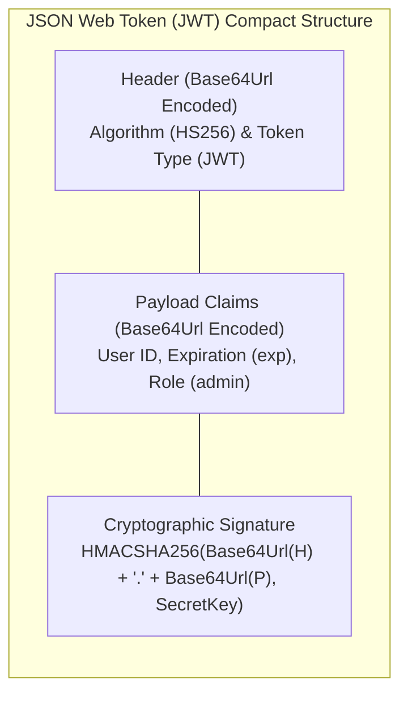

# Security & Authentication

> [!info] Document Metadata
> - **Course:** `=this.course`
> - **Topic:** `=this.topic`
> - **Status:** `=this.status`

**Tags:** #[[Web Development]] #[[CCAPDEV]] #[[Security & Authentication]] #[[Conceptual]] #[[M5]]

---

## Overview

> Extracted notes for Security & Authentication covering both theoretical and practical elements.

### Authentication Models: Session vs. Token

```mermaid
sequenceDiagram
    autonumber
    actor Client as Browser Client
    participant Server as Express Server
    participant Store as Session Store / DB

    Note over Client,Store: 1. Stateful Session-Based Authentication (express-session)
    Client->>Server: POST /login (username, password)
    Server->>Store: Verify credentials in User Collection
    Store-->>Server: Credentials Valid
    Server->>Store: Generate session record {sid: "s_987", userId: 42}
    Server-->>Client: 200 OK (Set-Cookie: connect.sid=s_987; HttpOnly; SameSite=Strict)
    Client->>Server: GET /profile (Cookie: connect.sid=s_987)
    Server->>Store: Query session store (connect-mongo) for sid "s_987"
    Store-->>Server: Return active session data
    Server-->>Client: 200 OK (Render Profile HTML)

    Note over Client,Store: 2. Stateless Token-Based Authentication (JSON Web Tokens)
    Client->>Server: POST /api/auth/login (username, password)
    Server->>Store: Verify credentials
    Store-->>Server: Credentials Valid
    Note over Server: Generate signed JWT using server private secret key
    Server-->>Client: 200 OK (Response Body: { accessToken: "eyJhbGciOi..." })
    Client->>Server: GET /api/data (Header: Authorization: Bearer <token>)
    Note over Server: Statistically verify signature: HMACSHA256(H.P, secret) -> Zero DB Query!
    Server-->>Client: 200 OK (JSON Data)
```



## Key Definitions
- **Session-based Authentication:** Users need to have credentials stored in the database for authentication. The server does the heavy lifting to check if the user exists and assigns a unique session ID for the user. This is stateful since the session persists in some server storage.
- **Token-based Authentication:** The client needs to generate a unique token containing information about the user and this token is sent to the server on every request made. However, no session or record of the user is stored in the database or the server storage which makes it stateless.
- **Session-based Pros/Cons:** Pros: Session is stored in a database; ensures user authentication through session ID; allows storing additional information. Cons: Database lookup can be time consuming for high-volume apps. Best for: Client-server connections with real users.
- **Token-based Pros/Cons:** Pros: Lightweight for the server (just check token validity). Cons: Content is decodable (Base64Url); needs to be stored securely. Best for: Server-to-server communication and microservices.
- **JSON Web Tokens (JWT):** An open standard (RFC 7519) that defines a compact, self-contained way for securely transmitting information between parties as a JSON object.
- **Sessions, Tokens, Cookies:** For session-based, the server generates a session ID and sends that to the client. For token-based, the server signs a token that has a certain validity. In both cases, the client needs to store that credential somewhere. That’s where cookies or client storage come in. 

## Theoretical Framework

> Cookies
> A cookie is a small chunk of information stored on the browser, usually sent by the server. 
> Cookies are used by the browser as a means to preserve the state of being authenticated or keep data for other requests.
> This is because web pages have no memories. Navigating to each page in the same app can be treated as a “new” session.

> Wait, aren’t sessions stored in the database? 
> Why do we have to save them in a cookie?
> Database querying can be expensive. Cookies are used for faster checking of the session ID and it’s also a way to store the tokens.

> Browser Storage
> If you use Google Chrome’s Inspect tool, there’s an Application tab there which shows you the different browser storage.
> There’s Local Storage, Session Storage and Cookies.
> Read more about HTML5 security here.

> Sessions
> express-session
> This is the base package for implementing sessions on your application.
> passport + passport-local
> Passport.js has a bunch of different authentication strategies that you can use. To use “local” or your own application’s username and password authentication, bundle it with passport-local.

> Session Storage
> passport-local also uses express-sessions under the hood, so both are customizable.
> By default, they use the local MemoryStore in which when the server is restarted, all sessions are deleted. This is not recommended for production (deployed) applications.
> There’s a list of compatible session stores that you can choose from. The best is to couple it with the database management system you’re already using for your app (i.e. connect-mongo for mongoose based apps).

## Multiple Choice Questions

1. Which of the following is a primary characteristic of Session-based Authentication?
- **A)** The server does not store any information about the authenticated user.
- **B)** It is considered stateless.
- **C)** The server assigns a unique session ID and persists it in a server-side database or memory.
- **D)** The token contains all user details and is fully decodable by the client.

2. What is a notable drawback (Con) of Token-based Authentication?
- **A)** It requires extremely heavy database lookups on every request.
- **B)** It cannot be used for server-to-server communication.
- **C)** The content of the token is typically decodable (e.g., JWT) and must be stored securely.
- **D)** It strictly relies on the Local MemoryStore which deletes tokens on server restart.

3. When using `express-session` combined with `passport-local` in a production environment, why is the default MemoryStore not recommended?
- **A)** Because when the server is restarted, all stored sessions are deleted.
- **B)** Because MemoryStore automatically shares sessions across all users.
- **C)** Because it requires users to manually input their IP address to login.
- **D)** Because it encrypts the session ID poorly, making it vulnerable to brute force.

### Answer Key & Explanations
1. **C)** Session-based authentication is stateful, as the server checks if the user exists, assigns a unique session ID, and stores that session in a database or server storage.
2. **C)** A con of token-based authentication is that the content is often decodable (like JWT) and must be stored very securely since the server relies purely on the token's signature.
3. **A)** By default, the local MemoryStore deletes all sessions when the server restarts, meaning all users would be logged out.

## References & Navigation

- **Previous Topic:** [[Cookies and Sessions]]
- **Next Topic:** [[Password Hashing]]
- **Related Notes:** [[Cybersecurity Awareness]], [[Security]]
