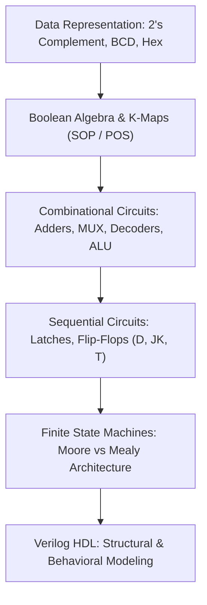

> [!info] Document Metadata
> - **Course:** `=this.course`
> - **Topic:** `=this.topic`
> - **Status:** `=this.status`

**Tags:** #[[Computer Science]] #[[CSARCH1]] #[[Digital Logic]] #[[Verilog]] #[[Reviewer]] #[[Finals]]

---

# CSARCH1 Comprehensive Finals Reviewer

## Overview

This reviewer consolidates Computer Organization and Digital Logic (CSARCH1). Core disciplines encompass positional base conversions, signed binary data representations (Sign-Magnitude, 1's Complement, 2's Complement), Boolean algebra theorems, Karnaugh Maps (K-Maps) minimization, combinational logic design (Adders, Multiplexers, Decoders, Encoders), sequential circuits (Latches, Flip-Flops: SR, D, JK, T), Finite State Machines (Mealy vs Moore models), state transition minimization, and Verilog Hardware Description Language (structural gate-level and behavioral modeling).

---

## 1. Digital Combinational & Sequential Building Blocks

| Component | Function / Truth Behavior | Key Boolean Equations |
| :--- | :--- | :--- |
| **Half Adder** | Adds 2 single bits | $\text{Sum} = A \oplus B$, $\text{Cout} = A B$ |
| **Full Adder** | Adds 2 bits plus carry-in $Cin$ | $\text{Sum} = A \oplus B \oplus Cin$, $\text{Cout} = A B + Cin(A \oplus B)$ |
| **Multiplexer (MUX)** | $2^n$-to-1 data selector using $n$ select lines | $Y = \sum_{i=0}^{2^n-1} m_i \cdot D_i$ |
| **Decoder** | $n$-to-$2^n$ binary line decoder | Activates exactly one output line corresponding to input binary value |
| **D Flip-Flop** | Data storage on active clock edge | $Q(t+1) = D$ |
| **JK Flip-Flop** | Universal storage with toggle state | $Q(t+1) = J \bar{Q} + \bar{K} Q$ (Toggles when $J=1, K=1$) |
| **T Flip-Flop** | Binary counter toggle element | $Q(t+1) = T \oplus Q$ |

---

## 2. Moore vs Mealy Finite State Machines

```mermaid
flowchart TD
    subgraph Moore["Moore FSM: Output depends ONLY on Current State"]
        direction LR
        In1["Inputs"] --> NextStateLogic1["Next State Logic"]
        NextStateLogic1 --> StateReg1["State Registers (Flip-Flops)"]
        StateReg1 --> OutLogic1["Output Logic"]
        OutLogic1 --> Out1["Outputs (Glitch-Free)"]
        StateReg1 -.-> NextStateLogic1
    end
    subgraph Mealy["Mealy FSM: Output depends on Current State AND Current Inputs"]
        direction LR
        In2["Inputs"] --> NextStateLogic2["Next State Logic"]
        NextStateLogic2 --> StateReg2["State Registers"]
        StateReg2 --> OutLogic2["Output Logic"]
        In2 --> OutLogic2
        OutLogic2 --> Out2["Outputs (Can Glitch)"]
        StateReg2 -.-> NextStateLogic2
    end
```

- **Moore Machine**: Outputs are associated strictly with states. Synchronous and glitch-free; often requires more states.
- **Mealy Machine**: Outputs are associated with transitions (state + inputs). Responds one cycle faster, uses fewer states, but output can glitch with input noise.

---

## 3. High-Yield Exam Checklist

- [ ] In $n$-bit 2's complement, what is the valid numerical range? **$-2^{n-1}$ to $2^{n-1}-1$** (e.g. 8-bit: $-128$ to $+127$).
- [ ] How is 2's complement computed? Invert all bits and add 1.
- [ ] In a K-Map, can you group cells in groups of 3 or 6? **NO!** Groups must strictly be powers of 2 ($1, 2, 4, 8, 16$).
- [ ] In Verilog, what assignment operator is used inside clocked `always @(posedge clk)` blocks? Non-blocking assignment **`<=`**.
- [ ] For continuous combinational assignments in Verilog, what keyword is used? **`assign`** with blocking evaluation.

---

## Multiple Choice Questions

1. What is the 8-bit 2's complement representation of decimal $-43$?
    - **A)** `11010101`
    - **B)** `11010100`
    - **C)** `10101011`
    - **D)** `11101011`

2. How many $2$-to-$1$ multiplexers are required to construct an $8$-to-$1$ multiplexer?
    - **A)** 4
    - **B)** 7
    - **C)** 8
    - **D)** 15

3. What is the characteristic next-state equation for a JK flip-flop?
    - **A)** $Q_{next} = D$
    - **B)** $Q_{next} = J Q + K \bar{Q}$
    - **C)** $Q_{next} = J \bar{Q} + \bar{K} Q$
    - **D)** $Q_{next} = J \oplus K$

4. Which statement correctly differentiates a Moore machine from a Mealy machine?
    - **A)** In a Moore machine, outputs depend on both current state and current inputs.
    - **B)** In a Mealy machine, outputs depend on both current state and current inputs.
    - **C)** Moore machines always require fewer states than Mealy machines.
    - **D)** Mealy machines have outputs strictly tied to state flip-flops without input feeding.

5. In Verilog HDL, which statement should be used to describe sequential registers triggered on the rising edge of a clock?
    - **A)** `assign out = in;`
    - **B)** `always @(posedge clk) q <= d;`
    - **C)** `always @(*) q = d;`
    - **D)** `initial clk = 0;`

### Answer Key & Explanations

1. **A**. $+43$ in 8-bit binary is `00101011`. Invert all bits (1's complement): `11010100`. Add 1 (2's complement): `11010101`.
2. **B**. Tree of 2-to-1 MUXes: Level 1 requires 4 MUXes (handling 8 inputs down to 4), Level 2 requires 2 MUXes (4 inputs to 2), Level 3 requires 1 MUX (2 inputs to 1). Total $= 4 + 2 + 1 = 7$.
3. **C**. When $J=0, K=0 \implies Q$; when $J=0, K=1 \implies 0$; when $J=1, K=0 \implies 1$; when $J=1, K=1 \implies \bar{Q}$.
4. **B**. Moore outputs depend solely on the current state, whereas Mealy outputs are a combinational function of current state and external inputs.
5. **B**. Clocked edge-triggered behavior in Verilog is modeled using an `always @(posedge clk)` event control block with non-blocking assignments (`<=`).

## References & Navigation

- **Previous Topic:** [[CCPROG1]]
- **Next Topic:** [[CSARCH2]], [[LBYARCH]]
- **Prerequisites:** [[Digital Logic]], Boolean Algebra, Combinational/Sequential Circuits, Verilog
- **Cross-Curricular Connections:** [[CSOPESY]]
