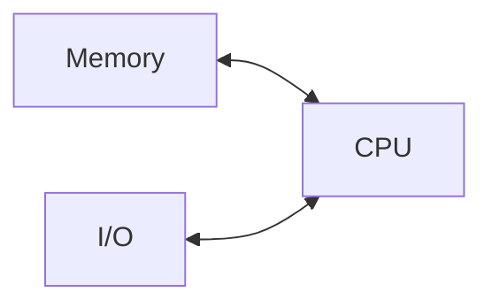

# Introduction to Computer Organization_Arch_Digital_System

> [!info] Document Metadata
> - **Course:** `=this.course`
> - **Topic:** `=this.topic`
> - **Status:** `=this.status`

**Tags:** #[[Computer Science]] #[[CSARCH1]] #[[Conceptual]] #[[M1]]

---

## Overview
Computer Organization and Architecture form the foundational concepts of how computer systems are designed and operate. This module introduces the fundamental distinctions between computer architecture (which deals with the system's observable behavior and instruction sets) and computer organization (which focuses on the microarchitectural implementation details). Additionally, it explores the Von Neumann architecture, which revolutionized computing by introducing the stored-program concept, and establishes the differences between analog systems (continuous signals) and digital systems (discrete signals).

## Key Definitions
- **Computer Architecture:** The design aspects of a computer visible to a programmer, encompassing the Instruction Set Architecture (ISA), data representation, and addressing modes.
- **Computer Organization (Microarchitecture):** The high-level implementation details of a computer's design, such as memory interconnects, cache design, and internal processor logic.
- **Von Neumann Architecture:** A computer architecture based on the stored-program concept where both instructions and data are stored in a single main memory, and instructions are fetched, decoded, and executed sequentially.
- **Instruction Set Architecture (ISA):** The boundary between hardware and software, defining the set of instructions the processor can execute.
- **Analog System:** A system that uses continuous, variable physical quantities to represent data (e.g., sine waves).
- **Digital System:** A system that uses discrete, finite values (typically binary digits 0 and 1) to represent data.

## Theoretical Framework / Core Concepts

### Computer Architecture vs. Computer Organization
The design of a computer system is fundamentally divided into its **Architecture** and its **Organization**.
- **Architecture** determines *what* the computer can do. It answers questions like: Is an integer 32-bit or 64-bit? Does the ISA use a load-store model? Does it support complex instructions like multiplication?
- **Organization** determines *how* the computer achieves those capabilities. For example, if the architecture specifies a multiplication instruction, the organization decides whether to implement a dedicated hardware multiplier or to reuse an existing adder circuit sequentially. It also deals with control signals (hardwired vs. microprogrammed) and memory hierarchy (like cache memory).

### The Von Neumann Architecture
Most modern computers, from desktops to tablets, employ the Von Neumann Architecture.
1. **Stored Program Concept:** Both the data and the instructions required to manipulate that data reside in the same read-write memory.
2. **Sequential Execution:** The Central Processing Unit (CPU) continually fetches instructions from memory, decodes them, and executes them in sequence.

### Analog vs. Digital Systems
- **Analog Systems** capture information using continuous physical variables. They have no fixed range, offer "approximate" results based on measurement, and are prone to degradation from noise.
- **Digital Systems** restrict variables to discrete levels (binary 0 and 1). This quantization allows for exact, counted results that can be reliably stored and transmitted without degradation. In computing, these discrete states are represented abstractly by Low/High voltage, False/True logic, or Off/On states.

## Worked Examples / Protocol Walkthroughs / Calculations

### Scenario: Implementing a Multiplication Instruction
Assume a processor architecture includes a `MUL` (Multiply) instruction. 
1. **Architectural View:** The programmer sees the `MUL` instruction and understands that it multiplies two registers.
2. **Organizational View:** The hardware designer must choose an implementation. 
   - *Option A:* Build a dedicated combinational multiplier circuit. (Faster but uses more silicon area/power).
   - *Option B:* Use a sequential binary multiplier utilizing the existing Adder unit, shifting and adding over multiple clock cycles. (Slower but cheaper).

### Signal Abstraction in Digital Systems
A digital system might interpret a voltage of `0.0V to 0.8V` as a binary `0` (Logic Low) and `2.0V to 3.3V` as a binary `1` (Logic High). By abstracting continuous voltages into two distinct bands, the system inherently filters out minor electrical noise, leading to exact computations.

## Summary & Key Takeaways
- Computer Architecture defines the system from the programmer's perspective (ISA, data types), while Computer Organization involves the internal hardware implementation (datapath, control, memory layout).
- The Von Neumann Architecture is characterized by storing both programs and data in a unified memory and executing instructions sequentially.
- Analog systems process continuous signals, providing approximate measurements, whereas digital systems process discrete binary signals, providing exact and highly reliable computations.

## Multiple Choice Questions

1. Which of the following is primarily considered an architectural attribute rather than an organizational attribute?
    - **A)** The design of the cache memory subsystem
    - **B)** The presence of a hardware multiplier circuit
    - **C)** The choice between hardwired or microprogrammed control
    - **D)** The specific addressing modes supported by the instruction set

2. What is the fundamental characteristic of the Von Neumann Architecture?
    - **A)** Separate memory modules for data and instructions
    - **B)** Parallel execution of multiple program threads
    - **C)** Storing both programs and data in the same main memory
    - **D)** Processing signals in an analog continuous format

3. How does Computer Organization differ from Computer Architecture?
    - **A)** Organization defines the programmer's view; Architecture defines the hardware layout
    - **B)** Organization focuses on implementation details; Architecture focuses on the instruction set and logic capabilities
    - **C)** Organization is only concerned with software; Architecture is only concerned with hardware
    - **D)** There is no difference; the terms are perfectly synonymous

4. Which of the following best describes an analog system?
    - **A)** It relies on discrete voltage levels to represent logic states
    - **B)** It produces exact, counted results based on finite numbers
    - **C)** It processes continuous signals that vary at a continuous rate
    - **D)** It is immune to electronic noise and degradation

5. In the context of Instruction Set Architecture (ISA), what does it serve as?
    - **A)** The physical cooling mechanism of the CPU
    - **B)** The boundary interface between software and hardware
    - **C)** The layout of transistors on the silicon die
    - **D)** The power regulation standard for the motherboard

6. If a system abstracts data into "Low" and "High" states, what type of system is it?
    - **A)** Continuous System
    - **B)** Analog System
    - **C)** Digital System
    - **D)** Quantum System

7. Which of the following is an example of an organizational decision?
    - **A)** Deciding whether an integer is 32-bit or 64-bit
    - **B)** Deciding to use a sequential circuit adder for multiplication to save space
    - **C)** Deciding to include a square root instruction in the ISA
    - **D)** Deciding to use Big Endian or Little Endian data representation

8. What happens during the execution cycle in a Von Neumann Architecture?
    - **A)** Instructions are simultaneously fetched from multiple I/O devices
    - **B)** Instructions are fetched, decoded, and executed sequentially
    - **C)** The CPU generates its own instructions dynamically without memory
    - **D)** Data is executed while instructions are stored in the CPU cache

9. Why are digital systems preferred for data computation over analog systems?
    - **A)** Because digital signals can carry a continuous range of information
    - **B)** Because digital systems provide exact results and abstract variables into discrete values
    - **C)** Because analog systems can only handle binary operations
    - **D)** Because digital systems do not require electrical power

10. Which aspect of computer design encompasses both ISA, organization, and hardware implementation?
    - **A)** Software Engineering
    - **B)** Computer Architecture (broadly defined)
    - **C)** Operating Systems
    - **D)** Peripheral Interfacing

### Answer Key & Explanations

1. **D**. Addressing modes are part of the ISA, defining how software can access memory, which is an architectural attribute.
2. **C**. The Von Neumann Architecture's defining feature is the stored-program concept, keeping both instructions and data in unified memory.
3. **B**. Architecture is what the system does (the abstract capabilities and ISA), while Organization is how it is built (the microarchitecture and hardware implementation).
4. **C**. Analog systems use continuous signals (like sine waves) that vary at a continuous rate, unlike digital systems which use discrete steps.
5. **B**. The ISA acts as the conceptual boundary and contract between the hardware executing the instructions and the software issuing them.
6. **C**. Digital systems rely on discrete binary states, commonly abstracted as Low/High, True/False, or 0/1.
7. **B**. Deciding *how* to implement a multiplication operation (using an adder sequentially vs. a dedicated multiplier) is an organizational, microarchitectural decision.
8. **B**. A core principle of Von Neumann is that instructions are fetched from memory, decoded, and executed in a sequential manner.
9. **B**. Digital systems count discrete states rather than measuring continuous variations, resulting in "exact" and reproducible computations.
10. **B**. Computer Architecture in the broad sense involves designing the instruction set, the microarchitecture (organization), and the specific hardware implementation.

## References & Navigation

- **Next Topic:** [[Positional Number System]]
- **Related Notes:** [[Computer Hardware Components - CPU and Motherboard]], [[Course Overview & Architecture Foundations]]
