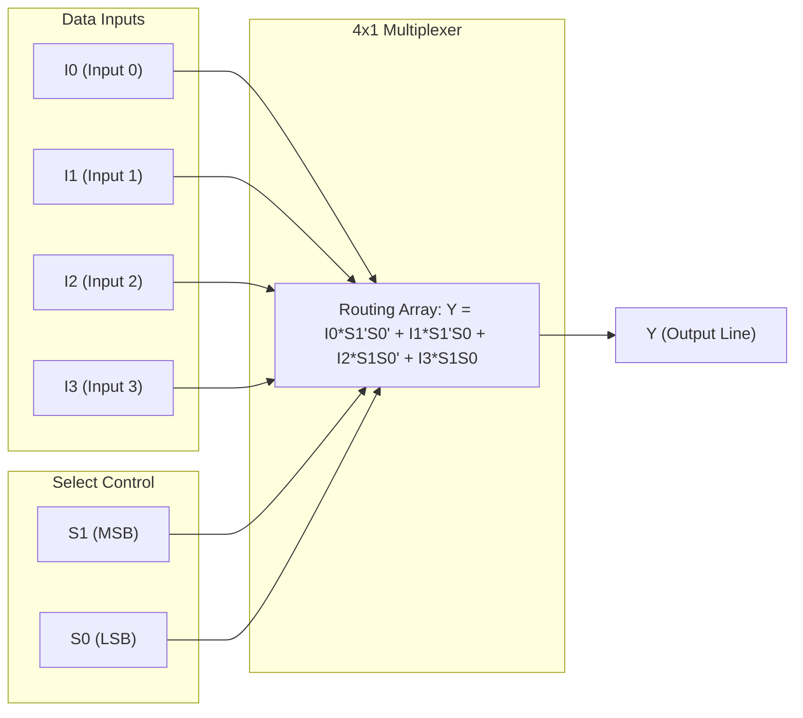
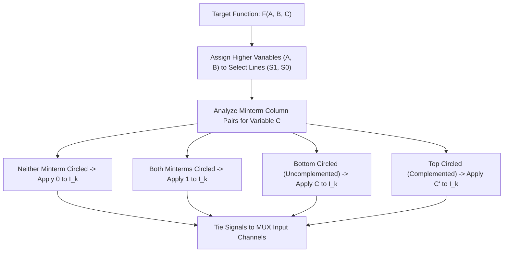

**Tags:** #[[Computer Science]] #[[CSARCH1]] #[[Computer Architecture]] #[[Combinational Circuits]] #[[Combinational Circuit - Multiplexer]]

---

# Combinational Circuit - Multiplexer

## Overview
This sub-module discusses how to implement combinational circuits using multiplexers.
**Objective:** Learn how to implement combinational circuits using multiplexers.

## Definitions
**Multiplexers:**
- Selects binary information from one of many input lines and directs it to a single output line.
- Also called a **data selector**.
- Selection is controlled by a set of selection lines.
- Typically has $2^n$ input lines and $n$ selection lines.

### Examples of Multiplexers
- **Two-to-one-line multiplexer (2x1):** 
  - $S$ = selection line
  - $I_0, I_1$ = data lines
- **Four-to-one-line multiplexer (4x1):** 
  - $S_1, S_0$ = selection lines
  - $I_0, I_1, I_2, I_3$ = data lines

## Boolean Function Implementation Using Multiplexer
To implement a Boolean function using a multiplexer:
1. List the inputs of the multiplexer. Under the list, align all the minterms in two rows.
2. The first row lists all those minterms where the chosen variable is complemented, and the second row lists all the minterms with the variable uncomplemented.
3. Circle all minterms of the given function and inspect each column separately.
4. **Rules for mapping to inputs:**
   - If two minterms in a column are **not circled**, apply `0` to the corresponding multiplexer input.
   - If two minterms are **circled**, apply `1` to the corresponding multiplexer input.
   - If the **bottom minterm is circled** and the **top is not circled**, apply the variable to the corresponding multiplexer input.
   - If the **top minterm is circled** and the **bottom is not circled**, apply the complemented variable to the corresponding multiplexer input.

## Multiple Choice Questions

1. What is the primary function of a multiplexer?
    - **A)** To distribute a single input to multiple outputs
    - **B)** To select binary information from one of many input lines and direct it to a single output line
    - **C)** To perform arithmetic addition
    - **D)** To store multiple bits of data

2. A multiplexer is often referred to by what alternative name?
    - **A)** Data selector
    - **B)** Data distributor
    - **C)** Decoder
    - **D)** Encoder

3. If a multiplexer has n selection lines, how many input data lines does it typically have?
    - **A)** n
    - **B)** n^2
    - **C)** 2*n
    - **D)** 2^n

4. In a Two-to-one-line (2x1) multiplexer, how many selection lines are required?
    - **A)** 1
    - **B)** 2
    - **C)** 3
    - **D)** 4

5. In a Four-to-one-line (4x1) multiplexer, how many selection lines are required?
    - **A)** 1
    - **B)** 2
    - **C)** 3
    - **D)** 4

6. When implementing a Boolean function using a multiplexer, what are listed under the multiplexer inputs to determine connections?
    - **A)** The maxterms
    - **B)** The prime implicants
    - **C)** The minterms arranged in rows (complemented and uncomplemented)
    - **D)** The don't-care conditions

7. If neither of the two minterms in a column (for a specific variable state) are circled, what is applied to that multiplexer input?
    - **A)** 1
    - **B)** 0
    - **C)** The variable itself
    - **D)** The complement of the variable

8. If both minterms in a column are circled, what is applied to that multiplexer input?
    - **A)** 1
    - **B)** 0
    - **C)** The variable itself
    - **D)** High impedance (Z)

9. If only the bottom minterm (uncomplemented row) is circled in a column, what is applied to that multiplexer input?
    - **A)** 0
    - **B)** 1
    - **C)** The input variable
    - **D)** The complement of the variable

10. How many selection inputs are needed for an 8x1 multiplexer?
    - **A)** 1
    - **B)** 2
    - **C)** 3
    - **D)** 4

### Answer Key & Explanations

1. **B**. A multiplexer routes one of multiple input signals to a single common output line.
2. **A**. Since it literally selects which data passes through, it is called a data selector.
3. **D**. Multiplexers scale using binary selection logic; n selection bits can choose between 2^n data inputs.
4. **A**. A single selection line can choose between 2^1 = 2 inputs.
5. **B**. Two selection lines are needed to pick from 2^2 = 4 input channels.
6. **C**. The layout strategy uses minterm matrices to map truth table conditions directly to input pins.
7. **B**. If neither minterm is part of the Boolean function, the multiplexer should constantly output 0 for that condition.
8. **A**. If both conditions demand an active output regardless of the unmapped variable, the input pin is tied to 1.
9. **C**. Following the algorithm, circling only the uncomplemented minterm implies tying the pin to the uncomplemented variable.
10. **C**. Selecting among 8 distinct data lines requires 3 selection lines (2^3 = 8).

## References & Navigation

- **Previous Topic:** [[Combinational Circuit - Decoder]]
- **Next Topic:** [[Combinational Circuit - NAND NOR]]
