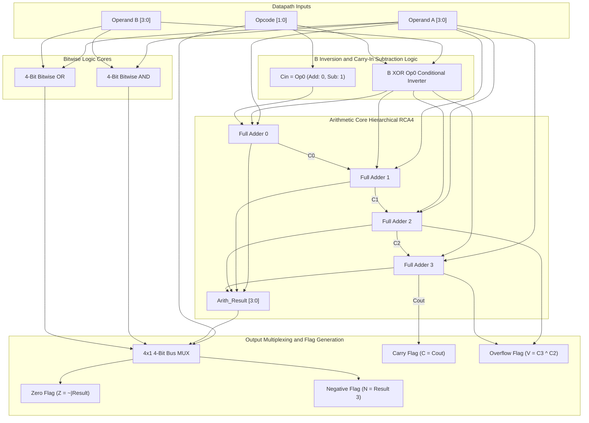

# Hardware Description Language_Structural Modelling

> [!info] Document Metadata
> - **Course:** `=this.course`
> - **Topic:** `=this.topic`
> - **Status:** `=this.status`

**Tags:** #[[Computer Science]] #[[CSARCH1]] #[[Code Snippets]] #[[M4]]

---

## Overview

This module covers the use of **Verilog Hardware Description Language (HDL)** for **Structural Modelling** in combinational circuits.
- **Structural Modelling** involves combining two or more modules to build a hierarchical description of a design.
- It can follow a **top-down** or **bottom-up** approach. In bottom-up design, building blocks are identified first and then combined to build the top-level block.

## Code Implementation

### NAND Implementation (Two-Level)
Example: `F = AB + CD` using NAND gates.

```verilog
`timescale 1ns / 1ps

// Define 2-input NAND gate
module NAND_2(F, X, Y);
    output F;
    input X, Y;
    assign F = ~(X & Y);
endmodule

// Structural implementation of F = AB + CD
module NAND_impl(F, A, B, C, D);
    input A, B, C, D;
    output F;
    wire t1, t2;
    
    NAND_2 N1(t1, A, B);
    NAND_2 N2(t2, C, D);
    NAND_2 N3(F, t1, t2);
endmodule
```

**Non-structural equivalent:**
```verilog
`timescale 1ns / 1ps

module NAND(F, A, B, C, D);
    input A, B, C, D;
    output F;
    assign F = ~((~(A & B)) & (~(C & D)));
endmodule
```

### NOR Implementation (Two-Level)
Example: `F = AB + CD = (A+C)(B+C)(A+D)(B+D)` using NOR gates.

```verilog
`timescale 1ns / 1ps

// 2-input NOR gate
module NOR_2(F, X, Y);
    output F;
    input X, Y;
    assign F = ~(X | Y);
endmodule

// 4-input NOR gate
module NOR_4(F, A, B, C, D);
    output F;
    input A, B, C, D;
    assign F = ~(A | B | C | D);
endmodule

// Structural implementation
module NOR_IMPL(F, A, B, C, D);
    input A, B, C, D;
    output F;
    wire p1, p2, p3, p4;
    
    NOR_2 Z1(p1, A, C);
    NOR_2 Z2(p2, B, C);
    NOR_2 Z3(p3, A, D);
    NOR_2 Z4(p4, B, D);
    NOR_4 Z5(F, p1, p2, p3, p4);
endmodule
```

### Multiplexer Implementations (4x1 MUX)

**Gate-Level Structural:**
```verilog
`timescale 1ns / 1ps
module mux41_gate(Y, I3, I2, I1, I0, S1, S0);
    input I3, I2, I1, I0, S0, S1;
    output Y;
    wire S0_not, S1_not, T1, T2, T3, T4;
    
    not G1 (S0_not, S0),
        G2 (S1_not, S1);
    and H1 (T1, S1_not, S0_not, I0),
        H2 (T2, S1_not, S0, I1),
        H3 (T3, S1, S0_not, I2),
        H4 (T4, S1, S0, I3);
    or (Y, T1, T2, T3, T4);
endmodule
```

**Dataflow:**
```verilog
`timescale 1ns / 1ps
module mux41_data(Y, I3, I2, I1, I0, S1, S0);
    input I3, I2, I1, I0, S1, S0;
    output Y;
    wire T1, T2, T3, T4;
    
    assign T1 = (!S1) & (!S0) & I0;
    assign T2 = (!S1) & (S0) & I1;
    assign T3 = (S1) & (!S0) & I2;
    assign T4 = (S1) & (S0) & I3;
    assign Y = T1 | T2 | T3 | T4;
endmodule
```

**Behavioral:**
```verilog
`timescale 1ns / 1ps
module mux41_behav(F, I3, I2, I1, I0, S1, S0);
    input I3, I2, I1, I0, S1, S0;
    output reg F;
    
    always @*
        case ({S1, S0})
            2'b00: F = I0;
            2'b01: F = I1;
            2'b10: F = I2;
            2'b11: F = I3;
        endcase
endmodule
```

### Advanced Structural Application
Implementing `F = Σm(1,2,6,7)` using a 4x1 MUX and `Z` as input:
```verilog
module sommux41_behav(F, X, Y, Z);
    input X, Y, Z;
    output F;
    wire Z_not;
    
    not K1(Z_not, Z);
    // Instantiate 4-to-1 multiplexer for sigma(1,2,6,7)
    mux41_behav D1(F, 1'b1, 1'b0, Z_not, Z, X, Y);
endmodule
```

**Testbench:**
```verilog
`timescale 1ns / 1ps
module mux41_behav_TB();
    reg [2:0] t_I;
    wire t_F;
    integer i;
    
    sommux41_behav dut(t_F, t_I[2], t_I[1], t_I[0]);
    
    initial begin
        t_I = 3'b000;
        for (i=1; i<8; i=i+1) begin
            #10 t_I = i;
        end
    end
    
    initial begin
        $display("Implement f=sigma(1,2,6,7) using 4x1 behav multiplexer");
        $monitor("time=%0d, X=%b, Y=%b, Z=%b, F=%b ", $time, t_I[2], t_I[1], t_I[0], t_F);
        $dumpfile("sommux41_behav.vcd");
        $dumpvars();
    end
endmodule
```

### Production Deep-Dive: Hierarchical Structural 4-Bit Arithmetic Logic Unit (ALU)

A full industrial-style structural design decomposes a complex datapath into reusable primitive modules connected strictly through intermediate `wire` nets. Below is a complete 4-bit Arithmetic Logic Unit (ALU) supporting addition (`ADD`), subtraction (`SUB`), bitwise AND (`AND`), and bitwise OR (`OR`), along with 4 condition code status flags: Zero (`Z`), Carry (`C`), Overflow (`V`), and Negative (`N`).

#### Datapath Architecture Diagram



#### Operation Function Table

| Opcode `Op[1:0]` | Operation | Arithmetic / Logic Function | Subtraction Mechanism (`Op[0] = 1`) |
| :--- | :--- | :--- | :--- |
| `2'b00` | **ADD** | $Result = A + B$ | $Cin = 0$, $B$ unaltered |
| `2'b01` | **SUB** | $Result = A - B = A + \overline{B} + 1$ | $Cin = 1$, $B \oplus 1 = \overline{B}$ (Two's Complement) |
| `2'b10` | **AND** | $Result = A \ \& \ B$ | Bitwise conjunction |
| `2'b11` | **OR** | $Result = A \ \| \ B$ | Bitwise disjunction |

#### Complete Structural Verilog Implementation

```verilog
`timescale 1ns / 1ps

// 1. Primitive 1-Bit Full Adder
module full_adder(
    output wire sum,
    output wire cout,
    input  wire a,
    input  wire b,
    input  wire cin
);
    wire s1, c1, c2;
    
    // Sum calculation: a ^ b ^ cin
    xor g1 (s1, a, b);
    xor g2 (sum, s1, cin);
    
    // Carry calculation: (a & b) | (s1 & cin)
    and g3 (c1, a, b);
    and g4 (c2, s1, cin);
    or  g5 (cout, c1, c2);
endmodule

// 2. Structural 4-Bit Ripple Carry Adder with Overflow Detection
module rca_4bit(
    output wire [3:0] sum,
    output wire       cout,
    output wire       overflow,
    input  wire [3:0] a,
    input  wire [3:0] b,
    input  wire       cin
);
    wire c0, c1, c2;

    full_adder fa0 (sum[0], c0,   a[0], b[0], cin);
    full_adder fa1 (sum[1], c1,   a[1], b[1], c0);
    full_adder fa2 (sum[2], c2,   a[2], b[2], c1);
    full_adder fa3 (sum[3], cout, a[3], b[3], c2);

    // Overflow for signed two's complement: Carry into MSB ^ Carry out of MSB
    xor g_ovf (overflow, cout, c2);
endmodule

// 3. Structural 4-Bit Bitwise AND Module
module and_4bit(
    output wire [3:0] out,
    input  wire [3:0] a,
    input  wire [3:0] b
);
    and g0 (out[0], a[0], b[0]);
    and g1 (out[1], a[1], b[1]);
    and g2 (out[2], a[2], b[2]);
    and g3 (out[3], a[3], b[3]);
endmodule

// 4. Structural 4-Bit Bitwise OR Module
module or_4bit(
    output wire [3:0] out,
    input  wire [3:0] a,
    input  wire [3:0] b
);
    or g0 (out[0], a[0], b[0]);
    or g1 (out[1], a[1], b[1]);
    or g2 (out[2], a[2], b[2]);
    or g3 (out[3], a[3], b[3]);
endmodule

// 5. Structural 4-Bit 4-to-1 Multiplexer
module mux4_4bit(
    output wire [3:0] out,
    input  wire [3:0] in0, // ADD
    input  wire [3:0] in1, // SUB
    input  wire [3:0] in2, // AND
    input  wire [3:0] in3, // OR
    input  wire [1:0] sel
);
    wire sel0_n, sel1_n;
    wire [3:0] w0, w1, w2, w3;

    not n0 (sel0_n, sel[0]);
    not n1 (sel1_n, sel[1]);

    // Decode and route each bit slice structurally
    genvar i;
    generate
        for (i = 0; i < 4; i = i + 1) begin : mux_slice
            and a0 (w0[i], in0[i], sel1_n, sel0_n);
            and a1 (w1[i], in1[i], sel1_n, sel[0]);
            and a2 (w2[i], in2[i], sel[1],  sel0_n);
            and a3 (w3[i], in3[i], sel[1],  sel[0]);
            or  o0 (out[i], w0[i], w1[i], w2[i], w3[i]);
        end
    endgenerate
endmodule

// 6. Top-Level Structural 4-Bit ALU with Status Flags
module alu_structural_4bit(
    output wire [3:0] result,
    output wire       flag_z,  // Zero flag
    output wire       flag_c,  // Carry flag
    output wire       flag_v,  // Overflow flag
    output wire       flag_n,  // Negative flag
    input  wire [3:0] a,
    input  wire [3:0] b,
    input  wire [1:0] op       // 00: ADD, 01: SUB, 10: AND, 11: OR
);
    wire [3:0] b_operand;
    wire [3:0] arith_res, and_res, or_res;
    wire       rca_cout, rca_ovf;

    // Subtraction logic: if op[0] is 1, invert B using XOR
    xor x0 (b_operand[0], b[0], op[0]);
    xor x1 (b_operand[1], b[1], op[0]);
    xor x2 (b_operand[2], b[2], op[0]);
    xor x3 (b_operand[3], b[3], op[0]);

    // Instantiate arithmetic and logic modules
    rca_4bit adder_unit (
        .sum(arith_res),
        .cout(rca_cout),
        .overflow(rca_ovf),
        .a(a),
        .b(b_operand),
        .cin(op[0]) // Cin = 1 when subtracting (2's complement addition)
    );

    and_4bit and_unit (.out(and_res), .a(a), .b(b));
    or_4bit  or_unit  (.out(or_res),  .a(a), .b(b));

    // Structural MUX to select datapath result
    mux4_4bit out_mux (
        .out(result),
        .in0(arith_res),
        .in1(arith_res),
        .in2(and_res),
        .in3(or_res),
        .sel(op)
    );

    // Status Flags:
    // Zero flag: NOR of all result bits
    nor nor_z (flag_z, result[0], result[1], result[2], result[3]);

    // Negative flag: Result MSB (sign bit in two's complement)
    assign flag_n = result[3];

    // Carry and Overflow flags valid only during arithmetic operations (~op[1])
    assign flag_c = (~op[1]) & rca_cout;
    assign flag_v = (~op[1]) & rca_ovf;
endmodule
```

#### Testbench with Timing Stimulus & Flag Verification

```verilog
`timescale 1ns / 1ps

module tb_alu_structural_4bit();
    reg  [3:0] tb_a;
    reg  [3:0] tb_b;
    reg  [1:0] tb_op;
    wire [3:0] tb_result;
    wire       tb_z, tb_c, tb_v, tb_n;

    // Instantiate Unit Under Test (UUT)
    alu_structural_4bit uut (
        .result(tb_result),
        .flag_z(tb_z),
        .flag_c(tb_c),
        .flag_v(tb_v),
        .flag_n(tb_n),
        .a(tb_a),
        .b(tb_b),
        .op(tb_op)
    );

    initial begin
        $dumpfile("alu_structural.vcd");
        $dumpvars(0, tb_alu_structural_4bit);

        $display("=== 4-Bit Structural ALU Verification ===");
        $monitor("Time=%0t | Op=%b | A=%b (%d) | B=%b (%d) | Res=%b (%d) | Z=%b C=%b V=%b N=%b",
                 $time, tb_op, tb_a, $signed(tb_a), tb_b, $signed(tb_b), tb_result, $signed(tb_result),
                 tb_z, tb_c, tb_v, tb_n);

        // Test 1: ADD with normal sum (3 + 2 = 5)
        tb_op = 2'b00; tb_a = 4'b0011; tb_b = 4'b0010; #10;

        // Test 2: ADD with signed overflow (7 + 2 = 9 -> -7 in 4-bit 2's complement)
        tb_op = 2'b00; tb_a = 4'b0111; tb_b = 4'b0010; #10;

        // Test 3: SUB producing zero (5 - 5 = 0, Z flag high)
        tb_op = 2'b01; tb_a = 4'b0101; tb_b = 4'b0101; #10;

        // Test 4: SUB producing negative number (2 - 5 = -3, N flag high)
        tb_op = 2'b01; tb_a = 4'b0010; tb_b = 4'b0101; #10;

        // Test 5: Bitwise AND
        tb_op = 2'b10; tb_a = 4'b1100; tb_b = 4'b1010; #10;

        // Test 6: Bitwise OR
        tb_op = 2'b11; tb_a = 4'b1100; tb_b = 4'b1010; #10;

        $display("=== All Test Vectors Completed Successfully ===");
        $finish;
    end
endmodule
```

## Multiple Choice Questions

1. What does structural modeling in Verilog HDL involve?
- **A)** Describing the algorithm using loops and variables
- **B)** Combining two or more modules to build a hierarchical description
- **C)** Using continuous assignment expressions exclusively
- **D)** Creating a state transition table for logic execution

2. In a bottom-up design approach for structural modeling, what is the first step?
- **A)** The top-level block is decomposed into sub-modules.
- **B)** Building blocks are first identified and then combined.
- **C)** State assignments are defined.
- **D)** A testbench is created before writing modules.

3. How are individual gates or sub-modules added to a structural model in Verilog?
- **A)** By using procedural blocks like always
- **B)** By instantiating them with specific instance names and port connections
- **C)** By defining them inside the assign statements
- **D)** By importing them as libraries

4. Which keyword is used to declare internal connections between instantiated modules in structural modeling?
- **A)** reg
- **B)** wire
- **C)** logic
- **D)** connection

5. In structural modelling, can a testbench instantiate the top-level module?
- **A)** No, structural modules cannot be tested.
- **B)** Yes, a testbench acts as a top-level module that instantiates the design under test.
- **C)** Only if the testbench is written in behavioral modelling.
- **D)** Yes, but only for combinational circuits, not sequential.

### Answer Key & Explanations
1. **B)** Structural modeling consists of combining two or more modules to build a hierarchical design.
2. **B)** In a bottom-up approach, building blocks are identified first and then combined to form the top-level block.
3. **B)** Structural modeling relies on instantiating sub-modules (like NAND or NOR gates) with connections to build a circuit.
4. **B)** Internal signals that connect instantiated modules are declared as wires.
5. **B)** A testbench is a module itself that instantiates the module to be tested and applies inputs to it.

## References & Navigation

- **Previous Topic:** [[Combinational Circuit - Tri state gates]]
- **Next Topic:** [[Introduction to Sequential Circuit]]
- **Related Notes:** [[Introduction to Hardware Description Language]], [[Summary of Verilog Syntax]]