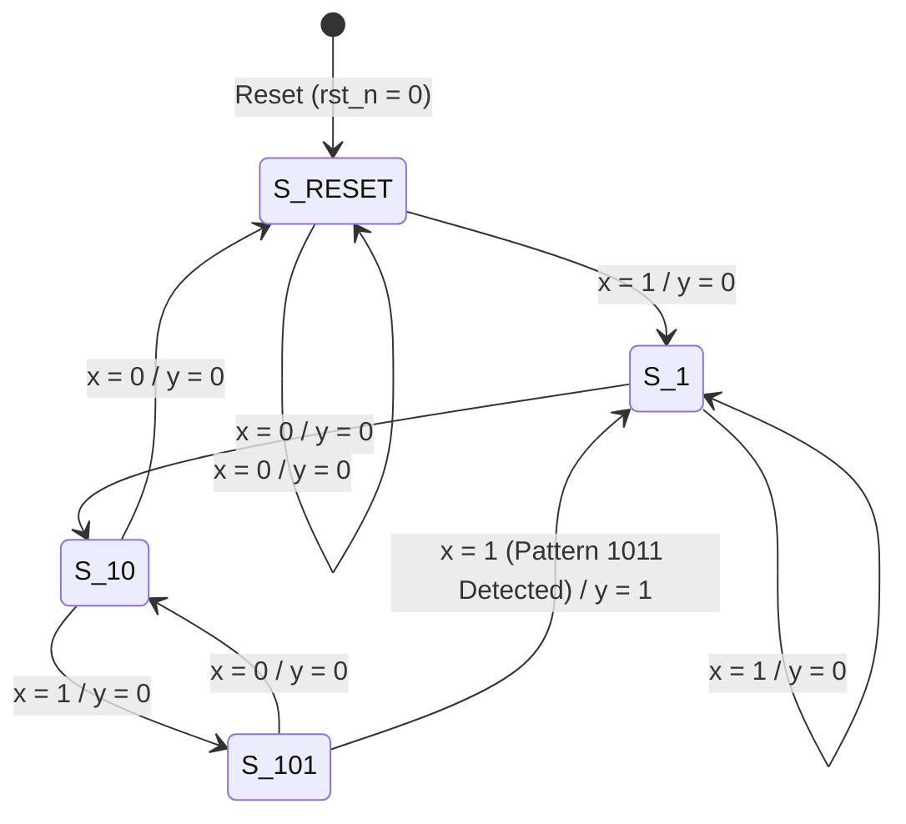

# Hardware Description Language for sequential circuit

> [!info] Document Metadata
> - **Course:** `=this.course`
> - **Topic:** `=this.topic`
> - **Status:** `=this.status`

**Tags:** #[[Computer Science]] #[[CSARCH1]] #[[Code Snippets]] #[[M5]]

---

## Overview

This module covers the use of Verilog HDL for designing and modeling sequential circuits.
- **Behavioral modeling** describes circuits by their functional and algorithmic level. It is typically used for sequential circuits but can be used for combinational ones as well.
- Utilizes the `always` block followed by procedural assignment statements.
- Outputs of procedural assignments inside an `always` block must be of type `reg`.

### Key Concepts

#### Edge Triggering
Used for modeling clock behavior. The `always` block triggers on specific edges:
- `posedge clk` for positive edge trigger.
- `negedge clk` for negative edge trigger.

#### Blocking vs. Non-blocking Statements
- **Blocking (`=`)**: Executed sequentially in the order they are listed. Use when sequential ordering is imperative and for level-sensitive combinational circuits.
- **Non-blocking (`<=`)**: Executed concurrently. The right-hand side expressions are evaluated first, and then assigned to the left-hand side. Use when modeling concurrent execution (e.g., edge-sensitive behavior such as flip-flops and synchronous registers).

## Code Implementation

### Behavioral Modeling: Flip-Flops

**D Flip-Flop:**
```verilog
`timescale 1ns / 1ps
module FF_D(Q, D, clk, rst);
    input D, clk, rst;
    output reg Q;
    
    always @(posedge clk, negedge rst)
        if (rst == 0) 
            Q <= 1'b0;
        else 
            Q <= D;
endmodule
```

**JK Flip-Flop:**
```verilog
module FF_JK(Q, J, K, clk, rst);
    output reg Q;
    input J, K, clk, rst;
    
    always @(posedge clk, negedge rst)
        if (rst == 0) 
            Q <= 0;
        else begin
            case ({J, K})
                2'b00: Q <= Q;
                2'b01: Q <= 1'b0;
                2'b10: Q <= 1'b1;
                2'b11: Q <= ~Q;
            endcase
        end
endmodule
```

### Testbenches for Sequential Circuits
Testbenches require generating a continuous clock pulse and setting the simulation length.

**D Flip-Flop Testbench:**
```verilog
module FF_D_tb();
    reg t_D, t_clk, t_rst;
    wire t_Q;
    
    FF_D dut(t_Q, t_D, t_clk, t_rst);
    
    initial begin
        t_clk = 1'b0;
        forever #5 t_clk = ~t_clk; // Generate clock pulse
    end
    
    initial begin
        t_rst = 1'b0;
        #10 t_rst = 1'b1;
        #10 t_rst = 1'b0;
    end
    
    initial begin
        t_D = 1'b0;
        forever #10 t_D = ~t_D;
    end
    
    initial begin
        $display("D FF with reset");
        $monitor("time=%03d, Clk=%b, reset=%b, D=%b, Q=%b", $time, t_clk, t_rst, t_D, t_Q);
        $dumpfile("FF_D.vcd");
        $dumpvars();
    end
    
    initial #100 $finish; // Set length of simulation
endmodule
```

### Structural Modeling of Sequential Circuits
Using state equations to instantiate Flip-Flops (e.g., detecting consecutive 1s).
```verilog
module detect3(y, A, B, x, clock, reset);
    output y, A, B;
    input x, clock, reset;
    wire DA, DB;
    
    // Flip-flop input and output equations
    assign DA = (A & x) | (B & x);
    assign DB = (A & x) | ((~B) & x);
    assign y = A & B;
    
    // Instantiate D FF
    FF_D F1(A, DA, clock, reset);
    FF_D F2(B, DB, clock, reset);
endmodule
```

### State Diagram Modeling
Modeling directly from states.
```verilog
module detect3sd(y, state, x, clk, reset);
    output reg y;
    output reg[1:0] state;
    reg[1:0] next_state;
    input x, clk, reset;
    
    parameter S0 = 2'b00, S1 = 2'b01, S2 = 2'b10, S3 = 2'b11;
    
    // Handle trigger
    always @(posedge clk, negedge reset)
        if (reset == 0) state <= S0;
        else state <= next_state;
        
    // Handle input (State transitions)
    always @(state, x)
        case (state)
            S0: if (x) next_state = S1; else next_state = S0;
            S1: if (x) next_state = S2; else next_state = S0;
            S2: if (x) next_state = S3; else next_state = S0;
            S3: if (x) next_state = S3; else next_state = S0;
        endcase
        
    // Handle output
    always @(state, x)
        case (state)
            S0, S1, S2: y = 1'b0;
            S3: y = 1'b1;
        endcase
endmodule
```

### Production Deep-Dive: Finite State Machine (FSM) Sequence Detector (Overlapping `1011`)

In digital design, Finite State Machines (FSMs) are modeled using standardized coding templates to ensure determinism and prevent unintended latch synthesis. Below is an industrial-standard implementation of an overlapping sequence detector for the bit pattern **`1011`**.

#### State Transition Diagram



> [!NOTE] Mealy vs. Moore Overlapping Semantics
> - **Mealy Architecture**: The output $y$ is asserted during the clock cycle where the 4th bit ($x=1$) arrives while in state $S_{101}$. The machine immediately transitions back to $S_1$ because the incoming `1` also serves as the leading bit for the next potential sequence (for example, `1011011` triggers twice).
> - **Two-Always-Block Design Standard**:
>   1. **Synchronous State Register Block**: Driven by `posedge clk or negedge rst_n`. Uses non-blocking assignments (`<=`).
>   2. **Combinational Next-State and Output Block**: Driven by `@*`. Uses blocking assignments (`=`) and specifies default assignments to eliminate latch inference.

#### Complete Verilog Implementation

```verilog
`timescale 1ns / 1ps

module seq_detector_1011_mealy (
    output reg        y,          // Asserted high when sequence 1011 is detected
    output wire [1:0] current_st, // Exposed for waveform tracing
    input  wire       clk,        // System clock
    input  wire       rst_n,      // Asynchronous active-low reset
    input  wire       x           // Serial data input stream
);

    // State Encoding using Local Parameters
    localparam [1:0] S_RESET = 2'b00,  // Initial state / No valid prefix
                     S_1     = 2'b01,  // Detected '1'
                     S_10    = 2'b10,  // Detected '10'
                     S_101   = 2'b11;  // Detected '101'

    reg [1:0] state_reg, next_st;

    assign current_st = state_reg;

    // Block 1: Sequential State Memory (Clocked with Asynchronous Reset)
    always @(posedge clk or negedge rst_n) begin
        if (!rst_n) begin
            state_reg <= S_RESET;
        end else begin
            state_reg <= next_st;
        end
    end

    // Block 2: Combinational Next-State Logic and Mealy Output Logic
    always @(*) begin
        // Default safe assignments to eliminate inferred latches
        next_st = state_reg;
        y       = 1'b0;

        case (state_reg)
            S_RESET: begin
                if (x == 1'b1)
                    next_st = S_1;
                else
                    next_st = S_RESET;
            end

            S_1: begin
                if (x == 1'b0)
                    next_st = S_10;
                else
                    next_st = S_1; // Maintain state on repeated '1's
            end

            S_10: begin
                if (x == 1'b1)
                    next_st = S_101;
                else
                    next_st = S_RESET;
            end

            S_101: begin
                if (x == 1'b1) begin
                    // Pattern '1011' completed: Assert Mealy output
                    y       = 1'b1;
                    next_st = S_1;    // Overlapping: Trailing '1' is start of next pattern
                end else begin
                    next_st = S_10;   // Bit '0' preserves '10' prefix
                end
            end

            default: begin
                next_st = S_RESET;
                y       = 1'b0;
            end
        endcase
    end

endmodule
```

#### Testbench with Clock Generator & Bitstream Stimulus

```verilog
`timescale 1ns / 1ps

module tb_seq_detector_1011_mealy();
    reg        clk;
    reg        rst_n;
    reg        x;
    wire       y;
    wire [1:0] current_st;

    // Instantiate Unit Under Test (UUT)
    seq_detector_1011_mealy uut (
        .y(y),
        .current_st(current_st),
        .clk(clk),
        .rst_n(rst_n),
        .x(x)
    );

    // Clock Generator: 100MHz (Period = 10ns, Toggle every 5ns)
    initial begin
        clk = 1'b0;
        forever #5 clk = ~clk;
    end

    // Helper task to feed serial bits synchronously with clock
    task send_bit(input bit_val);
        begin
            @(negedge clk); // Drive inputs on negative edge to satisfy setup time
            x = bit_val;
            @(posedge clk);
            #1; // Sample shortly after positive edge
            $display("Time=%0t | State=%b | Input x=%b | Output y=%b", 
                     $time, current_st, x, y);
        end
    endtask

    // Stimulus process
    initial begin
        $dumpfile("seq_1011_mealy.vcd");
        $dumpvars(0, tb_seq_detector_1011_mealy);

        // Initialization & Reset Phase
        rst_n = 1'b0;
        x     = 1'b0;
        #15; // Hold reset active across clock edges
        rst_n = 1'b1;
        #10;

        $display("=== Feeding Bitstream: 1 -> 0 -> 1 -> 1 (First Detection) ===");
        send_bit(1);
        send_bit(0);
        send_bit(1);
        send_bit(1); // Expect y = 1 here

        $display("=== Feeding Overlapping Suffix: 0 -> 1 -> 1 (Second Detection via overlap) ===");
        send_bit(0);
        send_bit(1);
        send_bit(1); // Expect y = 1 here again due to overlap!

        $display("=== Feeding Non-matching Pattern: 0 -> 0 -> 1 -> 0 ===");
        send_bit(0);
        send_bit(0);
        send_bit(1);
        send_bit(0);

        #20;
        $display("=== Simulation Completed Successfully ===");
        $finish;
    end
endmodule
```

## Multiple Choice Questions

1. What keyword introduces a procedural assignment block in behavioral modeling?
    - **A)** initial
    - **B)** always
    - **C)** assign
    - **D)** wire

2. What data type must the output of a procedural assignment statement be within an always block?
    - **A)** reg
    - **B)** wire
    - **C)** logic
    - **D)** parameter

3. Which keyword is used to specify a positive edge-triggered clock in Verilog?
    - **A)** posedgetrig
    - **B)** positive
    - **C)** posedge
    - **D)** rising_edge

4. What is the primary difference between blocking and nonblocking statements?
    - **A)** Blocking statements are for constants, nonblocking for variables.
    - **B)** Blocking statements execute concurrently, nonblocking sequentially.
    - **C)** Blocking statements are used in testbenches, nonblocking in modules.
    - **D)** Blocking statements execute sequentially, nonblocking concurrently.

5. When modeling latched behavior or flip-flops, which type of assignment is recommended?
    - **A)** Blocking assignment
    - **B)** Nonblocking assignment
    - **C)** Continuous assignment
    - **D)** Wire assignment

6. How does one typically generate a continuous clock pulse in a Verilog testbench?
    - **A)** By using an always block without delays
    - **B)** By using a generate block
    - **C)** By using an initial block with a forever loop and a delay
    - **D)** By assigning it to a random number generator

7. What system task is used to terminate a simulation at a specific time?
    - **A)** $finish
    - **B)** $stop
    - **C)** $exit
    - **D)** $end

8. In a state diagram based Verilog model, what construct is typically used inside an always block to define state transitions?
    - **A)** if-else chains
    - **B)** while loops
    - **C)** for loops
    - **D)** case-endcase statements

9. What is the general rule for using blocking assignments?
    - **A)** Use them when modeling edge-sensitive behavior
    - **B)** Use them when modeling concurrent execution
    - **C)** Use them when sequential ordering is imperative and in level-sensitive behavior
    - **D)** Use them strictly for clock generation

10. In a structural model of a sequential circuit, how are memory elements like D Flip-Flops handled?
    - **A)** They are instantiated as separate modules
    - **B)** They are modeled implicitly using continuous assignments
    - **C)** They are created using delay operators
    - **D)** They are ignored and handled by the synthesizer

### Answer Key & Explanations

1. **B**. The always block is used to describe procedural behavior.
2. **A**. Any signal assigned a value inside an always block must be declared as a reg data type.
3. **C**. The posedge keyword is specifically used for positive edge triggering on a clock or signal.
4. **D**. Blocking statements (=) are executed sequentially in order, while nonblocking (<=) are executed concurrently.
5. **B**. Nonblocking assignments (<=) are the rule for modeling concurrent, edge-sensitive, or latched behavior like flip-flops.
6. **C**. Testbenches often generate clocks using `initial begin clk=0; forever #5 clk=~clk; end`.
7. **A**. `$finish` is used in an initial block to end the simulation after a certain delay.
8. **D**. case statements perfectly map states to their respective next-state logic.
9. **C**. Blocking assignments are used for sequential ordering in combinational logic (level sensitive).
10. **A**. In a structural model, flip-flops are defined in their own modules and instantiated into the top-level block.

## References & Navigation

- **Previous Topic:** [[Sequential Circuit - Design]]
- **Related Notes:** [[Introduction to Hardware Description Language]], [[Sequential Circuit - Design]]