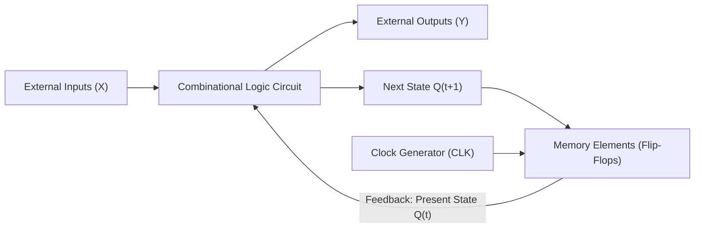
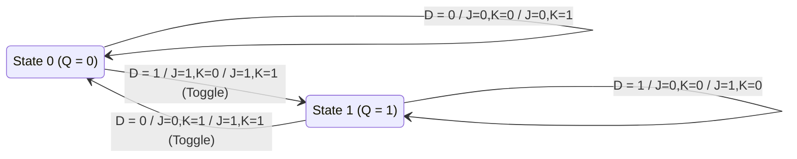

# Introduction to Sequential Circuit

> [!info] Document Metadata
> - **Course:** `=this.course`
> - **Topic:** `=this.topic`
> - **Status:** `=this.status`

**Tags:** #[[Computer Science]] #[[CSARCH1]] #[[Conceptual]] #[[M5]]

---

## Overview

Sequential circuits act as storage elements and possess memory. The output (or next state) in a sequential circuit is a function of the **present state** and the **input**.
- The system must have at least one **feedback path** from the memory element to the system inputs.

### Synchronous vs. Asynchronous Sequential Circuits
- **Synchronous sequential circuit:** Behavior is defined at discrete instants of time. Synchronization is achieved by a timing device called a **clock generator**, providing a periodic train of clock pulses (clock or clk).
  - Clock pulses can be **level triggered** (positive or negative) or **edge triggered** (positive or negative).
- **Asynchronous sequential circuit:** Behavior depends on the order in which input signals change. It can be affected at any instant of time. There is no single system clock, and transitions are defined in units of gate delay.

## Key Definitions

### Memory Elements: Latch vs. Flip-Flop
- Basic memory elements are capable of storing one bit of information (0 or 1).
- **Latch:** Based on level signal, primarily used in asynchronous sequential circuits.
- **Flip-Flop:** Based on edge trigger, primarily used in synchronous sequential circuits.

### Types of Flip-Flops

There are 4 major types of Flip-Flops, differing in the number of inputs and how inputs affect the binary state:

1. **SR Flip-Flop (Set-Reset):**
   - **S=0, R=0:** No change
   - **S=0, R=1:** Reset (Q=0)
   - **S=1, R=0:** Set (Q=1)
   - **S=1, R=1:** Indeterminate
   - **Characteristic Equation:** `Q(t+1) = S + R'Q` (where S and R cannot both be 1)

2. **JK Flip-Flop:**
   - **J=0, K=0:** No change
   - **J=0, K=1:** Reset (Q=0)
   - **J=1, K=0:** Set (Q=1)
   - **J=1, K=1:** Toggle
   - **Characteristic Equation:** `Q(t+1) = JQ' + K'Q`

3. **D Flip-Flop (Data):**
   - **D=0:** Follows input (Q=0)
   - **D=1:** Follows input (Q=1)
   - **Characteristic Equation:** `Q(t+1) = D`

4. **T Flip-Flop (Toggle):**
   - **T=0:** No change
   - **T=1:** Toggle
   - **Characteristic Equation:** `Q(t+1) = T'Q + TQ' = T ⊕ Q`

## Multiple Choice Questions

1. What defines a sequential circuit's output?
- **A)** It depends only on the present input.
- **B)** It depends only on the clock signal.
- **C)** It depends on the present input and the present state (memory).
- **D)** It depends exclusively on the previous output.

2. What is required in a sequential system that differentiates it from a combinational system?
- **A)** An arithmetic logic unit
- **B)** At least one feedback path from the memory element to system inputs
- **C)** A set of tri-state buffers
- **D)** Only NAND or NOR gates

3. What achieves synchronization in a synchronous sequential circuit?
- **A)** A clock generator providing a periodic train of clock pulses
- **B)** Gate delays within the combinational logic
- **C)** External user inputs
- **D)** Asynchronous resets

4. What is the primary difference between a latch and a flip-flop?
- **A)** Latches store 2 bits; flip-flops store 1 bit.
- **B)** Latches are based on edge-triggering; flip-flops are level-triggered.
- **C)** Latches are level-triggered; flip-flops are edge-triggered.
- **D)** Latches are synchronous; flip-flops are asynchronous.

5. In an SR Flip-Flop, what happens when both S and R inputs are 1?
- **A)** The state toggles.
- **B)** The state remains unchanged.
- **C)** The output is indeterminate.
- **D)** The output becomes high-impedance.

6. What is the defining characteristic of a JK Flip-Flop when both J and K are 1?
- **A)** The flip-flop resets.
- **B)** The flip-flop state toggles.
- **C)** The output becomes indeterminate.
- **D)** The output matches the input.

7. Which flip-flop simply follows its input at the next clock edge?
- **A)** SR Flip-Flop
- **B)** JK Flip-Flop
- **C)** D Flip-Flop
- **D)** T Flip-Flop

8. What is the state equation for a D Flip-Flop?
- **A)** Q(t+1) = S + R'Q
- **B)** Q(t+1) = D
- **C)** Q(t+1) = JQ' + K'Q
- **D)** Q(t+1) = T'Q + TQ'

9. What does an asynchronous sequential circuit's behavior depend upon?
- **A)** The frequency of the system clock.
- **B)** The order in which input signals change and transitions defined by gate delay.
- **C)** The rising edge of the periodic clock pulse.
- **D)** The falling edge of the periodic clock pulse.

10. In a T (Toggle) Flip-Flop, what is the next state when T=0?
- **A)** Toggles to the opposite state
- **B)** Resets to 0
- **C)** Sets to 1
- **D)** Remains unchanged

### Answer Key & Explanations
1. **C)** A sequential circuit's output is a function of both the present state (memory) and the inputs.
2. **B)** To retain state, sequential circuits must have at least one feedback path.
3. **A)** Synchronous circuits use a clock generator with periodic pulses to synchronize changes.
4. **C)** Latches react to signal levels (level-triggered), whereas flip-flops react to clock transitions (edge-triggered).
5. **C)** The SR flip-flop has an indeterminate state when both Set and Reset are high.
6. **B)** The JK flip-flop solves the indeterminate state of the SR flip-flop by toggling the output when both inputs are 1.
7. **C)** The D (Data) flip-flop passes its D input to the Q output on the clock edge.
8. **B)** The next state of a D flip-flop is simply its D input.
9. **B)** Asynchronous circuits lack a central clock; they depend on input changes and gate delays.
10. **D)** A T flip-flop maintains its current state (no change) when T is 0, and toggles when T is 1.

## References & Navigation

- **Previous Topic:** [[Hardware Description Language Structural Modelling]]
- **Next Topic:** [[Sequential Circuit - Analysis]]
- **Related Notes:** [[Combinational Circuit - Design]], [[Sequential Circuit - Analysis]]