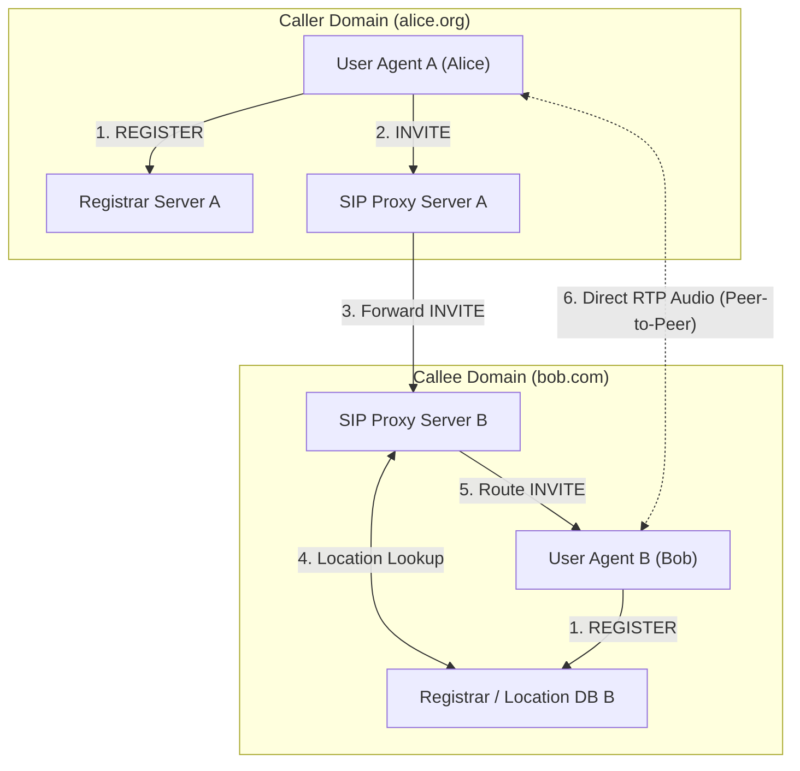
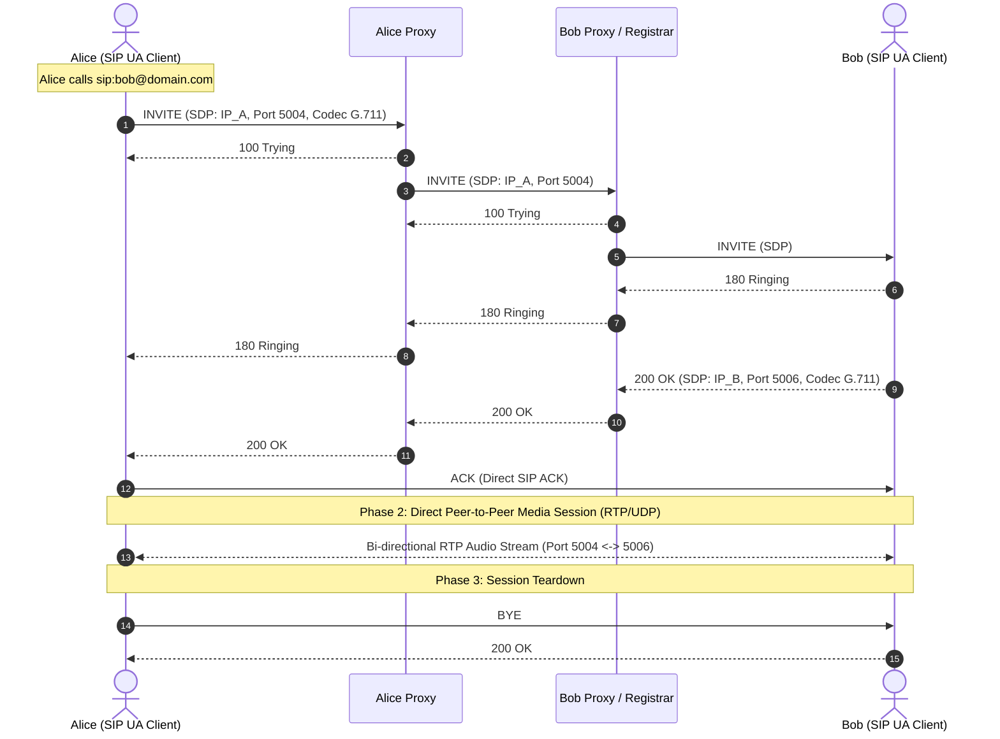

> [!info] Document Metadata
> - **Course:** `=this.course`
> - **Topic:** `=this.topic`
> - **Status:** `=this.status`

**Tags:** #[[Computer Science]] #[[NSCOM01]] #[[Conceptual]] #[[SIP]] #[[VoIP]]

---

## Overview
The Session Initiation Protocol (SIP), defined in RFC 3261, is an application-layer signaling protocol used for establishing, modifying, and terminating multimedia sessions (like VoIP calls) over IP networks. SIP's main vision is to route calls using mnemonic identifiers (like email addresses) rather than static phone numbers, enabling high mobility and device independence.

## Key Definitions
- **SIP (Session Initiation Protocol):** A signaling protocol used to set up and manage multimedia sessions.
- **Registrar Server:** A SIP server that keeps track of the current IP addresses of registered users.
- **Proxy Server:** A SIP server that routes requests to the user's current location, acting similarly to DNS.

## Theoretical Framework / Core Concepts

### SIP Services and Capabilities
1. **Call Setup:** SIP facilitates the negotiation between caller and callee to agree upon media types, port numbers, and specific codecs (e.g., PCM mu-law vs. GSM).
2. **Name Translation / User Location:** It maps a user-friendly identifier (e.g., `alice@domain.com`) to the dynamic IP address where the user's device is currently connected.
3. **Call Management:** SIP allows active sessions to be modified. Users can add new media streams (e.g., upgrading a voice call to a video call), change codecs mid-session, transfer calls, or invite new participants to create a conference.

### SIP Architecture: Servers
The SIP infrastructure relies on specialized servers to manage mobility and routing.
- **Registrar Server:** When a user boots up their SIP client, it sends a `REGISTER` message to their domain's Registrar Server. This updates a database mapping the user's SIP URI to their current IP address.
- **Proxy Server:** When a caller wants to reach a callee, they send an `INVITE` to their local Proxy Server. The proxy resolves the callee's domain, contacts the corresponding proxy or registrar, and routes the `INVITE` to the callee's current IP.

## Protocol Walkthroughs

### Call Setup Example
Assume Alice wants to call Bob using SIP. The default port for SIP messages is **5060**.

1. **INVITE:** Alice's client sends a SIP `INVITE` message. The payload contains a description (usually in SDP - Session Description Protocol) specifying Alice's IP address, her receiving port, and her preferred codec (e.g., PCM mu-law).
2. **Response:** 
   - If Bob accepts the call and supports the codec, his client sends a `200 OK` message back. The response contains Bob's IP, his receiving port, and the agreed-upon codec.
   - If Bob does not support the codec, his client might reply with a `606 Not Acceptable`, prompting Alice to try a different codec.
3. **ACK:** Alice sends an `ACK` message to acknowledge Bob's `200 OK`.
4. **Media Flow:** The SIP signaling phase is complete. The actual audio/video data now flows directly between Alice and Bob over RTP.

## Summary & Key Takeaways
- SIP separates the signaling (call setup/teardown) from the actual media transport (which is handled by RTP).
- It enables user mobility by mapping human-readable SIP URIs to dynamic IP addresses using Registrar and Proxy servers.
- SIP allows dynamic negotiation of session parameters (IPs, ports, codecs) and in-call modifications.

## Multiple Choice Questions
1. What RFC formally defines the Session Initiation Protocol (SIP)?
- **A)** RFC 3550
- **B)** RFC 3261
- **C)** RFC 1918
- **D)** RFC 802

2. What is the primary function of SIP?
- **A)** To carry the actual audio data over the network
- **B)** To provide VCR controls for streaming video
- **C)** To establish, modify, and terminate multimedia sessions
- **D)** To encrypt VoIP traffic

3. Which of the following is NOT a core service provided by SIP?
- **A)** Name translation and user location
- **B)** Call setup and codec negotiation
- **C)** Call management and mid-session modifications
- **D)** Routing of physical packets at the network layer

4. Which server acts similarly to a local DNS server by routing INVITE messages to locate a callee?
- **A)** Registrar Server
- **B)** Proxy Server
- **C)** Media Server
- **D)** Tracker Server

5. What does a SIP client do when it first powers on to ensure it can receive calls?
- **A)** Sends an INVITE to the Proxy Server
- **B)** Sends a REGISTER message to the Registrar Server
- **C)** Sends an ACK to all contacts
- **D)** Opens an RTSP out-of-band connection

6. What is the default port number used for SIP messages?
- **A)** 80
- **B)** 443
- **C)** 5060
- **D)** 8080

7. What message does Alice send to Bob to initiate a SIP call?
- **A)** SETUP
- **B)** SYN
- **C)** INVITE
- **D)** HELLO

8. If Bob receives a call setup request but does not support the requested audio codec, what SIP response might he send?
- **A)** 200 OK
- **B)** 404 Not Found
- **C)** 500 Server Error
- **D)** 606 Not Acceptable

9. After SIP negotiation is complete (INVITE, OK, ACK), how does the actual audio data travel?
- **A)** Encapsulated inside SIP messages
- **B)** Via HTTP requests
- **C)** Over a separate RTP connection
- **D)** Over a direct TCP connection via the Proxy Server

10. Which protocol is typically used to format the payload of a SIP INVITE message to describe IP addresses, ports, and codecs?
- **A)** HTML
- **B)** SDP (Session Description Protocol)
- **C)** XML
- **D)** JSON

### Answer Key & Explanations
1. **B** - SIP is defined in RFC 3261.
2. **C** - SIP is a signaling protocol designed strictly for setting up and managing sessions, not for transporting the media itself.
3. **D** - SIP operates at the application layer; network layer routing is handled by IP.
4. **B** - The Proxy Server is responsible for resolving destinations and routing SIP requests through the network.
5. **B** - The REGISTER message updates the network database with the user's current dynamic IP address.
6. **C** - Port 5060 is the standard port for SIP traffic.
7. **C** - The INVITE message is used to propose a session and negotiate parameters.
8. **D** - A 606 Not Acceptable response indicates the callee was reached but the specific session parameters (like the codec) are not supported.
9. **C** - Once SIP sets up the session, the application switches to RTP for the actual transmission of real-time media.
10. **B** - While not heavily detailed in the brief, the payload carrying the session details in SIP is standardly formatted using SDP.

## References & Navigation

- **Previous Topic:** [[Real-Time Protocols]]
- **Next Topic:** [[P2P Architecture and BitTorrent]]
- **Related Notes:** [[Applications]]
