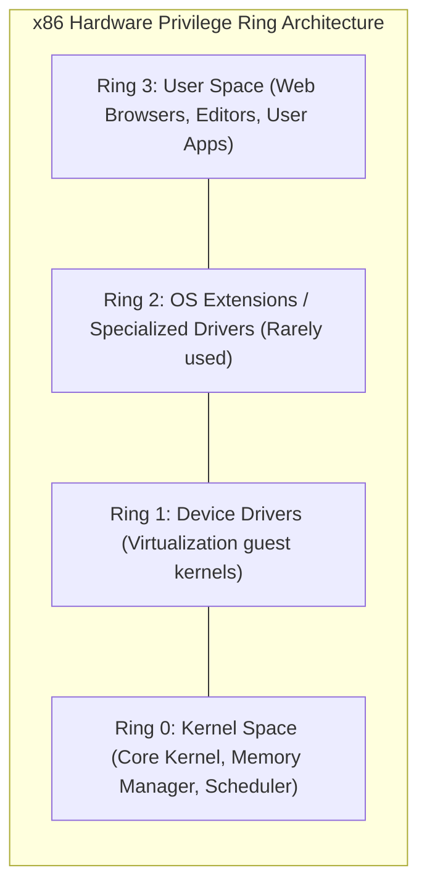
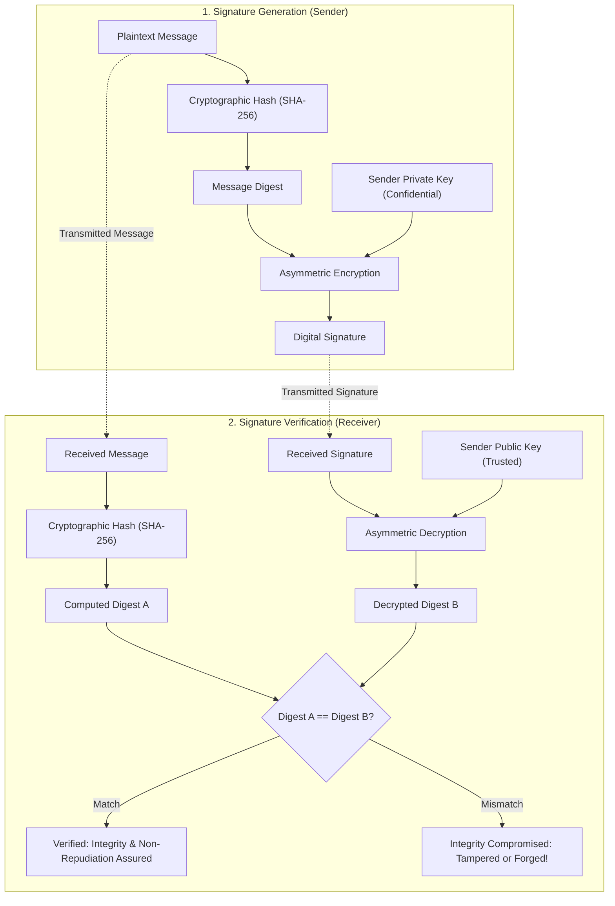

> [!info] Document Metadata
> - **Course:** `=this.course`
> - **Topic:** `=this.topic`
> - **Status:** `=this.status`

**Tags:** #[[Computer Science]] #[[NSSECU1]] #[[Conceptual]] #[[Operating Systems]] #[[Cryptography]]

---

## Overview
This module explores the fundamental security mechanisms within Operating Systems (Windows and Linux) and the principles of modern cryptography. Understanding OS internals is critical for both offensive and defensive security. Cryptography forms the mathematical foundation for securing data at rest, in transit, and in use.

## Key Definitions
- **Kernel:** The core component of an operating system that manages system resources and hardware communication.
- **Symmetric Encryption:** A cryptographic method where the same key is used for both encryption and decryption.
- **Asymmetric Encryption:** A cryptographic method using a public/private key pair.
- **Hash Function:** A mathematical algorithm that maps data of arbitrary size to a bit string of a fixed size.

## Theoretical Framework / Core Concepts

### OS Security Concepts
- **Privilege Rings:** CPU architectures use rings (e.g., Ring 0 to Ring 3) to enforce privilege separation. The kernel runs in Ring 0 (highest privilege), while user applications run in Ring 3.
- **File Permissions (Linux):** Controlled via Read (r), Write (w), and Execute (x) bits for Owner, Group, and Others.
- **Access Control Lists (ACLs):** Used heavily in Windows (NTFS) to define fine-grained permissions for users and groups.

### Cryptography
- **Symmetric vs. Asymmetric:** Symmetric (e.g., AES) is fast and used for bulk data. Asymmetric (e.g., RSA, ECC) is slower but solves the key exchange problem.
- **Public Key Infrastructure (PKI):** A set of roles, policies, and procedures needed to create, manage, distribute, use, store, and revoke digital certificates and manage public-key encryption.
- **Digital Signatures:** Provides non-repudiation and integrity by encrypting a hash of the message with the sender's private key.

## Worked Examples / Protocol Walkthroughs / Calculations

### Linux File Permissions Calculation
Permissions: `rwxr-x---`
- Owner: `rwx` = $4 + 2 + 1 = 7$
- Group: `r-x` = $4 + 0 + 1 = 5$
- Others: `---` = $0 + 0 + 0 = 0$
- Octal Representation: `750`

### RSA Key Exchange Concept
1. Alice generates a key pair: `Public_A` and `Private_A`.
2. Bob wants to send a secret symmetric key `K` to Alice.
3. Bob encrypts `K` using `Public_A`: $C = E(Public\_A, K)$.
4. Alice receives $C$ and decrypts it: $K = D(Private\_A, C)$.

## Summary & Key Takeaways
- Operating systems enforce security boundaries through user privileges and memory protection mechanisms.
- Cryptography provides confidentiality (encryption), integrity (hashing), and non-repudiation (digital signatures).
- Modern secure communications (like TLS) use asymmetric cryptography for key exchange and symmetric cryptography for data encryption.

## Multiple Choice Questions

1. In standard CPU privilege rings, which ring is typically reserved for the OS Kernel?
    - **A)** Ring 3
    - **B)** Ring 2
    - **C)** Ring 1
    - **D)** Ring 0

2. Which encryption algorithm uses the same key for both encryption and decryption?
    - **A)** RSA
    - **B)** ECC
    - **C)** AES
    - **D)** Diffie-Hellman

3. What is the octal value for Linux permissions `rw-r--r--`?
    - **A)** 644
    - **B)** 755
    - **C)** 777
    - **D)** 600

4. Which cryptographic function is one-way and cannot be mathematically reversed?
    - **A)** AES-256
    - **B)** RSA-2048
    - **C)** SHA-256
    - **D)** 3DES

5. Digital signatures are created using the sender's:
    - **A)** Public key
    - **B)** Private key
    - **C)** Symmetric key
    - **D)** Hash key

6. What does PKI stand for in cryptography?
    - **A)** Private Key Integration
    - **B)** Public Key Infrastructure
    - **C)** Protocol Key Interchange
    - **D)** Public Key Internet

7. Which of the following is a symmetric block cipher?
    - **A)** RSA
    - **B)** AES
    - **C)** SHA-1
    - **D)** MD5

8. In Windows NTFS, what mechanism allows for fine-grained file permissions?
    - **A)** UGO
    - **B)** ACLs
    - **C)** SELinux
    - **D)** AppArmor

9. The main advantage of asymmetric encryption over symmetric encryption is:
    - **A)** Faster execution speed
    - **B)** Lower computational overhead
    - **C)** Simplified key distribution
    - **D)** Smaller ciphertext sizes

10. Non-repudiation guarantees that:
    - **A)** Data cannot be read by unauthorized parties
    - **B)** Data has not been altered in transit
    - **C)** The sender of a message cannot deny having sent it
    - **D)** Systems remain available during an attack

### Answer Key & Explanations

1. **D**. Ring 0 is the most privileged level and is where the operating system kernel resides.
2. **C**. AES (Advanced Encryption Standard) is a symmetric encryption algorithm.
3. **A**. `rw-` is 6, `r--` is 4, and `r--` is 4, resulting in 644.
4. **C**. SHA-256 is a cryptographic hash function, which is designed to be one-way and irreversible.
5. **B**. A digital signature is created by encrypting the message hash with the sender's private key.
6. **B**. PKI stands for Public Key Infrastructure, which manages digital certificates.
7. **B**. AES is a symmetric block cipher widely used for securing data.
8. **B**. Access Control Lists (ACLs) define specific permissions for users and groups in NTFS.
9. **C**. Asymmetric encryption solves the problem of securely sharing keys over an insecure channel.
10. **C**. Non-repudiation (usually achieved via digital signatures) prevents a sender from falsely denying they sent a message.

## References & Navigation

- **Previous Topic:** [[Introduction to Cybersecurity]]
- **Next Topic:** [[Software and Network Security]]
- **Related Notes:** [[Password Hashing]]
