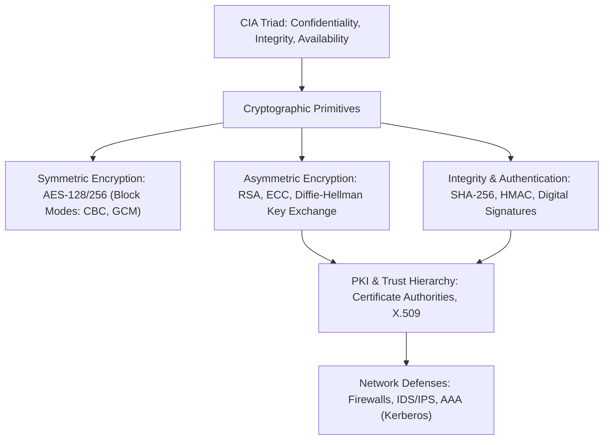
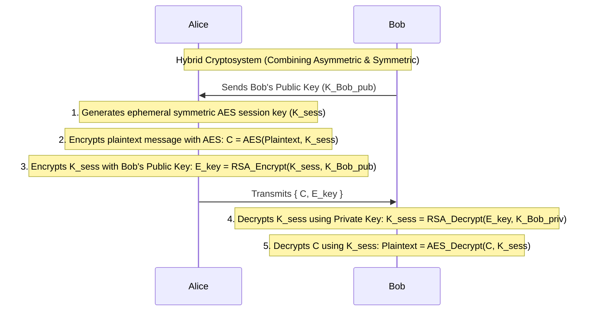

> [!info] Document Metadata
> - **Course:** `=this.course`
> - **Topic:** `=this.topic`
> - **Status:** `=this.status`

**Tags:** #[[Computer Science]] #[[NSSECU1]] #[[Cybersecurity]] #[[Cryptography]] #[[Reviewer]] #[[Finals]]

---

# NSSECU1 Comprehensive Finals Reviewer

## Overview

This reviewer consolidates Network Security 1 (NSSECU1). Core disciplines cover information security fundamentals (CIA Triad: Confidentiality, Integrity, Availability), threat modeling, classical ciphers, symmetric cryptography (DES, 3DES, AES), block cipher modes of operation (ECB, CBC, CTR, GCM), asymmetric cryptography (RSA, Diffie-Hellman Key Exchange, Elliptic Curve Cryptography), cryptographic hash functions (SHA-256, HMAC), Public Key Infrastructure (PKI, X.509 certificates, CA hierarchy), network authentication protocols (Kerberos), defensive firewalls, and vulnerability scanning fundamentals.

---

## 1. Cryptography Primitives Master Matrix

| Primitive Category | Core Algorithms | Key Size / Output | Security Goal | Typical Application |
| :--- | :--- | :--- | :--- | :--- |
| **Symmetric Encryption** | AES (Rijndael), 3DES, ChaCha20 | 128, 192, 256 bits | Confidentiality (Bulk data) | TLS session encryption, BitLocker, IPsec |
| **Asymmetric Encryption** | RSA, ECC (ECDSA, Ed25519) | RSA: 2048–4096 bits   ECC: 256 bits | Key Exchange, Digital Signatures | TLS handshake, SSH keys, PGP |
| **Cryptographic Hash** | SHA-256, SHA-3, BLAKE2 | 256, 512 bits | Integrity (One-way property) | File verification, Password storage, Blockchain |
| **Message Authentication** | HMAC-SHA256, Poly1305 | Keyed MAC tag | Integrity + Authenticity | API request signing, TLS record integrity |
| **Key Agreement** | Diffie-Hellman (ECDH) | Curve25519 (256-bit) | Forward Secrecy key agreement | Ephemeral session key derivation |

---

## 2. Hybrid Cryptosystem Workflow

---

## 3. High-Yield Exam Checklist

- [ ] Does ECB mode provide security for pattern-rich data? **NO!** Electronic Codebook encrypts identical plaintext blocks into identical ciphertext blocks (the ECB Tux vulnerability).
- [ ] What is Forward Secrecy (PFS)? Compromise of the server's long-term private key does NOT compromise past recorded session keys (achieved via Ephemeral Diffie-Hellman: DHE/ECDHE).
- [ ] In a Digital Signature, which key signs the hash? The **sender's private key** signs; anyone with the **sender's public key** verifies.
- [ ] What are the 3 properties of cryptographic hashes? Pre-image resistance (one-way), Second pre-image resistance, and Collision resistance.
- [ ] In Kerberos authentication, what ticket is used to request service tickets? The **Ticket Granting Ticket (TGT)** issued by the AS.

---

## 4. Comprehensive Practice Exam

1. Which block cipher mode of operation is vulnerable to visual pattern leakage because identical plaintext blocks encrypt to identical ciphertext blocks?
   - A) Cipher Block Chaining (CBC)
   - B) Electronic Codebook (ECB)
   - C) Counter (CTR)
   - D) Galois/Counter Mode (GCM)

2. In asymmetric public-key cryptography, how does Alice digitally sign a message sent to Bob to prove authenticity and non-repudiation?
   - A) Alice encrypts the message hash using Bob's public key.
   - B) Alice encrypts the message hash using Alice's private key.
   - C) Alice encrypts the message hash using Alice's public key.
   - D) Alice encrypts the message hash using Bob's private key.

3. The Diffie-Hellman key exchange protocol allows two parties to establish a shared secret over an insecure channel, but is vulnerable to which attack if unauthenticated?
   - A) Frequency Analysis
   - B) Birthday Attack
   - C) Man-in-the-Middle (MitM) Attack
   - D) Buffer Overflow

4. What is the primary purpose of a Salt when hashing user passwords?
   - A) To encrypt the password with symmetric AES
   - B) To defend against precomputed Rainbow Table attacks and ensure identical passwords yield distinct hashes
   - C) To speed up hash verification on the server
   - D) To compress the password length

5. What authentication ticket does a client present to the Ticket Granting Server (TGS) in a Kerberos environment to obtain a service ticket?
   - A) PAC (Privilege Attribute Certificate)
   - B) TGT (Ticket Granting Ticket)
   - C) X.509 Certificate
   - D) SAML Token

---

### Answer Key & Explanations

1. **B) Electronic Codebook (ECB)** — ECB encrypts each 128-bit block independently with the same key without an Initialization Vector (IV), preserving structural patterns across identical data blocks.
2. **B) Alice encrypts the message hash using Alice's private key** — Only Alice possesses her private key. Anyone can verify the signature by decrypting the hash using Alice's public key and comparing it to the computed message hash, guaranteeing authentication and non-repudiation.
3. **C) Man-in-the-Middle (MitM) Attack** — Classical Diffie-Hellman provides no identity authentication. An active adversary can intercept the public parameters, negotiate two separate shared secrets with Alice and Bob, and transparently decrypt/tamper with traffic.
4. **B) To defend against precomputed Rainbow Table attacks and ensure identical passwords yield distinct hashes** — A salt is a unique random nonce appended to each password before hashing, rendering global rainbow tables useless.
5. **B) TGT (Ticket Granting Ticket)** — The client authenticates to the Authentication Server (AS) to receive a TGT encrypted with the TGS secret key, which is subsequently presented to the TGS to obtain service tickets.

---

## References & Navigation

- **Previous Topic:** [[CSNETWK]]
- **Next Topic:** [[NSSECU2]]
- **Prerequisites:** [[Network Security]], Cryptography, AES, RSA, PKI, Firewalls
- **Cross-Curricular Connections:** [[NSCOM02]]
