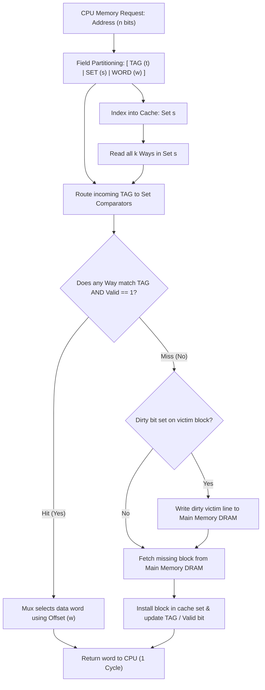
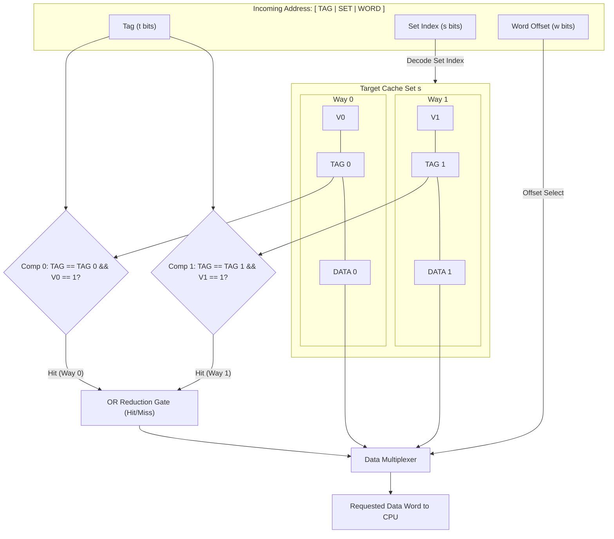

# Module 13: Cache Memory Principles & Mapping Architectures

> [!info] Document Metadata
> - **Course:** `=this.course`
> - **Topic:** `=this.topic`
> - **Status:** `=this.status`

**Tags:** #[[Computer Science]] #[[CSARCH2]] #[[Computer Architecture]] #[[Hardware Modeling]] #[[Cache Memory Principles & Mapping Architectures]]

---

## Overview

> Cache memory is high-speed on-chip SRAM situated directly between the CPU execution core and main memory, designed to transparently intercept memory requests. To service an access in a single clock cycle, cache hardware must rapidly map an incoming $n$-bit memory address to an internal storage frame and verify whether the requested data is present. This module examines the three canonical cache mapping architectures: **Direct Mapping**, **Fully Associative Mapping**, and **$k$-Way Block Set-Associative Mapping**. We formalize the mathematical bit-partitioning formulas for TAG, SET/LINE, and WORD/OFFSET fields, and derive total hardware bit-capacity equations including tag and status bit overheads.

## Key Definitions

- **Cache Line / Block:** The fundamental atomic unit of data transfer between cache and main memory, typically 32, 64, or 128 bytes in size.
- **Tag Store:** A specialized memory array within the cache holding the high-order address bits corresponding to the memory block currently occupying each cache frame.
- **Valid Bit ($V$):** A 1-bit status flag per cache line indicating whether the stored line contains valid, initialized data ($V=1$) or uninitialized garbage ($V=0$).
- **Dirty Bit ($D$):** A 1-bit status flag per cache line in write-back caches indicating whether the line has been modified by the CPU ($D=1$) and must be written to main memory upon eviction.
- **Direct Mapping:** A rigid mapping function where each main memory block maps to exactly one predetermined cache line index, given by $\text{Line} = \text{MM Block} \pmod{\text{Total Cache Lines}}$.
- **Fully Associative Mapping:** A flexible mapping architecture where any main memory block can reside in any arbitrary cache frame, requiring parallel comparison across all tags.
- **$k$-Way Set-Associative Mapping:** A hybrid architecture where the cache is partitioned into $S$ sets, each consisting of $k$ lines. A memory block maps to a unique set index ($\text{Set} = \text{MM Block} \pmod S$), but can occupy any of the $k$ lines within that set.

## Theoretical Framework / Core Concepts

### 1. The Anatomy of a Cache Entry

Every cache line frame contains both the payload data and architectural metadata:

```text
+---+---+-------------------------+-----------------------------------------+
| V | D |       TAG Field         |             DATA BLOCK PAYLOAD          |
|1b |1b |       (t bits)          |           (Block Size * 8 bits)         |
+---+---+-------------------------+-----------------------------------------+
  ^   ^
  |   +-- Dirty Bit (1 = Modified in cache, 0 = Clean)
  +------ Valid Bit (1 = Frame holds valid data, 0 = Cold/Invalid)
```



### 2. Direct Mapping Architecture

In Direct Mapping, main memory block $B$ maps strictly to cache line index $i$:
$$i = B \pmod N$$
where $N = 2^k$ is the total number of cache lines.

```text
Direct-Mapped Address Partitioning (n bits total):
+-------------------------------+-----------------------+-----------------------+
|          TAG (t bits)         |     LINE (k bits)     |     WORD (w bits)     |
+-------------------------------+-----------------------+-----------------------+
 n - k - w bits                  k = log2(Lines)         w = log2(Bytes/Block)
```

```text
Direct-Mapped Hardware Matching:
Address: [ TAG ] [ LINE ] [ WORD ]
                     |
                     v (k-bit Decoder)
             Select Line k
                     |
         +-----------v-----------+
Line k:  | V | TAG_k | DATA_k    |
         +---+-------+-----------+
           |     |         |
           |     v         |
     V=1? -+-> [ =? ] <----+ (Compare incoming TAG with TAG_k)
                 |
             Hit / Miss
```

- **Pros:** Minimal hardware complexity; requires only **1 comparator**; fastest hit time.
- **Cons:** Extremely vulnerable to **conflict misses (thrashing)** if a program repeatedly accesses two different memory blocks that map to the same line index.

### 3. Fully Associative Mapping Architecture

In Fully Associative Mapping, a main memory block can be placed in any vacant or evicted line. There is no line index in the address.

```text
Fully Associative Address Partitioning (n bits total):
+-------------------------------------------------------+-----------------------+
|                     TAG (t bits)                      |     WORD (w bits)     |
+-------------------------------------------------------+-----------------------+
 t = n - w bits                                          w = log2(Bytes/Block)
```

```text
Fully Associative Hardware Matching:
Address: [ TAG ] [ WORD ]
             |
             +------------+------------+ ... (Broadcast TAG to ALL lines)
             |            |            |
             v            v            v
        +---------+  +---------+  +---------+
Line 0: | Comp #0 |  | Comp #1 |  | Comp #N | Line N-1
        +---------+  +---------+  +---------+
             |            |            |
             +------------+------------+
                          |
                   OR Reduction Tree ---> Hit / Miss
```

- **Pros:** Completely eliminates conflict misses; maximizes storage utilization.
- **Cons:** Requires $N$ parallel comparators ($N = \text{Total Cache Lines}$), incurring high power, silicon area, and capacitive routing delay for large caches.

### 4. $k$-Way Block Set-Associative Mapping Architecture

$k$-Way Set-Associative mapping combines the search efficiency of direct mapping with the conflict resilience of associativity:

$$\text{Total Sets } S = \frac{\text{Total Cache Lines } N}{k}$$
$$\text{Set Index } s = B \pmod S$$

```text
k-Way Set-Associative Address Partitioning (n bits total):
+-------------------------------+-----------------------+-----------------------+
|          TAG (t bits)         |      SET (s bits)     |     WORD (w bits)     |
+-------------------------------+-----------------------+-----------------------+
 t = n - s - w bits              s = log2(Sets)          w = log2(Bytes/Block)
```



### 5. Mathematical Summary of Address Bit-Splitting

For a memory system with $2^n$ bytes of addressable physical memory, a cache capacity of $C$ bytes, and a block size of $B = 2^w$ bytes:

| Parameter | Direct Mapping | Fully Associative | $k$-Way Set-Associative |
| :--- | :--- | :--- | :--- |
| **Total Cache Blocks ($N$)** | $C / B = 2^k$ | $C / B = N$ | $C / B = N$ |
| **Total Sets ($S$)** | $N$ (Each line is a set) | $1$ (Single set) | $N / k = 2^s$ |
| **Offset Bits ($w$)** | $\log_2(B)$ | $\log_2(B)$ | $\log_2(B)$ |
| **Index Bits** | $k = \log_2(N)$ | $0$ (No index field) | $s = \log_2(S)$ |
| **Tag Bits ($t$)** | $n - k - w$ | $n - w$ | $n - s - w$ |
| **Comparators Required** | 1 | $N$ | $k$ |

#### Total Cache Hardware Sizing Formula:
$$\text{Total Hardware Bits} = N \times \left( (B \times 8) + t + 1_{\text{Valid}} + 1_{\text{Dirty}} \right)$$

## Worked Examples / Calculations / Hardware Traces

### Example 1: Address Bit Splitting Across All Three Architectures

**Problem:** A system has a 32-bit physical address space ($n = 32$), a $64\text{ KiB}$ data cache, and a block size of $64\text{ bytes}$. Calculate the exact bit widths for TAG, LINE/SET, and WORD fields for:
1. Direct Mapping
2. Fully Associative Mapping
3. 4-Way Set-Associative Mapping

**Solution:**
- Address width $n = 32\text{ bits}$.
- Block size $B = 64\text{ bytes} = 2^6 \implies \text{Offset Bits } w = 6\text{ bits}$.
- Cache size $C = 64\text{ KiB} = 64 \times 1024\text{ bytes} = 65,536\text{ bytes} = 2^{16}\text{ bytes}$.
- Total cache blocks $N = \frac{C}{B} = \frac{2^{16}}{2^6} = 2^{10} = 1024\text{ blocks}$.

1. **Direct Mapping:**
   - Index bits $k = \log_2(N) = \log_2(1024) = 10\text{ bits}$.
   - Offset bits $w = 6\text{ bits}$.
   - Tag bits $t = n - k - w = 32 - 10 - 6 = 16\text{ bits}$.
   - **Format:** $[\text{TAG: 16 bits} \mid \text{LINE: 10 bits} \mid \text{OFFSET: 6 bits}]$.

2. **Fully Associative Mapping:**
   - Index bits $= 0\text{ bits}$.
   - Offset bits $w = 6\text{ bits}$.
   - Tag bits $t = n - w = 32 - 6 = 26\text{ bits}$.
   - **Format:** $[\text{TAG: 26 bits} \mid \text{OFFSET: 6 bits}]$.

3. **4-Way Set-Associative Mapping ($k = 4$):**
   - Total sets $S = \frac{N}{k} = \frac{1024}{4} = 256\text{ sets} = 2^8\text{ sets}$.
   - Set bits $s = \log_2(S) = \log_2(256) = 8\text{ bits}$.
   - Offset bits $w = 6\text{ bits}$.
   - Tag bits $t = n - s - w = 32 - 8 - 6 = 18\text{ bits}$.
   - **Format:** $[\text{TAG: 18 bits} \mid \text{SET: 8 bits} \mid \text{OFFSET: 6 bits}]$.

### Example 2: Total Hardware Cache Sizing Calculation

**Problem:** For the 4-Way Set-Associative cache in Example 1, calculate:
1. The raw data capacity (in bits and bytes).
2. The total silicon storage capacity including Tag store, Valid bit, and Dirty bit for all lines.
3. The percentage overhead introduced by metadata bits.

**Solution:**
1. **Raw Data Capacity:**
   $$\text{Data Capacity} = 64\text{ KiB} = 65,536\text{ bytes} = 524,288\text{ bits}$$

2. **Total Hardware Storage Bits:**
   - Number of lines $N = 1024$.
   - Bits per line $= \text{Data bits} + \text{Tag bits} + \text{Valid} + \text{Dirty}$
     $$\text{Bits/Line} = (64 \times 8) + 18 + 1 + 1 = 512 + 20 = 532\text{ bits}$$
   - Total Cache Bits $= 1024 \times 532 = 544,768\text{ bits} = 68,096\text{ bytes} \approx 66.5\text{ KiB}$.

3. **Metadata Overhead:**
   $$\text{Overhead Bits} = 544,768 - 524,288 = 20,480\text{ bits} = 2,560\text{ bytes} = 2.5\text{ KiB}$$
   $$\text{Overhead Percentage} = \frac{2,560\text{ B}}{65,536\text{ B}} \times 100\% = 3.906\%$$

## Complexity Analysis / Common Pitfalls

- **Byte vs. Word Addressing Offset:** When a memory problem specifies that addresses reference 32-bit *words* rather than *bytes*, the offset bits must be calculated as $w = \log_2(\text{words per block})$ instead of $\log_2(\text{bytes per block})$. Forgetting this produces an off-by-2 bit allocation error.
- **Calculating Sets vs. Blocks in Associative Caches:** A common student mistake is using the total number of cache blocks ($N$) instead of the number of sets ($S = N/k$) when deriving the SET index field width $s$.
- **Direct Mapped Thrashing in Loops:** Placing two arrays accessed simultaneously in a loop at memory addresses that share the same LINE index causes a cache miss on *every single access*, dropping system performance by over $90\%$.

## Multiple Choice Questions

1. A 32-bit byte-addressable system uses a Direct-Mapped cache with 512 lines and a block size of 32 bytes. What is the bit configuration of the address fields?
- **A)** Tag: 18 bits, Line: 9 bits, Offset: 5 bits
- **B)** Tag: 16 bits, Line: 10 bits, Offset: 6 bits
- **C)** Tag: 20 bits, Line: 7 bits, Offset: 5 bits
- **D)** Tag: 15 bits, Line: 9 bits, Offset: 8 bits

2. How many tag comparators operate in parallel during a cache lookup in an 8-Way Set-Associative cache?
- **A)** 1 comparator
- **B)** 8 comparators
- **C)** Total number of sets comparators
- **D)** Total number of cache lines comparators

3. What is the primary advantage of Fully Associative cache mapping over Direct Mapping?
- **A)** Requires zero comparator circuits
- **B)** Completely eliminates conflict misses by allowing any memory block to occupy any cache frame
- **C)** Halves the memory bus cycle latency
- **D)** Uses fewer tag bits per cache entry

4. In a $k$-Way Set-Associative cache with 2,048 total lines and $k = 4$, how many bits are required for the SET index field?
- **A)** 8 bits
- **B)** 9 bits
- **C)** 10 bits
- **D)** 11 bits

5. What is the function of the Valid bit ($V$) in each cache line?
- **A)** Indicates whether the CPU is in supervisor kernel mode
- **B)** Indicates whether the line contains valid initialized memory data
- **C)** Indicates whether the line must be written back to DRAM
- **D)** Controls the tri-state output buffer gating

### Answer Key & Explanations

1. **A**. Block size $32\text{ bytes} \implies w = \log_2(32) = 5\text{ bits}$. Cache lines $512 \implies k = \log_2(512) = 9\text{ bits}$. Tag bits $t = 32 - 9 - 5 = 18\text{ bits}$.
2. **B**. In an $k$-way set-associative cache, the hardware simultaneously compares the incoming tag against the tags of all $k$ lines inside the selected set. For $k=8$, exactly 8 comparators run in parallel.
3. **B**. Fully Associative caches allow a memory block to reside in any line frame, preventing conflict misses where multiple active blocks compete for a single rigid line index.
4. **B**. Total sets $S = \frac{\text{Total Lines}}{k} = \frac{2048}{4} = 512\text{ sets}$. Set index bits $s = \log_2(512) = 9\text{ bits}$.
5. **B**. The valid bit differentiates populated, valid cache data ($V=1$) from uninitialized startup/garbage data ($V=0$) upon system reset.

## References & Navigation

- **Previous Topic:** [[Memory System Organization & Hierarchy]]
- **Next Topic:** [[Cache Replacement Policies & Write Strategies]]
- **Related Notes:** [[Virtual Memory & Address Translation (Paging & TLB)]], [[Functional Units & Performance Fundamentals]]
