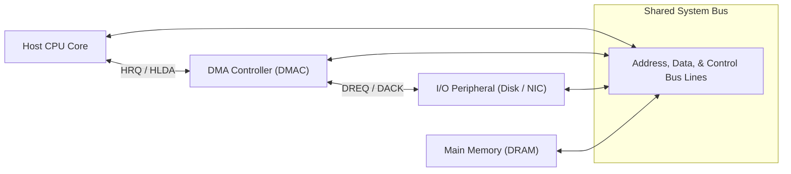

# Module 16: I/O Organization & Interrupt Handling

> [!info] Document Metadata
> - **Course:** `=this.course`
> - **Topic:** `=this.topic`
> - **Status:** `=this.status`

**Tags:** #[[Computer Science]] #[[CSARCH2]] #[[Computer Architecture]] #[[Hardware Modeling]] #[[I/O Organization & Interrupt Handling]]

---

## Overview

> Modern microprocessors interact with an extensive variety of peripheral devices—solid-state storage controllers, network interface cards (NICs), graphics processing units (GPUs), and human input interfaces—that operate at vastly disparate data rates and clock domains. This module examines the architectural organization of the Input/Output subsystem. We contrast **Memory-Mapped I/O vs. Port-Mapped (Isolated) I/O**, evaluate the three fundamental I/O transfer paradigms (**Programmed I/O, Interrupt-Driven I/O, and Direct Memory Access**), analyze hardware bus arbitration schemes, and formalize the exact microarchitectural lifecycle of hardware interrupt dispatching.

## Key Definitions

- **I/O Module / Interface:** The hardware controller bridging the system bus and a peripheral device, handling data buffering, voltage level translation, status reporting, and command decoding.
- **Memory-Mapped I/O (MMIO):** An addressing scheme where peripheral device control, status, and data registers share the exact same physical address space as main memory, allowing standard load/store instructions (`MOV`, `LDR`, `STR`) to interact with hardware.
- **Port-Mapped / Isolated I/O (PMIO):** An addressing scheme where peripheral devices reside in a physically isolated I/O address space, accessed exclusively via dedicated machine instructions (e.g., x86 `IN` and `OUT`) and distinguished by an $M/\overline{IO}$ bus signal.
- **Programmed I/O (Polling):** A data transfer technique where the CPU continuously checks a peripheral's status register in a synchronous busy-wait loop until the device is ready.
- **Interrupt-Driven I/O:** An asynchronous data transfer technique where the peripheral signals its readiness by asserting an electrical interrupt line (`INTR`), freeing the CPU to execute other tasks until serviced.
- **Direct Memory Access (DMA):** A high-performance hardware transfer mechanism where a dedicated **DMA Controller (DMAC)** takes mastership of the system bus to transfer blocks of data directly between I/O devices and main memory without routing bytes through CPU registers.
- **Interrupt Vector Table (IVT):** An array of function pointers stored in memory mapping interrupt vector numbers to their corresponding **Interrupt Service Routine (ISR)** entry points.

## Theoretical Framework / Core Concepts

### 1. Memory-Mapped I/O vs. Port-Mapped I/O

```text
Memory-Mapped I/O (ARM, RISC-V, PCIe):
+-------------------------------------------------------------------------+
| [ Physical RAM Space (0x00000000 - 0xEFFFFFFF) ]                        |
+-------------------------------------------------------------------------+
| [ I/O Device Registers / PCIe BARs (0xF0000000 - 0xFFFFFFFF) ]          |
+-------------------------------------------------------------------------+
- Uses standard CPU instructions: MOV [0xF0001000], EAX

Port-Mapped / Isolated I/O (x86 Legacy Ports):
+------------------------------------+  +--------------------------------+
| Physical RAM Space (Memory Bus)   |  | Isolated I/O Ports (0x0000-FFFF|
| (Accessed via standard MOV/LOAD)   |  | (Accessed via IN / OUT instrs) |
+------------------------------------+  +--------------------------------+
- Dedicated M/~IO bus control line distinguishes memory vs. I/O transactions.
```

| Architectural Feature | Memory-Mapped I/O (MMIO) | Port-Mapped I/O (PMIO) |
| :--- | :--- | :--- |
| **Address Space** | Unified with Main Memory | Completely Separate (e.g. 64 KB) |
| **Assembly Instructions** | All ALU/Memory (`MOV`, `ADD`, `OR`) | Dedicated (`IN`, `OUT` only) |
| **Control Bus Signals** | `Read`, `Write` | `I/O Read`, `I/O Write`, $M/\overline{IO}$ |
| **Address Decoding** | Standard MMU / Bus Decoder | Separate Port Decoder |
| **Primary Modern Use** | PCIe Devices, GPUs, ARM, RISC-V | Legacy PC peripherals (PIT, PIC, COM) |

### 2. The Three Fundamental I/O Data Transfer Paradigms

```mermaid
flowchart TD
    subgraph Polling["1. Programmed I/O (Polling)"]
        P1["CPU issues Read Command"] --> P2["CPU busy-waits reading Status Register"]
        P2 --> P3{"Device Ready?"}
        P3 -- No --> P2
        P3 -- Yes --> P4["CPU reads data into register (100% CPU wasted)"]
    end

    subgraph Interrupt["2. Interrupt-Driven I/O"]
        I1["CPU issues Read Command"] --> I2["CPU continues normal task execution"]
        I2 -.->|"Device asserts INTR pin"| I3["Hardware interrupt pauses CPU execution"]
        I3 --> I4["CPU saves context, runs ISR, fetches data into RAM"]
    end

    subgraph DMA["3. Direct Memory Access (DMA)"]
        D1["CPU programs DMAC (Src, Dest, Length)"] --> D2["CPU continues concurrent processing"]
        D2 -.->|"Bus Mastership"| D3["DMAC transfers multi-KB block directly into RAM"]
        D3 --> D4["DMAC raises single interrupt upon block completion"]
    end
```



### 3. Direct Memory Access (DMA) Mechanics & Transfer Modes

The DMA Controller (DMAC) sits directly on the system bus alongside the CPU:



#### DMA Operational Transfer Modes:
1. **Burst Mode (Block Transfer):**
   - The DMAC requests the bus ($HRQ$), receives mastership ($HLDA$), and transfers the entire data block (e.g., 64 KiB) without interruption.
   - *Trade-off:* Maximizes transfer throughput, but locks the CPU out of memory for the duration of the burst.
2. **Cycle Stealing Mode:**
   - The DMAC requests the bus for a single bus cycle, transfers **one word**, and immediately relinquishes the bus back to the CPU.
   - *Trade-off:* Interleaves I/O data transfers with CPU instruction execution, minimizing processor stalling.
3. **Transparent Mode:**
   - The DMAC transfers data only during clock cycles when it detects that the CPU is executing internal operations (e.g., ALU multiply) without utilizing the external system bus.

### 4. Hardware Interrupt Processing Lifecycle

When an external hardware device requests CPU service:

```text
1. Device asserts INTR line on processor pin.
2. CPU finishes executing the CURRENT machine instruction.
3. CPU samples INTR; if interrupts are enabled (IF=1):
   - CPU emits INTA (Interrupt Acknowledge) signal on control bus.
   - Device places its 8-bit Interrupt Vector Number onto data bus.
4. Hardware Context Save:
   - CPU pushes FLAGS register, Code Segment (CS), and Return EIP/RIP onto the Stack.
5. CPU multiplies Vector Number by 4 (or 8) to index the Interrupt Vector Table.
6. CPU loads the target Interrupt Service Routine (ISR) address into PC/EIP.
7. CPU executes ISR code.
8. ISR ends with IRET (Interrupt Return) instruction:
   - CPU pops saved context (FLAGS, EIP) off the stack.
   - Normal program execution resumes seamlessly.
```

## Worked Examples / Calculations / Hardware Traces

### Example 1: CPU Utilization Analysis (Polling vs. Interrupts vs. DMA)

**Problem:** A high-speed network controller receives data at a continuous rate of $10\text{ MB/s}$ in $1\text{ KiB}$ packets ($1024\text{ bytes}$). The CPU runs at a clock frequency of $2.0\text{ GHz}$.
- **Polling:** Checking the device status register takes 50 clock cycles. The CPU must poll at twice the packet arrival rate to prevent buffer overflow.
- **Interrupts:** Each 1-byte read in an ISR requires an interrupt handling overhead of 400 clock cycles.
- **DMA:** The DMAC transfers each 1 KiB packet in cycle-stealing mode. Initializing the DMAC takes 100 clock cycles, and servicing the final completion interrupt takes 300 clock cycles.

Calculate the percentage of total CPU capacity consumed under each paradigm.

**Solution:**
- **Packet Arrival Rate:**
  $$\text{Packets per second} = \frac{10 \times 10^6\text{ B/s}}{1024\text{ B/packet}} \approx 9,765.625\text{ packets/s}$$
- **Total CPU Cycles per second:** $2.0 \times 10^9\text{ cycles/s}$.

1. **Programmed I/O (Polling):**
   - Polling frequency $= 2 \times 9,765.625 = 19,531.25\text{ polls/s}$.
   - If dedicated polling loop is running continuously: **$100\%$ CPU Utilization** (Core is locked in `while` loop).

2. **Interrupt-Driven I/O (Byte-by-Byte Interrupts):**
   - Interrupts per second $= 10\text{ million bytes/s} = 10^7\text{ interrupts/s}$.
   - CPU cycles required $= 10^7 \times 400\text{ cycles} = 4.0 \times 10^9\text{ cycles/s}$.
   $$\text{CPU Utilization} = \frac{4.0 \times 10^9}{2.0 \times 10^9} \times 100\% = 200\% \implies \mathbf{System\ Crashes\ (Buffer\ Overflow)}$$

3. **Direct Memory Access (DMA):**
   - Total overhead per 1 KiB packet $= 100\text{ cycles (setup)} + 300\text{ cycles (ISR)} = 400\text{ cycles per packet}$.
   - Cycles per second $= 9,765.625 \times 400\text{ cycles} = 3,906,250\text{ cycles/s}$.
   $$\text{CPU Utilization} = \frac{3,906,250}{2.0 \times 10^9} \times 100\% \approx 0.195\%$$

*Conclusion:* DMA reduces CPU overhead from a system-halting $200\%$ down to less than $0.2\%$, enabling multi-gigabit network throughput.

## Complexity Analysis / Common Pitfalls

- **Neglecting to Preserve Registers in ISRs:** A critical systems programming error is failing to save and restore general-purpose registers modified inside an Interrupt Service Routine. Because interrupts arrive asynchronously, modifying `EAX` without pushing/popping it corrupts the interrupted user process.
- **Cache Incoherence with DMA:** When a DMA controller writes data directly into physical DRAM, the CPU's cache may still contain stale copies of those memory lines. Systems must employ **hardware cache snooping (Bus Snooping)** or explicit software cache invalidation instructions before reading DMA buffers.
- **Interrupt Storms / Priority Inversion:** Unmasking high-frequency hardware interrupts without rate limiting can cause an "Interrupt Storm" where the CPU spends $100\%$ of its time entering and exiting ISRs, starving background application threads.

## Multiple Choice Questions

1. In Memory-Mapped I/O (MMIO), how does the processor access peripheral device control registers?
- **A)** Using special `IN` and `OUT` assembly instructions exclusively
- **B)** Using standard memory access instructions (`MOV`, `LOAD`, `STORE`) targeting reserved physical memory addresses
- **C)** By transmitting microcode over the serial bus
- **D)** By issuing page fault traps to the operating system

2. What is the primary operational advantage of Direct Memory Access (DMA) over Interrupt-Driven I/O?
- **A)** DMA allows the CPU to calculate floating-point operations faster
- **B)** DMA enables high-speed bulk data transfers directly between devices and memory without requiring CPU cycles for every individual byte
- **C)** DMA eliminates the need for physical DRAM
- **D)** DMA prevents all cache misses

3. What action does the CPU take immediately upon receiving a hardware interrupt request (assuming interrupts are unmasked)?
- **A)** Immediately halts and reboots the motherboard
- **B)** Completes the execution of the current machine instruction before saving context and servicing the interrupt
- **C)** Aborts the current instruction mid-cycle and clears the register file
- **D)** Switches from 64-bit mode to 16-bit real mode

4. In DMA **Cycle Stealing** mode, how does the DMA controller transfer data?
- **A)** It locks the system bus for several minutes continuously
- **B)** It takes control of the bus for one bus cycle at a time, interleaving word transfers with CPU bus operations
- **C)** It transfers data only when the computer is powered down
- **D)** It re-encodes data using Booth's multiplication algorithm

5. What data structure does the CPU reference to locate the memory address of an Interrupt Service Routine corresponding to an interrupt vector number?
- **A)** Translation Lookaside Buffer (TLB)
- **B)** Interrupt Vector Table (IVT) / Interrupt Descriptor Table (IDT)
- **C)** Cache Tag Array
- **D)** Branch Target Buffer (BTB)

### Answer Key & Explanations

1. **B**. Memory-Mapped I/O maps peripheral device registers into the standard memory address space, allowing any memory reference instruction (`MOV`, `LDR`, `STR`) to read/write hardware registers.
2. **B**. DMA transfers entire blocks of data directly between peripherals and main RAM across the system bus, asserting an interrupt only once per block and freeing the CPU from processing individual byte interrupts.
3. **B**. The CPU never halts mid-instruction for an external interrupt; it completes the currently executing instruction, pushes the architectural state (FLAGS, PC) onto the stack, and branches to the ISR.
4. **B**. Cycle Stealing mode acquires the bus for single-word transfers between CPU operations, minimizing CPU execution stalls while maintaining continuous I/O throughput.
5. **B**. The Interrupt Vector Table (or IDT in protected mode) holds the jump vectors (function pointers) for all hardware and software interrupt handlers indexed by vector number.

## References & Navigation

- **Previous Topic:** [[Virtual Memory & Address Translation (Paging & TLB)]]
- **Next Topic:** [[Pipelining Fundamentals & Pipeline Hazards]]
- **Related Notes:** [[Processing Unit Organization & Single-Bus Datapath]], [[Functional Units & Performance Fundamentals]]
