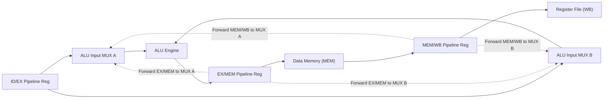
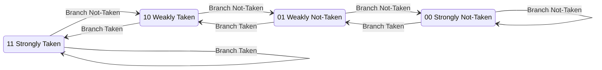

# Module 17: Pipelining Fundamentals & Pipeline Hazards

> [!info] Document Metadata
> - **Course:** `=this.course`
> - **Topic:** `=this.topic`
> - **Status:** `=this.status`

**Tags:** #[[Computer Science]] #[[CSARCH2]] #[[Computer Architecture]] #[[Hardware Modeling]] #[[Pipelining Fundamentals & Pipeline Hazards]]

---

## Overview

> Instruction Pipelining is the dominant microarchitectural technique used to maximize processor throughput. By partitioning instruction execution into discrete, balanced stages and overlapping their execution concurrently, pipelining allows a processor to complete approximately one instruction every clock cycle ($CPI \approx 1.0$). This module analyzes the canonical **5-Stage RISC/x86 Execution Pipeline** (IF, ID, EX, MEM, WB), establishes the mathematical derivations for **Pipeline Speedup**, and provides an exhaustive analysis of the three major pipeline bottlenecks: **Structural Hazards**, **Data Hazards** (RAW, WAR, WAW with Forwarding and Load-Use stalls), and **Control Hazards** (Branch Penalties, Dynamic 2-Bit Branch Prediction, and Branch Target Buffers).

## Key Definitions

- **Instruction Pipelining:** An execution technique where multiple machine instructions are overlapped in execution across successive hardware pipeline stages, analogous to an industrial manufacturing assembly line.
- **Pipeline Stage / Segment:** A discrete hardware sub-unit that performs a specific phase of instruction processing within one clock cycle period.
- **Pipeline Registers (Latches):** High-speed flip-flop arrays placed between adjacent pipeline stages (IF/ID, ID/EX, EX/MEM, MEM/WB) that capture and isolate intermediate results on each clock edge.
- **Throughput:** The number of instructions completed per unit time, maximized in an ideal $k$-stage pipeline to $1 / \tau$ instructions per second.
- **Structural Hazard:** A hardware resource conflict occurring when two or more concurrent pipeline stages attempt to access the exact same physical resource simultaneously.
- **Data Hazard:** A condition where an instruction cannot proceed because its required operand has not yet been written back by a preceding in-flight instruction.
- **Read-After-Write (RAW) / True Dependency:** A data hazard occurring when instruction $j$ attempts to read a register before preceding instruction $i$ writes its updated value.
- **Data Forwarding / Bypassing:** An architectural optimization where computed ALU results are routed directly from downstream pipeline registers (EX/MEM or MEM/WB) back to the ALU input multiplexers, eliminating pipeline stalls.
- **Control (Branch) Hazard:** A delay in instruction throughput caused by conditional or unconditional branch instructions that alter the Program Counter ($PC$).
- **Pipeline Stall (Bubble):** An idle clock cycle inserted into a pipeline stage that propagates downstream as a `NOP` (No-Operation), resolving hazard dependencies at the cost of execution throughput.

## Theoretical Framework / Core Concepts

### 1. The Classic 5-Stage RISC Datapath Pipeline

The canonical 5-stage pipeline partitions instruction execution into five synchronized phases:

```mermaid
flowchart LR
    subgraph S1["Stage 1: IF"]
        IF["Instruction Fetch (I-Cache)"]
    end
    subgraph R1["IF/ID"]
        L1["Pipeline Reg"]
    end
    subgraph S2["Stage 2: ID"]
        ID["Decode & Reg Read"]
    end
    subgraph R2["ID/EX"]
        L2["Pipeline Reg"]
    end
    subgraph S3["Stage 3: EX"]
        EX["ALU Execution / Addr Calc"]
    end
    subgraph R3["EX/MEM"]
        L3["Pipeline Reg"]
    end
    subgraph S4["Stage 4: MEM"]
        MEM["Memory Access (D-Cache)"]
    end
    subgraph R4["MEM/WB"]
        L4["Pipeline Reg"]
    end
    subgraph S5["Stage 5: WB"]
        WB["Register Write-Back"]
    end

    S1 --> R1 --> S2 --> R2 --> S3 --> R3 --> S4 --> R4 --> S5
```



#### Detailed Operations per Stage:
1. **IF (Instruction Fetch):**
   - Fetch the instruction from the L1 Instruction Cache (I-Cache) using the current Program Counter: $\text{Instruction} \leftarrow \text{Memory}[PC]$.
   - Increment the Program Counter: $PC \leftarrow PC + 4$.
2. **ID (Instruction Decode & Register Fetch):**
   - Decode the opcode field and control signals.
   - Read source operands from the Register File: $A \leftarrow \text{Reg}[Rs], B \leftarrow \text{Reg}[Rt]$.
   - Sign-extend the immediate offset field to 32/64 bits.
3. **EX (Execute / ALU / Address Calculation):**
   - Perform ALU arithmetic/logical operations ($A \text{ op } B$) or compute memory Effective Address ($EA = A + \text{SignExtImm}$).
   - Evaluate branch conditions for conditional jumps.
4. **MEM (Memory Access):**
   - For `LOAD` instructions: Read data word from L1 Data Cache (D-Cache): $\text{Data} \leftarrow \text{Memory}[EA]$.
   - For `STORE` instructions: Write data word into L1 D-Cache: $\text{Memory}[EA] \leftarrow B$.
5. **WB (Write-Back):**
   - Write the ALU result or memory loaded data back into the destination register in the Register File: $\text{Reg}[Rd] \leftarrow \text{Result}$.

### 2. Pipeline Speedup and Performance Metrics

Let:
- $k =$ Number of pipeline stages (e.g., $k = 5$).
- $n =$ Total number of instructions executed.
- $\tau =$ Clock cycle time of the pipelined processor, defined by the slowest stage plus latch overhead:
  $$\tau = \max(\tau_1, \tau_2, \dots, \tau_k) + d_{\text{latch}}$$

```text
Timing Progression for n Instructions in a k-Stage Pipeline:
Clock Cycle:   1    2    3    4    5    6    7    8    9
Inst 1:       [IF] [ID] [EX] [MEM][WB]
Inst 2:            [IF] [ID] [EX] [MEM][WB]
Inst 3:                 [IF] [ID] [EX] [MEM][WB]
Inst 4:                      [IF] [ID] [EX] [MEM][WB]
Inst 5:                           [IF] [ID] [EX] [MEM][WB]
              |<--- k cycles --->|
              |<----------------- (k + n - 1) cycles -------------->|
```

- **Non-Pipelined Execution Time:**
  $$T_{\text{non-pipe}} = n \times (k \cdot \tau)$$
- **Pipelined Execution Time:**
  $$T_{\text{pipe}} = (k + n - 1) \times \tau$$
- **Ideal Theoretical Speedup ($S_k$):**
  $$S_k = \frac{T_{\text{non-pipe}}}{T_{\text{pipe}}} = \frac{n \cdot k \cdot \tau}{(k + n - 1) \cdot \tau} = \frac{n \cdot k}{k + n - 1}$$

As $n \to \infty$ (large programs):
$$\lim_{n \to \infty} S_k = k$$

An ideal $k$-stage pipeline achieves a maximum speedup of $k\times$ over a non-pipelined processor, yielding an ideal $CPI = 1.0$.

### 3. Structural Hazards and Mitigations

```text
Structural Conflict Scenario (Unified Memory):
Cycle:           1      2      3      4      5
Inst 1 (LOAD):  [IF]   [ID]   [EX]  [MEM]   [WB]  <--- Accesses Unified Memory in MEM stage
Inst 4 (FETCH):               [IF]   [ID]   ...   <--- Attempts to FETCH from SAME Memory!
                               ^
                          [CONFLICT!]
```

- **Mitigation: Split L1 Caches (Modified Harvard Architecture):** Modern processors implement physically isolated **L1 Instruction Cache (I-Cache)** and **L1 Data Cache (D-Cache)** on the processor die. Stage 1 (IF) accesses I-Cache simultaneously while Stage 4 (MEM) accesses D-Cache without conflict.

### 4. Data Hazards and Forwarding (Bypassing)

Data dependencies occur when an instruction references a register modified by a preceding instruction:

```text
RAW Data Hazard Example:
Inst 1: ADD R1, R2, R3      ; Writes result to R1 in WB stage (Cycle 5)
Inst 2: SUB R4, R1, R5      ; Reads R1 in ID stage (Cycle 2) -- STALE VALUE!
```



- **EX-to-EX Forwarding:** The result generated by the ALU in Stage 3 is forwarded from the `EX/MEM` register directly back to the ALU input for the immediately following instruction.
- **MEM-to-EX Forwarding:** The result from two instructions prior is forwarded from the `MEM/WB` register back to the ALU input.

#### The Load-Use Data Hazard & Inevitable Stall:
When an instruction depends directly on a `LOAD`:
```text
Inst 1: LW  R1, 0(R2)      ; Data only becomes available at END of MEM (Cycle 4)
Inst 2: ADD R3, R1, R4      ; Needs R1 at START of EX (Cycle 3) -- Cannot forward back in time!
```

```text
Load-Use Hazard with 1-Cycle Stall (Bubble):
Cycle:        1     2     3     4     5     6     7
LW R1, 0(R2):[IF]  [ID]  [EX]  [MEM] [WB]
ADD R3, R1..:      [IF]  [ID]  [STALL][EX]  [MEM] [WB]  <-- 1 Bubble inserted
                                       ^
                                       +--- Forwarded from MEM/WB to EX
```

- **Hardware Mitigation:** The **Hazard Detection Unit** inserts a 1-cycle bubble into the pipeline, stalling the `ADD` in ID stage and holding the Program Counter.
- **Software Mitigation (Compiler Scheduling):** Compilers reorder independent instructions between the `LW` and the dependent instruction to fill the load-delay slot.

### 5. Control Hazards and Branch Prediction

When a branch instruction is fetched in Stage 1 (IF), the CPU does not know if the branch is taken or the branch target address until Stage 2 (ID) or Stage 3 (EX).

```text
Branch Penalty (2 Stalls if resolved in EX):
Cycle:        1     2     3     4     5     6
BEQ Target:  [IF]  [ID]  [EX]  [MEM] [WB]
Inst 2:            [IF]  [FLUSH] (Squashed)
Inst 3:                  [IF]  [FLUSH] (Squashed)
Target Inst:                   [IF]  [ID]  [EX]  ...
```

#### Branch Hazard Mitigations:
1. **Static Branch Prediction:**
   - **Predict-Not-Taken:** Always fetch $PC+4$. If branch is taken, flush pipeline (1 to 2 penalty cycles).
   - **Predict-Taken:** Used for backward loops (which are taken $> 90\%$ of the time).
2. **Dynamic 2-Bit Saturating Branch Predictor:**
   - Uses a 2-bit state machine that requires **two consecutive mispredictions** to change its prediction policy, preventing thrashing on loop exit boundaries.



3. **Branch Target Buffer (BTB):** An on-chip cache indexed by $PC$ that stores the predicted target address and branch direction, allowing the IF stage to fetch the branch target in cycle 2 without stalling.

## Worked Examples / Calculations / Hardware Traces

### Example 1: Pipeline Execution Trace with Forwarding and Stalls

**Problem:** Consider the execution of the following sequence of instructions on a 5-stage pipeline equipped with full ALU-to-ALU data forwarding:

```text
I1: LW   R1, 40(R6)
I2: ADD  R2, R1, R7
I3: SUB  R3, R1, R8
I4: OR   R4, R2, R5
```

Show the cycle-by-cycle pipeline reservation table, indicate where data forwarding occurs, and calculate the total number of clock cycles to complete all 4 instructions.

**Solution:**

```text
Instruction     | 1  | 2  | 3  | 4  | 5  | 6  | 7  | 8  | 9  | Notes
----------------+----+----+----+----+----+----+----+----+----+-------------------------------------
I1: LW  R1..    | IF | ID | EX |MEM | WB |    |    |    |    | R1 available at end of MEM (Cycle 4)
I2: ADD R2,R1.. |    | IF | ID | ST | EX |MEM | WB |    |    | Load-use hazard on R1 -> 1 Stall
I3: SUB R3,R1.. |    |    | IF | IF | ID | EX |MEM | WB |    | Stalled in IF; forwards R1 from MEM/WB
I4: OR  R4,R2.. |    |    |    |    | IF | ID | EX |MEM | WB | Forwards R2 from I2's EX/MEM (Cycle 6)
```

- **Detailed Step Analysis:**
  - `I2 (ADD)` depends on `I1 (LW)` for `R1`. A load-use hazard is detected $\implies$ 1-cycle stall inserted at Cycle 4.
  - In Cycle 5, data is forwarded from `I1`'s `MEM/WB` register into `I2`'s `EX` stage.
  - `I3 (SUB)` reads `R1`. Since `I1` has completed `MEM`, `R1` is forwarded from `MEM/WB` into `I3`'s `EX` stage in Cycle 6.
  - `I4 (OR)` depends on `I2` for `R2`. `R2` is forwarded from `I2`'s `EX/MEM` register directly into `I4`'s `EX` stage in Cycle 7.
- **Total Execution Time:** Exactly **9 clock cycles** to complete all 4 instructions.

### Example 2: Pipeline Speedup Calculation with Hazard Stalls

**Problem:** A $1.8\text{ GHz}$ 5-stage pipelined processor executes a program of $10^6$ instructions. The instruction mix exhibits:
- $20\%$ of instructions are `LOAD` instructions, and $50\%$ of these are immediately followed by a dependent instruction requiring a 1-cycle stall.
- $15\%$ of instructions are conditional branches, of which $60\%$ are taken. The processor uses a Predict-Not-Taken policy where mispredicted branches incur a 2-cycle branch penalty.
- Remaining instructions execute with ideal $CPI = 1$.

Calculate:
1. The average CPI of the processor on this workload.
2. The total program execution time.
3. The effective speedup compared to an unpipelined single-cycle processor running at $400\text{ MHz}$.

**Solution:**
1. **Average CPI:**
   $$CPI_{\text{base}} = 1.0$$
   $$\text{Stalls from Load-Use} = 0.20 \times 0.50 \times 1\text{ stall} = 0.10\text{ cycles/instruction}$$
   $$\text{Stalls from Branch Misprediction} = 0.15 \times 0.60 \times 2\text{ stalls} = 0.18\text{ cycles/instruction}$$
   $$CPI_{\text{avg}} = 1.0 + 0.10 + 0.18 = 1.28\text{ cycles/instruction}$$

2. **Total Execution Time:**
   $$T_{\text{exec}} = \frac{I \times CPI_{\text{avg}}}{f} = \frac{(10^6) \times 1.28}{1.8 \times 10^9\text{ Hz}} = \frac{1.28 \times 10^6}{1.8 \times 10^9} \approx 0.000711\text{ seconds} = 711.11\ \mu\text{s}$$

3. **Speedup over Unpipelined CPU:**
   - Unpipelined CPU: $CPI = 1.0$, $f = 400\text{ MHz}$.
   $$T_{\text{unpiped}} = \frac{10^6 \times 1.0}{400 \times 10^6\text{ Hz}} = 0.0025\text{ seconds} = 2,500\ \mu\text{s}$$
   $$\text{Speedup } S = \frac{T_{\text{unpiped}}}{T_{\text{exec}}} = \frac{2,500\ \mu\text{s}}{711.11\ \mu\text{s}} \approx 3.516\times$$

## Complexity Analysis / Common Pitfalls

- **Assuming Forwarding Eliminates All Data Stalls:** A widespread misconception is that hardware forwarding eliminates all data hazards. When an instruction immediately consumes data from a preceding `LOAD` instruction, forwarding cannot travel backward in time; exactly one hardware stall (bubble) is mandatory.
- **Structural Hazard Ignorance in Unified Caches:** Forgetting that pipelining requires simultaneous instruction fetching (IF) and memory operand transfers (MEM) leads to severe performance degradation if separate I/D caches are omitted.
- **Branch Delay Slot Off-by-One in Compilers:** In older MIPS architectures with architectural branch delay slots, compilers must ensure that the instruction in the delay slot is safe to execute regardless of whether the branch is taken or not.

## Multiple Choice Questions

1. In a classic 5-stage RISC pipeline, what are the five sequential stages in order of execution?
    - **A)** Fetch, Decode, Memory, Execute, Write-Back
    - **B)** Instruction Fetch (IF), Instruction Decode (ID), Execute (EX), Memory Access (MEM), Write-Back (WB)
    - **C)** Decode, Fetch, ALU, Store, Clear
    - **D)** Load, Translate, Branch, Execute, Halt

2. What hazard occurs when an instruction attempts to use the data loaded by an immediately preceding `LOAD` instruction?
    - **A)** Load-Use Data Hazard
    - **B)** Structural Hazard
    - **C)** Write-After-Write Hazard
    - **D)** Page Fault Hazard

3. How does Hardware Data Forwarding (Bypassing) resolve a Read-After-Write (RAW) hazard between consecutive ALU instructions?
    - **A)** By pausing the processor for 3 clock cycles
    - **B)** By spilling all registers to the external hard drive
    - **C)** By routing the computed result directly from the EX/MEM pipeline register back into the ALU input multiplexer before the result is written to the register file
    - **D)** By executing both instructions in parallel using two separate ALUs

4. What is the ideal theoretical speedup of an instruction pipeline with $k$ balanced stages as the number of instructions $n \to \infty$?
    - **A)** $1\times$
    - **B)** $k / 2$
    - **C)** $k^2$
    - **D)** $k\times$

5. Why does a 2-bit saturating dynamic branch predictor perform better on loop exit boundaries than a 1-bit predictor?
    - **A)** It uses floating-point hardware to predict addresses
    - **B)** It requires two consecutive mispredictions to change its prediction state, preventing an isolated loop termination from flipping the predictor to Not-Taken
    - **C)** It stores the entire loop body inside the instruction register
    - **D)** It eliminates the need for an Instruction Fetch stage

### Answer Key & Explanations

1. **B**. The canonical 5-stage RISC pipeline order is: Instruction Fetch (IF), Instruction Decode & Register Read (ID), Execute / ALU (EX), Memory Access (MEM), and Write-Back (WB).
2. **A**. A Load-Use hazard occurs because loaded memory data only becomes available at the end of the MEM stage (Stage 4), while the subsequent instruction requires the operand at the beginning of the EX stage (Stage 3), necessitating a 1-cycle stall.
3. **C**. Data forwarding bypasses the slow write-back to the register file by routing the newly computed ALU value directly from the `EX/MEM` or `MEM/WB` intermediate pipeline registers back to the ALU input MUX.
4. **D**. As the number of instructions $n$ becomes very large, the speedup formula $S_k = \frac{n \cdot k}{k + n - 1}$ asymptotically approaches $k\times$.
5. **B**. A 1-bit predictor flips immediately upon a single loop exit, causing a guaranteed misprediction on the very next iteration. The 2-bit counter has hysteresis and requires two consecutive mispredictions before switching states.

## References & Navigation

- **Previous Topic:** [[Module 16 - I/O Organization & Interrupt Handling]]
- **Next Topic:** [[[REV] CSARCH2 Comprehensive Reviewer and Practice Exam]]
- **Related Notes:** [[Functional Units & Performance Fundamentals]], [[Processing Unit Organization & Single-Bus Datapath]]
