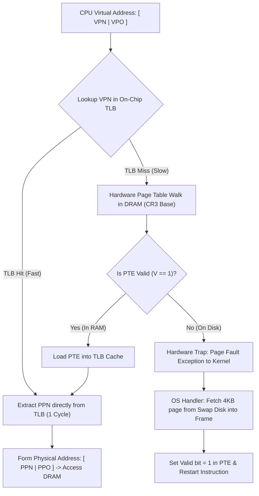

# Module 15: Virtual Memory & Address Translation (Paging & TLB)

> [!info] Document Metadata
> - **Course:** `=this.course`
> - **Topic:** `=this.topic`
> - **Status:** `=this.status`

**Tags:** #[[Computer Science]] #[[CSARCH2]] #[[Computer Architecture]] #[[Hardware Modeling]] #[[Virtual Memory & Address Translation (Paging & TLB)]]

---

## Overview

> Virtual Memory is an architectural abstraction that decouples a program's logical address space from physical semiconductor DRAM. Managed cooperatively by the CPU's **Memory Management Unit (MMU)** and the operating system kernel, virtual memory provides complete process memory isolation, uniform memory mapping, and allows systems to execute programs whose memory footprint exceeds physical RAM by transparently swapping blocks to secondary storage. This module analyzes the mathematical mechanics of **Paging**, the structure of **Multi-Level Page Tables**, high-speed address translation caching via the **Translation Lookaside Buffer (TLB)**, and the exact hardware-software sequence of **Page Faults**.

## Key Definitions

- **Virtual Address (VA):** The logical memory address generated by CPU instructions during program execution.
- **Physical Address (PA):** The actual electrical address driven onto the motherboard memory bus to access a specific physical DRAM byte.
- **Page:** A contiguous, fixed-size block of virtual address space (typically $4\text{ KiB} = 4,096\text{ bytes}$ or $2\text{ MiB}$ huge pages).
- **Page Frame:** A contiguous block of physical DRAM memory matching the exact size of a virtual page.
- **Memory Management Unit (MMU):** The dedicated hardware unit within the CPU die that intercepts virtual addresses and dynamically translates them into physical addresses.
- **Page Table Entry (PTE):** A record stored in memory mapping a Virtual Page Number ($VPN$) to a Physical Page Number ($PPN$), along with status bits (Valid, Dirty, Reference, Access Rights).
- **Translation Lookaside Buffer (TLB):** A specialized, high-speed associative hardware cache inside the MMU that stores recently used Page Table Entries to accelerate address translation.
- **Page Fault:** A hardware interrupt/exception triggered when an instruction references a virtual page whose Page Table Entry has its Valid bit cleared ($V=0$), indicating the page resides on secondary disk storage rather than physical RAM.

## Theoretical Framework / Core Concepts

### 1. Paging Architecture and Address Structure

Virtual memory partitions addresses into a **Page Number** and a **Page Offset**:

```text
Virtual Address Space:                       Physical Memory (DRAM):
+---------------------+-------------+       +---------------------+-------------+
| Virtual Page Number | Page Offset |       | Physical Page Number| Page Offset |
|       (VPN)         |    (VPO)    |       |        (PPN)        |    (PPO)    |
+---------------------+-------------+       +---------------------+-------------+
       n - p bits          p bits                  m - p bits          p bits
```

- **Offset Invariant:** The low-order $p$ bits representing the offset within the page are identical in both virtual and physical addresses ($VPO = PPO$).
- **Page Size Formulation:**
  $$\text{Page Size } P = 2^p \quad (\text{e.g., } P = 4\text{ KiB} = 4096\text{ B} \implies p = 12\text{ bits})$$

```text
Address Translation Mechanics:
Virtual Address: [   VPN   |   VPO   ]
                      |         |
                      v         |
             +----------------+ |
             |   PAGE TABLE   | |
             | VPN -> PPN Map | |
             +----------------+ |
                      |         |
                      v         v
Physical Address:[   PPN   |   PPO   ]
```

### 2. Page Table Entry (PTE) Anatomy

A standard 32-bit or 64-bit Page Table Entry contains both the translated frame base address and status/protection flags:

```text
+---+---+---+---+-----+-----+-----------------------------------------------+
| V | D | R | U | R/W | X/D |          Physical Page Number (PPN)           |
+---+---+---+---+-----+-----+-----------------------------------------------+
```

- **Valid Bit ($V$):** $1 =$ Page is resident in physical DRAM; $0 =$ Page is on disk (access triggers Page Fault).
- **Dirty Bit ($D$):** $1 =$ Page was modified by a write; must be written back to disk swap space when evicted.
- **Reference / Access Bit ($R$):** Set to $1$ whenever the page is read or written; used by OS page replacement algorithms (e.g., Clock / Second-Chance algorithm).
- **User / Supervisor ($U$):** $1 =$ User-mode accessible; $0 =$ Ring 0 Kernel supervisor only.
- **Read / Write ($R/W$):** $1 =$ Read and Write allowed; $0 =$ Read-only.
- **Execute Disable ($XD$ / $NX$):** $1 =$ Data-only page (prevents buffer-overflow code injection attacks).

### 3. Hierarchical (Multi-Level) Page Tables

In a 32-bit flat paging system with $4\text{ KiB}$ pages, each process requires:
$$\text{Total Pages} = \frac{2^{32}}{2^{12}} = 2^{20} = 1,048,576\text{ pages}$$
$$\text{Page Table Size} = 1,048,576 \times 4\text{ bytes/PTE} = 4\text{ MiB per process!}$$

To avoid wasting 4 MiB of DRAM for sparsely allocated processes, **Two-Level Paging** divides the VPN into a **Page Directory Index** and a **Page Table Index**:

```text
Two-Level Address Partitioning (32-bit Virtual Address):
+--------------------------+--------------------------+-------------------------+
| Page Directory Idx (10b) |  Page Table Idx (10b)    |    Page Offset (12b)    |
+--------------------------+--------------------------+-------------------------+
            |                          |                           |
            v                          v                           |
     [Page Directory]          [Page Table Page]                   |
     (Points to Table)         (Points to PPN)                     |
            |                          |                           |
            +--------------------------+                           v
                                                     [ Physical Memory Byte ]
```

- **Memory Saving:** Unallocated regions of virtual memory do not need physical Page Table Pages; only the 4 KiB root Page Directory must always be resident in DRAM.

### 4. Translation Lookaside Buffer (TLB) and MMU Operation

Because multi-level paging requires 2 to 4 sequential memory reads just to translate a single address, the MMU integrates a **Translation Lookaside Buffer (TLB)**:



### 5. Page Fault Handling Sequence

When the MMU detects $V = 0$ during a page table walk:
1. **Trap to Kernel:** CPU halts current instruction execution, saves register state, and jumps to the OS **Page Fault Handler** interrupt vector.
2. **Disk Location Lookup:** OS examines the process's Virtual Memory Area (VMA) structures to locate the missing page on the disk backing file or swap partition.
3. **Physical Frame Allocation:** OS selects a free physical DRAM page frame. If all frames are occupied, a page replacement algorithm (e.g., LRU/Clock) selects a victim frame, writing it back to disk if $D=1$.
4. **DMA Transfer:** OS initiates a Direct Memory Access (DMA) transfer to read the page from disk into the allocated physical frame. The faulting process is placed in a **Blocked / Waiting** state while other processes execute.
5. **Update PTE:** Upon I/O completion, OS updates the PTE with the new $PPN$, sets $V=1$, and updates the TLB.
6. **Instruction Restart:** The CPU scheduler restores the faulting process and **re-executes the exact instruction** that caused the page fault.

## Worked Examples / Calculations / Hardware Traces

### Example 1: Effective Memory Access Time (EMAT) with TLB

**Problem:** A virtual memory system has the following performance characteristics:
- TLB Access Time $= 1\text{ ns}$
- Physical DRAM Access Time $= 60\text{ ns}$
- TLB Hit Rate $= 98\%$
- The system uses a Two-Level Page Table (each page table walk requires 2 DRAM memory accesses on a TLB miss).
- Page Fault Rate $= 0.001\%$ ($1 \times 10^{-5}$), with an average Page Fault Service Penalty of $8\text{ ms}$ ($8 \times 10^6\text{ ns}$).

Calculate the Effective Memory Access Time ($EMAT$).

**Solution:**
$$\text{Translation Time on TLB Hit} = t_{\text{TLB}} = 1\text{ ns}$$
$$\text{Translation Time on TLB Miss (No Fault)} = t_{\text{TLB}} + (2 \times t_{\text{DRAM}}) = 1 + (2 \times 60) = 121\text{ ns}$$

1. **Effective Address Translation Time ($T_{\text{trans}}$):**
   $$T_{\text{trans}} = (0.98 \times 1\text{ ns}) + (0.02 \times 121\text{ ns}) = 0.98 + 2.42 = 3.40\text{ ns}$$

2. **Combined EMAT including Page Faults and Data Access:**
   $$\text{Memory Access Latency} = t_{\text{DRAM}} = 60\text{ ns}$$
   $$\text{Fault Overhead} = P_{\text{fault}} \times \text{Penalty} = (10^{-5}) \times (8 \times 10^6\text{ ns}) = 80\text{ ns}$$
   $$EMAT = T_{\text{trans}} + t_{\text{DRAM}} + \text{Fault Overhead} = 3.40\text{ ns} + 60\text{ ns} + 80\text{ ns} = 143.40\text{ ns}$$

### Example 2: Multi-Level Virtual Address Bit Partitioning

**Problem:** A 48-bit virtual address architecture (x86-64 canonical) uses 4-level paging with $4\text{ KiB}$ page sizes ($P = 2^{12}$). Each Page Table Entry is 8 bytes ($2^3\text{ bytes}$).
1. Calculate the number of bits in the Page Offset ($VPO$).
2. Calculate the number of PTEs that fit inside a single 4 KiB Page Table Page.
3. Determine how the remaining VPN bits are partitioned across the 4 page table levels (PML4, PDPT, PD, PT).

**Solution:**
1. **Page Offset Bits:**
   $$p = \log_2(4096) = 12\text{ bits}$$
2. **PTEs per Page Table Page:**
   $$\text{Entries per Page} = \frac{4096\text{ bytes}}{8\text{ bytes/entry}} = 512\text{ entries} = 2^9 \implies 9\text{ bits per level}$$
3. **Partitioning the 48-bit Virtual Address:**
   - Remaining Virtual Page Number bits $= 48 - 12 = 36\text{ bits}$.
   - Partitioned equally across 4 levels: $\frac{36\text{ bits}}{4\text{ levels}} = 9\text{ bits per level}$.
   $$\text{Virtual Address} = [\text{PML4: 9b} \mid \text{PDPT: 9b} \mid \text{PD: 9b} \mid \text{PT: 9b} \mid \text{Offset: 12b}]$$

## Complexity Analysis / Common Pitfalls

- **Confusing Page Size with Page Table Size:** Students often confuse the fixed physical size of an individual page (e.g., $4\text{ KiB}$) with the total memory consumed by the entire page table data structure.
- **Virtual Page Offset Modification Mistake:** Inexperienced engineers sometimes attempt to translate or alter the offset bits during address translation. The Page Offset ($VPO$) is passed directly and unmodified to become the Physical Page Offset ($PPO$).
- **Instruction Restartability Requirements:** Because a page fault can occur in the middle of executing a complex CISC instruction (e.g., `MOV [EAX], [EBX]` where the destination page is not present), the CPU must be capable of rolling back all partially modified internal registers to restore the pre-instruction state before taking the fault trap.

## Multiple Choice Questions

1. In a virtual memory system with 32-bit virtual addresses and a $4\text{ KiB}$ page size, how many bits are used for the Virtual Page Number (VPN) and the Page Offset?
    - **A)** VPN: 10 bits, Offset: 22 bits
    - **B)** VPN: 20 bits, Offset: 12 bits
    - **C)** VPN: 16 bits, Offset: 16 bits
    - **D)** VPN: 24 bits, Offset: 8 bits

2. What hardware component within the CPU is responsible for translating virtual addresses into physical memory addresses?
    - **A)** Arithmetic Logic Unit (ALU)
    - **B)** Control Store ROM
    - **C)** Memory Management Unit (MMU)
    - **D)** Direct Memory Access Controller (DMAC)

3. What condition triggers a hardware Page Fault exception?
    - **A)** The TLB experiences a parity check error
    - **B)** The CPU attempts to access a virtual page whose Page Table Entry has its Valid bit set to `0` ($V=0$)
    - **C)** The Program Counter increments past the 32-bit address boundary
    - **D)** Two threads write to the same cache block simultaneously

4. Why are Multi-Level Page Tables used in modern 64-bit operating systems?
    - **A)** To make virtual memory access faster than L1 cache
    - **B)** To drastically reduce the memory footprint required to store page tables for sparse virtual address spaces
    - **C)** To eliminate the need for a Translation Lookaside Buffer
    - **D)** To convert Little Endian data into Big Endian format

5. If the Translation Lookaside Buffer (TLB) achieves a hit, how many main memory DRAM accesses are required to perform the address translation itself?
    - **A)** 0 DRAM accesses (Translation is performed entirely on-chip in 1 clock cycle)
    - **B)** 1 DRAM access
    - **C)** 2 DRAM accesses
    - **D)** 4 DRAM accesses

### Answer Key & Explanations

1. **B**. Page size $4\text{ KiB} = 2^{12}\text{ bytes} \implies 12\text{ offset bits}$. Total virtual address is 32 bits $\implies \text{VPN} = 32 - 12 = 20\text{ bits}$.
2. **C**. The Memory Management Unit (MMU) is the dedicated hardware unit on the CPU chip that performs dynamic virtual-to-physical address translation.
3. **B**. When $V=0$ in the PTE, the referenced virtual page is not resident in physical RAM (it is on disk swap), causing the MMU to trigger a Page Fault interrupt.
4. **B**. A flat page table for a 64-bit or 32-bit address space would require gigabytes of contiguous RAM. Multi-level hierarchical trees allocate page table pages only for the memory regions currently mapped by the process.
5. **A**. On a TLB hit, the Physical Page Number is extracted directly from the on-chip TLB in $\approx 1\text{ ns}$, avoiding memory page table walks completely.

## References & Navigation

- **Previous Topic:** [[Cache Replacement Policies & Write Strategies]]
- **Next Topic:** [[Module 16 - I/O Organization & Interrupt Handling]]
- **Related Notes:** [[Memory System Organization & Hierarchy]], [[Cache Memory Principles & Mapping Architectures]]
