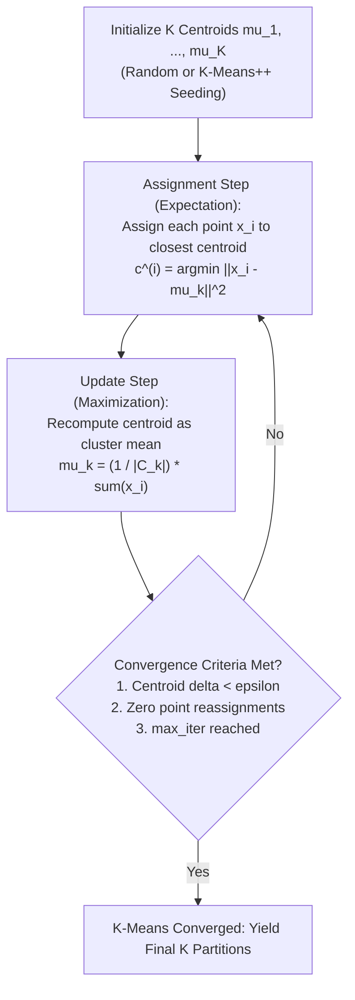
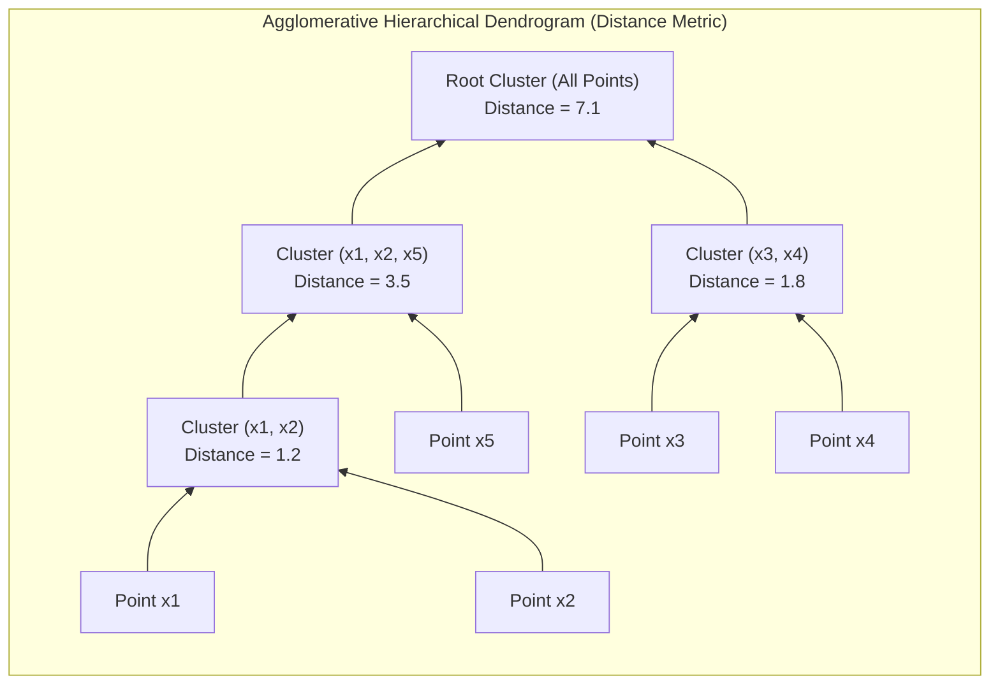
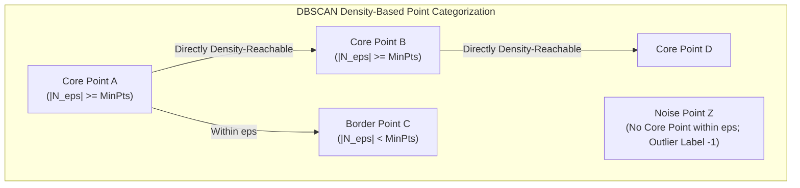

> [!info] Document Metadata
> - **Course:** `=this.course`
> - **Topic:** `=this.topic`
> - **Status:** `=this.status`

**Tags:** #[[CSMODEL]] #[[Clustering]] #[[Computer Science]] #[[Data Science]] #[[Statistical Modeling]] #[[Python]] #[[Machine Learning]]

---

# Module 12: Clustering

## Key Concepts

### 1. Introduction to Clustering & Distance Metrics
Clustering is an **unsupervised learning** technique that aims to discover the natural groupings or latent structure within a set of unlabeled data points. 

* **Goal of Clustering:** Group data points into clusters such that:
  * **Intra-cluster similarity is maximized:** Points within the same cluster are as similar (close) to each other as possible.
  * **Inter-cluster similarity is minimized:** Points in different clusters are as dissimilar (far apart) from each other as possible.
* **Key Challenges:**
  * **Curse of Dimensionality:** In high-dimensional spaces, pairwise distances between points tend to converge to the same value, making distance-based clustering ineffective without dimensionality reduction.
  * **Scalability:** Datasets often contain hundreds of features and millions of points.
  * **Cluster Geometry:** Many algorithms assume spherical clusters and fail on complex, non-convex shapes.

#### Distance Metrics
The choice of distance metric depends fundamentally on how data is represented:

1. **Euclidean Distance (Continuous Points in $\mathbb{R}^d$):**
   Used when data points are represented as coordinate vectors in continuous space.
   $$D_E(p, q) = \sqrt{\sum_{i=1}^n (q_i - p_i)^2}$$

2. **Cosine Distance & Similarity (Vectors / Directional Data):**
   Used when data is represented as high-dimensional vectors where magnitude is less important than direction (e.g., text document TF-IDF vectors, facial features).
   * **Cosine Similarity:** $S_C(A, B) = \cos(\theta) = \frac{A \cdot B}{\|A\| \|B\|} = \frac{\sum A_i B_i}{\sqrt{\sum A_i^2} \sqrt{\sum B_i^2}}$
   * **Cosine Distance:** $D_C(A, B) = 1 - S_C(A, B)$

3. **Jaccard Distance & Similarity (Sets / Binary Features):**
   Used when data is represented as sets of items (e.g., presence/absence of words in documents, customer purchase baskets).
   * **Jaccard Similarity:** $S_J(A, B) = \frac{|A \cap B|}{|A \cup B|} = \frac{|A \cap B|}{|A| + |B| - |A \cap B|}$
   * **Jaccard Distance:** $D_J(A, B) = 1 - S_J(A, B) = \frac{|A \cup B| - |A \cap B|}{|A \cup B|}$

---

### 2. K-Means Clustering (Point Assignment Algorithm)
K-Means is a **partitioning point assignment algorithm** that partitions a dataset into $K$ pre-defined, non-overlapping clusters in Euclidean space.

#### Step-by-Step Algorithm:
1. **Specify $K$:** Determine the number of clusters $K$.
2. **Initialize Centroids:** Choose $K$ initial centroids $\mu_1, \mu_2, \dots, \mu_K$.
   * *Random Initialization:* Randomly pick $K$ data points.
   * *K-Means++ Initialization:* Pick the first centroid at random, then pick each subsequent centroid from remaining points with probability proportional to their squared distance from the nearest existing centroid. This ensures initial centroids are spread far apart.
3. **Assignment Step:** Assign each data point $x_i$ to its nearest centroid based on Euclidean distance:
   $$c^{(i)} = \arg\min_{k \in \{1, \dots, K\}} \|x_i - \mu_k\|^2$$
4. **Update Step:** Recalculate each centroid as the mean of all points assigned to that cluster:
   $$\mu_k = \frac{1}{|C_k|} \sum_{i \in C_k} x_i$$
5. **Convergence:** Repeat steps 3 and 4 until convergence criteria are met:
   * No points change cluster assignment between iterations.
   * Centroid movements fall below a small tolerance $\epsilon$.
   * Maximum number of iterations (`max_iter`) is reached.



#### Inertia / Within-Cluster Sum of Squares (WCSS):
K-Means minimizes the objective function known as **Inertia** or **SSE (Sum of Squared Errors)**:
$$\text{Inertia} = \sum_{k=1}^K \sum_{i \in C_k} \|x_i - \mu_k\|^2$$

#### Choosing $K$: The Elbow Method
Because Inertia monotonically decreases as $K$ increases (reaching 0 when $K = N$), we cannot simply minimize Inertia. Instead, the **Elbow Method** runs K-Means for a range of $K$ values (e.g., $1 \dots 10$) and plots Inertia vs. $K$. The optimal $K$ is at the **"elbow" point**—the point of diminishing returns where adding more clusters yields significantly smaller reductions in Inertia.

#### Time Complexity & Characteristics:
* **Time Complexity:** $O(K \cdot N \cdot d \cdot i)$ per run, where $N$ is the number of points, $d$ is dimensions, $K$ is clusters, and $i$ is iterations.
* **Pros:** Fast, scalable, easy to understand.
* **Cons:** Requires pre-specifying $K$; sensitive to initial centroid locations (can converge to local minima); sensitive to outliers; restricted to spherical/convex clusters of similar density.

---

### 3. Hierarchical Clustering
Hierarchical clustering builds a nested tree of clusters without needing $K$ specified upfront.

#### Two Paradigms:
1. **Agglomerative (Bottom-Up):** Starts with $N$ clusters (each data point is its own cluster). At each step, it merges the two closest/most similar clusters until a single cluster containing all points remains.
2. **Divisive (Top-Down):** Starts with 1 all-inclusive cluster and recursively splits it into smaller sub-clusters.

#### Cluster Representation: Centroid vs. Clustroid
* **Euclidean Space — Centroid:** The average/mean of all data points in the cluster. Note that a centroid is a synthetic, artificial point that may not correspond to any actual data point.
* **Non-Euclidean Space — Clustroid:** In non-Euclidean spaces (where averages cannot be calculated), a cluster is represented by its **clustroid**—an **actual data point** within the cluster closest to all other points in that cluster.
  * *Definitions of "closest" point for Clustroid:*
    1. Smallest maximum distance to other points in the cluster (Minimax).
    2. Smallest average distance to other points in the cluster.
    3. Smallest sum of squared distances to other points in the cluster.

#### Linkage Criteria (Inter-Cluster Distance):
When merging two multi-point clusters $C_A$ and $C_B$, linkage defines how distance between the clusters is computed:

| Linkage Method | Formula | Description & Characteristics |
| :--- | :--- | :--- |
| **Single Linkage** (Minimum Distance) | $D(C_A, C_B) = \min_{x \in C_A, y \in C_B} d(x, y)$ | Distance between closest pair of points. Can find non-elliptical shapes; prone to **chaining effect** (long thin clusters connected by single noise points). |
| **Complete Linkage** (Maximum Distance) | $D(C_A, C_B) = \max_{x \in C_A, y \in C_B} d(x, y)$ | Distance between furthest pair of points. Creates compact, tight, spherical clusters of similar diameter; sensitive to outliers. |
| **Average Linkage** (Mean Distance) | $D(C_A, C_B) = \frac{1}{\|C_A\|\|C_B\|} \sum_{x \in C_A} \sum_{y \in C_B} d(x, y)$ | Average distance between all pairs. Robust compromise between single and complete linkage. |
| **Ward's Linkage** (Variance Minimization) | $\Delta \text{ESS} = \frac{\|C_A\|\|C_B\|}{\|C_A\| + \|C_B\|} \|\mu_A - \mu_B\|^2$ | Minimizes increase in total Within-Cluster Variance upon merging. Produces balanced, spherical clusters. Requires Euclidean distance. |

#### Dendrograms & Termination Conditions:
A **dendrogram** is a tree diagram visualizing the hierarchical merges. The vertical height of a branch represents the distance at which two clusters were merged. Cutting the dendrogram horizontally at a chosen height determines the final clusters.



* **Termination Conditions:**
  1. Stop when a predefined number of clusters $K$ is reached.
  2. Stop when the next merge would create a cluster with low **cohesion**:
     * *Diameter Limit:* Maximum distance between any two points in the merged cluster exceeds a threshold.
     * *Radius Limit:* Maximum distance of a point from the centroid/clustroid exceeds a threshold.
     * *Density Limit:* Ratio of points to diameter/radius drops below a threshold.

* **Complexity:** Naïve implementation is $O(N^3)$; optimized versions achieve $O(N^2 \log N)$ or $O(N^2)$ space/time.

---

### 4. DBSCAN (Density-Based Spatial Clustering of Applications with Noise)
DBSCAN defines clusters as **continuous dense regions of points** separated by low-density regions. It can discover arbitrary non-spherical shapes and automatically isolates noise.

#### Hyperparameters:
* $\epsilon$ (`eps`): The radius of the neighborhood around a point.
* `min_samples`: The minimum number of points required within $\epsilon$-neighborhood to form a dense region.

#### Point Categorization:
Given a dataset, DBSCAN classifies every point into one of three types:
1. **Core Point:** Has $\ge \text{min\_samples}$ within its $\epsilon$-neighborhood (including itself).
2. **Border Point:** Has $<\text{min\_samples}$ within its $\epsilon$-neighborhood, but falls within the $\epsilon$-neighborhood of a Core Point.
3. **Noise Point (Outlier):** Neither a Core Point nor a Border Point. (Assigned cluster label `-1`).



#### Density Reachability Concepts:
* **Directly Density-Reachable:** Point $p$ is directly density-reachable from point $q$ if $p \in N_\epsilon(q)$ and $q$ is a **Core Point**.
* **Density-Reachable:** Point $p$ is density-reachable from $q$ if there is a chain of core points $p_1, p_2, \dots, p_n$ with $p_1 = q$ and $p_n = p$ where each $p_{i+1}$ is directly density-reachable from $p_i$.
* **Density-Connected:** Points $p$ and $q$ are density-connected if there exists a point $o$ such that both $p$ and $q$ are density-reachable from $o$.

#### Characteristics:
* **Pros:** Does not require specifying $K$; handles arbitrary shapes (e.g. concentric rings, moons); robust to noise/outliers.
* **Cons:** Cannot handle clusters of varying densities well; sensitive to parameter tuning ($\epsilon$, `min_samples`); struggles in high-dimensional sparse data.

---

### 5. Cluster Evaluation Metrics

Evaluating clustering quality without ground truth labels uses **internal validation metrics**:

#### A. Silhouette Score
Measures how similar a point is to its own cluster compared to other clusters.
For point $i$:
$$s(i) = \frac{b(i) - a(i)}{\max(a(i), b(i))}$$
Where:
* $a(i)$ = mean distance from point $i$ to all other points in the **same** cluster (intra-cluster distance / cohesion).
* $b(i)$ = mean distance from point $i$ to all points in the **nearest neighboring** cluster (inter-cluster distance / separation).

* **Score Interpretation:**
  * $+1$: Point is far away from neighboring clusters (excellent clustering).
  * $0$: Point lies on or near the decision boundary between two clusters.
  * $-1$: Point is assigned to the wrong cluster.
  * **Overall Silhouette Score:** Mean $s(i)$ across all samples. High values indicate well-separated, dense clusters.

#### B. Davies-Bouldin Index (DBI)
Measures the average similarity ratio of each cluster with its most similar cluster:
$$DBI = \frac{1}{K} \sum_{i=1}^K \max_{j \neq i} \left( \frac{s_i + s_j}{d(c_i, c_j)} \right)$$
Where:
* $s_i$ = average distance of all points in cluster $i$ to their centroid $c_i$ (cluster dispersion).
* $d(c_i, c_j)$ = distance between centroids $c_i$ and $c_j$.

* **Interpretation:** **LOWER DBI values indicate BETTER clustering** (clusters are compact and well-separated).

---

### 6. When to Use Each Algorithm

| Scenario / Criterion | K-Means | Hierarchical (Agglomerative) | DBSCAN |
| :--- | :--- | :--- | :--- |
| **Cluster Shape** | Spherical, convex | Varies by linkage | Arbitrary non-spherical |
| **Number of Clusters $K$** | Must specify upfront | Can explore via dendrogram | Automatically determined |
| **Outlier/Noise Handling** | Poor (pulls centroids) | Sensitive (depends on linkage) | Excellent (labels noise as `-1`) |
| **Dataset Size** | Scalable to large $N$ | Small to medium $N$ ($O(N^2)$ memory) | Medium to large $N$ |
| **Distance Metric** | Euclidean only | Any metric (Ward = Euclidean) | Any distance metric |
| **Cluster Density** | Assumes uniform density | Handles varying density | Fails with varying density |

---

## Python Snippets

### 1. K-Means & The Elbow Method (`sklearn.cluster.KMeans`)
Demonstrates initializing K-Means, retrieving attributes (`inertia_`, `labels_`, `cluster_centers_`), and implementing the Elbow Method loop.

```python
import numpy as np
import matplotlib.pyplot as plt
from sklearn.cluster import KMeans
from sklearn.datasets import make_blobs

# Generate synthetic dataset (3 clusters)
X, y_true = make_blobs(n_samples=300, centers=3, cluster_std=0.60, random_state=42)

# --- 1. Basic KMeans Usage ---
kmeans = KMeans(
    n_clusters=3,        # Number of clusters K
    init='k-means++',    # Centroid initialization method ('k-means++' or 'random')
    n_init=10,           # Number of random initializations to run (selects best inertia)
    max_iter=300,        # Maximum iterations per single run
    random_state=42      # Deterministic seed
)

# Fit model and predict cluster assignments
cluster_labels = kmeans.fit_predict(X)

# Key attributes:
print("Cluster Labels:", kmeans.labels_[:5])            # Shape (N,), cluster index for each sample
print("Cluster Centroids:\n", kmeans.cluster_centers_) # Shape (K, d), coordinates of centroids
print("Inertia (WCSS):", kmeans.inertia_)               # Float, Sum of Squared Errors (SSE)

# --- 2. The Elbow Method Loop ---
inertias = []
K_range = range(1, 11)

for k in K_range:
    km = KMeans(n_clusters=k, init='k-means++', n_init=10, random_state=42)
    km.fit(X)
    inertias.append(km.inertia_)

# Plotting the Elbow Curve
plt.figure(figsize=(8, 4))
plt.plot(K_range, inertias, 'bo-')
plt.xlabel('Number of Clusters (K)')
plt.ylabel('Inertia (WCSS)')
plt.title('Elbow Method For Optimal K')
plt.grid(True)
plt.show()
```

---

### 2. Hierarchical Agglomerative Clustering & Dendrograms
Demonstrates `sklearn.cluster.AgglomerativeClustering` and generating dendrograms with `scipy.cluster.hierarchy`.

```python
import numpy as np
import matplotlib.pyplot as plt
from sklearn.cluster import AgglomerativeClustering
from scipy.cluster.hierarchy import dendrogram, linkage
from sklearn.datasets import make_blobs

# Generate sample data
X, _ = make_blobs(n_samples=50, centers=3, cluster_std=0.5, random_state=42)

# --- 1. Scipy Dendrogram & Linkage Matrix ---
# linkage methods: 'single', 'complete', 'average', 'ward'
# metric: 'euclidean', 'cityblock', 'cosine' (Note: 'ward' requires 'euclidean')
Z = linkage(X, method='ward', metric='euclidean')

plt.figure(figsize=(10, 5))
dendrogram(
    Z,
    truncate_mode=None,  # Show full tree
    color_threshold=5.0  # Height threshold for coloring clusters
)
plt.title("Hierarchical Clustering Dendrogram (Ward Linkage)")
plt.xlabel("Sample Index")
plt.ylabel("Distance / Variance Increase")
plt.axhline(y=5.0, color='r', linestyle='--', label='Cut Line (K=3)')
plt.legend()
plt.show()

# --- 2. Sklearn AgglomerativeClustering ---
agg_clustering = AgglomerativeClustering(
    n_clusters=3,        # Target K clusters
    metric='euclidean',  # Distance metric ('euclidean', 'l1', 'cosine') - note: 'affinity' in older sklearn
    linkage='ward'       # Linkage criterion ('ward', 'complete', 'average', 'single')
)

labels = agg_clustering.fit_predict(X)
print("Agglomerative Cluster Labels:\n", labels)
```

---

### 3. DBSCAN Clustering (`sklearn.cluster.DBSCAN`)
Demonstrates density-based clustering, identifying core sample indices, and handling noise points.

```python
import numpy as np
from sklearn.cluster import DBSCAN
from sklearn.datasets import make_moons

# Generate non-spherical moon-shaped dataset with noise
X, _ = make_moons(n_samples=200, noise=0.08, random_state=42)

# Initialize DBSCAN
dbscan = DBSCAN(
    eps=0.2,            # Neighborhood radius
    min_samples=5,      # Minimum samples required in eps-neighborhood for core point
    metric='euclidean'  # Distance metric
)

# Fit and predict labels (-1 represents noise points)
labels = dbscan.fit_predict(X)

# Attributes:
core_indices = dbscan.core_sample_indices_  # Indices of core points in original X array
labels_arr = dbscan.labels_                  # Cluster labels for each point

n_clusters_ = len(set(labels_arr)) - (1 if -1 in labels_arr else 0)
n_noise_ = list(labels_arr).count(-1)

print(f"Estimated number of clusters: {n_clusters_}")
print(f"Estimated number of noise points: {n_noise_}")
print(f"Total Core Points count: {len(core_indices)}")
print("First 10 point labels:", labels_arr[:10])
```

---

### 4. Cluster Evaluation Metrics (`sklearn.metrics`)
Demonstrates computing **Silhouette Score** and **Davies-Bouldin Index** to evaluate K-Means and DBSCAN outputs.

```python
import numpy as np
from sklearn.cluster import KMeans, DBSCAN
from sklearn.metrics import silhouette_score, davies_bouldin_score
from sklearn.datasets import make_blobs

# Generate data
X, _ = make_blobs(n_samples=300, centers=4, cluster_std=0.60, random_state=42)

# Fit K-Means with K=4
kmeans = KMeans(n_clusters=4, init='k-means++', n_init=10, random_state=42)
km_labels = kmeans.fit_predict(X)

# --- Evaluate K-Means ---
# Silhouette Score: Higher is better (Range: [-1, 1])
sil_km = silhouette_score(X, km_labels)

# Davies-Bouldin Index: Lower is better (Range: [0, inf))
db_km = davies_bouldin_score(X, km_labels)

print(f"K-Means (K=4) Silhouette Score: {sil_km:.4f} (Higher = Better)")
print(f"K-Means (K=4) Davies-Bouldin Index: {db_km:.4f} (Lower = Better)")

# --- Evaluating DBSCAN (Handling Noise Points) ---
dbscan = DBSCAN(eps=0.5, min_samples=5)
db_labels = dbscan.fit_predict(X)

# Filter out noise points (label == -1) before scoring if evaluating core clusters
valid_mask = db_labels != -1
if len(set(db_labels[valid_mask])) > 1:
    sil_db = silhouette_score(X[valid_mask], db_labels[valid_mask])
    db_db = davies_bouldin_score(X[valid_mask], db_labels[valid_mask])
    print(f"DBSCAN (excl. noise) Silhouette Score: {sil_db:.4f}")
    print(f"DBSCAN (excl. noise) Davies-Bouldin Index: {db_db:.4f}")
```

---

## Formulas & Key Equations

1. **Euclidean Distance:**
   $$D_E(p, q) = \sqrt{\sum_{i=1}^n (q_i - p_i)^2}$$

2. **Cosine Similarity & Distance:**
   $$S_C(A, B) = \frac{A \cdot B}{\|A\| \|B\|} = \frac{\sum_{i=1}^n A_i B_i}{\sqrt{\sum_{i=1}^n A_i^2} \sqrt{\sum_{i=1}^n B_i^2}}$$
   $$D_C(A, B) = 1 - S_C(A, B)$$

3. **Jaccard Similarity & Distance:**
   $$S_J(A, B) = \frac{|A \cap B|}{|A \cup B|}, \quad D_J(A, B) = 1 - S_J(A, B) = \frac{|A \cup B| - |A \cap B|}{|A \cup B|}$$

4. **K-Means Inertia / Within-Cluster Sum of Squares (WCSS):**
   $$\text{Inertia} = \sum_{k=1}^K \sum_{i \in C_k} \|x_i - \mu_k\|^2$$

5. **K-Means Centroid Update Rule:**
   $$\mu_k = \frac{1}{|C_k|} \sum_{x_i \in C_k} x_i$$

6. **Hierarchical Linkage Formulas:**
   * **Single Linkage:** $D(C_A, C_B) = \min_{x \in C_A, y \in C_B} d(x, y)$
   * **Complete Linkage:** $D(C_A, C_B) = \max_{x \in C_A, y \in C_B} d(x, y)$
   * **Average Linkage:** $D(C_A, C_B) = \frac{1}{|C_A||C_B|} \sum_{x \in C_A} \sum_{y \in C_B} d(x, y)$
   * **Ward Linkage Distance Increase:** $\Delta \text{ESS} = \frac{|C_A||C_B|}{|C_A| + |C_B|} \|\mu_A - \mu_B\|^2$

7. **Silhouette Coefficient (for sample $i$):**
   $$s(i) = \frac{b(i) - a(i)}{\max(a(i), b(i))}$$
   $$\text{Overall Silhouette} = \frac{1}{N} \sum_{i=1}^N s(i)$$

8. **Davies-Bouldin Index (DBI):**
   $$DBI = \frac{1}{K} \sum_{i=1}^K \max_{j \neq i} \left( \frac{s_i + s_j}{d(c_i, c_j)} \right)$$

---

## ⚠ Common Exam Traps

* **Centroid vs. Clustroid Definition:**
  * A **Centroid** is an artificial point computed as the mean of points (valid only in Euclidean space).
  * A **Clustroid** is an *actual, existing data point* from the cluster chosen to minimize distance (max, avg, or sum of squares) to all other points in that cluster (used in non-Euclidean spaces).

* **Scale Sensitivity in Distance-Based Algorithms:**
  K-Means, Agglomerative Clustering, and DBSCAN rely heavily on distance metrics. Unscaled features with large numerical ranges (e.g., Annual Income: $\$50,000$) will completely dominate features with small ranges (e.g., Age: $25$). **Always standardize features (`StandardScaler`) prior to clustering!**

* **Ward's Linkage Metric Constraint:**
  In `AgglomerativeClustering`, passing `linkage='ward'` **requires Euclidean distance**. Attempting to use Manhattan, Cosine, or Precomputed distance metrics with Ward linkage will raise a `ValueError`.

* **Misinterpreting Inertia vs. Optimal $K$:**
  Inertia strictly decreases as $K$ increases, reaching $0$ when $K = N$. Therefore, selecting $K$ by looking for the minimum Inertia is wrong. You must look for the **elbow bend** (point of inflection) or evaluate with Silhouette/DBI.

* **DBSCAN Noise Labels (`-1`) in Evaluation Metrics:**
  DBSCAN assigns noise points a label of `-1`. Passing `-1` directly into `silhouette_score(X, labels)` treats noise as a valid cluster, distorting the metric. Noise points should be filtered out when evaluating core cluster separation, or carefully interpreted.

* **DBSCAN Core vs. Border Point Conditions:**
  * Core Point: Neighborhood contains $\ge \text{min\_samples}$ (including the point itself).
  * Border Point: Neighborhood contains $<\text{min\_samples}$, but is within $\epsilon$ distance of a Core Point.
  * *Trap:* If point $A$ has 3 points in its neighborhood (`min_samples=4`) and is near Core Point $B$, $A$ is a **Border Point**, NOT a Core Point!

* **Davies-Bouldin Index vs. Silhouette Score Directionality:**
  * **Silhouette Score:** Higher is better (closer to $+1.0$).
  * **Davies-Bouldin Index:** Lower is better (closer to $0.0$).

* **Single Linkage Chaining Effect:**
  Single linkage defines inter-cluster distance as the minimum distance between any pair of points. As a result, noise points bridging two separate dense clusters cause single linkage to merge them into one long, thin "chain" cluster.

* **API Changes: `affinity` vs. `metric` in Scikit-Learn:**
  In scikit-learn version 1.2+, the parameter `affinity` in `AgglomerativeClustering` was renamed to `metric`. Using `affinity` in newer versions generates deprecation warnings or errors.

---

## Practice Questions

**Q1. (Conceptual — Distance Metrics & Cluster Representation)**
A data science team is building a document topic clustering system where documents are represented as word frequency vectors. Which distance metric and cluster representation method are most appropriate for this task? A) Euclidean Distance with Centroid B) Cosine Distance with Clustroid C) Jaccard Distance with Centroid D) Euclidean Distance with Clustroid

**Q2. (Python Code Reading — K-Means Attributes & Mechanics)**
Consider the following Python code snippet:
```python
import numpy as np
from sklearn.cluster import KMeans

X = np.array([
    [1, 2], [1, 4], [1, 0],
    [10, 2], [10, 4], [10, 0]
])

kmeans = KMeans(n_clusters=2, init=np.array([[1, 2], [10, 2]]), n_init=1, random_state=0)
kmeans.fit(X)

print(kmeans.labels_)
print(kmeans.inertia_)
```
What is the value of `kmeans.inertia_` computed after fitting? A) 0.0 B) 8.0 C) 16.0 D) 32.0

**Q3. (Python Code Reading — DBSCAN Mechanics)**
Analyze the following Python snippet:
```python
import numpy as np
from sklearn.cluster import DBSCAN

X = np.array([
    [0, 0], [0, 1], [1, 0],   # Group 1
    [5, 5],                    # Isolated point
    [10, 10], [10, 11]         # Group 2
])

db = DBSCAN(eps=1.5, min_samples=3)
labels = db.fit_predict(X)
print("Labels:", labels)
print("Core indices count:", len(db.core_sample_indices_))
```
What will be the output for `labels` and `len(db.core_sample_indices_)`? A) Labels: `[0, 0, 0, -1, 1, 1]`, Core indices count: 5 B) Labels: `[0, 0, 0, -1, -1, -1]`, Core indices count: 3 C) Labels: `[0, 0, 0, 1, 2, 2]`, Core indices count: 5 D) Labels: `[0, 0, 0, -1, 1, 1]`, Core indices count: 3

**Q4. (Calculation — Agglomerative Linkage Merging)**
Given four 1D data points $P_1 = 1$, $P_2 = 2$, $P_3 = 5$, and $P_4 = 8$:
If we perform Agglomerative Hierarchical Clustering using **Complete Linkage** with Euclidean distance, which pair of clusters/points will be merged in the **second step**? A) $\{P_1, P_2\}$ and $\{P_3\}$ B) $\{P_1, P_2\}$ and $\{P_3, P_4\}$ C) $\{P_3\}$ and $\{P_4\}$ D) $\{P_2\}$ and $\{P_3\}$

**Q5. (Conceptual — Cluster Evaluation Metrics)**
A student runs three different clustering configurations on a dataset and records the following metrics: Configuration A: Silhouette Score = 0.72, Davies-Bouldin Index = 0.45 Configuration B: Silhouette Score = 0.35, Davies-Bouldin Index = 1.20 Configuration C: Silhouette Score = 0.70, Davies-Bouldin Index = 0.85

Which configuration represents the best clustering result and why? A) Configuration B, because it has the highest Davies-Bouldin Index. B) Configuration C, because Silhouette Score and Davies-Bouldin Index balance out. C) Configuration A, because it has the highest Silhouette Score and the lowest Davies-Bouldin Index. D) Configuration A, because Silhouette Score and Davies-Bouldin Index should both be maximized.

---

### Answer Key

* **Q1: B** — Document word frequency spaces are non-Euclidean high-dimensional vector spaces where vector direction matters more than magnitude (Cosine Distance). In non-Euclidean spaces, averages/centroids cannot be formed synthetically, so an actual existing document point must be used as the cluster representative (Clustroid).
* **Q2: C** — Points $[1, 2], [1, 4], [1, 0]$ are assigned to Centroid 1 $[1, 2]$. Squared distances to Centroid 1: $(1-1)^2+(2-2)^2 = 0$, $(1-1)^2+(4-2)^2 = 4$, $(1-1)^2+(0-2)^2 = 4$. Sum = 8. Points $[10, 2], [10, 4], [10, 0]$ are assigned to Centroid 2 $[10, 2]$. Squared distances to Centroid 2: $(10-10)^2+(2-2)^2 = 0$, $(10-10)^2+(4-2)^2 = 4$, $(10-10)^2+(0-2)^2 = 4$. Sum = 8. Total Inertia (WCSS) = $8 + 8 = 16.0$.
* **Q3: B** — Points $[0, 0], [0, 1], [1, 0]$ each have distance $\le 1.414 \le 1.5$ to each other, so each has 3 points in its $\epsilon$-neighborhood. Since `min_samples=3`, all 3 points are Core Points (assigned cluster `0`). Point $[5, 5]$ has only 1 point in its neighborhood (noise `-1`). Points $[10, 10], [10, 11]$ have distance 1.0 from each other, but only 2 points in their neighborhood ($< 3$). Neither is a core point nor near a core point, so both are classified as noise (`-1`). Total core points = 3.
* **Q4: C** — Initial distances: $d(P_1, P_2) = 1$, $d(P_2, P_3) = 3$, $d(P_3, P_4) = 3$. 
  * Step 1: Merge closest pair $(P_1, P_2)$ at distance 1. Cluster $C_1 = \{P_1, P_2\}$.
  * Step 2: Compute complete linkage distances from $C_1$ to remaining points:
    * $D_{complete}(C_1, P_3) = \max(d(P_1, P_3), d(P_2, P_3)) = \max(4, 3) = 4$.
    * $D_{complete}(C_1, P_4) = \max(d(P_1, P_4), d(P_2, P_4)) = \max(7, 6) = 7$.
    * $d(P_3, P_4) = 3$.
    * The minimum available distance is between $P_3$ and $P_4$ ($3 < 4$). Thus, $\{P_3\}$ and $\{P_4\}$ are merged in Step 2.
* **Q5: C** — Good clustering corresponds to **maximizing Silhouette Score** (closer to +1, indicating strong intra-cluster cohesion and inter-cluster separation) and **minimizing Davies-Bouldin Index** (closer to 0, indicating compact, well-separated clusters). Configuration A has both the highest Silhouette Score (0.72) and the lowest DBI (0.45).

## Multiple Choice Questions

1. Which distance metric is best suited for finding clusters of arbitrary shapes?
- **A)** K-Means
- **B)** DBSCAN
- **C)** Hierarchical Agglomerative
- **D)** Gaussian Mixture Models

2. What does the Silhouette Score evaluate?
- **A)** The number of clusters to choose
- **B)** The compactness and separation of clusters
- **C)** The time complexity of the clustering algorithm
- **D)** The density of the noise points

3. In K-Means clustering, what is the role of the `centroid`?
- **A)** It acts as an outlier detection threshold
- **B)** It is the mean position of all points in a cluster
- **C)** It connects the two closest points in different clusters
- **D)** It is a hyperparameter for the number of clusters

4. Which algorithm does not require the user to specify the number of clusters in advance?
- **A)** K-Means
- **B)** Mini-Batch K-Means
- **C)** DBSCAN
- **D)** Spectral Clustering

5. In hierarchical clustering, what is a dendrogram used for?
- **A)** Visualizing the feature space
- **B)** Representing the arrangement of clusters produced by the algorithm
- **C)** Evaluating the Silhouette score
- **D)** Calculating Euclidean distance

### Answer Key & Explanations
1. **B)** DBSCAN is a density-based algorithm that can find arbitrarily shaped clusters.
2. **B)** Silhouette score measures how similar an object is to its own cluster compared to other clusters.
3. **B)** The centroid is the center (mean) of a cluster.
4. **C)** DBSCAN determines clusters based on density parameters (eps and min_samples), not a predefined cluster count.
5. **B)** A dendrogram is a tree-like diagram that records the sequences of merges or splits.

## References & Navigation

- **Previous Topic:** [[Linear Programming]]
- **Next Topic:** [[Association Rule Mining]]
- **Related Notes:** [[K-Means Clustering]], [[Machine Learning Models]]
