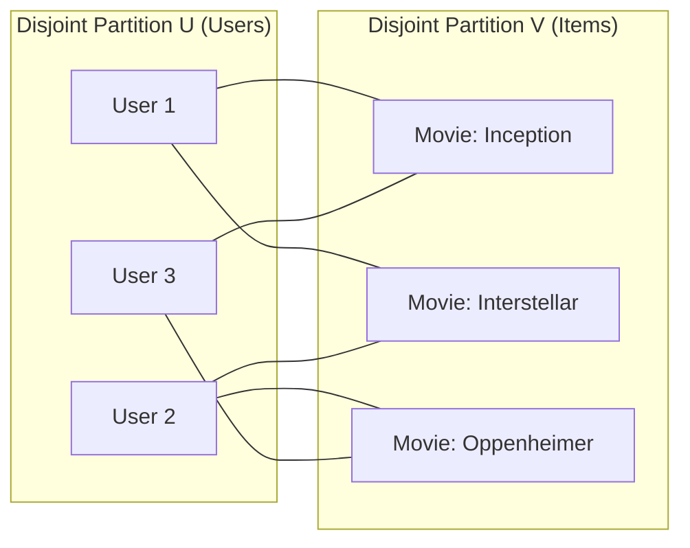
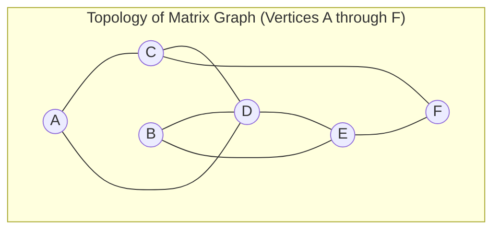

> [!info] Document Metadata
> - **Course:** `=this.course`
> - **Topic:** `=this.topic`
> - **Status:** `=this.status`

**Tags:** #[[CSMODEL]] #[[Graph Data Modelling]] #[[Computer Science]] #[[Data Science]] #[[Statistical Modeling]] #[[Python]] #[[Machine Learning]]

---

# Module 17: Graph Data Modelling

---

## Key Concepts

### 1. What is a Graph?
 A **graph** is a mathematical representation of a network — a collection of objects (**nodes/vertices**) where some pairs are connected by **links/edges**. Used as a **general language** for describing systems of interacting entities. Key vocabulary:

| Real-world term | Mathematical term |
|---|---|
| Network | Graph |
| Node / Actor | Vertex (V) |
| Link / Tie | Edge (E) |

**Types of real-world graphs:** **Natural graphs (Networks):** Social networks, brain neural connections, gene/protein interactions, communication systems. **Information graphs:** Knowledge graphs, scene graphs, similarity networks.

A graph is formally written as **G = (V, E)** where V is the set of vertices and E is the set of edges.

---

### 2. Undirected Graphs
 Edges have **no direction** — they represent a **two-way (symmetric)** relationship. Example: Facebook friendships (if A is friends with B, B is friends with A).

**Formal definition:** G = (V, E), where E = {(A, C), (A, D), (B, D), ...} Edges are **unordered pairs**: (u, v) = (v, u)

**Degree** = number of edges at a vertex.

**Key formula — Maximum edges in undirected graph:**
$$\text{Max edges} = \frac{n(n-1)}{2}$$

A graph with exactly this many edges is a **complete undirected graph** (every vertex is connected to every other vertex).

**Sum of all adjacency list lengths** = **2|E|** (each edge counted twice, once from each end).

---

### 3. Directed Graphs (Digraphs)
 Edges have a **specified direction** — they represent a **one-way (asymmetric)** relationship. Example: Twitter follows (A follows B does not mean B follows A). At most **2 directed edges** (in opposite directions) can connect two vertices. Edges are **ordered pairs**: <u, v> != <v, u>

**In-degree** = number of arrows **pointing TO** a vertex.  
**Out-degree** = number of arrows **originating FROM** a vertex.

**Key formula — Maximum edges in directed graph:**
$$\text{Max edges} = n(n-1)$$

A graph with exactly n(n-1) edges is a **complete directed graph**.

**Sum of all adjacency list lengths** = **|E|** (each edge counted once from its source).

**Example from PDF:**  
For graph G1 with vertices {A, B, C, D, E, F, G, H}: Out-degree of A = 1, Out-degree of D = 2, Out-degree of C = 3 In-degree of B = 1, In-degree of G = 2, In-degree of F = 3

---

### 4. Weighted Graphs
 Each edge has an associated **weight** (numerical value), given by a weight function:
  $$w: E \rightarrow \mathbb{R}$$ Weights can represent: distance, cost, similarity, bandwidth, strength of relationship. Can be **undirected weighted** or **directed weighted**. In the adjacency matrix: entries contain the **weight** instead of 0/1.

---

### 5. Bipartite Graphs
 A graph whose vertices can be split into **two disjoint sets** $U$ and $V$ such that **every edge connects a vertex in $U$ to a vertex in $V$** (no edges exist within $U$ or within $V$). Common in recommender systems (Users $\leftrightarrow$ Items) and affiliation networks.



---

### 6. Graph Connectivity
 A graph is **connected** if every pair of vertices has a path between them. A graph is **disconnected** if at least one pair of vertices cannot reach each other. **Connected components:** Maximal subgraphs in which all vertices are connected to each other.

---

### 7. Graph Representations

#### Adjacency List
 Array of $|V|$ lists; for each vertex $u$, the list $A[u]$ contains all vertices $v$ such that edge $(u, v) \in E$.
- **Memory:** $O(V + E)$ — preferred for **sparse graphs** ($|E| \ll |V|^2$).
- For weighted graphs: store (neighbor, weight) pairs.
- Undirected: each edge $(u, v)$ appears in BOTH $A[u]$ and $A[v]$ $\implies$ total list size = $2|E|$.
- Directed: each edge $\langle u, v \rangle$ appears only in $A[u]$ $\implies$ total list size = $|E|$.

#### Adjacency Matrix
 A $|V| \times |V|$ matrix $A$ where:
$$a_{ij} = \begin{cases} 1 & \text{if } (i, j) \in E \\ 0 & \text{otherwise} \end{cases}$$
- **Memory:** $O(V^2)$ — preferred for **dense graphs** ($|E| \approx |V|^2$).
- Undirected: matrix is symmetric ($A = A^T$).
- Directed: matrix may be asymmetric.



**Adjacency Matrix Equivalent:**
```text
    A  B  C  D  E  F
A [ 0  0  1  1  0  0 ]
B [ 0  0  0  1  1  0 ]
C [ 1  0  0  1  0  1 ]
D [ 1  1  1  0  1  0 ]
E [ 0  1  0  1  0  1 ]
F [ 0  0  1  0  1  0 ]
```

**Comparison table:**

| Property | Adjacency List | Adjacency Matrix |
|---|---|---|
| Memory | O(V + E) | O(V^2) |
| Best for | Sparse graphs | Dense graphs |
| Edge lookup | O(degree) | O(1) |
| List all neighbors | O(degree) | O(V) |

---

### 8. Graph Properties

#### Path A **path** is a sequence of vertices connected by edges, where no vertex is repeated. **Path length:** Number of edges in the path. **Shortest path:** Path with the minimum number of edges (or minimum total weight in weighted graphs).

#### Diameter The **diameter** of a graph is the **longest shortest path** between any two vertices.
$$\text{diameter}(G) = \max_{u,v \in V} d(u,v)$$ Where d(u,v) is the shortest path distance between u and v.

#### Graph Density Measures how many edges exist compared to the maximum possible.

$$\text{density (undirected)} = \frac{2|E|}{|V|(|V|-1)}$$
$$\text{density (directed)} = \frac{|E|}{|V|(|V|-1)}$$
 Range: [0, 1]. Value of 1 = complete graph. Value near 0 = sparse graph.

#### Clustering Coefficient Measures the degree to which nodes in a graph tend to **cluster together**.

**Local Clustering Coefficient** for node u:
$$C_u = \frac{\text{number of triangles through } u}{\text{number of possible triangles through } u} = \frac{2T_u}{\deg(u)(\deg(u)-1)}$$
 T_u = number of edges between neighbors of u. Ranges from 0 (no neighbors connected) to 1 (all neighbors fully connected).

**Global Clustering Coefficient (Average):**
$$\bar{C} = \frac{1}{|V|}\sum_{u \in V} C_u$$

---

### 9. Centrality Measures

Centrality answers: **"Which node is most important?"** Different definitions of "important" give different centrality measures.

#### Degree Centrality **Simplest** centrality: importance = number of direct connections.
$$C_D(v) = \frac{\deg(v)}{n-1}$$ Normalized by (n-1), where n = number of nodes. **Use:** Identify highly connected hubs (e.g., popular users on social media).

#### Betweenness Centrality Measures how often a node lies on the **shortest path** between other pairs of nodes.
$$C_B(v) = \sum_{s \neq v \neq t} \frac{\sigma_{st}(v)}{\sigma_{st}}$$ sigma_st = total number of shortest paths from s to t. sigma_st(v) = number of those paths that pass through v. Normalized version divides by (n-1)(n-2)/2 for undirected graphs. **Use:** Identify bridges/brokers in a network (e.g., critical routers, influencers bridging communities).

#### Closeness Centrality A node is important if it is **close (on average) to all other nodes**.
$$C_C(v) = \frac{n-1}{\sum_{u \neq v} d(v,u)}$$ Reciprocal of the average shortest path length to all other nodes. Higher value = more central (closer to everyone). **Use:** Identify nodes that can spread information quickly.

#### Eigenvector Centrality A node is important if it is connected to **other important nodes** (recursive definition).
$$C_E(v) = \frac{1}{\lambda} \sum_{u \in N(v)} C_E(u)$$ lambda is the largest eigenvalue of the adjacency matrix A. In matrix form: **Ax = lambda*x** — x is the eigenvector corresponding to lambda_max. **Use:** Google's PageRank is derived from eigenvector centrality.

---

### 10. PageRank
 Developed by Larry Page and Sergey Brin (Google, 1998) for ranking web pages. A node's PageRank is high if it receives links from **many** highly-ranked nodes. **Damping factor d** (typically 0.85): probability a random surfer keeps clicking links vs. jumping to a random page.

$$PR(u) = \frac{1-d}{N} + d \sum_{v \in B_u} \frac{PR(v)}{L(v)}$$
 N = total number of nodes. B_u = set of nodes that link TO u (in-neighbors). L(v) = out-degree of v (number of links from v). d = damping factor (typically 0.85). Computed **iteratively** until convergence.

**Intuition:** A random surfer starting at any page will, after many steps, visit each page with a frequency equal to its PageRank.

---

### 11. Community Detection
 Goal: Find groups of nodes (**communities**) that are **densely connected internally** and **sparsely connected externally**. Real-world use: Social group detection, protein complex identification.

**Modularity (Q):** Measures the quality of a partition.
$$Q = \frac{1}{2|E|} \sum_{ij}\left[A_{ij} - \frac{k_i k_j}{2|E|}\right]\delta(c_i, c_j)$$
 A_ij = adjacency matrix entry. k_i = degree of node i. delta(c_i, c_j) = 1 if i and j are in the same community, 0 otherwise. Q in [-1, 1]; Q > 0.3 indicates meaningful community structure.

**Common algorithms:** **Louvain Method:** Greedy optimization of modularity; very fast for large graphs. **Girvan-Newman:** Removes edges with highest betweenness iteratively. **Label Propagation:** Each node adopts the most common label of its neighbors.

---

### 12. Graph Embeddings

Graph embeddings transform a graph into a **low-dimensional continuous vector space** while preserving its topology, making graphs compatible with ML algorithms.

> **Why?** ML algorithms work on continuous numerical data. Graphs are discrete. Embeddings bridge this gap.

Each node v is mapped to a dense vector: **Phi: v in V -> R^d**

#### DeepWalk (Perozzi et al., 2014) Analogy: **Graphs are like texts**. Nodes are like words; random walks are like sentences. Uses **random walks** to generate sequences of nodes, then applies **Word2Vec (SkipGram)** to learn embeddings. Maximizes:
$$\Pr(\Phi(v_n) \mid \Phi(v_0), \Phi(v_1), \ldots, \Phi(v_{n-1}))$$ The mapping Phi: v in V -> R^(|V| x d) learns latent social representations. **Process:** Generate random walks -> treat walks as sentences -> train Word2Vec.

#### Node2Vec (Grover & Leskovec, 2016) Extends DeepWalk with a **biased random walk** controlled by parameters **p** and **q**. Introduces search bias **alpha**, which allows interpolation between BFS and DFS:

$$\pi_{vx} = \alpha_{pq}(t, x) \times w_{vx}$$

**Search Bias alpha_pq(t, x):**
$$\alpha_{pq}(t,x) = \begin{cases} 1/p & \text{if } d_{tx} = 0 \text{ (return to previous node)} \\ 1 & \text{if } d_{tx} = 1 \text{ (neighbor of previous node)} \\ 1/q & \text{if } d_{tx} = 2 \text{ (farther away)} \end{cases}$$
 **p (return parameter):** Controls likelihood of backtracking. Low p -> explore locally (BFS-like). **q (in-out parameter):** Controls exploration. Low q -> explore farther (DFS-like). **BFS:** Ideal for learning **local neighborhood** structure (structural roles). **DFS:** Ideal for learning **global structure** (community membership).

---

### 13. Graph Applications

| Application | Description |
|---|---|
| **Network Compression** | Summarize large graphs into smaller representations |
| **Clustering** | Group similar nodes together (community detection) |
| **Link Prediction** | Predict whether an edge will form between two nodes |
| **Node Classification** | Label nodes based on graph structure (semi-supervised) |
| **Recommender Systems** | User-item bipartite graphs for recommendations |
| **Knowledge Graphs** | Represent facts as entity-relation-entity triples |

---

## Python Snippets

### Creating Graphs with NetworkX

```python
import networkx as nx
import matplotlib.pyplot as plt

# --- Undirected Graph ---
G = nx.Graph()

# Add nodes individually
G.add_node("A")
G.add_node("B")
G.add_nodes_from(["C", "D", "E"])

# Add edges
G.add_edge("A", "C")
G.add_edge("A", "D")
G.add_edges_from([("B", "D"), ("B", "E"), ("C", "E")])

print("Nodes:", list(G.nodes()))     # ['A', 'B', 'C', 'D', 'E']
print("Edges:", list(G.edges()))     # [('A', 'C'), ('A', 'D'), ...]
print("Number of nodes:", G.number_of_nodes())  # 5
print("Number of edges:", G.number_of_edges())  # 5
```

### Creating Directed and Weighted Graphs

```python
import networkx as nx

# --- Directed Graph (DiGraph) ---
DG = nx.DiGraph()
DG.add_edges_from([("A", "C"), ("C", "A"), ("C", "F"), ("D", "F"), ("E", "B")])

print("In-degree of F:", DG.in_degree("F"))    # 2
print("Out-degree of C:", DG.out_degree("C"))   # 2

# --- Weighted Graph ---
WG = nx.Graph()
WG.add_edge("A", "C", weight=2)
WG.add_edge("A", "D", weight=2)
WG.add_edge("C", "D", weight=3)
WG.add_edge("C", "F", weight=5)
WG.add_edge("D", "E", weight=3)
WG.add_edge("E", "F", weight=5)

# Access weight
print(WG["C"]["F"]["weight"])  # 5
print(WG.edges(data=True))     # shows all edges with weights
```

### Graph Properties: Degree, Density, Diameter

```python
import networkx as nx

G = nx.karate_club_graph()   # famous 34-node social network

# Degree of each node
print(dict(G.degree()))

# Degree of a specific node
print(G.degree(0))

# Graph density
print(nx.density(G))         # float in [0, 1]

# Diameter (only for connected graphs)
print(nx.diameter(G))        # longest shortest path

# Average shortest path length
print(nx.average_shortest_path_length(G))

# Clustering coefficient
print(nx.clustering(G))           # dict: node -> local CC
print(nx.average_clustering(G))   # global average CC
```

### Shortest Path

```python
import networkx as nx

G = nx.Graph()
G.add_edges_from([("A","B"),("B","C"),("C","D"),("A","D"),("B","D")])

# Shortest path between two nodes
path = nx.shortest_path(G, source="A", target="C")
print(path)     # ['A', 'B', 'C'] or ['A', 'D', 'C'] — one shortest path

# Length of shortest path
length = nx.shortest_path_length(G, source="A", target="C")
print(length)   # 2

# All shortest paths between all pairs
all_paths = dict(nx.shortest_path(G))
```

### Connected Components

```python
import networkx as nx

G = nx.Graph()
G.add_edges_from([(1, 2), (2, 3)])   # Component 1
G.add_edges_from([(4, 5)])            # Component 2
G.add_node(6)                         # Isolated node -- Component 3

# Check connectivity
print(nx.is_connected(G))             # False

# Get all connected components (as sets of nodes)
components = list(nx.connected_components(G))
print(components)   # [{1, 2, 3}, {4, 5}, {6}]

# Number of components
print(nx.number_connected_components(G))  # 3

# Largest connected component
largest = max(nx.connected_components(G), key=len)
G_sub = G.subgraph(largest)
```

### Centrality Measures

```python
import networkx as nx

G = nx.karate_club_graph()

# Degree Centrality — normalized by (n-1)
deg_cent = nx.degree_centrality(G)
print(sorted(deg_cent.items(), key=lambda x: x[1], reverse=True)[:3])

# Betweenness Centrality — fraction of shortest paths through a node
bet_cent = nx.betweenness_centrality(G)
print(sorted(bet_cent.items(), key=lambda x: x[1], reverse=True)[:3])

# Closeness Centrality — reciprocal of avg shortest path to all other nodes
clo_cent = nx.closeness_centrality(G)
print(sorted(clo_cent.items(), key=lambda x: x[1], reverse=True)[:3])

# Eigenvector Centrality — importance from important neighbors
eig_cent = nx.eigenvector_centrality(G)
print(sorted(eig_cent.items(), key=lambda x: x[1], reverse=True)[:3])
```

### PageRank

```python
import networkx as nx

# PageRank requires a directed graph (DiGraph)
DG = nx.DiGraph()
DG.add_edges_from([
    ("A", "B"), ("A", "C"),
    ("B", "C"),
    ("C", "A"),
    ("D", "C")
])

# Compute PageRank (alpha = damping factor, default 0.85)
pr = nx.pagerank(DG, alpha=0.85)
print(pr)
# {'A': 0.37, 'B': 0.19, 'C': 0.39, 'D': 0.05} (approximate)

# Sort by PageRank score descending
ranked = sorted(pr.items(), key=lambda x: x[1], reverse=True)
print(ranked)  # C has highest PR due to many in-links
```

### Community Detection

```python
import networkx as nx
import networkx.algorithms.community as nx_comm

G = nx.karate_club_graph()

# Greedy Modularity — fast community detection via modularity optimization
communities = nx_comm.greedy_modularity_communities(G)
print(f"Number of communities: {len(communities)}")
for i, c in enumerate(communities):
    print(f"Community {i}: {sorted(c)}")

# Label Propagation — faster, non-deterministic
lp_communities = list(nx_comm.label_propagation_communities(G))
print(f"LP Communities: {len(lp_communities)}")

# Modularity score (higher = better separation, typically > 0.3 is meaningful)
modularity = nx_comm.modularity(G, communities)
print(f"Modularity Q: {modularity:.4f}")
```

### Graph Visualization with draw()

```python
import networkx as nx
import matplotlib.pyplot as plt
import networkx.algorithms.community as nx_comm

G = nx.karate_club_graph()

# Compute communities for color coding
communities = list(nx_comm.greedy_modularity_communities(G))
color_map = {}
for i, community in enumerate(communities):
    for node in community:
        color_map[node] = i
node_colors = [color_map[n] for n in G.nodes()]

# Choose layout
pos = nx.spring_layout(G, seed=42)   # force-directed layout

# Draw the graph
plt.figure(figsize=(10, 7))
nx.draw(
    G, pos,
    with_labels=True,          # show node labels
    node_color=node_colors,    # color by community
    cmap=plt.cm.Set1,          # colormap
    node_size=500,
    font_size=8,
    edge_color="gray"
)
plt.title("Karate Club Graph — Communities Colored")
plt.tight_layout()
plt.show()
```

### Adjacency Matrix / List Conversion

```python
import networkx as nx
import numpy as np

G = nx.Graph()
G.add_edges_from([("A","B"), ("B","C"), ("A","C")])

# Adjacency Matrix as numpy array
nodes = sorted(G.nodes())
A = nx.to_numpy_array(G, nodelist=nodes)
print(A)
# [[0. 1. 1.]
# [1. 0. 1.]
# [1. 1. 0.]]

# Adjacency List (dict of dicts)
adj_list = dict(G.adjacency())
for node, neighbors in adj_list.items():
    print(f"{node}: {list(neighbors.keys())}")

# Convert adjacency matrix back to graph
G2 = nx.from_numpy_array(A)

# Bipartite graph check
print(nx.is_bipartite(G))  # False for complete triangle
```

---

## Formulas & Key Equations

| Formula | Description |
|---|---|
| G = (V, E) | Graph definition |
| Max edges (undirected) = n(n-1)/2 | Maximum edges for n-node undirected graph |
| Max edges (directed) = n(n-1) | Maximum edges for n-node directed graph |
| Memory (adj list) = O(V+E) | Space complexity of adjacency list |
| Memory (adj matrix) = O(V^2) | Space complexity of adjacency matrix |
| density (undirected) = 2|E| / (|V|(|V|-1)) | Graph density (undirected) |
| density (directed) = |E| / (|V|(|V|-1)) | Graph density (directed) |
| C_D(v) = deg(v) / (n-1) | Degree centrality (normalized) |
| C_B(v) = sum sigma_st(v)/sigma_st | Betweenness centrality |
| C_C(v) = (n-1) / sum d(v,u) | Closeness centrality |
| Ax = lambda*x (eigenvector) | Eigenvector centrality (matrix form) |
| PR(u) = (1-d)/N + d * sum PR(v)/L(v) | PageRank formula (d = 0.85) |
| C_u = 2T_u / (deg(u)(deg(u)-1)) | Local clustering coefficient |
| Phi: v -> R^(|V| x d) | DeepWalk/Node2Vec embedding mapping |
| pi_vx = alpha_pq(t,x) * w_vx | Node2Vec transition probability |

---

## Common Exam Traps
 **Undirected max edges = n(n-1)/2, NOT n(n-1).** The n(n-1) formula is for directed graphs. Don't mix them up. **Degree in undirected vs. in/out-degree in directed.** Undirected graphs have only one "degree" per node. Directed graphs have separate in-degree and out-degree. **Adjacency matrix is symmetric only for undirected graphs.** A directed graph's matrix is generally NOT symmetric. **Adjacency list total length:** For undirected = 2|E| (each edge stored TWICE). For directed = |E| (each edge stored ONCE from its source). **Closeness centrality = RECIPROCAL of average distance.** Higher closeness = closer to all other nodes. Don't confuse with raw average distance. **Betweenness centrality counts only SHORTEST paths.** Longer paths don't count. **PageRank requires a DiGraph in NetworkX.** `nx.pagerank()` will raise an error on an undirected `nx.Graph()`. **Clustering coefficient is undefined for nodes with degree 0 or 1** (cannot form a triangle). **Graph diameter is only defined for connected graphs.** If the graph is disconnected, call `nx.diameter()` on a connected component only. **DeepWalk != Node2Vec.** DeepWalk uses simple uniform random walks. Node2Vec adds a biased walk with parameters p and q. When p=1, q=1, Node2Vec reduces to DeepWalk. **Node2Vec p and q effects:** Low p = prefer returning to source (BFS-like). Low q = prefer exploring farther away (DFS-like). High p, high q = uniform random walk. **Modularity Q > 0.3** generally indicates strong community structure. Q can be negative. **`nx.Graph()` vs `nx.DiGraph()`:** PageRank, in_degree/out_degree only work correctly on DiGraph. Most centrality functions work on both but produce different results. **Density = 1.0 means COMPLETE graph**, not just "highly connected."

---

## Practice Questions

**Q1.** A directed graph has 5 vertices. What is the maximum number of edges it can have? A) 10 B) 15 C) 20 D) 25

---

**Q2.** What does the following code output?

```python
import networkx as nx

G = nx.Graph()
G.add_edges_from([(1,2),(1,3),(2,3),(4,5)])
print(nx.is_connected(G))
print(nx.number_connected_components(G))
```
 A) `True` and `1` B) `False` and `2` C) `True` and `2` D) `False` and `3`

---

**Q3.** In Node2Vec, what happens when the parameter **q** is set to a very small value? A) The random walk tends to return to the previously visited node (BFS-like behavior) B) The random walk explores farther from the source (DFS-like behavior) C) The walk terminates early after few steps D) The walk ignores edge weights entirely

---

**Q4.** Which centrality measure identifies nodes that serve as critical **bridges** between communities? A) Degree centrality B) Closeness centrality C) Betweenness centrality D) Eigenvector centrality

---

**Q5.** What is the output of the following code?

```python
import networkx as nx

G = nx.Graph()
G.add_edges_from([("A","B"),("B","C"),("C","D"),("D","A"),("A","C")])
print(round(nx.clustering(G, "A"), 2))
```

Node A connects to B, C, D (degree=3). Edges among A's neighbors: (B,C) and (C,D) — that's 2 edges out of 3 possible.
 A) 0.33 B) 0.50 C) 0.67 D) 1.00

---

**Q6.** An undirected graph has 6 vertices and 9 edges. What is its **density**? A) 0.4 B) 0.6 C) 0.7 D) 0.8

---

**Q7.** What does the following code compute, and what type of graph does it require?

```python
import networkx as nx

DG = nx.DiGraph()
DG.add_edges_from([("A","B"),("B","C"),("C","A"),("D","A")])
pr = nx.pagerank(DG, alpha=0.85)
print(max(pr, key=pr.get))
```
 A) Finds the node with highest degree; works on undirected graphs B) Finds the node with highest betweenness centrality; requires DiGraph C) Finds the node with highest PageRank score; requires DiGraph D) Finds the node with highest closeness centrality; works on any graph

---

**Q8.** Which graph representation is preferred for a **sparse** graph, and why? A) Adjacency matrix — O(V^2) storage is minimal for sparse graphs B) Adjacency list — O(V+E) storage is more efficient when |E| << |V|^2 C) Adjacency matrix — enables O(1) edge insertion D) Adjacency list — requires O(V^2) storage regardless of edges

---

**Q9.** In the **PageRank** formula `PR(u) = (1-d)/N + d * sum PR(v)/L(v)`, what does `L(v)` represent? A) The number of incoming links to node v B) The PageRank score of node v C) The number of outgoing links from node v D) The total number of nodes in the graph

---

**Q10.** DeepWalk and Node2Vec both use random walks on graphs. What is the **key difference** between the two? A) DeepWalk uses weighted edges; Node2Vec uses unweighted edges B) DeepWalk uses biased random walks; Node2Vec uses uniform random walks C) Node2Vec introduces parameters p and q to bias walks between BFS and DFS exploration D) DeepWalk requires directed graphs; Node2Vec works on undirected graphs only

---

### Answer Key

| Q | Answer | Explanation |
|---|---|---|
| Q1 | **C) 20** | Max directed edges = n(n-1) = 5 x 4 = 20 |
| Q2 | **B) False and 2** | Graph has two components: {1,2,3} and {4,5} |
| Q3 | **B) DFS-like behavior** | Low q means 1/q is large for d=2 (far nodes), making the walk explore farther away |
| Q4 | **C) Betweenness centrality** | It measures how many shortest paths pass through a node — bridges score highest |
| Q5 | **C) 0.67** | 2 edges exist among 3 neighbors of A, out of 3 possible -> 2/3 approx 0.67 |
| Q6 | **B) 0.6** | density = 2x9 / (6x5) = 18/30 = 0.6 |
| Q7 | **C) PageRank; requires DiGraph** | `nx.pagerank()` computes PageRank and requires a directed graph |
| Q8 | **B) Adjacency list** | O(V+E) is efficient when graph is sparse (few edges relative to nodes) |
| Q9 | **C) Out-degree of v** | L(v) = number of links leaving v; PageRank is split equally among out-neighbors |
| Q10 | **C) Node2Vec uses p and q bias** | Node2Vec's alpha_pq biases walks; DeepWalk uses pure uniform random walks |

## Multiple Choice Questions

1. What does an adjacency matrix represent in graph data modelling?
    - **A)** The textual features of nodes
    - **B)** A square matrix indicating whether pairs of vertices are adjacent or connected by edges
    - **C)** The geographic distances between nodes
    - **D)** A list of edges without node references

2. PageRank determines the importance of a node based on:
    - **A)** The number and quality of links pointing to it
    - **B)** Its alphabetical order
    - **C)** The total number of outgoing edges
    - **D)** The size of its data payload

3. Degree centrality measures:
    - **A)** The shortest path between a node and all others
    - **B)** The amount of time a node has existed
    - **C)** The number of direct connections a node has
    - **D)** The probability of a random walk visiting the node

4. A directed graph is characterized by:
    - **A)** Having no cycles
    - **B)** Edges that can only connect a node to itself
    - **C)** Bidirectional relationships exclusively
    - **D)** Edges having a specific orientation or direction (from node A to node B)

5. What is the primary purpose of node embeddings?
    - **A)** To compress the graph into a single integer
    - **B)** To map nodes to low-dimensional continuous vectors while preserving network topology
    - **C)** To visualize graphs in 3D
    - **D)** To delete disconnected nodes

### Answer Key & Explanations

1. **B**. An adjacency matrix has a 1 (or weight) if an edge exists between node i and node j.
2. **A**. PageRank counts in-links and weighs them by the importance of the referring nodes.
3. **C**. Degree centrality is simply the count of incident edges on a node.
4. **D**. Directed graphs have edges with direction (A -> B is not the same as B -> A).
5. **B**. Embeddings (like Node2Vec) create vector representations for machine learning downstream tasks.

## References & Navigation

- **Previous Topic:** [[Image Data Modelling]]
- **Related Notes:** [[Time Series Data Modelling]], [[Image Data Modelling]]
