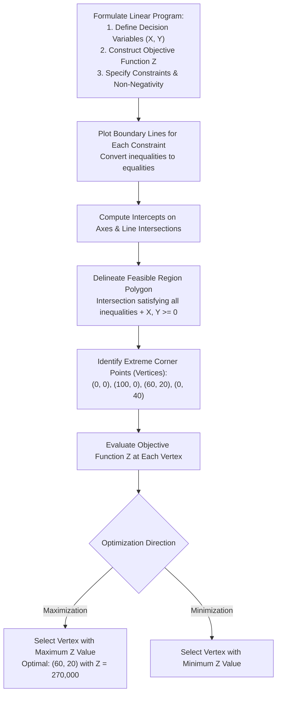
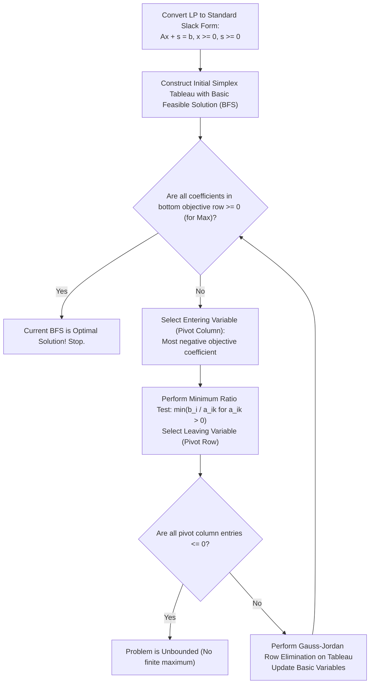

> [!info] Document Metadata
> - **Course:** `=this.course`
> - **Topic:** `=this.topic`
> - **Status:** `=this.status`

**Tags:** #[[CSMODEL]] #[[Linear Programming]] #[[Computer Science]] #[[Data Science]] #[[Statistical Modeling]] #[[Python]] #[[Machine Learning]]

---

# Module 14: Linear Programming

---

## Key Concepts

### What is Linear Programming? **Linear Programming (LP)** is a mathematical optimization technique used to obtain the most optimal solution (maximum or minimum) for a problem subject to constraints. Real-life problems are formulated into **mathematical models** consisting of:
An **objective function** (what you want to optimize)
**Constraints** (limitations expressed as linear inequalities/equalities)
**Decision variables** (the unknowns you control) All components — objective function, constraints, and decision variables — **must be linear** for a problem to qualify as a Linear Programming Problem (LPP).

---

### Decision Variables Variables that **directly affect the output/objective**. Must be **identified first** before formulating any LP problem. Convention: typically denoted as X, Y, Z or x₁, x₂, x₃, etc. **Example:** In a drink shop problem producing Drink A and Drink B:
X = number of cups of Drink A to produce
Y = number of cups of Drink B to produce

---

### Objective Function The **mathematical expression** of what you want to maximize or minimize. Form: Z = c₁x₁ + c₂x₂ + ⋯ + cₙxₙ Two types:
**Maximization:** `max Z = ...` (e.g., maximize profit)
**Minimization:** `min Z = ...` (e.g., minimize cost) **Example (drink shop):** `max Z = 50X + 45Y` **Example (farmer):** `max Z = 2500X + 6000Y`

---

### Constraints **Restrictions or limitations** on the decision variables (usually resource limits). Expressed as **linear inequalities** (≤, ≥) or equalities (=). **Example (drink shop):**
Coffee constraint: X + Y ≤ 5
Milk constraint: 3X + 2Y ≤ 12 **Example (farmer):**
Budget constraint: 100X + 200Y ≤ 10,000  →  simplified: X + 2Y ≤ 100
Man-days constraint: 10X + 30Y ≤ 1,200  →  simplified: X + 3Y ≤ 120
Land constraint: X + Y ≤ 110

---

### Non-Negativity Restriction Decision variables **must always be ≥ 0** (you can't produce a negative quantity). Always explicitly stated: X ≥ 0, Y ≥ 0 Graphically: restricts the solution to the **first quadrant**.

---

### LP Problem Formulation Steps
1. **Identify** the decision variables
2. **Write** the objective function (max or min)
3. **List** all constraints as linear inequalities/equalities
4. **State** the non-negativity restriction

---

### Feasible Region The set of **all points (X, Y)** that satisfy **all constraints simultaneously** (including non-negativity). Graphically: the **shaded intersecting region** of all plotted inequalities. Every point in the feasible region is a **feasible solution**. The **optimal solution** lies at one of the **corner points (vertices)** of the feasible region.

> **Key property (Fundamental Theorem of LP):** The optimal solution always occurs at a **corner point (extreme point/vertex)** of the feasible region.

---

### Graphical Method (2-Variable LP)
Used to solve LP problems with **exactly two decision variables**.



### Algorithmic Simplex Method Execution Pipeline



**Steps:**
1. Plot each constraint as a line (replace inequality with equality and find intercepts).
2. Shade the feasible side of each constraint.
3. Identify the **feasible region** (intersection of all shaded areas + first quadrant).
4. Find the **corner points** of the feasible region.
5. Evaluate the **objective function** at each corner point.
6. Choose the corner point that gives the **maximum (or minimum)** value.

---

### Corner Point Method (Manual Solving — Calculator Steps)

Given constraints (boundary lines), find corner points by:

| Corner Point Found By | Method |
|---|---|
| Intersection with X-axis | Set Y = 0, solve for X |
| Intersection with Y-axis | Set X = 0, solve for Y |
| Intersection of two constraint lines | Solve the 2-equation system simultaneously |

**Simultaneous equation example** (from farmer problem): Line 1: X + 2Y = 100 Line 2: X + 3Y = 120

Subtract Line 1 from Line 2:
  Y = 20
Substitute back: X + 2(20) = 100  →  X = 60

Corner point: (60, 20)

**Evaluate Z at each corner point:**

| Corner Point (X, Y) | Z = 2500X + 6000Y |
|---|---|
| (0, 0) | 0 |
| (100, 0) | 250,000 |
| (60, 20) | **270,000 ← Maximum** |
| (0, 40) | 240,000 |

∴ Optimal: Plant wheat on **60 ha** and corn on **20 ha** → Profit = **Php 270,000**

---

### Standard Form of an LP
LP problems are converted to **standard form** for algorithmic solving. Standard form requires:
1. All constraints are **equalities** (not inequalities)
2. All variables are **non-negative**
3. RHS of each constraint is **non-negative**

**Slack Variables** convert inequalities to equalities: For a **≤** constraint: add a **slack variable** sᵢ ≥ 0
X + Y ≤ 5  becomes  X + Y + s₁ = 5
Slack variable s₁ represents **unused resources** For a **≥** constraint: subtract a **surplus variable** sᵢ ≥ 0
X + Y ≥ 3  becomes  X + Y − s₁ = 3

**Example (drink shop in standard form):**

  max Z = 50X + 45Y

Subject to:
  X  +  Y + s₁       = 5
  3X + 2Y       + s₂ = 12
  X, Y, s₁, s₂ ≥ 0

---

### Simplex Method (Conceptual Overview) An **algebraic algorithm** that moves from one corner point (basic feasible solution) to an adjacent corner point that improves the objective function. Works for **any number of variables** (unlike graphical method, which only works for 2). At each iteration:
  1. Select an **entering variable** (most negative objective coefficient for maximization)
  2. Select a **leaving variable** (minimum ratio test)
  3. **Pivot** to the new basis
  4. Repeat until no improvement possible `scipy.optimize.linprog` implements an efficient variant of this under the hood.

---

### Shadow Prices (Dual Values / Marginal Values) The **shadow price** of a constraint = how much the optimal objective value changes if the RHS of that constraint increases by **1 unit**. If a constraint is **not binding** (slack > 0): shadow price = **0** If a constraint is **binding** (slack = 0): shadow price > 0 (for maximization) **Example:** Shadow price of coffee constraint = 40 means → if we had 1 more unit of coffee (RHS: 5 → 6), maximum profit increases by Php 40.

---

### Sensitivity Analysis Studies how the **optimal solution changes** when problem parameters change. Two main questions:
  1. **Objective coefficient ranging:** How much can a coefficient cᵢ change before the optimal **basis** changes?
  2. **RHS ranging:** How much can a constraint RHS bᵢ change before the optimal **basis** changes? Useful for: understanding which constraints are critical, how robust the solution is.

---

## Python Snippets

### `scipy.optimize.linprog` — Overview

> ⚠ **CRITICAL:** `linprog` **MINIMIZES** by default. To **maximize**, you must **negate** the objective function coefficients AND negate `result.fun` to get the true maximum.

```python
from scipy.optimize import linprog

result = linprog(
    c,          # Coefficients of the objective (MINIMIZES c @ x)
    A_ub=None,  # Matrix for inequality constraints (A_ub @ x <= b_ub)
    b_ub=None,  # RHS vector for <= constraints
    A_eq=None,  # Matrix for equality constraints (A_eq @ x == b_eq)
    b_eq=None,  # RHS vector for = constraints
    bounds=None # List of (min, max) per variable. Default: (0, None)
)
```

**Parameter breakdown:**

| Parameter | Shape | Meaning |
|---|---|---|
| `c` | `(n,)` | Objective function coefficients |
| `A_ub` | `(m, n)` | Each row = one `<=` constraint |
| `b_ub` | `(m,)` | RHS of each `<=` constraint |
| `A_eq` | `(p, n)` | Each row = one `=` constraint |
| `b_eq` | `(p,)` | RHS of each `=` constraint |
| `bounds` | list of tuples | `(lower, upper)` per variable; `None` = no bound |

**Result attributes:**

| Attribute | Meaning |
|---|---|
| `result.x` | Optimal values of decision variables |
| `result.fun` | Optimal objective value (negated if max) |
| `result.success` | `True` if optimization converged |
| `result.message` | Human-readable status |
| `result.slack` | Slack for each `<=` constraint |

---

### Complete Worked Example 1: Drink Shop (Maximization)

**Problem:** Drink A: 1 unit coffee, 3 units milk; profit = Php 50 Drink B: 1 unit coffee, 2 units milk; profit = Php 45 Available: 5 units coffee, 12 units milk **Maximize:** Z = 50X + 45Y

```python
from scipy.optimize import linprog

# Decision variables: [X (Drink A), Y (Drink B)]

# Objective: MAXIMIZE 50X + 45Y
# linprog MINIMIZES, so negate the coefficients
c = [-50, -45]  # <-- negated for maximization

# Inequality constraints (A_ub @ x <= b_ub)
# X + Y <= 5    (coffee constraint)
# 3X + 2Y <= 12 (milk constraint)
A_ub = [
    [1, 1],   # coffee: 1*X + 1*Y <= 5
    [3, 2],   # milk:   3*X + 2*Y <= 12
]
b_ub = [5, 12]

# Bounds: X >= 0, Y >= 0 (default is (0, None), so this is optional)
bounds = [(0, None), (0, None)]

result = linprog(c, A_ub=A_ub, b_ub=b_ub, bounds=bounds, method='highs')

print("Success:", result.success)
print(f"Optimal X (Drink A): {result.x[0]:.2f} cups")
print(f"Optimal Y (Drink B): {result.x[1]:.2f} cups")
print(f"Maximum Profit: Php {-result.fun:.2f}")  # negate to get max value
print(f"Slack (coffee): {result.slack[0]:.2f}")
print(f"Slack (milk):   {result.slack[1]:.2f}")
```

**Expected Output:**
```text
Success: True
Optimal X (Drink A): 2.00 cups
Optimal Y (Drink B): 3.00 cups
Maximum Profit: Php 235.00
Slack (coffee): 0.00
Slack (milk):   0.00
```

---

### Complete Worked Example 2: Farmer Problem (3 Constraints)

**Problem:** Wheat: cost=100/ha, labor=10 days/ha, profit=2500/ha Corn:  cost=200/ha, labor=30 days/ha, profit=6000/ha Budget=10,000; labor=1,200 days; land=110 ha **Maximize:** Z = 2500X + 6000Y

```python
from scipy.optimize import linprog

# Decision variables: [X (wheat ha), Y (corn ha)]

# Maximize 2500X + 6000Y  -->  minimize -2500X - 6000Y
c = [-2500, -6000]

# Constraints (A_ub @ x <= b_ub):
# 100X + 200Y <= 10000  (budget)
# 10X  + 30Y  <= 1200   (man-days)
# X    + Y    <= 110    (land area)
A_ub = [
    [100, 200],   # budget
    [10,  30],    # man-days
    [1,   1],     # land
]
b_ub = [10000, 1200, 110]

bounds = [(0, None), (0, None)]  # X, Y >= 0

result = linprog(c, A_ub=A_ub, b_ub=b_ub, bounds=bounds, method='highs')

print(f"Success: {result.success}")
print(f"Wheat (X): {result.x[0]:.2f} hectares")
print(f"Corn  (Y): {result.x[1]:.2f} hectares")
print(f"Maximum Profit: Php {-result.fun:,.2f}")  # negate back
print(f"\nSlack values (leftover capacity):")
print(f"  Budget:    Php {result.slack[0]:,.2f} remaining")
print(f"  Man-days:  {result.slack[1]:.2f} days remaining")
print(f"  Land:      {result.slack[2]:.2f} ha remaining")
```

**Expected Output:**
```text
Success: True
Wheat (X): 60.00 hectares
Corn  (Y): 20.00 hectares
Maximum Profit: Php 270,000.00

Slack values (leftover capacity):
  Budget:    Php 0.00 remaining
  Man-days:  0.00 days remaining
  Land:      30.00 ha remaining
```

> Land constraint has slack = 30 → **non-binding** (30 ha unused).
> Budget and man-days have slack = 0 → **binding** (fully consumed).

---

### Worked Example 3: Minimization with >= Constraints

**Problem:** Minimize Z = 3x₁ + 5x₂ subject to: x₁ + x₂ >= 4 x₁ + 3x₂ >= 6 x₁, x₂ >= 0

```python
from scipy.optimize import linprog

# Minimize 3x1 + 5x2 (no negation needed for minimization)
c = [3, 5]

# Convert >= to <= by multiplying both sides by -1:
# -x1 - x2  <= -4
# -x1 - 3x2 <= -6
A_ub = [
    [-1, -1],   # -(x1 + x2 >= 4)
    [-1, -3],   # -(x1 + 3x2 >= 6)
]
b_ub = [-4, -6]

bounds = [(0, None), (0, None)]

result = linprog(c, A_ub=A_ub, b_ub=b_ub, bounds=bounds, method='highs')

print(f"Optimal x1: {result.x[0]:.2f}")
print(f"Optimal x2: {result.x[1]:.2f}")
print(f"Minimum Cost: {result.fun:.2f}")  # no negation needed for min
```

**Expected Output:**
```text
Optimal x1: 3.00
Optimal x2: 1.00
Minimum Cost: 14.00
```

---

### Accessing Shadow Prices

```python
from scipy.optimize import linprog

c = [-50, -45]
A_ub = [[1, 1], [3, 2]]
b_ub = [5, 12]
bounds = [(0, None), (0, None)]

result = linprog(c, A_ub=A_ub, b_ub=b_ub, bounds=bounds, method='highs')

# For scipy >= 1.7.0 with method='highs':
if hasattr(result, 'ineqlin') and result.ineqlin is not None:
    # Negate marginals for maximization (they come out negative for max problems)
    shadow_prices = -result.ineqlin.marginals
    print("Shadow prices:", shadow_prices)
    # shadow_prices[0] = shadow price of coffee constraint
    # shadow_prices[1] = shadow price of milk constraint

# Check binding constraints
for i, (slack, sp) in enumerate(zip(result.slack, shadow_prices)):
    binding = "BINDING" if slack < 1e-6 else "non-binding"
    print(f"Constraint {i+1}: slack={slack:.2f}, shadow_price={sp:.2f}, {binding}")
```

---

### Checking Result Status

```python
result = linprog(c, A_ub=A_ub, b_ub=b_ub, bounds=bounds, method='highs')

if result.success:
    print("Optimal solution found!")
    print("Variables:", result.x)
    print("Objective value:", -result.fun)  # if maximization
else:
    print("Problem status:", result.message)
    # Common messages:
    # "Optimization terminated successfully" -> success
    # "The problem is infeasible"            -> no feasible solution exists
    # "The problem is unbounded"             -> objective can go to infinity
```

---

## Formulas & Key Equations

### LP Standard Form

```text
min (or max) Z = c^T x

Subject to:
  A_ub x <= b_ub   (inequality constraints)
  A_eq x  = b_eq   (equality constraints)
  x >= 0
```

---

### Converting >= Constraint to <= for linprog

```text
a₁x₁ + a₂x₂ >= b
        ↕ (multiply both sides by -1)
-a₁x₁ - a₂x₂ <= -b
```

---

### Converting Maximization to Minimization for linprog

```text
max Z = c₁x₁ + c₂x₂
         ↕
min(-Z) = -c₁x₁ - c₂x₂

After solving: TRUE MAX = -result.fun
```

---

### Slack Variable Conversion

```text
a₁x₁ + a₂x₂ <= b
         ↕ (add slack variable s >= 0)
a₁x₁ + a₂x₂ + s = b

s = 0  → constraint is BINDING (active, at the boundary)
s > 0  → constraint is NON-BINDING (unused capacity)
```

---

### Finding Corner Points from Two Lines

Given:
```text
a₁X + b₁Y = r₁
a₂X + b₂Y = r₂
```

Using elimination or Cramer's rule:
```text
X = (r₁b₂ - r₂b₁) / (a₁b₂ - a₂b₁)
Y = (a₁r₂ - a₂r₁) / (a₁b₂ - a₂b₁)
```

---

### Corner Point Evaluation Table (Template)

| Corner Point (X, Y) | Z = c₁X + c₂Y |
|---|---|
| (0, 0) | 0 |
| (a, 0) | c₁·a |
| (x*, y*) | c₁x* + c₂y* |
| (0, b) | c₂·b |

Choose corner giving **max Z** (maximization) or **min Z** (minimization).

---

## ⚠ Common Exam Traps
 **Forgetting to negate `c` for maximization** — `linprog` always minimizes. If you forget to negate, you solve the wrong problem.
 **Forgetting to negate `result.fun`** — after negating `c` for maximization, `result.fun` will be negative. You MUST compute `-result.fun` to get the true maximum.
 **Converting >= constraints incorrectly** — to use `A_ub` (≤ only), multiply BOTH sides of >= by -1: `ax >= b` → `-ax <= -b`. Put `-b` in `b_ub`.
 **`bounds` default is `(0, None)` per variable** — this already enforces non-negativity. Only change if variables can be negative or have upper limits.
 **The optimal is always at a corner point** — never test interior points in the corner-point method.
 **Binding vs. non-binding constraints** — if `result.slack[i] == 0`, constraint i is binding → shadow price ≠ 0. If slack > 0, it's non-binding → shadow price = 0.
 **A_ub row order matters** — `result.slack[0]` corresponds to the FIRST row of `A_ub`, `result.slack[1]` to the second, etc.
 **Feasible region may be unbounded** — for maximization, this can mean there's no finite maximum (linprog will report "unbounded").
 **Infeasible LP** — if constraints contradict each other, `result.success = False` and `result.message` will say "Infeasible problem."
 **LP allows fractional solutions** — standard LP doesn't guarantee integer results. If integers are required, you need Integer Linear Programming (ILP).
 **Don't negate for minimization** — only negate `c` AND `result.fun` for MAXIMIZATION. For minimization, use `c` as-is and read `result.fun` directly.
 **Shadow price interpretation direction** — shadow prices are for INCREASING the RHS by 1 unit. If a binding constraint's RHS increases, shadow price tells you the improvement.

---

## Practice Questions

**Q1.** A company produces two products P and Q. The profit per unit is Php 30 for P and Php 20 for Q. The production constraints are: 2P + Q ≤ 100 (machine hours) and P + 2Q ≤ 80 (labor hours), with P, Q ≥ 0. Which `linprog` call correctly **maximizes** profit?
 A) `linprog([30, 20], A_ub=[[2,1],[1,2]], b_ub=[100,80])` B) `linprog([-30, -20], A_ub=[[2,1],[1,2]], b_ub=[100,80])` C) `linprog([-30, -20], A_ub=[[-2,-1],[-1,-2]], b_ub=[-100,-80])` D) `linprog([30, 20], A_ub=[[-2,-1],[-1,-2]], b_ub=[-100,-80])`

---

**Q2.** After solving a maximization LP with `linprog`, `result.fun = -270`. What is the true maximum value of the objective function?
 A) -270 B) 270 C) 0 D) Cannot be determined

---

**Q3.** Consider the following code:

```python
from scipy.optimize import linprog
c = [-2500, -6000]
A_ub = [[100, 200], [10, 30], [1, 1]]
b_ub = [10000, 1200, 110]
bounds = [(0, None), (0, None)]
result = linprog(c, A_ub=A_ub, b_ub=b_ub, bounds=bounds, method='highs')
print(result.slack)
```

`result.slack[2]` equals **30**. What does this mean?
 A) The land constraint is binding — all 110 ha are used B) The farmer uses 30 ha more than allowed C) The land constraint is non-binding — 30 ha are unused D) The max profit increases by 30 if one more hectare is added

---

**Q4.** A linear programming problem has constraints:
X + 2Y ≤ 100, X + 3Y ≤ 120, X + Y ≤ 110, X,Y ≥ 0.
Maximize Z = 2500X + 6000Y. Corner points: (0,0), (100,0), (60,20), (0,40). What is the optimal solution?
 A) (0, 40) with Z = 240,000 B) (100, 0) with Z = 250,000 C) (60, 20) with Z = 270,000 D) (0, 0) with Z = 0

---

**Q5.** In the standard form of an LP, slack variable s₁ is added to constraint 3X + 2Y ≤ 12. At the optimal solution, s₁ = 0. This means:
 A) The constraint is non-binding and resources are wasted B) The constraint is binding — all 12 units of the resource are consumed C) The problem is infeasible D) The shadow price of this constraint is 0

---

**Q6.** Which of the following is **NOT** a requirement for a valid Linear Programming Problem?
 A) The objective function must be linear B) Constraints must be linear equalities or inequalities C) Decision variables must be integers D) Decision variables must be non-negative

---

**Q7.** What is the correct way to handle a **>=** constraint `x₁ + 2x₂ >= 6` when using `scipy.optimize.linprog`?
 A) Add it directly to `A_ub` as `[1, 2]` with `b_ub = 6` B) Multiply by -1: add `[-1, -2]` to `A_ub` with `b_ub = -6` C) Add it to `A_eq` as `[1, 2]` with `b_eq = 6` D) It cannot be handled by `linprog`

---

**Q8.** A shadow price of Php 50 for the coffee constraint in a drink shop problem means:
 A) The shop earns Php 50 for each cup produced B) The maximum profit will increase by Php 50 if one additional unit of coffee is available C) The constraint is not binding and adding coffee has no effect D) The minimum cost decreases by Php 50 for each unit of coffee used

---

**Answer Key:**
 **Q1: B** — `linprog` minimizes, so negate `c` to maximize: `c = [-30, -20]`. Constraints are already in ≤ form, so `A_ub` and `b_ub` stay unchanged.
 **Q2: B** — When `c` is negated for maximization, `result.fun` is the negated optimal. True maximum = `-result.fun = -(-270) = 270`.
 **Q3: C** — `result.slack[i]` is the leftover capacity for constraint i. Slack = 30 for land constraint (X + Y ≤ 110) means only 80 ha are used; 30 ha are unused → **non-binding**.
 **Q4: C** — Evaluate Z: (0,0)→0; (100,0)→250,000; (60,20)→270,000; (0,40)→240,000. Maximum is **Php 270,000 at (60, 20)**.
 **Q5: B** — Slack = 0 means the full 12 units are consumed. The constraint is **binding** (active at the boundary). A binding constraint typically has a non-zero shadow price.
 **Q6: C** — LP does NOT require integer decision variables (that's ILP). All other options ARE true LP requirements.
 **Q7: B** — `linprog`'s `A_ub` handles only ≤ constraints. Convert x₁ + 2x₂ ≥ 6 to ≤ form: multiply by -1 → -x₁ - 2x₂ ≤ -6. Add `[-1, -2]` to `A_ub` and `-6` to `b_ub`.
 **Q8: B** — Shadow price (dual value) = marginal value of relaxing a binding constraint by 1 unit. Shadow price of Php 50 means: 1 more unit of coffee → max profit increases by Php 50.

---

## Summary Cheat Sheet

```text
LP FORMULATION
──────────────
1. Decision variables: what you control (X, Y, ...)
2. Objective: max/min Z = c₁X + c₂Y + ...
3. Constraints: a₁X + a₂Y ≤ b  (resource limits)
4. Non-negativity: X ≥ 0, Y ≥ 0

GRAPHICAL METHOD (2 variables only)
─────────────────────────────────────
1. Plot each constraint as equality line (find x- and y-intercepts)
2. Shade the feasible side of each constraint
3. Find corner points (solve pairs of lines simultaneously)
4. Evaluate Z at each corner → pick max or min

CORNER POINT EXAMPLE
──────────────────────
Line 1: X + 2Y = 100
Line 2: X + 3Y = 120
→ Subtract: Y = 20
→ Substitute: X = 60
→ Corner point: (60, 20)

SCIPY LINPROG QUICK REFERENCE
──────────────────────────────
linprog(c, A_ub, b_ub, A_eq, b_eq, bounds)

• ALWAYS MINIMIZES
• To maximize:  negate c  AND  negate result.fun
• >= constraint: multiply both sides by -1 to get <=
• result.x      → optimal variable values
• result.fun    → optimal objective (negate if max)
• result.slack  → leftover for each <= constraint
• bounds default: (0, None) per variable = non-negativity

BINDING vs NON-BINDING
────────────────────────
slack = 0  → BINDING (active, limiting, shadow price != 0)
slack > 0  → NON-BINDING (unused capacity, shadow price = 0)

SHADOW PRICE
────────────
Shadow price of constraint i = change in optimal Z
when RHS of constraint i increases by 1 unit.
Only non-zero for BINDING constraints.
```

---

*Notes prepared for CSMODEL Finals | Module 14: Linear Programming*

## Multiple Choice Questions

1. In Linear Programming, what must be true about the objective function and constraints?
- **A)** They can include quadratic terms
- **B)** They must be entirely linear
- **C)** They must involve integer variables only
- **D)** They can only represent maximization problems

2. The optimal solution to an LP problem always occurs at:
- **A)** The origin
- **B)** The exact center of the feasible region
- **C)** A corner point (vertex) of the feasible region
- **D)** An arbitrary point outside the feasible region

3. What does a slack variable represent in a standard form LP?
- **A)** The amount of a resource that is overused
- **B)** The unused capacity or leftover amount of a resource in a <= constraint
- **C)** A negative decision variable
- **D)** The marginal cost of production

4. If a constraint has a shadow price of 0, what does this indicate?
- **A)** The constraint is binding and fully consumed
- **B)** The constraint is non-binding (there is unused capacity)
- **C)** The problem is infeasible
- **D)** The objective function cannot be maximized

5. By default, `scipy.optimize.linprog` solves which type of problem?
- **A)** Maximization
- **B)** Minimization
- **C)** Mixed-Integer Programming
- **D)** Non-linear optimization

### Answer Key & Explanations
1. **B)** LP requires all relationships (objective and constraints) to be strictly linear.
2. **C)** The Fundamental Theorem of LP states the optimal is at an extreme point (corner).
3. **B)** Slack variables convert <= inequalities to equalities by taking up the slack (unused resource).
4. **B)** If a constraint is not fully used (slack > 0), adding more of that resource has no value, hence shadow price = 0.
5. **B)** `linprog` minimizes by default; maximization requires negating the objective coefficients.

## References & Navigation

- **Previous Topic:** [[Bayesian Inference]]
- **Next Topic:** [[Clustering]]
- **Related Notes:** [[Optimization]], [[Foundations for Inference]]
