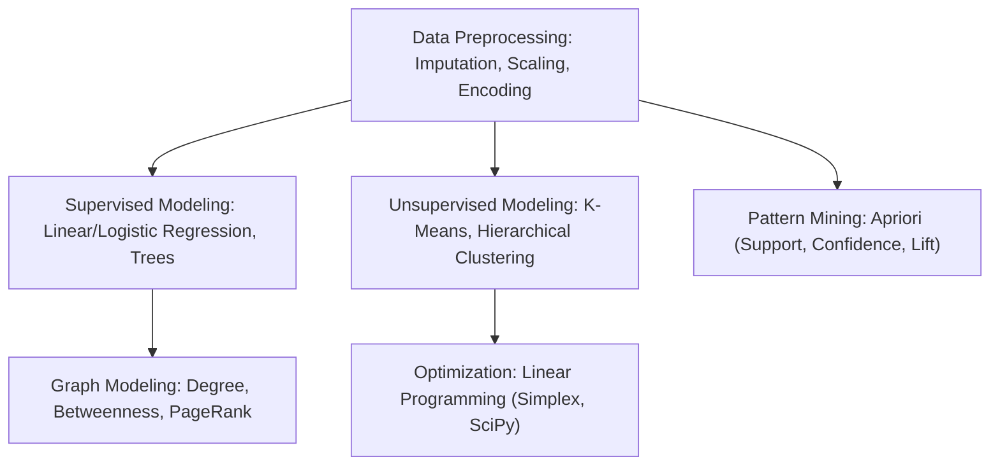

> [!info] Document Metadata
> - **Course:** `=this.course`
> - **Topic:** `=this.topic`
> - **Status:** `=this.status`

**Tags:** #[[Computer Science]] #[[CSMODEL]] #[[Data Science]] #[[Machine Learning]] #[[Reviewer]] #[[Finals]]

---

# CSMODEL Comprehensive Finals Reviewer

## Overview

This reviewer synthesizes Statistical Modeling and Simulation (CSMODEL). Core areas include exploratory data analysis (EDA), data cleaning and preprocessing (imputation, normalization, one-hot encoding), linear and multiple regression (Ordinary Least Squares, $R^2$, MSE, residual analysis), classification models (Logistic Regression, Decision Trees), unsupervised clustering (K-Means, Hierarchical Agglomerative Clustering, distance metrics: Euclidean, Manhattan, Cosine), Association Rule Mining (Apriori algorithm, Support, Confidence, Lift), Graph Data Modeling (NetworkX, centrality measures: Degree, Betweenness, Closeness, PageRank), and Linear Programming (Simplex method, SciPy optimization).

---

## 1. Master Metric & Modeling Matrix

| Technique / Model | Core Objective | Key Mathematical Metrics | Libraries / Functions |
| :--- | :--- | :--- | :--- |
| **Linear Regression** | Predict continuous target $y$ | $MSE = \frac{1}{n} \sum (y_i - \hat{y}_i)^2$, $R^2 = 1 - \frac{SS_{res}}{SS_{tot}}$ | `sklearn.linear_model.LinearRegression` |
| **Logistic Regression** | Binary classification probability | Sigmoid: $\sigma(z) = \frac{1}{1 + e^{-z}}$, Binary Cross-Entropy | `sklearn.linear_model.LogisticRegression` |
| **K-Means Clustering** | Partition into $K$ spherical clusters | Inertia (WCSS) = $\sum_{k} \sum_{x \in C_k} \|x - \mu_k\|^2$ | `sklearn.cluster.KMeans` (Elbow method) |
| **Association Rules** | Discover co-occurrence in transactions | $\text{Support}(X \implies Y) = \frac{freq(X \cup Y)}{N}$   $\text{Confidence} = \frac{freq(X \cup Y)}{freq(X)}$   $\text{Lift} = \frac{Support(X \cup Y)}{Support(X) \times Support(Y)}$ | `mlxtend.frequent_patterns.apriori` |
| **Graph Centrality** | Quantify node importance in network | Degree, Betweenness (shortest paths passing through), PageRank | `networkx` |
| **Linear Programming** | Maximize/minimize objective subject to linear constraints | $\min \mathbf{c}^T \mathbf{x} \text{ s.t. } A \mathbf{x} \le \mathbf{b}, \mathbf{x} \ge \mathbf{0}$ | `scipy.optimize.linprog` |

---

## 2. Association Rule Mining Metrics

- **Support**: Proportion of total transactions containing both $X$ and $Y$.
- **Confidence**: Conditional probability that a transaction contains $Y$ given that it contains $X$ ($P(Y \mid X)$).
- **Lift**: Ratio of observed co-occurrence to expected co-occurrence if independent:
  - $\text{Lift} > 1$: Positive correlation (items co-occur more than by chance).
  - $\text{Lift} = 1$: Independent (no relationship).
  - $\text{Lift} < 1$: Negative correlation (substitutes).

---

## 3. High-Yield Exam Checklist

- [ ] Does an $R^2$ of 0.85 mean that 85% of the variance in $y$ is explained by the model? **YES**.
- [ ] For K-Means, should features always be standardized (e.g. `StandardScaler`) beforehand? **YES**, because Euclidean distance is sensitive to feature scale!
- [ ] In graph centrality, what does Betweenness Centrality measure? The fraction of all shortest paths in the graph that pass through a given vertex.
- [ ] If Lift is less than 1, are the items positively associated? **NO**, Lift $< 1$ indicates negative association.
- [ ] In Linear Programming, where does the optimal solution always lie? At a **vertex (corner point)** of the feasible polygon/polyhedron!

---

## 4. Comprehensive Practice Exam

1. In Association Rule Mining, if 20 out of 100 transactions contain Bread, 30 contain Butter, and 15 contain both Bread and Butter, what is the Confidence of the rule $\{\text{Bread}\} \implies \{\text{Butter}\}$?
   - A) 15%
   - B) 50%
   - C) 75%
   - D) 25%

2. Using the data from Question 1, what is the Lift of the rule $\{\text{Bread}\} \implies \{\text{Butter}\}$?
   - A) 1.00
   - B) 1.50
   - C) 2.50
   - D) 0.75

3. In graph analysis, which centrality metric measures how often a node falls on the shortest path between all pairs of other nodes in the network?
   - A) Degree Centrality
   - B) Closeness Centrality
   - C) Betweenness Centrality
   - D) Eigenvector Centrality

4. What is the fundamental assumption of Ordinary Least Squares (OLS) linear regression regarding the residuals (errors)?
   - A) Residuals are exponentially distributed with variance proportional to $x$.
   - B) Residuals are normally distributed with zero mean and constant variance (homoscedasticity).
   - C) Residuals must always equal zero.
   - D) Residuals must be strictly positive.

5. When using the Elbow Method to choose the optimal number of clusters $K$ in K-Means, what metric is plotted against $K$?
   - A) Silhouette Score
   - B) Within-Cluster Sum of Squares (Inertia)
   - C) Lift
   - D) Adjusted Rand Index

---

### Answer Key & Explanations

1. **C) 75%** — $\text{Confidence}(\text{Bread} \implies \text{Butter}) = \frac{\text{freq}(\text{Bread} \cup \text{Butter})}{\text{freq}(\text{Bread})} = \frac{15}{20} = 0.75$ (75%).
2. **C) 2.50** — $\text{Lift} = \frac{\text{Support}(\text{Bread} \cup \text{Butter})}{\text{Support}(\text{Bread}) \times \text{Support}(\text{Butter})} = \frac{0.15}{0.20 \times 0.30} = \frac{0.15}{0.06} = 2.50$. Since $\text{Lift} > 1$, Bread and Butter are strongly positively associated.
3. **C) Betweenness Centrality** — Betweenness centrality quantifies the bridge role of a node by tallying the proportion of all shortest paths passing through that node.
4. **B) Residuals are normally distributed with zero mean and constant variance (homoscedasticity)** — The Gauss-Markov theorem requires residuals to have zero conditional mean, homoscedasticity, and no autocorrelation for OLS estimators to be BLUE (Best Linear Unbiased Estimator).
5. **B) Within-Cluster Sum of Squares (Inertia)** — Inertia measures the total squared distance of samples to their closest cluster center. The elbow point marks where adding further clusters yields diminishing reductions in inertia.

---

## References & Navigation

- **Previous Topic:** [[CSMATH2]], [[STT101A]]
- **Next Topic:** None
- **Prerequisites:** [[Statistical Modeling]], Regression, Clustering, Graph Analytics, Optimization
- **Cross-Curricular Connections:** [[CSINTSY]]
