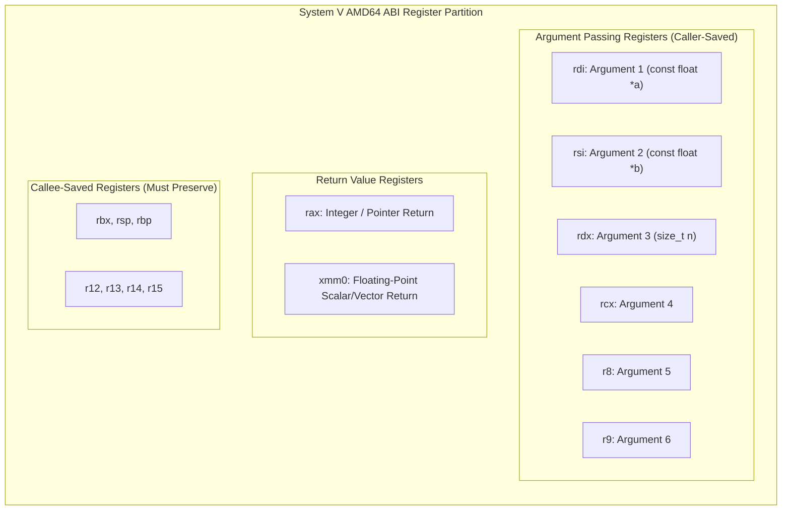

> [!info] Document Metadata
> - **Course:** `=this.course`
> - **Topic:** `=this.topic`
> - **Status:** `=this.status`

**Tags:** #[[Computer Science]] #[[LBYARCH]] #[[Conceptual]] #[[Assembly]] #[[Architecture]] #[[Code Snippets]]

---

## Overview
This note explores Assembly Language programming and its intrinsic connection to CPU architecture. Assembly acts as the bridge between high-level software and hardware execution, exposing the CPU's registers, memory management, and instruction set architecture (ISA). 

## Key Definitions
- **Assembly Language:** A low-level programming language that provides a strong correspondence between the program's statements and the architecture's machine code instructions.
- **Instruction Set Architecture (ISA):** The part of the computer architecture related to programming, including the native data types, instructions, registers, addressing modes, and memory architecture.
- **Registers:** Small, extremely fast storage locations directly within the CPU.
- **Opcode:** The portion of a machine language instruction that specifies the operation to be performed.
- **Addressing Mode:** The mechanism by which the operand of an instruction is specified.

## Theoretical Framework / Core Concepts

### CPU Architecture Basics
A typical von Neumann architecture includes the CPU (ALU and Control Unit), Memory, and I/O. The CPU executes instructions in a continuous loop:
1. **Fetch:** Retrieve the next instruction from memory.
2. **Decode:** Determine what the instruction means.
3. **Execute:** Perform the operation.
4. **Write-back:** Store the result in a register or memory.

### Registers (x86/x64 Perspective)
- **General Purpose Registers:** EAX (Accumulator), EBX (Base), ECX (Counter), EDX (Data), ESI (Source Index), EDI (Destination Index).
- **Pointers:** ESP (Stack Pointer), EBP (Base Pointer), EIP (Instruction Pointer).
- **Flags Register:** EFLAGS (stores status flags like Zero, Carry, Sign, Overflow).

### Common Assembly Instructions
- **Data Movement:** `MOV`, `PUSH`, `POP`
- **Arithmetic:** `ADD`, `SUB`, `MUL`, `DIV`, `INC`, `DEC`
- **Logic:** `AND`, `OR`, `XOR`, `NOT`
- **Control Flow:** `JMP`, `JE` (Jump if Equal), `JNE` (Jump if Not Equal), `CALL`, `RET`

## Worked Examples / Protocol Walkthroughs / Calculations

### Example 1: Basic Arithmetic and Data Movement
```assembly
section .data
    val1 dd 10
    val2 dd 20

section .text
    global _start

_start:
    ; Load values into registers
    mov eax, [val1]   ; eax = 10
    mov ebx, [val2]   ; ebx = 20
    
    ; Perform addition
    add eax, ebx      ; eax = eax + ebx (10 + 20 = 30)
    
    ; Exit program (Linux Syscall)
    mov eax, 1        ; sys_exit
    mov ebx, 0        ; exit code 0
    int 0x80
```

### Example 2: Implementing a Loop (Factorial)
```assembly
; Calculate factorial of 5 (5!)
    mov ecx, 5        ; Counter
    mov eax, 1        ; Result accumulator

factorial_loop:
    mul ecx           ; eax = eax * ecx
    dec ecx           ; Decrement counter
    cmp ecx, 1        ; Compare counter with 1
    jg factorial_loop ; Jump if greater to loop again
    
    ; eax now holds 120
```

### Example 3: x86-64 System V AMD64 ABI C-Interfaced Vector Kernel

#### NASM 64-Bit Subroutine (`vector_dot.asm`)
Calculates single-precision dot product: $\sum_{i=0}^{n-1} a[i] \cdot b[i]$.
- Argument 1 (`rdi`): Pointer to array A (`const float *a`)
- Argument 2 (`rsi`): Pointer to array B (`const float *b`)
- Argument 3 (`rdx`): Length of arrays (`size_t n`)
- Return value: Returned in SIMD register `xmm0` (`float`)

```nasm
bits 64
default rel

section .text
    global dot_product_asm

dot_product_asm:
    ; Function Prologue: Callee-saved register preservation
    push rbp
    mov rbp, rsp
    push rbx                ; rbx is callee-saved under System V ABI

    ; Initialize accumulator
    xorps xmm0, xmm0        ; xmm0 = 0.0f (Sum accumulator)
    xor rcx, rcx            ; rcx = 0 (Loop index i)

.loop_start:
    cmp rcx, rdx            ; Compare index i with length n
    jge .loop_done          ; If i >= n, branch to loop exit

    ; Load single precision floats from memory using indexed addressing
    movss xmm1, [rdi + rcx*4]   ; xmm1 = a[i]
    movss xmm2, [rsi + rcx*4]   ; xmm2 = b[i]

    ; Multiply and accumulate
    mulss xmm1, xmm2            ; xmm1 = a[i] * b[i]
    addss xmm0, xmm1            ; xmm0 += (a[i] * b[i])

    inc rcx                     ; i++
    jmp .loop_start

.loop_done:
    ; Function Epilogue: Restore stack and preserved registers
    pop rbx
    mov rsp, rbp
    pop rbp
    ret                         ; Return with float result in xmm0
```

#### C Host Application (`main.c`)

```c
#include <stdio.h>
#include <stdlib.h>

// External assembly declaration conforming to System V AMD64 ABI
extern float dot_product_asm(const float *a, const float *b, size_t n);

int main(void) {
    const size_t N = 4;
    float a[] = {1.5f, 2.0f, 3.5f, 4.0f};
    float b[] = {2.0f, 3.0f, 1.0f, 0.5f};

    // Expected: (1.5*2.0) + (2.0*3.0) + (3.5*1.0) + (4.0*0.5)
    //         = 3.0 + 6.0 + 3.5 + 2.0 = 14.5
    float result = dot_product_asm(a, b, N);

    printf("x86-64 NASM Vector Dot Product Result: %.2f\n", result);
    return 0;
}
```

## Theoretical Framework: x86-64 System V AMD64 Calling Convention



## Summary & Key Takeaways
- Assembly language requires a deep understanding of CPU components, particularly registers and memory mapping.
- Instructions are executed sequentially, but control flow can be altered using conditional and unconditional jumps based on status flags.
- Interacting with the operating system requires system calls (`int 0x80` or `syscall`).

## Multiple Choice Questions

1. What is the primary function of the Instruction Pointer (EIP/RIP) register?
    - **A)** To store intermediate arithmetic results
    - **B)** To hold the address of the next instruction to be executed
    - **C)** To point to the top of the stack
    - **D)** To handle system call numbers

2. Which assembly instruction is used to copy data from one location to another?
    - **A)** COPY
    - **B)** MOV
    - **C)** LD
    - **D)** SWAP

3. What happens during the "Decode" phase of the instruction cycle?
    - **A)** The instruction is fetched from memory.
    - **B)** The control unit interprets the opcode to determine the required actions.
    - **C)** The ALU performs an arithmetic operation.
    - **D)** Data is written back to memory.

4. Which flag is set when an arithmetic operation results in a zero?
    - **A)** Carry Flag
    - **B)** Sign Flag
    - **C)** Overflow Flag
    - **D)** Zero Flag

5. What does the `PUSH` instruction do?
    - **A)** Removes a value from the stack and stores it in a register.
    - **B)** Places a value onto the top of the stack.
    - **C)** Multiplies two registers.
    - **D)** Jumps to a specific label.

6. In x86 assembly, what is the role of the ECX register in loop instructions?
    - **A)** It stores the return address.
    - **B)** It acts as an accumulator for arithmetic.
    - **C)** It serves as a loop counter.
    - **D)** It points to the base of the current stack frame.

7. Which instruction alters the control flow unconditionally?
    - **A)** JMP
    - **B)** JE
    - **C)** JNE
    - **D)** CMP

8. The instruction `CMP EAX, EBX` works by performing which internal operation?
    - **A)** Addition
    - **B)** Subtraction
    - **C)** Bitwise AND
    - **D)** Bitwise XOR

9. What does the `RET` instruction do in assembly?
    - **A)** Returns 0 to the operating system.
    - **B)** Pops the return address from the stack and jumps to it.
    - **C)** Pushes the current instruction pointer to the stack.
    - **D)** Restarts the program.

10. Which addressing mode specifies the operand as a constant value directly in the instruction?
    - **A)** Direct Addressing
    - **B)** Register Addressing
    - **C)** Immediate Addressing
    - **D)** Indirect Addressing

### Answer Key & Explanations

1. **B**. The Instruction Pointer tracks the flow of execution by storing the memory address of the next instruction.
2. **B**. `MOV` is the standard mnemonic for moving (copying) data between registers and memory.
3. **B**. Decoding involves interpreting the fetched machine code to prepare for execution.
4. **D**. The Zero Flag (ZF) is set to 1 if the result of the last operation was zero.
5. **B**. `PUSH` decrements the stack pointer and stores the specified operand at the new top of the stack.
6. **C**. ECX is traditionally used as the counter register for loops and string operations.
7. **A**. `JMP` is an unconditional jump to a specified address, irrespective of any flags.
8. **B**. `CMP` performs a subtract operation to set flags but does not store the result.
9. **B**. `RET` is used to return from a subroutine by popping the return address off the stack into the instruction pointer.
10. **C**. Immediate addressing embeds the actual data value (the constant) directly within the machine instruction.

## References & Navigation

- **Previous Topic:** [[Verilog HDL and Digital Circuit Simulation]]
- **Related Notes:** [[Instruction Set Architecture (ISA) Principles & Addressing Modes]], [[Processing Unit Organization & Single-Bus Datapath]]
