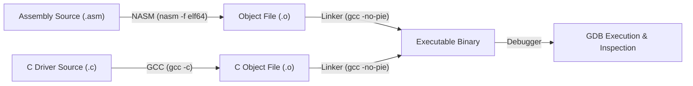
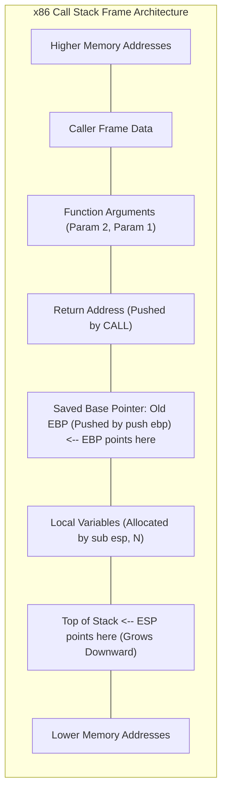

> [!info] Document Metadata
> - **Course:** `=this.course`
> - **Topic:** `=this.topic`
> - **Status:** `=this.status`

**Tags:** #[[Computer Science]] #[[LBYARCH]] #[[Conceptual]] #[[Reference]] #[[Review]] #[[Code Snippets]]

---

## Overview
This reference guide serves as a comprehensive review of the key concepts, syntax, and workflows utilized in the Computer Organization & Architecture Laboratory (LBYARCH). It bridges the gap between hardware description (Verilog) and low-level software programming (Assembly).

## Key Definitions
- **Datapath:** The component of the processor that performs arithmetic operations and handles data flow.
- **Control Unit:** The logic that directs the operation of the processor, interpreting instructions and signaling the datapath.
- **Pipeline:** An implementation technique where multiple instructions are overlapped in execution.
- **Cache:** A small, fast memory located close to the CPU that stores frequently accessed data.
- **Endianness:** The sequential order in which bytes are arranged into larger numerical values in memory.

## Theoretical Framework / Core Concepts

### Verilog vs. Assembly
- **Verilog** is spatial: it describes parallel hardware components and physical connections.
- **Assembly** is temporal: it describes a sequential set of instructions executed over time.

### Memory Hierarchy and Addressing
- **Little Endian vs. Big Endian:** In Little Endian (x86 architecture), the least significant byte is stored at the lowest memory address.
- **Memory Alignment:** Data is accessed more efficiently if its address is a multiple of its size (e.g., a 32-bit word aligned at a 4-byte boundary).

### The Build Process for Assembly
1. **Assemble:** Convert `.asm` source into object code `.o` (e.g., using NASM).
2. **Link:** Combine object files and libraries into an executable (e.g., using LD or GCC).



## Worked Examples / Protocol Walkthroughs / Calculations

### Quick Verilog Reference
```verilog
// Common combinational logic using continuous assignment
assign out = (a & b) | (~c);

// Synchronous reset D Flip-Flop
always @(posedge clk) begin
    if (reset)
        q <= 0;
    else
        q <= d;
end
```

### Quick Assembly Reference (x86 NASM)
```assembly
; Function prologue
push ebp
mov ebp, esp

; Local variable allocation
sub esp, 8

; Function epilogue
mov esp, ebp
pop ebp
ret
```



### Endianness Walkthrough
Consider storing the 32-bit hex value `0x12345678` at memory address `0x1000`.
- **Little Endian:**
  - `0x1000`: `0x78`
  - `0x1001`: `0x56`
  - `0x1002`: `0x34`
  - `0x1003`: `0x12`
- **Big Endian:**
  - `0x1000`: `0x12`
  - `0x1001`: `0x34`
  - `0x1002`: `0x56`
  - `0x1003`: `0x78`

## Summary & Key Takeaways
- Mastery of LBYARCH requires understanding both how to build hardware (Verilog) and how to program it (Assembly).
- Recognizing the memory architecture, including endianness and stack management, is critical for debugging assembly code.
- Always use proper simulation techniques (testbenches) for hardware and step-through debugging (GDB) for assembly software.


## References & Navigation

- **Related Notes:** [[LBYARCH Lab]]
