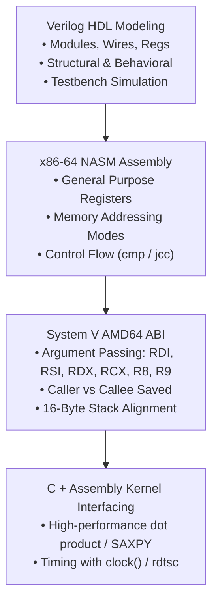
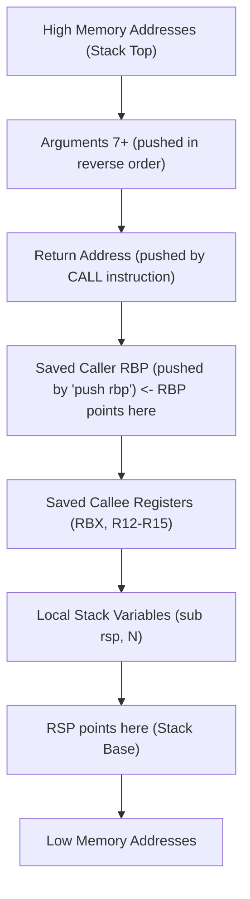

> [!info] Document Metadata
> - **Course:** `=this.course`
> - **Topic:** `=this.topic`
> - **Status:** `=this.status`

**Tags:** #[[Computer Science]] #[[LBYARCH]] #[[Assembly]] #[[x86-64]] #[[Verilog]] #[[Reviewer]] #[[Finals]]

---

# LBYARCH Comprehensive Finals Reviewer

## Overview

This reviewer synthesizes Computer Architecture and Organization Laboratory (LBYARCH). The curriculum comprises digital system modeling in Verilog HDL (combinational ALU design, testbenches with `$monitor` and `$finish`, structural vs behavioral syntax), x86-64 assembly programming using NASM, System V AMD64 ABI calling conventions, pointer and array memory addressing, floating-point scalar and SIMD vector operations (SSE/AVX: XMM/YMM registers), and interfacing C drivers with native x86-64 assembly kernels.

---

## 1. System V AMD64 ABI Calling Convention Matrix

| Register | Role / ABI Specification | Preserved across Call? (Saved by) |
| :--- | :--- | :--- |
| **`RAX`** | 1st Return Value (integers, pointers) | Caller-Saved (Scratch) |
| **`RDX`** | 2nd Return Value | Caller-Saved (Scratch) |
| **`RDI`** | **1st Function Argument** | Caller-Saved |
| **`RSI`** | **2nd Function Argument** | Caller-Saved |
| **`RDX`** | **3rd Function Argument** | Caller-Saved |
| **`RCX`** | **4th Function Argument** | Caller-Saved |
| **`R8`** | **5th Function Argument** | Caller-Saved |
| **`R9`** | **6th Function Argument** | Caller-Saved |
| **`XMM0`–`XMM7`** | Floating-point arguments and return value (`XMM0`) | Caller-Saved |
| **`RBX`, `RSP`, `RBP`, `R12`–`R15`** | Callee-Saved Registers | **Callee-Saved** (Must restore before `ret`) |

> [!IMPORTANT] Stack Alignment Requirement
> The System V AMD64 ABI mandates that the stack pointer `RSP` must be **16-byte aligned** (`RSP % 16 == 0`) immediately prior to executing any `call` instruction! Because `call` pushes the 8-byte return address, inside the function prologue `RSP % 16 == 8`.

---

## 2. x86-64 Stack Frame Architecture

---

## 3. High-Yield Exam Checklist

- [ ] Are the first 6 integer arguments passed in `RDI`, `RSI`, `RDX`, `RCX`, `R8`, `R9`? **YES**.
- [ ] If a function modifies `RBX`, `R12`, `R13`, `R14`, or `R15`, must it push and pop them? **YES** (Callee-saved).
- [ ] How is an array element `arr[i]` accessed in x86-64 when `RDI = arr` and `RCX = i` for 4-byte integers? `[rdi + rcx*4]`.
- [ ] In NASM, does `mov eax, [rbx]` dereference the memory address in `RBX`? **YES** (brackets mean dereference).
- [ ] In Verilog, what simulator directive stops simulation? **`$finish;`**.

---

## 4. Comprehensive Practice Exam

1. Under the System V AMD64 ABI, in which register does a C caller pass the third integer argument to an assembly function?
   - A) `RAX`
   - B) `RSI`
   - C) `RDX`
   - D) `RCX`

2. Which register must be explicitly preserved (pushed and popped) by an assembly function if it is modified during execution?
   - A) `RDI`
   - B) `RDX`
   - C) `R12`
   - D) `R10`

3. In x86-64 assembly, what does the instruction `lea rax, [rdi + rsi*4 + 8]` do?
   - A) Reads 4 bytes from memory at that computed address into `EAX`.
   - B) Computes the effective arithmetic address `rdi + rsi*4 + 8` and stores the result in `RAX` without touching memory.
   - C) Multiplies `RDI` by 4 and stores the address in `RSI`.
   - D) Triggers a memory bus error if the address is not mapped.

4. If an assembly function calls `printf`, what condition must be satisfied regarding the stack pointer `RSP` prior to the `call`?
   - A) `RSP` must be 8-byte aligned.
   - B) `RSP` must be 16-byte aligned (`RSP % 16 == 0`).
   - C) `RSP` must point to the data segment.
   - D) `RSP` must equal `RBP`.

5. In Verilog HDL testbenches, which system task displays a formatted string in the console whenever any monitored variable changes value?
   - A) `$display`
   - B) `$monitor`
   - C) `$finish`
   - D) `$stop`

---

### Answer Key & Explanations

1. **C) `RDX`** — The standard argument order for integer/pointer types is: 1st in `RDI`, 2nd in `RSI`, 3rd in `RDX`, 4th in `RCX`, 5th in `R8`, 6th in `R9`.
2. **C) `R12`** — `R12` through `R15`, as well as `RBX`, `RBP`, and `RSP`, are callee-saved registers. Any function that alters them must restore their original values before returning.
3. **B) Computes the effective arithmetic address `rdi + rsi*4 + 8` and stores the result in `RAX` without touching memory** — `LEA` (Load Effective Address) computes the memory address using the CPU address generation unit (AGU) and writes the calculated value directly to the destination register.
4. **B) `RSP` must be 16-byte aligned (`RSP % 16 == 0`)** — The System V ABI enforces 16-byte stack alignment at the point of the `call` instruction for SSE vector instruction safety and ABI compliance.
5. **B) `$monitor`** — `$monitor` continuously traces the specified argument list and prints to the console whenever any signal in the list changes state throughout simulation.

---

## References & Navigation

- **Previous Topic:** [[CSARCH1]]
- **Next Topic:** [[CSARCH2]]
- **Prerequisites:** [[Assembly Lab]], x86-64 NASM, System V ABI, Verilog Simulation
- **Cross-Curricular Connections:** [[CSOPESY]]
