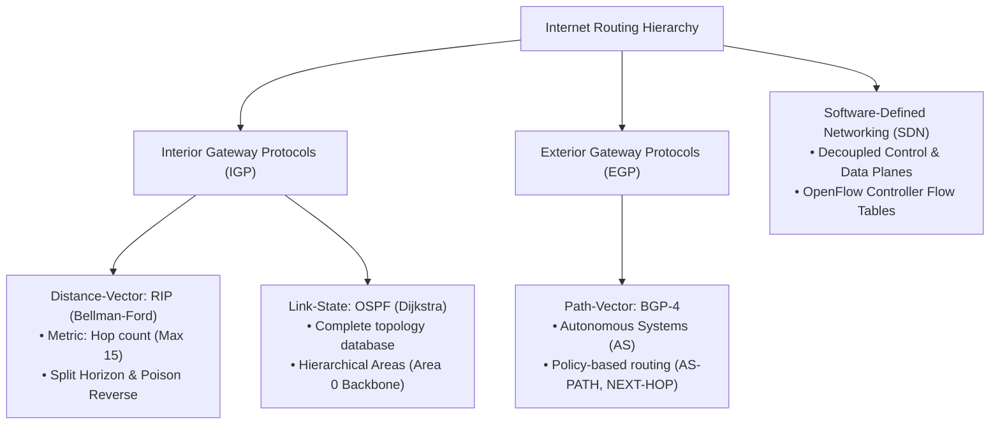
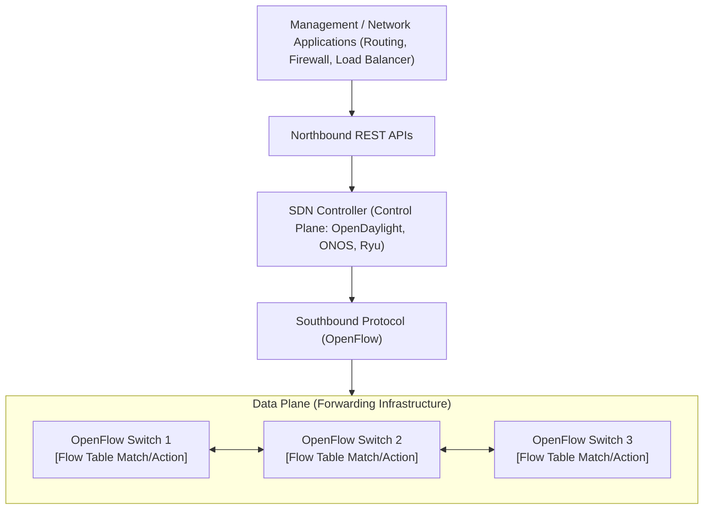

> [!info] Document Metadata
> - **Course:** `=this.course`
> - **Topic:** `=this.topic`
> - **Status:** `=this.status`

**Tags:** #[[Computer Science]] #[[NSCOM02]] #[[Networking]] #[[Routing Protocols]] #[[SDN]] #[[Reviewer]] #[[Finals]]

---

# NSCOM02 Comprehensive Finals Reviewer

## Overview

This reviewer consolidates Advanced Network Communications and Routing (NSCOM02). Core topics cover interior and exterior routing protocols, Distance-Vector routing (Bellman-Ford algorithm, Routing Information Protocol - RIP, Count-to-Infinity problem, Split Horizon with Poison Reverse), Link-State routing (Dijkstra's shortest path, Open Shortest Path First - OSPF, Link-State Advertisements - LSAs, hierarchical areas), Interdomain Routing (Border Gateway Protocol - BGP, Autonomous Systems, path vector attributes, peering vs transit), Software-Defined Networking (SDN architecture, separation of Control Plane and Data Plane, OpenFlow protocol, centralized controllers), and network telemetry/management (ICMP diagnostic messages, Simple Network Management Protocol - SNMP MIBs).

---

## 1. Routing Protocols Master Comparison Matrix

| Protocol | Type / Paradigm | Underlying Algorithm | Metric | Convergence Speed | Scalability / Scope |
| :--- | :--- | :--- | :--- | :--- | :--- |
| **RIPv2** | Interior (IGP), Distance-Vector | Bellman-Ford | Hop count (max 15 hops; 16 = $\infty$) | Slow (periodic 30s updates) | Small networks ($< 15$ hops) |
| **OSPFv2** | Interior (IGP), Link-State | Dijkstra's Shortest Path First | Cost (typically inverse of bandwidth) | Fast (event-driven LSAs) | Large enterprise networks (Hierarchical Areas) |
| **BGP-4** | Exterior (EGP), Path-Vector | Policy-based Path Vector | Policy rules, AS-PATH length, Local Pref | Moderate | Global Internet interconnect between ASes |
| **SDN (OpenFlow)** | Centralized Control Plane | Global controller computation | Programmable software policies | Real-time flow table pushes | Data centers, cloud networks, enterprise WANs |

---

## 2. SDN Architecture: Control Plane vs Data Plane

---

## 3. High-Yield Exam Checklist

- [ ] In RIP, what hop count represents unreachable / infinity? Exactly **16 hops**.
- [ ] What is the role of OSPF Area 0? It is the **Backbone Area** to which all other non-backbone areas must connect.
- [ ] In BGP, what attribute prevents routing loops between Autonomous Systems? The **AS-PATH** attribute (if a router sees its own AS number in the list, it drops the route!).
- [ ] Does SDN move the routing decision logic off the physical switches? **YES**, physical switches only execute high-speed packet forwarding according to flow rules pushed by the central controller.
- [ ] What SNMP operation is pushed asynchronously by an agent to alert the management station of an emergency event? **SNMP Trap** (or Inform).

---

## Multiple Choice Questions

1. What mechanism in Distance-Vector routing prevents a router from advertising a learned route back out the same interface through which it originally received it?
    - **A)** Dijkstra's Algorithm
    - **B)** Split Horizon
    - **C)** Link-State Refresh
    - **D)** Area Border Routing

2. What is the maximum valid hop count supported by the Routing Information Protocol (RIP) before a destination is declared unreachable?
    - **A)** 10
    - **B)** 15
    - **C)** 16
    - **D)** 255

3. In OSPF, what type of router connects one or more non-backbone areas directly to the backbone Area 0?
    - **A)** Internal Router (IR)
    - **B)** Autonomous System Boundary Router (ASBR)
    - **C)** Area Border Router (ABR)
    - **D)** Designated Router (DR)

4. Which BGP path attribute list guarantees loop-free interdomain routing by recording every Autonomous System traversed by a route advertisement?
    - **A)** NEXT-HOP
    - **B)** LOCAL-PREF
    - **C)** AS-PATH
    - **D)** MED (Multi-Exit Discriminator)

5. In Software-Defined Networking (SDN), what protocol commonly operates across the Southbound interface between the centralized controller and the data-plane forwarding switches?
    - **A)** BGP
    - **B)** OpenFlow
    - **C)** SNMP
    - **D)** RIP

### Answer Key & Explanations

1. **B**. Split Horizon prevents two-node routing loops by forbidding a router from advertising a route back out the interface from which it learned that route. Poison Reverse enhances this by advertising it back with a metric of infinity.
2. **B**. RIP defines 15 as the maximum reachable hop count; a metric of 16 is defined as infinity (unreachable), preventing infinite looping.
3. **C**. An ABR has interfaces in multiple OSPF areas, at least one of which must belong to the backbone Area 0, and is responsible for summarizing routes between areas.
4. **C**. AS-PATH contains an ordered list of AS numbers traversed. If a BGP router receives an advertisement containing its own local AS number, it immediately detects a routing loop and discards the route.
5. **B**. OpenFlow is the standardized Southbound protocol allowing SDN controllers to program the flow tables of network switches directly.

## References & Navigation

- **Previous Topic:** [[CSNETWK]]
- **Next Topic:** [[NSCOM03]]
- **Prerequisites:** [[Routing Protocols]], RIP, OSPF, BGP, SDN, OpenFlow
- **Cross-Curricular Connections:** [[NSSECU1]]
