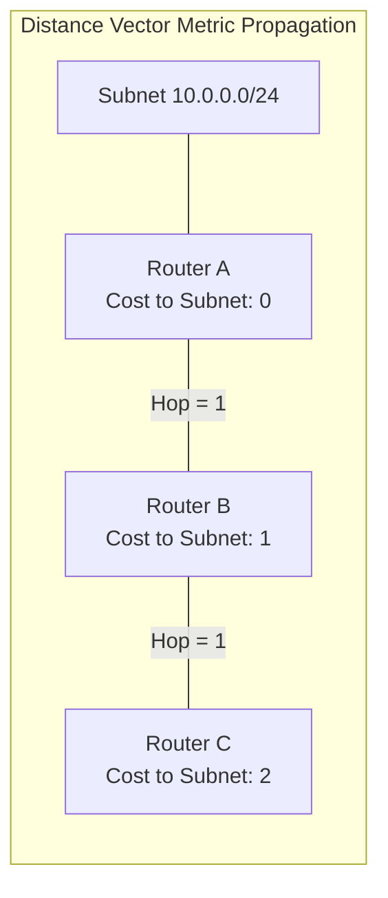
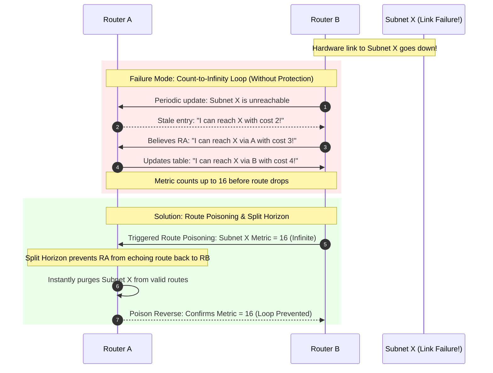

> [!info] Document Metadata
> - **Course:** `=this.course`
> - **Topic:** `=this.topic`
> - **Status:** `=this.status`

**Tags:** #[[Computer Science]] #[[NSCOM02]] #[[Conceptual]] #[[Distance-Vector Routing]]

## Overview
Distance-vector routing protocols are fundamental dynamic routing protocols that operate on a "routing by rumor" principle. Each router calculates the distance (metric) to a destination and determines the vector (next-hop router). The Routing Information Protocol (RIP) is the quintessential example of a distance-vector protocol, utilizing hop count as its primary metric. These protocols are generally suited for small, non-complex networks but suffer from slow convergence and scalability issues.

## Key Definitions
- **Distance-Vector:** A routing algorithm where routers determine the distance (cost) and direction (vector/next-hop) to destination networks.
- **RIP (Routing Information Protocol):** A standard distance-vector protocol using hop counts.
- **Hop Count:** The number of routers a packet must pass through. In RIP, a hop count of 16 is considered infinite (unreachable).
- **Administrative Distance (AD):** A measure of the trustworthiness of a routing protocol. RIP's AD is 120.
- **Count-to-Infinity (Bouncing Effect):** A routing loop issue where routers continuously increment metrics for a failed route.

## Theoretical Framework / Core Concepts

### Bellman-Ford Algorithm
Distance-vector protocols utilize the Bellman-Ford equation to calculate the shortest path. Each node receives the cost arrays from its neighbors, computes the cost to all destinations, and updates its routing table:
$$D_x(y) = \min_v \{ c(x, v) + D_v(y) \}$$

### RIP Characteristics
- **Metric:** Hop count. Maximum valid hops = 15.
- **Updates:** Full routing table updates are broadcast periodically (typically every 30 seconds).
- **Administrative Distance:** 120.

### Loop Prevention Mechanisms
To combat the count-to-infinity problem, several mechanisms are deployed:
1. **Split Horizon:** Prevents a router from advertising a route back out of the interface it was learned from.
2. **Route Poisoning:** Immediately advertises a failed route with an infinite metric (16 in RIP).
3. **Poison Reverse:** Overrides Split Horizon; sends the route back on the learned interface but marked as unreachable.
4. **Hold-down Timers:** Prevents a router from accepting new, potentially bad routing information for a set period after learning of a route failure.
5. **Triggered Updates:** Sends immediate updates when a topology change occurs, rather than waiting for the periodic timer.

## Worked Examples / Protocol Walkthroughs / Calculations

### Routing Table Entry Breakdown
`R 192.168.10.0/24 [120/4] via 10.1.1.2`
- **R:** Indicates the route was learned via RIP.
- **192.168.10.0/24:** The destination network.
- **[120/4]:** 
  - `120` is the Administrative Distance.
  - `4` is the metric (hop count).
- **via 10.1.1.2:** The next-hop router's IP address.

## Summary & Key Takeaways
- Distance-vector protocols rely on neighbors for routing information ("routing by rumor").
- RIP is limited to 15 hops; 16 implies the network is unreachable.
- Loop prevention is critical and handled via Split Horizon, Route Poisoning, Hold-down timers, and Triggered Updates.

## Multiple Choice Questions

1. What is the maximum allowable hop count for a valid route in the Routing Information Protocol (RIP)?
    - **A)** 15
    - **B)** 16
    - **C)** 120
    - **D)** 255

2. Which mechanism prevents a router from advertising a route back onto the same interface from which it was originally learned?
    - **A)** Route Poisoning
    - **B)** Hold-down Timers
    - **C)** Split Horizon
    - **D)** Triggered Updates

3. A routing table displays the entry: R 192.168.10.0/24 [120/4] via 10.1.1.2. What does the value 4 represent?
    - **A)** The Administrative Distance
    - **B)** The number of routers the packet must pass through to reach the destination
    - **C)** The amount of time in seconds before the route expires
    - **D)** The exit interface ID

4. Which issue occurs in distance-vector networks when a link fails and routers repeatedly advertise increasing metrics to each other?
    - **A)** The Bouncing Effect (Count-to-Infinity)
    - **B)** Link-State Flooding
    - **C)** Hot Potato Routing
    - **D)** The Broadcast Storm

5. What is the primary purpose of Route Poisoning?
    - **A)** To safely share routing tables over the Internet
    - **B)** To immediately advertise a failed network with an infinite metric (e.g., 16 in RIP)
    - **C)** To delay routing updates until the network is stable
    - **D)** To encrypt distance-vector routing updates

6. How do triggered updates improve distance-vector routing?
    - **A)** They increase the bandwidth of the link
    - **B)** They force the router to use OSPF instead of RIP
    - **C)** They allow a router to advertise a topology change immediately without waiting for the periodic timer
    - **D)** They convert hop counts into link costs

7. Which of the following best describes the "routing by rumor" concept?
    - **A)** A router independently builds a complete map of the network
    - **B)** A router makes forwarding decisions based entirely on the routing tables sent by its immediate neighbors
    - **C)** A router asks the centralized SDN controller for paths
    - **D)** A router queries DNS to find IP routes

8. What is the default Administrative Distance (AD) for RIP?
    - **A)** 1
    - **B)** 90
    - **C)** 110
    - **D)** 120

9. What is the role of a Hold-down Timer in routing protocols?
    - **A)** To keep the BGP session alive
    - **B)** To prevent a router from accepting a potentially bad replacement route for a set period after a failure
    - **C)** To measure the delay across a physical cable
    - **D)** To schedule when the router will reboot

10. Poison Reverse goes a step further than Split Horizon by doing what?
    - **A)** Sending the route back out the same interface it was learned, but marked as unreachable
    - **B)** Refusing to send the route back out the same interface it was learned
    - **C)** Dropping all packets destined for a specific IP
    - **D)** Changing the routing protocol to Link-State

### Answer Key & Explanations

1. **A**. RIP allows up to 15 hops; 16 is considered unreachable.
2. **C**. Split Horizon prevents routing loops by not sending routing info back the way it came.
3. **B**. In the bracket `[120/4]`, 120 is AD, and 4 is the hop count metric.
4. **A**. Count-to-Infinity happens when routers increment costs repeatedly due to a failed link.
5. **B**. Route poisoning quickly communicates a link failure by assigning an infinite metric.
6. **C**. Triggered updates speed up convergence by bypassing periodic update timers on changes.
7. **B**. Distance-vector routers rely solely on neighbors' routing tables rather than mapping the topology.
8. **D**. The standard Administrative Distance for RIP is 120.
9. **B**. Hold-down timers prevent routing loops by ignoring inferior routes immediately after a link failure.
10. **A**. Poison Reverse actively replies out the same interface with an infinite metric to ensure the neighbor knows the route is down.

## References & Navigation

- **Next Topic:** [[Link-State Routing and OSPF]]
- **Related Notes:** [[Link-State Routing and OSPF]], [[Network Layer]]
