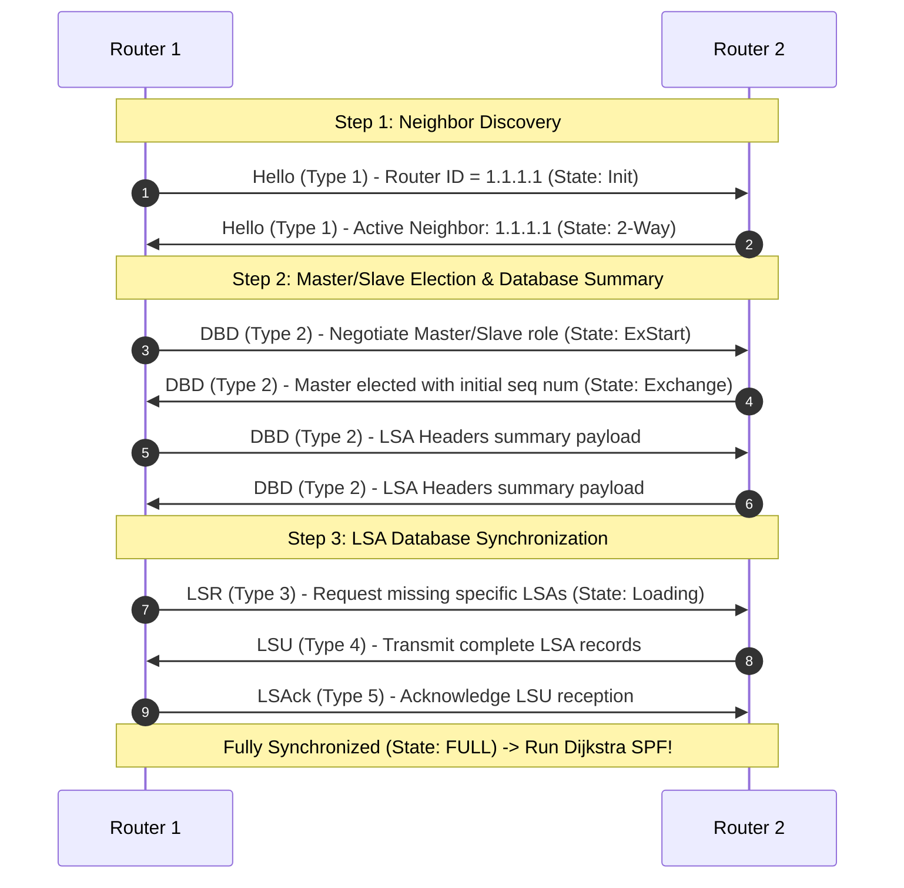
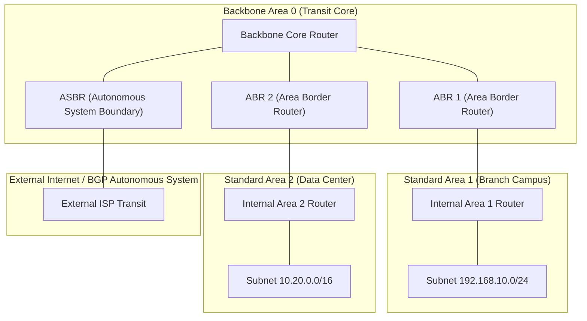

> [!info] Document Metadata
> - **Course:** `=this.course`
> - **Topic:** `=this.topic`
> - **Status:** `=this.status`

**Tags:** #[[Computer Science]] #[[NSCOM02]] #[[Conceptual]] #[[OSPF]] #[[Link-State]]

## Overview
Link-state routing protocols allow every router to build an independent, complete map of the network topology. Unlike distance-vector's "routing by rumor", link-state routers calculate their own best paths using Dijkstra's Shortest Path First (SPF) algorithm. Open Shortest Path First (OSPF) is a premier link-state protocol known for fast convergence, hierarchical design, and scalability in enterprise networks.

## Key Definitions
- **Link-State:** A routing method where each router possesses a full topology map (Link-State Database).
- **OSPF (Open Shortest Path First):** A widely deployed standard link-state routing protocol.
- **LSA (Link-State Advertisement):** Packets detailing a router's active interfaces, neighbors, and link costs.
- **LSDB (Link-State Database):** The collection of all LSAs, representing the network map.
- **Area 0:** The Backbone Area in multi-area OSPF; all other areas must connect to it.

## Theoretical Framework / Core Concepts

### Dijkstra's SPF Algorithm
Routers construct a Shortest Path Tree with themselves as the root. They evaluate the "cost" of each link (in OSPF, usually inversely proportional to bandwidth) to determine the lowest-cost path to every destination.

### OSPF Packet Types
1. **Hello (Type 1):** Discovers and maintains neighbors.
2. **Database Description (DBD) (Type 2):** Summarizes the local LSDB to sync with neighbors.
3. **Link State Request (LSR) (Type 3):** Requests specific missing LSAs.
4. **Link State Update (LSU) (Type 4):** Sends the requested full LSAs.
5. **Link State Acknowledgment (LSAck) (Type 5):** Acknowledges receipt of LSUs.

### Multi-Area OSPF Design
To handle large networks, OSPF uses a hierarchical structure. 
- **Area 0 (Backbone):** The core routing domain.
- **Non-backbone Areas:** Isolate link-state flooding. Changes in one area are summarized before passing to another, reducing memory and CPU loads on individual routers.

## Worked Examples / Protocol Walkthroughs / Calculations

### OSPF Path Selection vs RIP
If a router learns of `172.16.0.0/16` via OSPF and RIP:
- OSPF AD = 110
- RIP AD = 120
The router installs the OSPF route in its routing table (represented by an `O` in Cisco tables) because 110 is lower (more trustworthy) than 120.

## Summary & Key Takeaways
- Link-state routers independently compute shortest paths using the SPF algorithm.
- OSPF uses link bandwidth to calculate path cost.
- OSPF relies on partial, triggered updates (LSAs) only when a topology change occurs, contrasting with distance-vector's full periodic updates.
- Multi-area designs shrink LSDB sizes and lower processing overhead.

## Multiple Choice Questions

1. Which routing algorithm is utilized by Link-State protocols like OSPF?
    - **A)** Bellman-Ford
    - **B)** DUAL
    - **C)** Dijkstra's Shortest Path First (SPF)
    - **D)** Path-Vector

2. Instead of hop count, what metric does OSPF use to determine the best path?
    - **A)** Delay
    - **B)** Cost (inversely related to bandwidth)
    - **C)** Reliability
    - **D)** MTU

3. What structure does every OSPF router in an area build to independently calculate the shortest path to all networks?
    - **A)** The BGP Routing Information Base (RIB)
    - **B)** The MAC Address Table
    - **C)** The Link-State Database (LSDB)
    - **D)** The Distance-Vector Table

4. Which OSPF packet type is responsible for initially establishing neighbor relationships?
    - **A)** Type 1 - Hello
    - **B)** Type 2 - DBD
    - **C)** Type 3 - LSR
    - **D)** Type 4 - LSU

5. What information is carried inside a Type 4 Link-State Update (LSU) packet?
    - **A)** Only the router's IP address
    - **B)** ICMP Echo Requests
    - **C)** Link-State Advertisements (LSAs) detailing topology changes
    - **D)** BGP Keepalives

6. In a multi-area OSPF design, what is Area 0 exclusively known as?
    - **A)** The Stub Area
    - **B)** The Backbone Area
    - **C)** The Autonomous System Area
    - **D)** The Default Area

7. A router learns about the 172.16.0.0/16 network from both RIP and OSPF. Which route will be installed in the routing table, and why?
    - **A)** RIP, because its AD is 120
    - **B)** RIP, because it uses hop count
    - **C)** OSPF, because its AD (110) is lower than RIP's (120)
    - **D)** OSPF, because it uses cost

8. What is a primary drawback of using OSPF compared to RIP?
    - **A)** OSPF converges much slower than RIP
    - **B)** OSPF is limited to 15 hops
    - **C)** OSPF consumes more router CPU and memory resources
    - **D)** OSPF cannot support hierarchical design

9. In an OSPF network, what is the purpose of the Database Description (DBD) packet?
    - **A)** To acknowledge the receipt of an update
    - **B)** To provide a summary of the router's LSDB to a neighbor
    - **C)** To request a specific missing LSA
    - **D)** To terminate the neighbor adjacency

10. Which code letter represents an OSPF route in a Cisco routing table?
    - **A)** O
    - **B)** S
    - **C)** C
    - **D)** R

### Answer Key & Explanations

1. **C**. OSPF uses Dijkstra's Shortest Path First (SPF) algorithm to calculate loop-free paths.
2. **B**. OSPF relies on Cost, scaling it against link bandwidth.
3. **C**. The Link-State Database (LSDB) represents the router's complete topology map.
4. **A**. Hello packets are broadcast to discover and maintain adjacencies.
5. **C**. LSUs carry actual LSAs, detailing network changes.
6. **B**. Area 0 is the mandatory backbone in a multi-area design.
7. **C**. Administrative Distance (AD) determines trustworthiness; lower is better (OSPF 110 < RIP 120).
8. **C**. Maintaining the LSDB and running the SPF algorithm demands more hardware resources.
9. **B**. DBDs are exchanged early to check if local LSDBs are synchronized.
10. **A**. Cisco uses 'O' to mark routes dynamically learned via OSPF.

## References & Navigation

- **Previous Topic:** [[Distance-Vector Routing and RIP]]
- **Next Topic:** [[BGP and Interdomain Routing]]
- **Related Notes:** [[Distance-Vector Routing and RIP]], [[Network Layer]]
