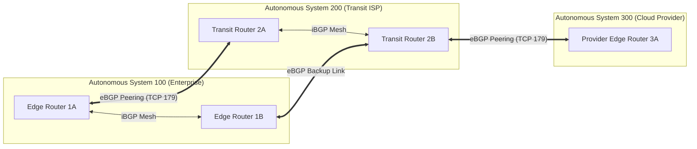
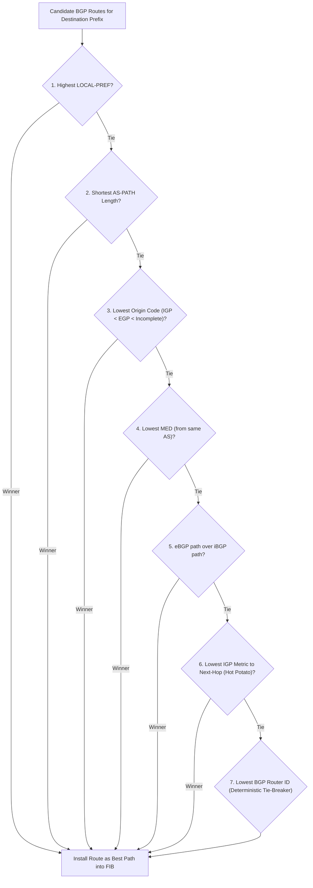

> [!info] Document Metadata
> - **Course:** `=this.course`
> - **Topic:** `=this.topic`
> - **Status:** `=this.status`

**Tags:** #[[Computer Science]] #[[NSCOM02]] #[[Conceptual]] #[[BGP]] #[[Routing]]

## Overview
Border Gateway Protocol (BGP) is the protocol that makes the internet work. It is an exterior gateway protocol (EGP) designed to exchange routing and reachability information among Autonomous Systems (AS) on the internet. Unlike interior protocols (like OSPF or RIP), BGP is a path-vector protocol that makes routing decisions based on paths, network policies, or rule-sets configured by a network administrator, prioritizing business policy over raw technical metrics like delay or hop count.

## Key Definitions
- **Interdomain Routing:** Routing between different Autonomous Systems.
- **BGP (Border Gateway Protocol):** The standard path-vector interdomain routing protocol.
- **Autonomous System (AS):** A collection of connected IP routing prefixes under the control of one or more network operators on behalf of a single administrative entity.
- **eBGP:** Exterior BGP; sessions established between routers in different ASes.
- **iBGP:** Interior BGP; sessions established between routers within the same AS.
- **Hot Potato Routing:** Forwarding a packet to the nearest exit point out of the local AS to minimize internal transit costs.

## Theoretical Framework / Core Concepts

### Path-Vector Operations and BGP Messages
BGP peers establish sessions over **TCP Port 179**. BGP uses four main message types:
1. **OPEN:** Establishes the connection and authenticates peers.
2. **UPDATE:** Advertises new routing information (NLRI) or withdraws previously advertised routes.
3. **KEEPALIVE:** Keeps the connection active (sent periodically).
4. **NOTIFICATION:** Sent when an error is detected; immediately closes the BGP TCP connection.

### Core BGP Attributes
BGP relies on attributes rather than simple metrics to choose the best path:
- **AS-PATH (Well-known mandatory):** A sequence of AS numbers a route has traversed. Crucial for loop prevention: if a router sees its own AS in the AS-PATH, it drops the route.
- **LOCAL-PREF:** Used inside an AS to choose the best outbound (exit) path. Higher is preferred.
- **MULTI-EXIT-DISC (MED):** Used to suggest to an external AS the preferred inbound (entry) path into your AS. Lower is preferred.

## Worked Examples / Protocol Walkthroughs / Calculations

### BGP Loop Prevention Scenario
Assume AS 100 advertises a prefix `10.0.0.0/8` to AS 200. The AS-PATH is `[100]`.
AS 200 forwards it to AS 300; AS-PATH becomes `[200, 100]`.
If a misconfiguration sends this route back to AS 100, the edge router at AS 100 examines the AS-PATH. Finding `100` inside `[200, 100]`, it drops the update, preventing a routing loop.

## Summary & Key Takeaways
- BGP is a Path-Vector Interdomain routing protocol that uses TCP 179.
- Network policy and attributes (LOCAL-PREF, MED) dictate routing choices, not link speed.
- The AS-PATH attribute fundamentally prevents routing loops at an inter-domain scale.
- A NOTIFICATION message immediately tears down the peering session.

## Multiple Choice Questions

1. Which protocol is strictly classified as an Interdomain routing protocol?
    - **A)** OSPF
    - **B)** EIGRP
    - **C)** RIP
    - **D)** BGP

2. What category of routing protocol does BGP fall under?
    - **A)** Distance-Vector
    - **B)** Link-State
    - **C)** Path-Vector
    - **D)** Autonomous-Vector

3. Which BGP message type is used to establish the initial connection and authenticate the peer?
    - **A)** UPDATE
    - **B)** OPEN
    - **C)** NOTIFICATION
    - **D)** KEEPALIVE

4. What transport protocol and port does BGP use to establish peer connections?
    - **A)** UDP 520
    - **B)** TCP 179
    - **C)** TCP 443
    - **D)** UDP 161

5. Which of the following best defines an eBGP session?
    - **A)** A session between two routers in the same Autonomous System
    - **B)** A session between two routers in different Autonomous Systems
    - **C)** A session that uses OSPF as a backup
    - **D)** A session that requires no authentication

6. What is the primary function of the BGP AS-PATH attribute?
    - **A)** To determine the internal cost to reach a gateway
    - **B)** To act as a loop-prevention mechanism by recording every AS the route passes through
    - **C)** To list the MAC addresses of all traversed routers
    - **D)** To assign an IP address to the next-hop router

7. Hot potato routing refers to a network's attempt to do what?
    - **A)** Pass the packet through as many ASes as possible
    - **B)** Drop packets when the CPU is overloaded
    - **C)** Hand off the packet to the nearest exit point to minimize internal transit costs
    - **D)** Maximize the inter-domain cost of a route

8. What action does a BGP router take immediately after sending a NOTIFICATION message?
    - **A)** It recalculates the shortest path
    - **B)** It closes the BGP TCP connection
    - **C)** It requests a new routing table
    - **D)** It retransmits the previous UPDATE message

9. How does a BGP router handle a received route if it sees its own AS number inside the AS-PATH attribute?
    - **A)** It prefers the route and installs it in the routing table
    - **B)** It modifies the AS number and forwards it
    - **C)** It drops the route because it indicates a routing loop
    - **D)** It places the route in a hold-down state

10. The LOCAL-PREF attribute is used to influence which of the following?
    - **A)** The best entry path into your Autonomous System
    - **B)** The best exit path out of your Autonomous System
    - **C)** The intra-domain OSPF cost
    - **D)** The MTU size of the data plane

### Answer Key & Explanations

1. **D**. BGP connects different Autonomous Systems (Interdomain).
2. **C**. BGP is a Path-Vector protocol utilizing complex attributes.
3. **B**. The OPEN message sets up the BGP peering session.
4. **B**. BGP requires reliable delivery and utilizes TCP over Port 179.
5. **B**. External BGP (eBGP) connects routers across different AS boundaries.
6. **B**. AS-PATH lists all transited ASes to fundamentally stop inter-AS loops.
7. **C**. Hot potato routing immediately dumps traffic out of the AS to save internal bandwidth.
8. **B**. NOTIFICATION indicates a fatal error, forcing connection termination.
9. **C**. Seeing its own AS in the AS-PATH means a loop has occurred; the route is discarded.
10. **B**. LOCAL-PREF is an intra-AS attribute dictating how outbound traffic leaves the network.

## References & Navigation

- **Previous Topic:** [[Link-State Routing and OSPF]]
- **Next Topic:** [[Software-Defined Networking]]
- **Related Notes:** [[Distance-Vector Routing and RIP]], [[Internetworking]]
