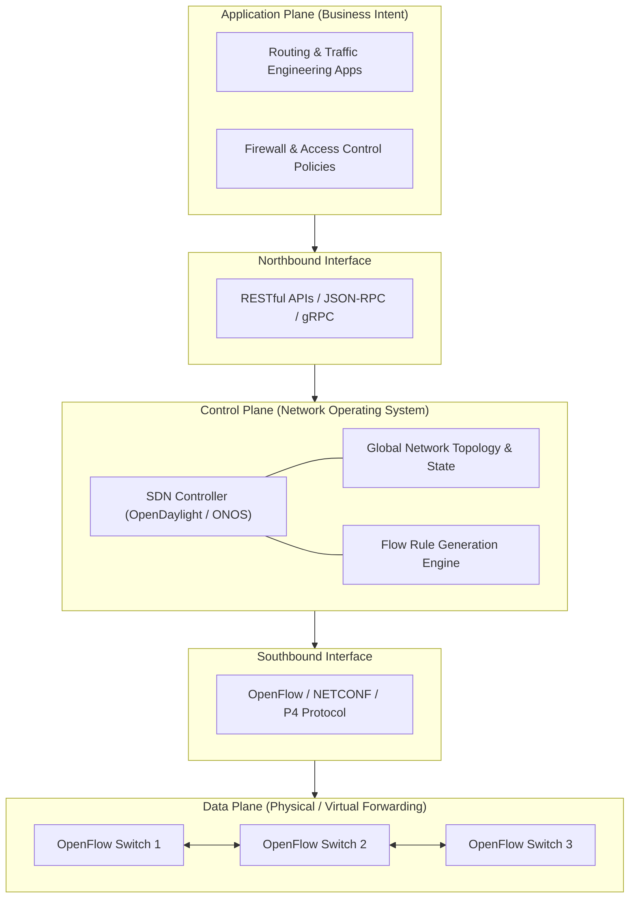
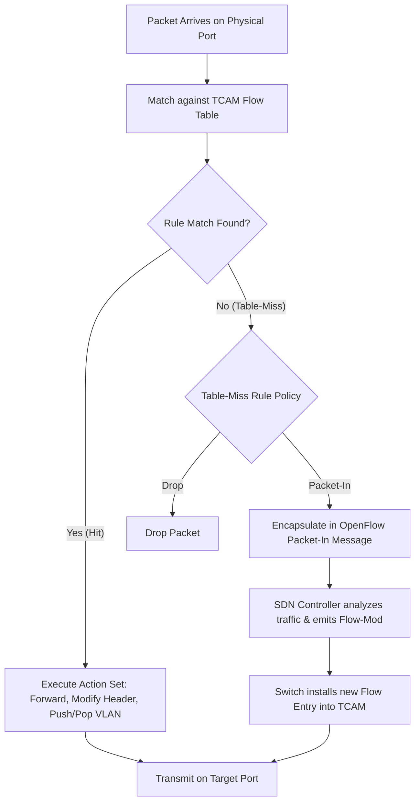

> [!info] Document Metadata
> - **Course:** `=this.course`
> - **Topic:** `=this.topic`
> - **Status:** `=this.status`

**Tags:** #[[Computer Science]] #[[NSCOM02]] #[[Conceptual]] #[[SDN]]

## Overview
Software-Defined Networking (SDN) is a modern network architecture that separates the network control plane (how routing decisions are made) from the data plane (how packets are forwarded). By decoupling these layers, SDN provides centralized, programmable, and dynamic control of network behavior, bypassing the rigid limitations of traditional, distributed routing protocols.

## Key Definitions
- **Control Plane:** The "brains" of the network, responsible for calculating paths and building routing tables.
- **Data Plane (Forwarding Plane):** The "muscle," responsible for actually moving packets from input ports to output ports.
- **SDN Controller:** The centralized software application that dictates the control plane logic for the entire network.
- **Southbound API:** Interfaces that bridge the SDN controller and the forwarding devices (e.g., OpenFlow).
- **Northbound API:** Interfaces that bridge the SDN controller and the overlying software applications/network administrators.

## Theoretical Framework / Core Concepts

### The Separation of Planes
In traditional networking, every router runs its own control plane (OSPF, BGP) and data plane. SDN extracts the control plane and centralizes it in the SDN Controller. 
The individual switches become "dumb" forwarding devices.

### OpenFlow Architecture
OpenFlow is the most prominent Southbound API protocol. Instead of traditional routing tables, OpenFlow uses **Flow Tables**.
Flow table entries consist primarily of two parts:
1. **Match Fields:** Criteria like Source IP, Destination MAC, VLAN ID, or TCP Port used to identify a packet.
2. **Actions:** What to do with the matched packet (e.g., forward out port 2, drop, modify header).

## Worked Examples / Protocol Walkthroughs / Calculations

### OpenFlow Packet Processing
When a packet arrives at an SDN switch:
1. The switch checks its flow tables.
2. If the packet header matches an existing rule (Match Field), the switch executes the associated Action (e.g., forward out Port 3).
3. If there is no match (table miss), the switch typically encapsulates the packet and sends it to the SDN Controller via the Southbound API to ask for instructions.

## Summary & Key Takeaways
- SDN cleanly abstracts the network control plane from the data plane.
- Centralized control allows network-wide programmability and automation.
- Southbound APIs (like OpenFlow) communicate with switches.
- Northbound APIs allow software apps to define network logic.
- Flow tables dictate forwarding based on Match Fields and Actions.

## Multiple Choice Questions
1. In a Software-Defined Network (SDN), what function is completely removed from the individual switches?
- **A)** The Data Plane
- **B)** The Physical Ports
- **C)** The Control Plane
- **D)** Packet Forwarding

2. What is the primary role of the Data Plane in a network device?
- **A)** To calculate the shortest path tree
- **B)** To exchange routing updates with neighbors
- **C)** To forward incoming packets to the correct output port based on local tables
- **D)** To authenticate the SDN controller

3. Which protocol serves as the standard Southbound API between an SDN controller and the forwarding switches?
- **A)** BGP
- **B)** OpenFlow
- **C)** OSPF
- **D)** SNMP

4. What interface does a network administrator or software application use to program network logic into the centralized SDN controller?
- **A)** The Southbound API
- **B)** The Northbound API
- **C)** The East-West API
- **D)** The Data Plane API

5. In an OpenFlow switch, what two primary components make up a flow table entry?
- **A)** IP address and MAC address
- **B)** Match fields and Actions
- **C)** LSA and LSDB
- **D)** AS-PATH and NEXT-HOP

6. What is a primary advantage of utilizing SDN in a modern enterprise network?
- **A)** It eliminates the need for IP addressing
- **B)** It allows centralized, programmable, and automated control of network-wide traffic flows
- **C)** It allows routers to physically move data without using electricity
- **D)** It replaces all copper cabling with fiber optics

7. Which plane is responsible for actually modifying packet headers if instructed?
- **A)** Control Plane
- **B)** Management Plane
- **C)** Data Plane
- **D)** Application Plane

8. What happens in an OpenFlow switch if a packet doesn't match any existing flow entries?
- **A)** It is broadcast out all ports
- **B)** It is sent to the Controller for processing
- **C)** It drops the packet silently
- **D)** It routes it via OSPF

9. In the SDN paradigm, traditional routing protocols (like OSPF or BGP) are typically:
- **A)** Moved to the Data Plane
- **B)** Executed on the centralized Controller or abandoned entirely for custom logic
- **C)** Run on every single switch simultaneously
- **D)** Converted into OpenFlow actions

10. What connects the Application Plane to the Control Plane in SDN?
- **A)** Southbound Interfaces
- **B)** Northbound Interfaces
- **C)** Physical cables
- **D)** Fiber optic links

### Answer Key & Explanations
1. **C** - The Control plane is abstracted away to the centralized controller.
2. **C** - The Data plane solely handles the physical and logical forwarding of traffic.
3. **B** - OpenFlow is the most common protocol bridging controllers and switches (Southbound).
4. **B** - Northbound APIs allow apps/admins to communicate intent down to the controller.
5. **B** - Flow tables evaluate 'Match fields' and execute corresponding 'Actions'.
6. **B** - Centralized, automated configuration is the fundamental benefit of SDN.
7. **C** - The Data plane executes the actions, which can include modifying headers.
8. **B** - The switch asks the controller how to handle unknown traffic.
9. **B** - Control plane logic moves to the controller application space.
10. **B** - Northbound APIs link higher-level applications to the controller.

## References & Navigation

- **Previous Topic:** [[BGP and Interdomain Routing]]
- **Next Topic:** [[Network Management, ICMP, and SNMP]]
- **Related Notes:** [[Network Layer]], [[BGP and Interdomain Routing]]
