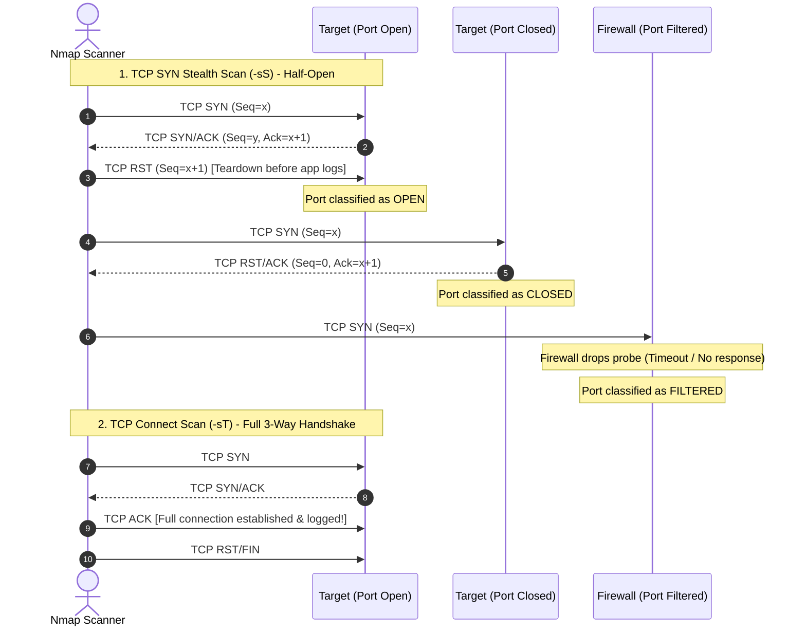

# Network Scanning

> [!info] Document Metadata
> - **Course:** `=this.course`
> - **Topic:** `=this.topic`
> - **Status:** `=this.status`

**Tags:** #[[Computer Science]] #[[NSSECU2]] #[[Cybersecurity]] #[[Network Scanning]] #[[Nmap]] #[[Port Scanning]] #[[TCP]] #[[UDP]]

---

## Overview

> Network scanning marks the operational transition from passive reconnaissance to active target probing. By dispatching crafted TCP, UDP, and ICMP packets across target IP ranges, security analysts determine live host availability, map exposed network ports, and evaluate transport-layer firewall behaviors. Mastering low-level packet dynamics—specifically the distinction between half-open TCP SYN scans, full TCP connect handshakes, and asynchronous UDP probes—enables precise, efficient network discovery while managing detection profiles and scanning overhead.

## Key Definitions

- **Host Discovery:** The process of determining which IP addresses within a target subnet are active, responsive systems (e.g., via ping sweeps or ARP probing).
- **Port Scanning:** Probing a list of transport-layer ports (TCP and UDP 1–65535) on a target host to identify listening network daemons.
- **Port State:** The operational condition of a probed port as classified by [[Nmap]]:
  - **Open:** An application is actively accepting connections on this port.
  - **Closed:** The target host responds with a packet indicating no service is listening (e.g., TCP RST or ICMP Port Unreachable).
  - **Filtered:** A firewall, router filter, or network device drops or blocks probes, preventing Nmap from determining if the port is open or closed.
  - **Unfiltered:** The port is accessible, but Nmap cannot determine whether it is open or closed (typically seen in ACK scans).
  - **Open|Filtered:** Nmap cannot distinguish whether the port is open or filtered by a packet filter (common in UDP scanning).
- **Three-Way Handshake:** The standard TCP connection establishment sequence: `SYN` $\rightarrow$ `SYN/ACK` $\rightarrow$ `ACK`.
- **TCP SYN Stealth Scan (`-sS`):** A "half-open" scanning technique that sends a `SYN` packet, awaits a `SYN/ACK`, and immediately responds with a `RST` to tear down the connection before it is completed by the operating system.
- **TCP Connect Scan (`-sT`):** A scan that uses the operating system's native `connect()` system call, completing the full three-way handshake; standard fallback when root raw socket privileges are unavailable.
- **UDP Scan (`-sU`):** Scanning connectionless UDP services by transmitting empty or protocol-specific UDP packets and analyzing ICMP error responses.
- **Timing Template:** Nmap pre-configured timing parameters (`-T0` to `-T5`) that govern probe delay, timeout thresholds, and packet concurrency.

## Theoretical Framework / Core Concepts

### 1. Host Discovery Mechanics

Before committing time to scan 65,535 ports per host, practitioners execute host discovery sweeps across target CIDR blocks:

```text
+-----------------------------------------------------------------------------------+
|                            HOST DISCOVERY METHODOLOGIES                           |
+-----------------------------------------------------------------------------------+
|  1. Local Ethernet / Layer 2: ARP Ping (-PR)                                      |
|     -> Broadcasts ARP requests; cannot be blocked by OS firewalls on local LAN.   |
+-----------------------------------------------------------------------------------+
|  2. Layer 3 / ICMP Ping Sweep (-sn -PE -PP -PM)                                   |
|     -> Sends ICMP Echo Requests (Type 8), Timestamp Requests, or Netmask Requests |
|     -> Frequently filtered by modern enterprise perimeter firewalls.              |
+-----------------------------------------------------------------------------------+
|  3. Layer 4 / TCP & UDP Probes (-PS, -PA, -PU)                                    |
|     -> Sends TCP SYN to port 80/443 (-PS) or TCP ACK to port 80 (-PA)             |
|     -> Bypasses pure ICMP blocks by eliciting TCP RST or SYN/ACK responses.       |
+-----------------------------------------------------------------------------------+
```

### 2. TCP Port Scanning Packet Dynamics

The fundamental distinction between scan types lies in how they interact with the TCP state machine:



#### Detailed Comparison of Scan Techniques

| Dimension | TCP SYN Scan (`-sS`) | TCP Connect Scan (`-sT`) | UDP Scan (`-sU`) |
| :--- | :--- | :--- | :--- |
| **Privileges Required** | Root / Administrator (`sudo`) for raw sockets | Any standard user account | Root / Administrator (`sudo`) |
| **Handshake State** | Half-open (SYN $\rightarrow$ SYN/ACK $\rightarrow$ RST) | Full completion (SYN $\rightarrow$ SYN/ACK $\rightarrow$ ACK) | No handshake (Connectionless) |
| **Application Logging** | Rarely logged by application layer | Logged in application daemon access logs | Logged only if valid application payload sent |
| **Scan Speed** | Fast, highly optimized | Slower (system call overhead per socket) | Very slow (due to ICMP rate limiting) |
| **Firewall Detection** | Easily detected by modern IDS/IPS | Detected by IDS/IPS and server logs | Harder to detect without Deep Packet Inspection |

### 3. UDP Port Scanning Dynamics & Rate Limiting

UDP scanning is notoriously slow due to operating system design:

1. **Open UDP Port:** If an application is listening and receives a valid probe, it may reply with an application-specific UDP response (e.g., DNS reply). If no data is returned, Nmap classifies the port as `open|filtered`.
2. **Closed UDP Port:** If no service is listening, the target host kernel generates an **ICMP Type 3 Code 3 (Destination Unreachable: Port Unreachable)** error packet.
3. **Filtered UDP Port:** If a firewall drops the UDP packet without responding, or returns ICMP Type 3 Codes 1, 2, 9, 10, or 13, Nmap marks the port as `filtered`.
4. **ICMP Rate Limiting:** The Linux kernel strictly limits ICMP error generation (e.g., `icmp_ratelimit` defaults to 1 packet per second), causing full-range UDP scans to take several hours if not carefully scoped.

### 4. Nmap Performance & Timing Controls

Nmap provides six timing templates to balance speed and network impact:

| Template | Name | Description & Use Case |
| :--- | :--- | :--- |
| `-T0` | **Paranoid** | Serial scanning, 5-minute wait between probes; designed for IDS evasion. |
| `-T1` | **Sneaky** | 15-second wait between probes; stealth operations. |
| `-T2` | **Polite** | 0.4-second delay; minimizes network bandwidth consumption. |
| `-T3` | **Normal** | Default timing; dynamic adjustments based on network responsiveness. |
| `-T4` | **Aggressive** | Fast, reliable network scanning; caps probe timeouts to 1.25s. Preferred for CTFs and assessments. |
| `-T5` | **Insane** | Sacrifices accuracy for speed; caps timeouts at 0.3s; suitable only for ultra-fast local LANs. |

## Nmap Command Reference & Scanning Protocols

```bash
# 1. Host Discovery / Ping Sweep (No Port Scan)
nmap -sn 192.168.10.0/24 -oN host_discovery.txt

# 2. Fast Top 100 Ports Discovery Scan
nmap -sS -F -T4 192.168.10.45 -oN quick_scan.txt

# 3. Comprehensive Full 65,535 TCP Port Scan
nmap -sS -p- -T4 --min-rate 1000 192.168.10.45 -oN full_tcp.txt

# 4. Service Version & OS Fingerprinting on Identified Open Ports
nmap -sV -sC -O -p 22,80,443,8080 -T4 192.168.10.45 -oA deep_service_scan

# 5. Targeted Top UDP Ports Scan
nmap -sU -p 53,67,68,69,123,161,500,514 -T4 192.168.10.45 -oN top_udp.txt

# 6. Aggressive Multi-Vector Scan (Service + Scripts + OS + Traceroute)
nmap -A -p- -T4 192.168.10.45 -oA aggressive_scan
```

### Key Nmap Flags Summary

- `-sS`: TCP SYN Stealth Scan (default with root).
- `-sT`: TCP Connect Scan (unprivileged default).
- `-sU`: UDP Scan.
- `-sV`: Probe open ports to determine service name and version info.
- `-sC`: Run default safe Lua scripts from the Nmap Scripting Engine (NSE).
- `-O`: Enable TCP/IP stack fingerprinting for Operating System detection.
- `-p-`: Scan all 65,535 ports (equivalent to `-p 1-65535`).
- `--min-rate <num>`: Force Nmap to send at least `<num>` packets per second.
- `-oA <basename>`: Save scan outputs in Normal (`.nmap`), XML (`.xml`), and Grepable (`.gnmap`) formats simultaneously.

## Evidence Logging & Scan Output Interpretation

When documenting scan results, security analysts must separate observed network transport behavior from speculative vulnerability claims:

```text
================================================================================
PORT SCAN EVIDENCE LOG
================================================================================
Target IP:       192.168.10.45
Scan Command:    nmap -sS -sV -p 22,80,3306 -T4 192.168.10.45
Execution Date:  2026-09-02T02:40:00Z

Observed Results:
PORT     STATE SERVICE VERSION
22/tcp   open  ssh     OpenSSH 8.2p1 Ubuntu 4ubuntu0.5 (Ubuntu Linux; protocol 2.0)
80/tcp   open  http    Apache httpd 2.4.41 ((Ubuntu))
3306/tcp open  mysql   MySQL 8.0.28-0ubuntu0.20.04.3

Factual Interpretation:
1. Host is live running Ubuntu Linux (focal 20.04 LTS).
2. Remote administrative SSH daemon is exposed on standard TCP/22.
3. Web service active on TCP/80; presents Apache 2.4.41 banner.
4. Database service (MySQL 3306) is directly bound to external interface (potential exposure).

Next Actionable Step:
Proceed to Module 4 (Enumeration) to banner grab and inspect MySQL permissions and HTTP web paths.
================================================================================
```

## Common Mistakes & Defensive Detection

- **Scanning Only Top 1000 Ports:** Default Nmap scans only the top 1000 most common ports. Attackers frequently place backdoors and administration consoles on high ports (e.g., 8080, 8443, 9001, 31337). Always run `-p-` during thorough assessments.
- **Using `-T5` on Unstable Networks:** Timing template `-T5` drops packet retransmission timers drastically, causing dropped packets to be falsely reported as `filtered` or `closed`.
- **Misinterpreting `Filtered` Ports:** Marking filtered ports as "secure" without realizing that a stateful firewall may be temporarily dropping SYN packets during peak loads.
- **Defensive Alerting:** TCP SYN floods and rapid sequential port sweeps trigger standard Snort and Suricata rules (`ET SCAN Potential Nmap Scan`). Using distributed scanning, randomized port ordering, or tuned timing (`-T2` / `-T3`) minimizes signature tripping.

## Multiple Choice Questions

1. Why does a TCP SYN scan (`-sS`) require root or administrative privileges to execute?
    - **A)** Because it modifies the host's default gateway routing table.
    - **B)** Because it constructs and transmits raw TCP packets bypassing the OS network stack.
    - **C)** Because it automatically alters the remote server's file permissions.
    - **D)** Because it decrypts encrypted SSH passwords in kernel memory.

2. In a TCP SYN scan, what packet does the scanner transmit immediately upon receiving a `SYN/ACK` from the target port?
    - **A)** `ACK`
    - **B)** `FIN`
    - **C)** `RST`
    - **D)** `PSH`

3. An Nmap scan against port 80 returns the state `filtered`. What does this indicate?
    - **A)** The port is actively accepting connections and serving an HTTP website.
    - **B)** The port responded with a `RST` packet indicating no service is listening.
    - **C)** A packet filtering device (firewall or ACL) dropped the probe, preventing Nmap from determining the true state.
    - **D)** The web server software was uninstalled by the system administrator.

4. Which Nmap command combination executes a ping sweep across the subnet `10.0.0.0/24` without performing any port scanning?
    - **A)** `nmap -sT 10.0.0.0/24`
    - **B)** `nmap -sn 10.0.0.0/24`
    - **C)** `nmap -p- 10.0.0.0/24`
    - **D)** `nmap -A 10.0.0.0/24`

5. Why are full 65,535-port UDP scans (`-sU -p-`) significantly slower than TCP scans against Linux targets?
    - **A)** UDP packets are twice as large as TCP packets.
    - **B)** The Linux kernel enforces strict ICMP rate limiting (typically 1 ICMP Port Unreachable packet per second).
    - **C)** UDP requires a four-way handshake for every port probed.
    - **D)** Nmap can only scan one UDP port per hour.

6. What is the effect of specifying the timing template `-T4` during an Nmap scan?
    - **A)** It delays each probe by 5 minutes to evade intrusion detection systems.
    - **B)** It sets aggressive timing parameters suitable for modern, reliable broadband networks.
    - **C)** It automatically exploits all discovered vulnerabilities using Metasploit.
    - **D)** It converts all TCP scans into UDP broadcasts.

7. Which Nmap flag combination instructs the tool to run default safe NSE scripts, detect service versions, and identify the remote operating system?
    - **A)** `-sn -PR`
    - **B)** `-sC -sV -O`
    - **C)** `-T0 -p 80`
    - **D)** `-oG output.gnmap`

8. A penetration tester scans only the default top 1000 ports and concludes that a server only runs SSH. Later, an attacker compromises the server via an admin console listening on port 8443. What scanning mistake occurred?
    - **A)** The tester failed to scan the full 1–65535 TCP port range (`-p-`).
    - **B)** The tester used a TCP SYN scan instead of a ping sweep.
    - **C)** The tester failed to turn off their own firewall.
    - **D)** The tester should have scanned only UDP ports.

### Answer Key & Explanations

1. **B**. Raw socket generation and custom packet flag manipulation (`SYN`, `RST`) require low-level kernel socket access, which is restricted to **root / Administrator** privileges.
2. **C**. To maintain a half-open state and prevent the connection from reaching the application layer, Nmap immediately sends a **`RST` (Reset)** packet upon receiving `SYN/ACK`.
3. **C**. A **`filtered`** state occurs when probes are silently dropped or blocked by an intermediary firewall, packet filter, or router access control list (ACL).
4. **B**. The **`-sn`** flag (formerly `-sP`) disables port scanning and performs only host discovery (ping sweep).
5. **B**. When probing closed UDP ports, Linux hosts generate **ICMP Destination Unreachable** packets, but kernel-level **rate limiting** throttles these responses to approximately 1 per second.
6. **B**. Timing template **`-T4` (Aggressive)** accelerates scanning by reducing probe timeouts and dynamic retransmission wait times, ideal for stable networks.
7. **B**. **`-sC`** runs default safe scripts, **`-sV`** determines service versions, and **`-O`** enables operating system detection.
8. **A**. High non-standard ports (e.g., 8080, 8443, 9001) are frequently omitted when relying solely on default top-1000 scans. Thorough audits require **`-p-`** (full 65,535 range).

## References & Navigation

- **Previous Topic:** [[Information Gathering and Reconnaissance]]
- **Next Topic:** [[Enumeration]]
- **Related Notes:** [[Information Gathering and Reconnaissance]], [[Enumeration]]
