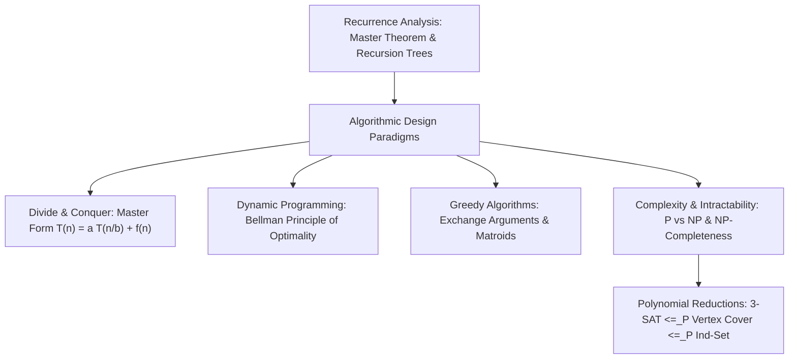
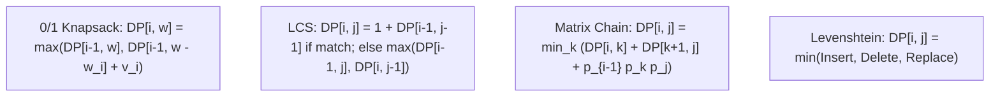
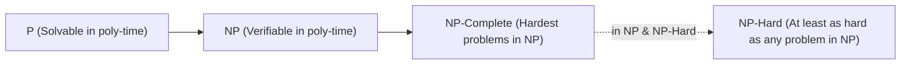

> [!info] Document Metadata
> - **Course:** `=this.course`
> - **Topic:** `=this.topic`
> - **Status:** `=this.status`

**Tags:** #[[Computer Science]] #[[CSALGCM]] #[[Algorithms]] #[[Complexity Theory]] #[[Reviewer]] #[[Finals]]

---

# CSALGCM Comprehensive Finals Reviewer

## Overview

This reviewer synthesizes Algorithms and Advanced Complexity (CSALGCM). Subjects cover computational complexity analysis (Asymptotic notations $O, \Omega, \Theta$, recurrence relations via Master Theorem, Recursion Tree, and Substitution methods), Divide and Conquer paradigms (MergeSort, QuickSort, Closest Pair of Points, Strassen's Matrix Multiplication), Dynamic Programming (optimal substructure, overlapping subproblems, memoization vs tabulation: 0/1 Knapsack, Longest Common Subsequence, Matrix Chain Multiplication, Levenshtein Edit Distance), Greedy Algorithms (Greedy Choice Property, Exchange Arguments: Fractional Knapsack, Huffman Coding, Activity Selection, Job Sequencing), and Computational Intractability (Decision problems, P, NP, NP-Completeness, polynomial-time reductions $\le_P$, Cook-Levin theorem, 3-SAT, Vertex Cover, Independent Set, Hamiltonian Cycle, TSP).

---

## 1. Master Theorem Recurrence Matrix

For recurrences of the standard form $T(n) = a T(n/b) + f(n)$ with $a \ge 1, b > 1$:
Let $c_{\text{crit}} = \log_b(a)$.

| Case | Condition on $f(n)$ | Solution $T(n)$ | Dominant Cost |
| :--- | :--- | :--- | :--- |
| **Case 1** | $f(n) = O(n^{c})$ where $c < c_{\text{crit}}$ | $\Theta(n^{\log_b a})$ | Tree Leaves dominate |
| **Case 2** | $f(n) = \Theta(n^{c_{\text{crit}}} \log^k n)$ for $k \ge 0$ | $\Theta(n^{\log_b a} \log^{k+1} n)$ | Evenly distributed across all levels |
| **Case 3** | $f(n) = \Omega(n^c)$ where $c > c_{\text{crit}}$ AND $a f(n/b) \le k f(n)$ | $\Theta(f(n))$ | Tree Root dominates |

---

## 2. Dynamic Programming Formulations

---

## 3. Complexity Classes & Reduction Hierarchy

- **P**: Problems solvable in deterministic polynomial time $O(n^k)$.
- **NP**: Decision problems verifiable by a deterministic Turing machine in polynomial time given a certificate.
- **NP-Complete**: $L \in \text{NP}$ and $\forall L' \in \text{NP}, L' \le_P L$.
- **Reduction Rule**: If $A \le_P B$ and $B \in \text{P} \implies A \in \text{P}$. If $A \le_P B$ and $A$ is NP-hard $\implies B$ is NP-hard!

---

## 4. High-Yield Exam Checklist

- [ ] In the Master Theorem, can you apply it if $b \le 1$ or $a < 1$? **NO**.
- [ ] What is the time complexity of the 0/1 Knapsack DP algorithm? Pseudo-polynomial $O(n W)$ (polynomial in $n$ and magnitude of $W$, but exponential in the number of bits of $W$).
- [ ] To prove a new problem $Y$ is NP-Complete, what must you reduce? Reduce a **known NP-Complete problem $X$ to $Y$** ($X \le_P Y$), NOT $Y \to X$!
- [ ] Does Fractional Knapsack require dynamic programming? **NO**, it is solved greedily by sorting by value-to-weight ratio $v_i / w_i$ in $O(n \log n)$.
- [ ] What is the optimal prefix code length metric in Huffman coding? Weighted average path length $\sum f_i \cdot \text{length}(c_i)$.

---

## 5. Comprehensive Practice Exam

1. Using the Master Theorem, what is the asymptotic solution to the recurrence $T(n) = 4 T(n/2) + n^2$?
   - A) $\Theta(n)$
   - B) $\Theta(n^2)$
   - C) $\Theta(n^2 \log n)$
   - D) $\Theta(n^3)$

2. What property allows a problem to be solved efficiently using Dynamic Programming rather than recalculating subproblems repeatedly?
   - A) Greedy Choice Property
   - B) Overlapping Subproblems and Optimal Substructure
   - C) Disjoint Subproblems
   - D) NP-Completeness

3. Which problem is solvable in polynomial time using a greedy algorithm based on value-to-weight ratio?
   - A) 0/1 Knapsack Problem
   - B) Fractional Knapsack Problem
   - C) Subset Sum Problem
   - D) Traveling Salesperson Problem

4. To prove that a new decision problem $B$ is NP-Complete, which two steps are required?
   - A) Prove $B \in \text{P}$, and reduce $B \le_P \text{3-SAT}$.
   - B) Prove $B \in \text{NP}$, and reduce a known NP-Complete problem $A$ to $B$ in polynomial time ($A \le_P B$).
   - C) Prove $B \in \text{NP}$, and reduce $B$ to a known polynomial problem $A$.
   - D) Show that $B$ cannot be solved in less than exponential time.

5. In Matrix Chain Multiplication of 4 matrices with dimensions $10 \times 100 \times 5 \times 50 \times 1$, what does the entry $m[i, j]$ represent in the DP table?
   - A) The product of matrices $A_i$ through $A_j$
   - B) The minimum number of scalar multiplications needed to compute the matrix product $A_i \dots A_j$
   - C) The optimal number of parentheses splits
   - D) The rank of the resulting product matrix

---

### Answer Key & Explanations

1. **C) $\Theta(n^2 \log n)$** — Here $a = 4, b = 2$. $c_{\text{crit}} = \log_b(a) = \log_2(4) = 2$. $f(n) = n^2 = \Theta(n^{c_{\text{crit}}} \log^0 n)$. By Master Theorem Case 2 (with $k = 0$), $T(n) = \Theta(n^2 \log n)$.
2. **B) Overlapping Subproblems and Optimal Substructure** — Dynamic programming caches solutions to overlapping subproblems to ensure each distinct state is evaluated only once, requiring optimal substructure (optimal solution composed of optimal solutions to subproblems).
3. **B) Fractional Knapsack Problem** — Because items can be divided continuously, greedily selecting items with the highest value-to-weight ratio $v_i / w_i$ guarantees an optimal solution.
4. **B) Prove $B \in \text{NP}$, and reduce a known NP-Complete problem $A$ to $B$ in polynomial time ($A \le_P B$)** — Showing $B \in \text{NP}$ proves it is verifiable in polynomial time; reducing a known NP-Complete problem $A$ to $B$ proves that $B$ is at least as hard as any problem in NP (NP-Hard).
5. **B) The minimum number of scalar multiplications needed to compute the matrix product $A_i \dots A_j$** — The DP recurrence table stores the minimized scalar multiplication cost over all possible parenthesization splits $k$ between $i$ and $j$.

---

## References & Navigation

- **Previous Topic:** [[CCDSALG]], [[CCDSTRU]]
- **Next Topic:** None
- **Prerequisites:** [[Algorithms and Complexity]], Master Theorem, DP, Greedy, NP-Completeness
- **Cross-Curricular Connections:** [[CSINTSY]]
