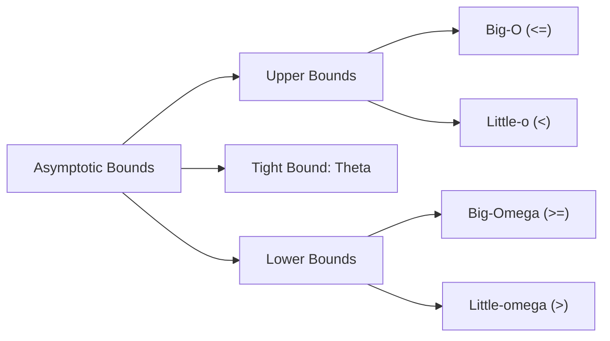

# [QZ] Evaluation of Algorithms

> [!info] Document Metadata
> **Course:** `=this.course` | **Topic:** `=this.topic` | **Status:** `=this.status`

**Tags:** #[[Computer Science]] #[[CSALGCM]] #[[Algorithms]] #[[Quiz]] #[[Asymptotic Analysis]] #[[Graph Representation]]

---

## Overview

Algorithm evaluation measures computational efficiency independently of specific hardware or compilers by using the Random-Access Machine (RAM) model and asymptotic growth notation. Comparing functions via $O$, $\Omega$, $\Theta$, $o$, and $\omega$ captures how time and space scale as input size $n$ grows toward infinity. These same tools evaluate fundamental data structures such as adjacency lists for representing graphs with $n$ vertices and $m$ edges.

## Asymptotic Notation Reference

| Notation | Limit Definition ($\lim_{n\to\infty} f(n)/g(n)$) | Intuitive Comparison | Strict or Inclusive? |
| :--- | :--- | :--- | :--- |
| $f = O(g)$ | $< \infty$ (bounded above by constant) | $f \le g$ | Inclusive (slower or same rate) |
| $f = o(g)$ | $= 0$ | $f < g$ | Strict (strictly slower) |
| $f = \Omega(g)$ | $> 0$ (bounded below by positive constant) | $f \ge g$ | Inclusive (faster or same rate) |
| $f = \omega(g)$ | $= \infty$ | $f > g$ | Strict (strictly faster) |
| $f = \Theta(g)$ | $= c$ where $0 < c < \infty$ | $f = g$ | Tight (same rate) |

## Quiz Compilation & Explanations

### Question 1 (1 pt)

**Prompt:**
The computing model underlying running time analysis of algorithms is called:

**Choices:**

- ROM
- RAM *(Correct)*
- Turing machine
- HPC

**Correct Answer:** **RAM**

**Rationale:**

- **Why RAM is correct:** Standard algorithm analysis uses the **Random-Access Machine (RAM)** model, which assumes sequential execution of primitive operations (arithmetic, data movement, control flow) in $O(1)$ constant time and constant-time memory access.
- **Why ROM is wrong:** ROM (Read-Only Memory) is a physical non-volatile storage hardware component, not an abstract computational model for complexity analysis.
- **Why Turing machine is wrong:** While Turing machines are foundational in computability and complexity theory (e.g., $\text{P}$ vs. $\text{NP}$), practical running-time analysis of algorithms uses the RAM model because Turing tapes lack constant-time random memory access.
- **Why HPC is wrong:** HPC (High-Performance Computing) refers to parallel supercomputing clusters rather than the baseline sequential model of algorithm analysis.

---

### Question 2 (1 pt)

**Prompt:**
True or False?

$$2n^2 + 10^8 n \log n = \omega(n \log n)$$

**Choices:**

- True *(Correct)*
- False

**Correct Answer:** **True**

**Rationale:**

- **Why True is correct:** Evaluating the limit as $n \to \infty$:

$$\lim_{n \to \infty} \frac{2n^2 + 10^8 n \log n}{n \log n} = \lim_{n \to \infty} \left(\frac{2n}{\log n} + 10^8\right) = \infty$$

Because the ratio diverges to $\infty$, $2n^2 + 10^8 n \log n$ grows strictly faster than $n \log n$, which is the exact definition of $\omega(n \log n)$.

- **Why False is wrong:** Selecting False typically falls for the large constant factor $10^8$ on $n \log n$. In asymptotic analysis, any positive constant coefficient is eventually dwarfed by a higher-order term ($2n^2$).

---

### Question 3 (1 pt)

**Prompt:**
True or False?
If $f = O(h)$ and $g = O(h)$, then $f + g = O(h)$.

**Choices:**

- True *(Correct)*
- False

**Correct Answer:** **True**

**Rationale:**

- **Why True is correct:** By definition of Big-$O$, there exist constants $c_1, n_1 > 0$ and $c_2, n_2 > 0$ such that $f(n) \le c_1 h(n)$ for $n \ge n_1$ and $g(n) \le c_2 h(n)$ for $n \ge n_2$. Setting $c = c_1 + c_2$ and $n_0 = \max(n_1, n_2)$, for all $n \ge n_0$:

$$f(n) + g(n) \le (c_1 + c_2)h(n) = c \cdot h(n)$$

Thus $f + g = O(h)$ holds (closure of Big-$O$ under addition).

- **Why False is wrong:** Adding two functions bounded by $h$ only scales the constant multiple ($c_1 + c_2$), which does not change the asymptotic growth class.

---

### Question 4 (1 pt)

**Prompt:**
True or False?
$f = o(g)$ means $f$ grows slower or at the same rate as $g$.

**Choices:**

- True
- False *(Correct)*

**Correct Answer:** **False**

**Rationale:**

- **Why False is correct:** Little-$o$ ($f = o(g)$) requires $\lim_{n \to \infty} \frac{f(n)}{g(n)} = 0$, meaning $f$ grows **strictly slower** than $g$ (analogous to $<$). It explicitly excludes growing at the same rate.
- **Why True is wrong:** "Grows slower or at the same rate as $g$" describes **Big-$O$** ($f = O(g)$, analogous to $\le$), not little-$o$.

---

### Question 5 (3 pts)

**Prompt:**
The following statements are about adjacency list representation $A$ of a graph $G$ with $n$ vertices and $m$ edges.
Place a `T` if true, and `F` if false.

| Statement | Correct Answer |
| :--- | :--- |
| The size of $A$ is $\Theta(n + m)$. | **T** |
| The size of $A$ is $O(n^2)$. | **T** |
| Using $A$, it takes $O(1)$ time to compute the degree of a vertex $v$ of $G$. | **F** |

**Statement-by-Statement Rationale:**

- **The size of $A$ is $\Theta(n + m)$ is T (Correct):** An adjacency list stores an array of $n$ vertex list headers plus $m$ edge entries (for a directed graph) or $2m$ edge entries (for an undirected graph). Total space is $\Theta(n + m)$.
- **The size of $A$ is $O(n^2)$ is T (Correct):** In any simple graph with $n$ vertices, the number of edges satisfies $m \le n(n - 1) = O(n^2)$ (directed) or $m \le \binom{n}{2} = O(n^2)$ (undirected). Hence $\Theta(n + m) = O(n + n^2) = O(n^2)$.
- **Using $A$, it takes $O(1)$ time to compute the degree of a vertex $v$ of $G$ is F (Incorrect):** In a standard adjacency list (linked lists without stored length metadata), computing the degree of vertex $v$ requires traversing all nodes in $A[v]$, which takes $\Theta(\deg(v)) = O(n)$ time in the worst case, not $O(1)$.

---

### Question 6 (3 pts)

**Prompt:**
Let $f(n) = \log_2(n)$ and $g(n) = \log_3(n)$.
Place a `T` if True and `F` if false.

| Statement | Correct Answer |
| :--- | :--- |
| 1. $f = o(g)$ | **F** |
| 2. $f = O(g)$ | **T** |
| 3. $f = \Theta(g)$ | **T** |

**Derivation via Change of Base:**

$$f(n) = \log_2(n) = \frac{\log_3(n)}{\log_3(2)} = (\log_2 3) \cdot \log_3(n) \approx 1.585 \cdot g(n)$$

Because $\log_2 3$ is a positive constant, $f(n)$ and $g(n)$ have the exact same asymptotic growth rate.

**Statement-by-Statement Rationale:**

- **1. $f = o(g)$ is F (Incorrect):** The limit $\lim_{n \to \infty} \frac{\log_2(n)}{\log_3(n)} = \log_2 3 \neq 0$, so $f$ does not grow strictly slower than $g$.
- **2. $f = O(g)$ is T (Correct):** Setting $c = \log_2 3$ yields $f(n) \le c \cdot g(n)$ for all $n \ge 1$, satisfying Big-$O$.
- **3. $f = \Theta(g)$ is T (Correct):** Setting $c_1 = c_2 = \log_2 3$ gives $c_1 g(n) \le f(n) \le c_2 g(n)$, proving all logarithms with constant bases $> 1$ belong to the same $\Theta$ class.

## Multiple Choice Questions

1. Under the RAM model of computation, what is assumed about basic instructions such as addition, comparison, and memory indexing?
    - **A)** Each executes in $O(\log n)$ time
    - **B)** Each executes in $O(1)$ constant time sequentially
    - **C)** Multiple instructions execute simultaneously across parallel cores
    - **D)** Memory access time grows linearly with the address index

2. Which asymptotic statement is equivalent to $\lim_{n \to \infty} \frac{f(n)}{g(n)} = \infty$?
    - **A)** $f(n) = O(g(n))$
    - **B)** $f(n) = o(g(n))$
    - **C)** $f(n) = \Theta(g(n))$
    - **D)** $f(n) = \omega(g(n))$

3. Why do $\log_2 n$ and $\log_{10} n$ belong to the same $\Theta$ complexity class?
    - **A)** Because both evaluate to $0$ at $n = 1$
    - **B)** Because they differ only by a constant multiplicative factor $\log_2 10$
    - **C)** Because all sublinear functions belong to the same $\Theta$ class
    - **D)** Because base-10 logarithms grow polynomially faster than base-2 logarithms

4. What is the space complexity of an adjacency list for an undirected simple graph with $n$ vertices and $m$ edges?
    - **A)** $\Theta(n^2)$ always
    - **B)** $\Theta(n + m)$
    - **C)** $\Theta(n \cdot m)$
    - **D)** $\Theta(m \log n)$

5. Which operation requires $\Theta(\deg(v))$ time in a standard linked-list adjacency list representation of an undirected graph?
    - **A)** Initializing the $n$ empty vertex pointers
    - **B)** Determining the degree of vertex $v$ by scanning its list
    - **C)** Accessing the head pointer of vertex $v$'s list
    - **D)** Counting the total number of vertices $n$

6. [BLANK] Evaluate each statement about an adjacency list representation $A$ of a graph $G = (V, E)$ with $n$ vertices and $m$ edges (enter `T` for True or `F` for False):

| Statement | Truth Value |
| :--- | :--- |
| The size of $A$ is $\Theta(n + m)$. | {{1}} |
| The size of $A$ is $O(n^2)$. | {{2}} |
| Using $A$, it takes $O(1)$ time to compute the degree of a vertex $v$ of $G$. | {{3}} |

7. [BLANK] Given $f(n) = \log_2(n)$ and $g(n) = \log_3(n)$, determine whether each asymptotic statement is True (`T`) or False (`F`):

| Statement | Truth Value |
| :--- | :--- |
| $f = o(g)$ | {{1}} |
| $f = O(g)$ | {{2}} |
| $f = \Theta(g)$ | {{3}} |

8. [MSQ] Which of the following asymptotic statements are TRUE? (Select all that apply)
    - **A)** $2n^2 + 10^8 n \log n = \omega(n \log n)$
    - **B)** If $f = O(h)$ and $g = O(h)$, then $f + g = O(h)$
    - **C)** $f = o(g)$ allows $f$ and $g$ to grow at the same rate
    - **D)** $\log_2 n = \Theta(\log_3 n)$

### Answer Key & Explanations

1. **B)** The RAM model defines a sequential processor where each elementary arithmetic, logic, and memory-access instruction takes $O(1)$ time. A and D contradict random access, and C describes parallel models (PRAM/HPC).
2. **D)** A limit of $\infty$ means $f(n)$ strictly dominates $g(n)$ asymptotically, which is the definition of little-omega ($\omega$). A and B represent upper bounds, and C requires a finite positive constant limit.
3. **B)** By the change-of-base identity, $\log_2 n = (\log_2 10)\log_{10} n$, and constant factors are absorbed in $\Theta$ notation. A is true mathematically but does not explain asymptotic equivalence, C is false (e.g., $\sqrt{n}$ vs $\log n$), and D is false.
4. **B)** Storing $n$ vertex list heads and $2m$ directed half-edges requires $\Theta(n + m)$ space. A describes an adjacency matrix, while C and D overestimate adjacency list storage.
5. **B)** Without a cached length field, finding $\deg(v)$ requires traversing all $\deg(v)$ entries in $A[v]$. A takes $\Theta(n)$, C takes $O(1)$, and D takes $O(1)$ if $n$ is stored.
6. **[1: T/true; 2: T/true; 3: F/false]** An adjacency list uses $n$ header pointers and $\Theta(m)$ edge nodes, giving $\Theta(n + m)$ space, which is $O(n^2)$ for any simple graph since $m \le n(n - 1)$. However, computing $\deg(v)$ in a standard linked-list representation requires scanning $A[v]$ in $\Theta(\deg(v))$ time rather than $O(1)$.
7. **[1: F/false; 2: T/true; 3: T/true]** By the change-of-base identity, $\log_2(n) = (\log_2 3)\log_3(n)$. Because the ratio converges to the nonzero constant $\log_2 3 \approx 1.585$ rather than $0$, $f = o(g)$ is false while both $f = O(g)$ and $f = \Theta(g)$ are true.
8. **A, B, D)** In A, $\lim_{n\to\infty}(2n^2 + 10^8 n \log n)/(n \log n) = \infty$, proving $\omega(n \log n)$. In B, Big-$O$ is closed under addition with constant $c_1 + c_2$. In D, all constant-base logarithms greater than $1$ share the same $\Theta$ class. C is false because little-$o$ requires strictly slower growth ($\lim f/g = 0$).

## References & Navigation

- **Previous Quiz:** None
- **Next Quiz:** [[[QZ] Recurrence Relations]]
- **Related Notes:** [[Complexity Analysis]], [[Problems, Problem Types, and Algorithms]], [[Computational Thinking in Problem Solving]]
