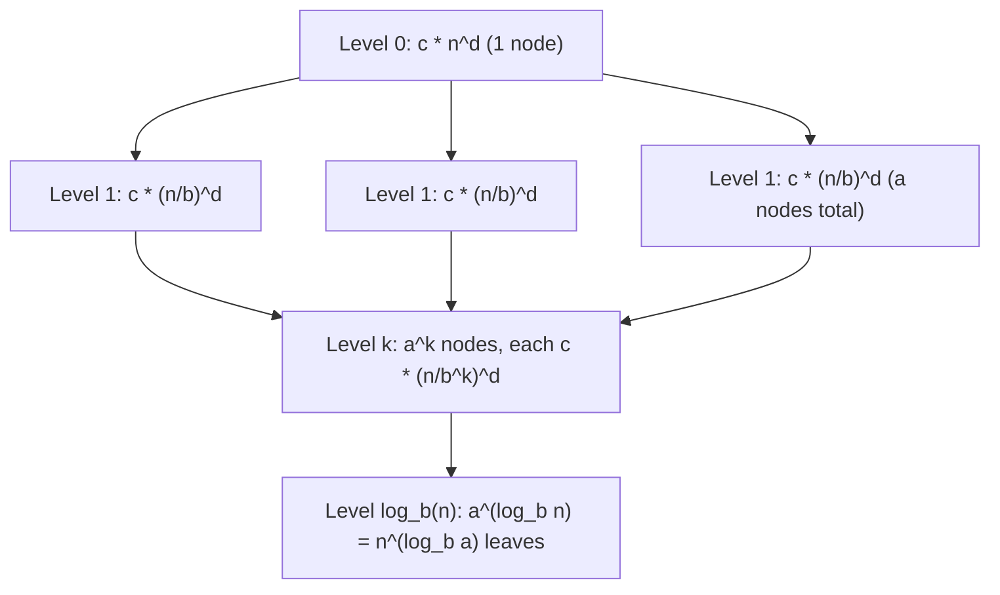

# [QZ] Master Theorem

> [!info] Document Metadata
> **Course:** `=this.course` | **Topic:** `=this.topic` | **Status:** `=this.status`

**Tags:** #[[Computer Science]] #[[CSALGCM]] #[[Algorithms]] #[[Quiz]] #[[Master Theorem]] #[[Recurrence Relations]]

---

## Overview

The Master Theorem provides a direct method for solving divide-and-conquer recurrences of the form $T(n) = aT(n/b) + O(n^d)$ without expanding the recurrence from scratch every time. Its proof rests on summing the work across all levels of a recursion tree, which reduces directly to evaluating a finite geometric series with common ratio $r = \frac{a}{b^d}$. Recognizing whether $r < 1$, $r = 1$, or $r > 1$ immediately identifies whether the root, all levels equally, or the leaves dominate total running time.

## Geometric Series & Recursion Tree Derivation

For the recurrence $T(n) = aT(n/b) + O(n^d)$ with $T(1) = O(1)$ (assuming $n$ is a power of $b$):

Summing the level costs from $k = 0$ to $k = \log_b n$ gives:

$$T(n) = cn^d \sum_{k=0}^{\log_b n} \left(\frac{a}{b^d}\right)^k$$

| Common Ratio $r = a / b^d$ | Geometric Series Behavior | Master Theorem Result | Dominant Tree Region |
| :--- | :--- | :--- | :--- |
| $0 < r < 1$ ($a < b^d$) | Converges to $\Theta(1)$ | $T(n) = O(n^d)$ | Root (Level $0$) |
| $r = 1$ ($a = b^d$) | $\log_b n + 1$ equal terms of $1$ | $T(n) = O(n^d \log_b n)$ | All levels equally |
| $r > 1$ ($a > b^d$) | Dominated by last term $\Theta(r^{\log_b n})$ | $T(n) = O(n^{\log_b a})$ | Leaves (Level $\log_b n$) |

## Quiz Compilation & Explanations

### Question 1 (1 pt)

**Prompt:**
Consider the function $g(n) = 1 + c + c^2 + \dots + c^n$, where $c = 1$.
Fill in the blank next to each statement below with `T` if the statement is True, or with `F` if the statement is False.

| Statement | Correct Answer |
| :--- | :--- |
| $g(n) = \Theta(1)$ | **F** |
| $g(n) = \Theta(n)$ | **T** |
| $g(n) = \Theta(c^n)$ | **F** |

**Rationale:**
Substituting $c = 1$ into the sum produces $n + 1$ identical terms equal to $1$:

$$g(n) = \underbrace{1 + 1 + 1 + \dots + 1}_{n + 1 \text{ terms}} = n + 1$$

- **$g(n) = \Theta(1)$ is F (Incorrect):** $n + 1$ grows unboundedly with $n$, so it cannot be bounded above by a constant.
- **$g(n) = \Theta(n)$ is T (Correct):** For all $n \ge 1$, $n \le n + 1 \le 2n$, so $g(n) = \Theta(n)$.
- **$g(n) = \Theta(c^n)$ is F (Incorrect):** When $c = 1$, $c^n = 1^n = 1$, making $\Theta(c^n) = \Theta(1)$, which fails for the same reason as the first statement.

---

### Question 2 (2 pts)

**Prompt:**
Consider the function $g(n) = 1 + c + c^2 + \dots + c^n$, where $c > 1$.
Fill in the blank next to each statement below with `T` if the statement is True, or with `F` if the statement is False.
*(Hint: Use the closed form expression for the sum of geometric series with common ratio $c$.)*

| Statement | Correct Answer |
| :--- | :--- |
| $g(n) = \Theta(1)$ | **F** |
| $g(n) = \Theta(n)$ | **F** |
| $g(n) = \Theta(c^n)$ | **T** |

**Rationale:**
Using the finite geometric series identity for $c > 1$:

$$g(n) = \frac{c^{n+1} - 1}{c - 1}$$

Since $c^n \le g(n) < \frac{c}{c - 1} c^n$ where $\frac{c}{c - 1}$ is a positive constant independent of $n$, the last term $c^n$ dominates the entire sum.

- **$g(n) = \Theta(1)$ is F (Incorrect):** Since $c > 1$, $c^n \to \infty$ exponentially, so $g(n)$ is not constant.
- **$g(n) = \Theta(n)$ is F (Incorrect):** An exponential function $c^n$ ($c > 1$) grows strictly faster than linear $n$, so $g(n) \neq O(n)$.
- **$g(n) = \Theta(c^n)$ is T (Correct):** Both the lower bound $1 \cdot c^n$ and upper bound $\frac{c}{c - 1} \cdot c^n$ hold for all $n \ge 0$, proving $g(n) = \Theta(c^n)$.

---

### Question 3 (1 pt)

**Prompt:**
Consider the function $g(n) = 1 + c + c^2 + \dots + c^n$, where $0 < c < 1$.
Fill in the blank next to each statement below with `T` if the statement is True, or with `F` if the statement is False.
*(Hint: Use the closed form expression for the sum of infinite geometric series with common ratio $< 1$.)*

| Statement | Correct Answer |
| :--- | :--- |
| $g(n) = \Theta(1)$ | **T** |
| $g(n) = \Theta(n)$ | **F** |
| $g(n) = \Theta(c^n)$ | **F** |

**Rationale:**
Because all terms are positive and the infinite geometric series converges for $0 < c < 1$:

$$1 \le g(n) = \frac{1 - c^{n+1}}{1 - c} < \frac{1}{1 - c}$$

Both $1$ and $\frac{1}{1 - c}$ are positive constants independent of $n$.

- **$g(n) = \Theta(1)$ is T (Correct):** The sum is tightly sandwiched between two positive constants $1$ and $\frac{1}{1-c}$, so $g(n) = \Theta(1)$.
- **$g(n) = \Theta(n)$ is F (Incorrect):** Because $g(n)$ is bounded above by a constant, it cannot grow linearly ($\Omega(n)$ fails).
- **$g(n) = \Theta(c^n)$ is F (Incorrect):** Because $0 < c < 1$, $c^n \to 0$ as $n \to \infty$, whereas $g(n) \ge 1$ forever. Thus $g(n)$ is not $O(c^n)$.

---

### Question 4 (1 pt)

**Prompt:**
*(Referring to the recursion tree for $T(n) = aT(n/b) + O(n^d)$, $T(1) = O(1)$)*
At Level 0 (i.e. level of the root node), there is 1 node/problem.
At Level 1, there are $a$ nodes/problems.
How many nodes/problems are there at Level $k$?

**Choices:**

- $b^k$
- $a^k$ *(Correct)*
- $d^k$

**Correct Answer:** **$a^k$**

**Rationale:**

- **Why $a^k$ is correct:** Every node splits into $a$ recursive sub-problems at the next level. Starting from $a^0 = 1$ node at Level 0, multiplying by $a$ per level produces $a^k$ nodes at Level $k$.
- **Why $b^k$ is wrong:** $b$ is the factor by which the input size shrinks per level (sub-problem size at Level $k$ is $n/b^k$), not the branching factor.
- **Why $d^k$ is wrong:** $d$ is the polynomial exponent of the non-recursive work $O(n^d)$ per node, unrelated to the node count.

---

### Question 5 (1 pt)

**Prompt:**
How many levels does this tree have?

**Choices:**

- $n^b + 1$
- $b^n + 1$
- $\log_b n + 1$ *(Correct)*
- $\log_b a + 1$

**Correct Answer:** **$\log_b n + 1$**

**Rationale:**

- **Why $\log_b n + 1$ is correct:** At Level $k$, each sub-problem has size $n / b^k$. Recursion terminates at the base case $n / b^k = 1$, which solves to $k = \log_b n$. Counting levels $0, 1, 2, \dots, \log_b n$ inclusively yields $\log_b n + 1$ levels.
- **Why $n^b + 1$ is wrong:** Input size shrinks exponentially by dividing by $b$, so depth is logarithmic, not polynomial in $n$.
- **Why $b^n + 1$ is wrong:** Depth cannot be exponential when problem size is divided by $b > 1$ at each step.
- **Why $\log_b a + 1$ is wrong:** The base case depends on reducing the input size $n$ to $1$, not reducing the branching factor $a$.

---

### Question 6 (2 pts)

**Prompt:**
The total time required at Level $k$ (i.e. sum of label of nodes at Level $k$) is:

**Choices:**

- $c^k \frac{a^d}{b^d} n$
- $a^k c \left(\frac{n}{b^k}\right)^d$ *(Correct)*
- $a^k c^d \log_b n^k$

**Correct Answer:** **$a^k c \left(\frac{n}{b^k}\right)^d$**

**Rationale:**

- **Why $a^k c \left(\frac{n}{b^k}\right)^d$ is correct:** At Level $k$, there are $a^k$ nodes, and each node operates on an input of size $\frac{n}{b^k}$, taking $c \left(\frac{n}{b^k}\right)^d$ time. Multiplying node count by work per node gives $a^k c \left(\frac{n}{b^k}\right)^d = cn^d \left(\frac{a}{b^d}\right)^k$.
- **Why $c^k \frac{a^d}{b^d} n$ is wrong:** The constant $c$ is not raised to the power $k$, $a$ is not raised to $d$, and $n$ must be raised to $d$.
- **Why $a^k c^d \log_b n^k$ is wrong:** Neither $c$ is raised to $d$ nor does the work per node at Level $k$ involve $\log_b n^k$.

---

### Question 7 (2 pts)

**Prompt:**
Total time required across all levels can be expressed as the following geometric series:

$$T(n) = cn^d \sum_{k=0}^{\log_b n} (a/b^d)^k.$$

The common ratio of this series is $\frac{a}{b^d}$. If $\frac{a}{b^d} > 1$, then which of the following is true?
*(Hint: Use your solutions from general geometric series in a previous question.)*

**Choices:**

- $T(n) = O(n^d)$
- $T(n) = O(1)$
- $T(n) = O(n^{\log_b a})$ *(Correct)*

**Correct Answer:** **$T(n) = O(n^{\log_b a})$**

**Rationale:**

- **Why $T(n) = O(n^{\log_b a})$ is correct:** From Question 2, a geometric series with ratio $r = \frac{a}{b^d} > 1$ is $\Theta(r^{\log_b n})$. Substituting this back in:

$$T(n) = cn^d \cdot \Theta\left(\left(\frac{a}{b^d}\right)^{\log_b n}\right) = cn^d \cdot \Theta\left(\frac{a^{\log_b n}}{(b^{\log_b n})^d}\right) = cn^d \cdot \Theta\left(\frac{n^{\log_b a}}{n^d}\right) = \Theta(n^{\log_b a})$$

Therefore $T(n) = O(n^{\log_b a})$.

- **Why $T(n) = O(n^d)$ is wrong:** $O(n^d)$ applies when $\frac{a}{b^d} < 1$ (root-dominated). When $\frac{a}{b^d} > 1$, $\log_b a > d$, so $n^{\log_b a}$ strictly exceeds $n^d$.
- **Why $T(n) = O(1)$ is wrong:** The series grows with $n$ and is multiplied by $cn^d$; it cannot be bounded by a constant.

## Multiple Choice Questions

1. For the geometric series $g(n) = \sum_{k=0}^{n} c^k$, which condition yields $g(n) = \Theta(1)$?
    - **A)** $c = 1$
    - **B)** $c > 1$
    - **C)** $0 < c < 1$
    - **D)** $c \ge 2$

2. In the recursion tree for $T(n) = aT(n/b) + O(n^d)$, what is the input size of each individual sub-problem at Level $k$?
    - **A)** $n / a^k$
    - **B)** $n / b^k$
    - **C)** $n - kb$
    - **D)** $n / d^k$

3. Which expression simplifies $a^{\log_b n}$ via logarithm identities?
    - **A)** $b^{\log_a n}$
    - **B)** $n^{\log_b a}$
    - **C)** $n^{\log_a b}$
    - **D)** $a^n / b$

4. In the Master Theorem series $T(n) = cn^d \sum_{k=0}^{\log_b n} (a/b^d)^k$, what is the tight bound when $a = b^d$?
    - **A)** $\Theta(n^d)$
    - **B)** $\Theta(n^d \log_b n)$
    - **C)** $\Theta(n^{\log_b a} \cdot n^d)$
    - **D)** $\Theta(b^n)$

5. Which region of the recursion tree dominates total running time when $a / b^d > 1$?
    - **A)** Only the root node at Level 0
    - **B)** Every level contributes an equal amount of work
    - **C)** The leaf level at depth $\log_b n$
    - **D)** The middle level at depth $\frac{1}{2}\log_b n$

6. [BLANK] Evaluate $g(n) = 1 + c + c^2 + \dots + c^n$ across the three geometric regimes (enter `T` for True or `F` for False):

| Statement | Truth Value |
| :--- | :--- |
| For $0 < c < 1$, $g(n) = \Theta(1)$ | {{1}} |
| For $c = 1$, $g(n) = \Theta(n)$ | {{2}} |
| For $c > 1$, $g(n) = \Theta(c^n)$ | {{3}} |
| For $c = 1$, $g(n) = \Theta(c^n)$ | {{4}} |

7. [INPUT] For the recursion tree of $T(n) = 3T(n/2) + O(n)$ with $n = 16$ and base case $T(1) = O(1)$, how many total levels does the tree have (counting Level 0 through the leaf level inclusively)?

8. [INPUT] In the recursion tree for $T(n) = 4T(n/2) + O(n)$, how many sub-problem nodes exist at Level $k = 3$?

### Answer Key & Explanations

1. **C)** When $0 < c < 1$, the sum is bounded between $1$ and $\frac{1}{1-c}$, so it is $\Theta(1)$. A gives $\Theta(n)$, while B and D both give exponential growth $\Theta(c^n)$.
2. **B)** Each recursive step divides the input size by $b$, so after $k$ levels the sub-problem size is $n / b^k$. A confuses $b$ with the branching factor $a$, C describes subtractive recursion, and D confuses $b$ with the work exponent $d$.
3. **B)** Using $a = b^{\log_b a}$, we get $a^{\log_b n} = (b^{\log_b a})^{\log_b n} = (b^{\log_b n})^{\log_b a} = n^{\log_b a}$. A, C, and D misapply logarithm base-change rules.
4. **B)** When $a = b^d$, the common ratio is $1$, so all $\log_b n + 1$ levels contribute $cn^d$ work, summing to $\Theta(n^d \log_b n)$. A omits the logarithmic factor, C overcounts by multiplying both terms, and D is exponential.
5. **C)** When $a / b^d > 1$, the cost per level increases geometrically with depth $k$, so the final leaf level $k = \log_b n$ dominates the sum. A corresponds to $a / b^d < 1$, B corresponds to $a / b^d = 1$, and D is never the dominant level in a monotonic geometric series.
6. **[1: T/true; 2: T/true; 3: T/true; 4: F/false]** When $0 < c < 1$, the geometric sum converges between $1$ and $1/(1-c)$, so it is $\Theta(1)$. When $c = 1$, there are $n + 1$ ones giving $\Theta(n)$, whereas $\Theta(c^n) = \Theta(1^n) = \Theta(1)$ is false. When $c > 1$, the final term $c^n$ dominates, yielding $\Theta(c^n)$.
7. **[5; 5 levels]** The tree has $\log_b n + 1$ inclusive levels. With $b = 2$ and $n = 16$, there are $\log_2 16 + 1 = 4 + 1 = 5$ levels (Levels $0, 1, 2, 3, 4$).
8. **[64; 64 nodes]** At Level $k$ of a recursion tree with branching factor $a$, there are $a^k$ nodes. With $a = 4$ and $k = 3$, there are $4^3 = 64$ nodes.

## References & Navigation

- **Previous Quiz:** [[[QZ] Recurrence Relations]]
- **Next Quiz:** [[[QZ] Divide and Conquer]]
- **Related Notes:** [[Complexity Analysis]], [[Divide and Conquer Introduction]]
