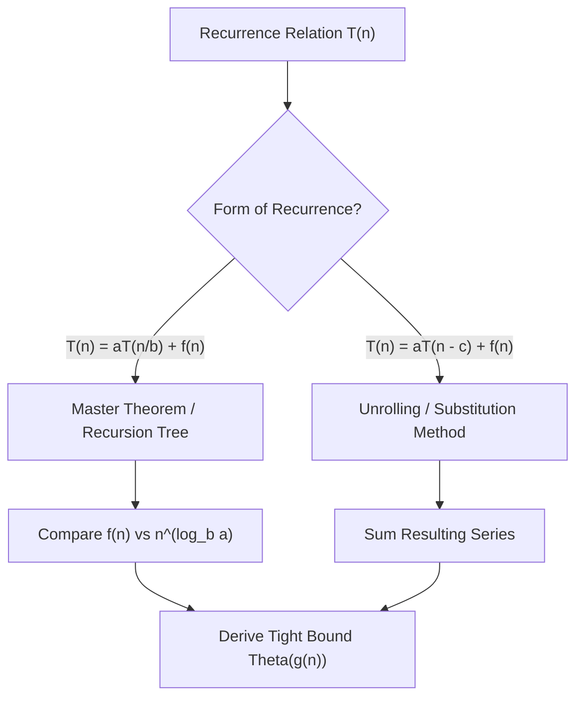

# [QZ] Recurrence Relations

> [!info] Document Metadata
> **Course:** `=this.course` | **Topic:** `=this.topic` | **Status:** `=this.status`

**Tags:** #[[Computer Science]] #[[CSALGCM]] #[[Algorithms]] #[[Quiz]] #[[Recurrence Relations]] #[[Asymptotic Analysis]]

---

## Overview

A recurrence relation expresses the running time $T(n)$ of a recursive algorithm in terms of its running time on smaller inputs. Analyzing recurrences is essential in CSALGCM for deriving tight asymptotic bounds ($\Theta$, $O$, $\Omega$, $o$, $\omega$) on divide-and-conquer and recursive routines. Techniques such as iteration (unrolling), recursion trees, substitution, and the Master Theorem bridge recursive definitions to closed-form complexity classes.

## Core Techniques for Solving Recurrences

| Recurrence Pattern | Tight Bound | Dominant Cost | Typical Example |
| :--- | :--- | :--- | :--- |
| $T(n) = 2T(n/2) + cn^2$ | $\Theta(n^2)$ | Root work dominates ($n^2 > n^{\log_2 2}$) | Quadratic combine step |
| $T(n) = 2T(n-1) + c$ | $\Theta(2^n)$ | Exponential branching ($2^n - 1$ calls) | Tower of Hanoi |
| $T(n) = 4T(n/2) + O(n)$ | $\Theta(n^2)$ | Leaf work dominates ($n^{\log_2 4} = n^2 > n$) | Naive 4-way matrix/integer recursion |
| $T(n) = 3T(n/2) + O(n)$ | $\Theta(n^{\log_2 3})$ | Leaf work dominates ($n^{\log_2 3} \approx n^{1.585} > n$) | Karatsuba multiplication |

## Quiz Compilation & Explanations

### Question 1 (4 pts)

**Prompt:**
Consider the following recurrence relation:

$$T(n) = 2T(n/2) + cn^2 \quad \text{for } n > 1 \text{ and } T(1) = c.$$

Which of the following is true? Mark each statement as `T` (True) or `F` (False).

| Statement | Correct Answer |
| :--- | :--- |
| $T(n) = O(n^3)$ | **T** |
| $T(n) = \Theta(n^3)$ | **F** |
| $T(n) = O(n^4)$ | **T** |
| $T(n) = \Omega(n^2)$ | **T** |
| $T(n) = \Omega(n^4)$ | **F** |
| $T(n) = \Theta(n^2 \log n)$ | **F** |

**Derivation of Tight Bound:**
Using the Master Theorem with $a = 2$, $b = 2$, and $f(n) = cn^2 = \Theta(n^2)$:

$$n^{\log_b a} = n^{\log_2 2} = n^1$$

Since $f(n) = \Theta(n^2)$ grows polynomially faster than $n^1$ (with $\epsilon = 1$) and satisfies the regularity condition $2 \cdot c(n/2)^2 = \frac{1}{2}cn^2 \le k \cdot cn^2$ for $k = \frac{1}{2} < 1$, Case 3 applies:

$$T(n) = \Theta(n^2)$$

**Statement-by-Statement Rationale:**

- **$T(n) = O(n^3)$ is T (Correct):** Big-$O$ specifies an asymptotic upper bound. Because $T(n) = \Theta(n^2)$ and $n^2 \le n^3$ for all $n \ge 1$, $T(n)$ is bounded above by $O(n^3)$.
- **$T(n) = \Theta(n^3)$ is F (Incorrect):** Big-$\Theta$ requires both an upper bound $O(n^3)$ and a lower bound $\Omega(n^3)$. Because $\lim_{n \to \infty} \frac{n^2}{n^3} = 0$, $T(n)$ is not $\Omega(n^3)$, so it cannot be $\Theta(n^3)$.
- **$T(n) = O(n^4)$ is T (Correct):** Since $n^2$ grows strictly slower than $n^4$, $n^4$ is a valid (loose) asymptotic upper bound on $T(n) = \Theta(n^2)$.
- **$T(n) = \Omega(n^2)$ is T (Correct):** Because $T(n) = \Theta(n^2)$, by definition $T(n)$ is both $O(n^2)$ and $\Omega(n^2)$.
- **$T(n) = \Omega(n^4)$ is F (Incorrect):** Big-$\Omega$ specifies an asymptotic lower bound. A quadratic function $\Theta(n^2)$ cannot grow at least as fast as $n^4$, since $\lim_{n \to \infty} \frac{n^2}{n^4} = 0$.
- **$T(n) = \Theta(n^2 \log n)$ is F (Incorrect):** The work at level $k$ is $2^k c(n/2^k)^2 = cn^2 \left(\frac{1}{2}\right)^k$, which forms a decaying geometric series summing to less than $2cn^2$, not $cn^2 \log n$. A $\Theta(n^2 \log n)$ bound would only occur if $a = 4$ (so $n^{\log_2 4} = n^2$ matched $f(n)$).

---

### Question 2 (2 pts)

**Prompt:**
Consider the following recurrence relation:

$$T(n) = \begin{cases} c, & \text{if } n = 1 \\ 2T(n - 1) + c, & \text{if } n > 1. \end{cases}$$

Place a `T` if the following statement is True. Place an `F` if false.

| Statement | Correct Answer |
| :--- | :--- |
| $T(n) = \Theta(n^2)$ | **F** |
| $T(n) = \Theta(2^n)$ | **T** |
| $T(n) = \Theta(n \log_2 n)$ | **F** |

**Derivation of Tight Bound:**
Unrolling the recurrence step by step:

$$T(n) = 2T(n-1) + c = 2(2T(n-2) + c) + c = 2^2 T(n-2) + c(1 + 2)$$

After $n - 1$ expansions reaching the base case $T(1) = c$:

$$T(n) = 2^{n-1}T(1) + c\sum_{k=0}^{n-2} 2^k = c\sum_{k=0}^{n-1} 2^k = c(2^n - 1) = \Theta(2^n)$$

**Statement-by-Statement Rationale:**

- **$T(n) = \Theta(n^2)$ is F (Incorrect):** Exponential growth $2^n$ dominates every polynomial $n^2$ as $n \to \infty$, so $2^n$ is not $O(n^2)$ and therefore cannot be $\Theta(n^2)$.
- **$T(n) = \Theta(2^n)$ is T (Correct):** Because $T(n) = c(2^n - 1)$, for $n \ge 1$ we have $\frac{c}{2} \cdot 2^n \le T(n) \le c \cdot 2^n$, establishing a tight bound of $\Theta(2^n)$.
- **$T(n) = \Theta(n \log_2 n)$ is F (Incorrect):** Linearithmic growth $n \log_2 n$ occurs when input size is halved at each step (e.g., $2T(n/2) + cn$), not decremented by $1$. Decrementing by $1$ creates a tree of depth $n$, yielding $\Theta(2^n)$ nodes.

---

### Question 3 (2 pts)

**Prompt:**
Consider the following recurrence relation:

$$T(n) = \begin{cases} O(1), & \text{if } n = 1 \\ 4T(n/2) + O(n), & \text{if } n > 1. \end{cases}$$

Place a `T` if the following statement is True. Place an `F` if false.

| Statement | Correct Answer |
| :--- | :--- |
| $T(n) = O(n^2)$ | **T** |
| $T(n) = \Theta(n^2)$ | **T** |
| $T(n) = o(n^2)$ | **F** |

**Derivation of Tight Bound:**
With $a = 4$, $b = 2$, and $f(n) = O(n)$, the watershed function is:

$$n^{\log_b a} = n^{\log_2 4} = n^2$$

Since $f(n) = O(n) = O(n^{2 - \epsilon})$ for $\epsilon = 1 > 0$, Case 1 of the Master Theorem applies. The $4^{\log_2 n} = n^2$ leaves each perform constant work, yielding $T(n) = \Theta(n^2)$.

**Statement-by-Statement Rationale:**

- **$T(n) = O(n^2)$ is T (Correct):** Since $T(n) = \Theta(n^2)$, it automatically satisfies the upper bound $T(n) = O(n^2)$.
- **$T(n) = \Theta(n^2)$ is T (Correct):** By Case 1 of the Master Theorem, the leaf cost $n^{\log_2 4} = n^2$ dominates the non-recursive work $O(n)$, giving a tight bound of $\Theta(n^2)$.
- **$T(n) = o(n^2)$ is F (Incorrect):** Little-$o$ requires $\lim_{n \to \infty} \frac{T(n)}{n^2} = 0$ (strictly slower growth than $n^2$). Because $T(n) = \Theta(n^2)$, the ratio approaches a positive constant, never $0$.

---

### Question 4 (2 pts)

**Prompt:**
Consider the following recurrence relation:

$$T(n) = \begin{cases} O(1), & \text{if } n = 1 \\ 3T(n/2) + O(n), & \text{if } n > 1. \end{cases}$$

Place a `T` if the following statement is True. Place an `F` if false.

| Statement | Correct Answer |
| :--- | :--- |
| $T(n) = O(n^2)$ | **T** |
| $T(n) = \Theta(n^2)$ | **F** |
| $T(n) = o(n^2)$ | **T** |

**Derivation of Tight Bound:**
With $a = 3$, $b = 2$, and $f(n) = O(n)$, the watershed function is:

$$n^{\log_2 3} \approx n^{1.585}$$

Since $f(n) = O(n) = O(n^{\log_2 3 - \epsilon})$ for $\epsilon \approx 0.585 > 0$, Case 1 of the Master Theorem yields:

$$T(n) = \Theta(n^{\log_2 3})$$

**Statement-by-Statement Rationale:**

- **$T(n) = O(n^2)$ is T (Correct):** Because $\log_2 3 \approx 1.585 < 2$, $n^{\log_2 3}$ grows slower than $n^2$, so $n^2$ is a valid asymptotic upper bound.
- **$T(n) = \Theta(n^2)$ is F (Incorrect):** $T(n)$ is not bounded below by $\Omega(n^2)$ since $\lim_{n \to \infty} \frac{n^{\log_2 3}}{n^2} = \lim_{n \to \infty} n^{\log_2 3 - 2} = 0$.
- **$T(n) = o(n^2)$ is T (Correct):** Because the exponent $\log_2 3 \approx 1.585$ is strictly less than $2$, $\lim_{n \to \infty} \frac{T(n)}{n^2} = 0$, satisfying the exact definition of little-$o$.

## Multiple Choice Questions

1. What is the tight asymptotic bound for $T(n) = 2T(n/2) + cn^2$ with $T(1) = c$?
    - **A)** $\Theta(n \log n)$
    - **B)** $\Theta(n^2)$
    - **C)** $\Theta(n^2 \log n)$
    - **D)** $\Theta(n^3)$

2. When unrolling $T(n) = 2T(n - 1) + c$ with $T(1) = c$, what closed-form expression is obtained?
    - **A)** $c(n^2 - 1)$
    - **B)** $c(2^n - 1)$
    - **C)** $cn \log_2 n$
    - **D)** $c \cdot 2^{n-1}$

3. Why is $T(n) = o(n^2)$ true for $T(n) = 3T(n/2) + O(n)$?
    - **A)** Because the non-recursive work $O(n)$ dominates the recursion
    - **B)** Because $T(n) = \Theta(n^{\log_2 3})$ and $\log_2 3 < 2$
    - **C)** Because $T(n) = \Theta(n^2)$ implies $T(n) = o(n^2)$
    - **D)** Because $3$ is an odd integer

4. Which of the following statements is FALSE for $T(n) = 4T(n/2) + O(n)$?
    - **A)** $T(n) = O(n^2)$
    - **B)** $T(n) = \Omega(n^2)$
    - **C)** $T(n) = \Theta(n^2)$
    - **D)** $T(n) = o(n^2)$

5. If $T(n) = \Theta(n^2)$, which pair of asymptotic statements are BOTH true?
    - **A)** $T(n) = O(n^3)$ and $T(n) = \Omega(n^2)$
    - **B)** $T(n) = \Theta(n^3)$ and $T(n) = O(n^4)$
    - **C)** $T(n) = \Omega(n^4)$ and $T(n) = O(n^3)$
    - **D)** $T(n) = o(n^2)$ and $T(n) = \Omega(n^2)$

6. [BLANK] Given $T(n) = 2T(n/2) + cn^2$ for $n > 1$ with $T(1) = c$, mark each statement as `T` (True) or `F` (False):

| Statement | Truth Value |
| :--- | :--- |
| $T(n) = O(n^3)$ | {{1}} |
| $T(n) = \Theta(n^3)$ | {{2}} |
| $T(n) = \Omega(n^2)$ | {{3}} |
| $T(n) = \Theta(n^2 \log n)$ | {{4}} |

7. [BLANK] Given $T(n) = 3T(n/2) + O(n)$ for $n > 1$ with $T(1) = O(1)$, mark each statement as `T` (True) or `F` (False):

| Statement | Truth Value |
| :--- | :--- |
| $T(n) = O(n^2)$ | {{1}} |
| $T(n) = \Theta(n^2)$ | {{2}} |
| $T(n) = o(n^2)$ | {{3}} |

8. [MSQ] Which asymptotic bounds hold for $T(n) = 4T(n/2) + O(n)$ with $T(1) = O(1)$? (Select all that apply)
    - **A)** $T(n) = O(n^2)$
    - **B)** $T(n) = \Theta(n^2)$
    - **C)** $T(n) = \Omega(n^2)$
    - **D)** $T(n) = o(n^2)$

### Answer Key & Explanations

1. **B)** Because $n^{\log_2 2} = n$ is polynomially smaller than $cn^2$, the root work dominates and the geometric series of level costs sums to $\Theta(n^2)$. A assumes linear work $cn$, C assumes equal work across $\log n$ levels, and D is only a loose upper bound $O(n^3)$, not a tight bound.
2. **B)** Expanding $n - 1$ times yields $c(1 + 2 + 4 + \dots + 2^{n-1}) = c(2^n - 1)$. A confuses exponential branching with quadratic sums, C corresponds to halving $n$, and D omits the non-leaf additive $c$ terms.
3. **B)** By Case 1 of the Master Theorem, $T(n) = \Theta(n^{\log_2 3}) \approx \Theta(n^{1.585})$. Since $\lim_{n \to \infty} n^{1.585}/n^2 = 0$, $T(n) = o(n^2)$. A is wrong because leaves dominate, C contradicts the definition of little-$o$, and D is irrelevant.
4. **D)** Since $n^{\log_2 4} = n^2$, $T(n) = \Theta(n^2)$, meaning $T(n)$ is $O(n^2)$ (A), $\Omega(n^2)$ (B), and $\Theta(n^2)$ (C), so it cannot grow strictly slower than $n^2$ ($o(n^2)$ is false).
5. **A)** Every $\Theta(n^2)$ function is bounded above by $O(n^3)$ and bounded below by $\Omega(n^2)$. B fails because $\Theta(n^3)$ is too tight/high, C fails because $\Omega(n^4)$ is a false lower bound, and D fails because $o(n^2)$ and $\Omega(n^2)$ are mutually exclusive.
6. **[1: T/true; 2: F/false; 3: T/true; 4: F/false]** By Case 3 of the Master Theorem, $T(n) = \Theta(n^2)$. Therefore it is $O(n^3)$ and $\Omega(n^2)$, whereas $\Theta(n^3)$ fails the lower bound and $\Theta(n^2 \log n)$ would only apply if $a = 4$.
7. **[1: T/true; 2: F/false; 3: T/true]** By Case 1 of the Master Theorem, $T(n) = \Theta(n^{\log_2 3}) \approx \Theta(n^{1.585})$. Since $\log_2 3 < 2$, $T(n)$ grows strictly slower than $n^2$, making both $O(n^2)$ and $o(n^2)$ true and $\Theta(n^2)$ false.
8. **A, B, C)** With $a = 4$, $b = 2$, and $f(n) = O(n)$, $n^{\log_2 4} = n^2$ dominates $O(n)$, so Case 1 gives $T(n) = \Theta(n^2)$. Any $\Theta(n^2)$ function satisfies both $O(n^2)$ and $\Omega(n^2)$, while $o(n^2)$ is false because $\lim_{n\to\infty} T(n)/n^2 > 0$.

## References & Navigation

- **Previous Quiz:** [[[QZ] Evaluation of Algorithms]]
- **Next Quiz:** [[[QZ] Master Theorem]]
- **Related Notes:** [[Complexity Analysis]], [[Divide and Conquer Introduction]]
