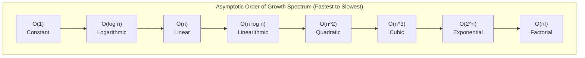
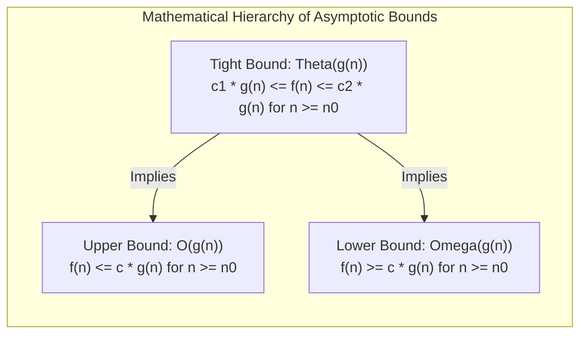

> [!info] Document Metadata
> - **Course:** `=this.course`
> - **Topic:** `=this.topic`
> - **Status:** `=this.status`

**Tags:** #[[Computer Science]] #[[CSALGCM]] #[[Algorithms and Complexity]] #[[Complexity Analysis]]

---

# Complexity Analysis

## Overview
To determine if an algorithm is practical for large-scale data, we must evaluate its efficiency mathematically. **Complexity Analysis** involves defining the theoretical limits of an algorithm's performance in terms of time and space constraints. By using **Asymptotic Analysis**, we can ignore machine-specific constants and lower-order terms to focus on the function's underlying **order of growth** relative to the input size $n$.

## Key Concepts

### Asymptotic Analysis
Asymptotic analysis evaluates the performance of an algorithm as the input size $n$ approaches infinity. It characterizes how fast the computational requirements grow.

#### Loose Bounds vs. Tight Bounds
Bounds in asymptotic notation can be categorized into loose and tight bounds. Loose bounds might overestimate or underestimate the growth significantly but are mathematically valid, while tight bounds offer a strict definition of exact growth.

**Loose Bounds:**
- **Big-Oh ($O$)**: Represents an **upper bound**. $f(n) = O(g(n))$ implies that $f(n)$ grows at worst as fast as $g(n)$.  
  *Formal Definition*: There exist constants $c > 0$ and $n_0 \ge 1$ such that $0 \le f(n) \le cg(n)$ for all $n \ge n_0$.
- **Big-Omega ($\Omega$)**: Represents a **lower bound**. $f(n) = \Omega(g(n))$ implies that $f(n)$ grows at least as fast as $g(n)$.  
  *Formal Definition*: There exist constants $c > 0$ and $n_0 \ge 1$ such that $0 \le cg(n) \le f(n)$ for all $n \ge n_0$.
- **Big-Theta ($\Theta$)**: Represents a **tight bound** (both upper and lower). $f(n) = \Theta(g(n))$ means $f(n)$ grows exactly at the same rate as $g(n)$.  
  *Formal Definition*: There exist constants $c_1, c_2 > 0$ and $n_0 \ge 1$ such that $0 \le c_1g(n) \le f(n) \le c_2g(n)$ for all $n \ge n_0$.

**Strict/Tight Bounds:**
- **Little-Oh ($o$)**: A strictly upper bound. $f(n) = o(g(n))$ means $f(n)$ grows *strictly slower* than $g(n)$.  
  *Formal Definition*: For *all* constants $c > 0$, there exists an $n_0 \ge 1$ such that $0 \le f(n) < cg(n)$ for all $n \ge n_0$.
- **Little-Omega ($\omega$)**: A strictly lower bound. $f(n) = \omega(g(n))$ means $f(n)$ grows *strictly faster* than $g(n)$.  
  *Formal Definition*: For *all* constants $c > 0$, there exists an $n_0 \ge 1$ such that $0 \le cg(n) < f(n)$ for all $n \ge n_0$.

### Limit Definitions for Asymptotic Bounds
We can use mathematical limits as $n \to \infty$ of the ratio $f(n)/g(n)$ to quickly find asymptotic relationships:
- If $\lim_{n \to \infty} \frac{f(n)}{g(n)} = 0$, then $f(n) = o(g(n))$ (strictly slower).
- If $\lim_{n \to \infty} \frac{f(n)}{g(n)} = \infty$, then $f(n) = \omega(g(n))$ (strictly faster).
- If $\lim_{n \to \infty} \frac{f(n)}{g(n)} = c$ ($0 < c < \infty$), then $f(n) = \Theta(g(n))$ (same rate).

## Algorithms & Formulas

### Orders of Growth
Algorithm complexities generally fall into these common classes (ordered from most to least efficient):
1. **$O(1)$**: Constant time. The operation doesn't depend on $n$.
2. **$O(\log n)$**: Logarithmic time. The search space is divided by a constant factor in each step (e.g., Binary Search).
3. **$O(n)$**: Linear time. Processing each element once.
4. **$O(n \log n)$**: Linearithmic time. Typical of optimal comparison-based sorts (e.g., Merge Sort).
5. **$O(n^2)$**: Quadratic time. Typical of nested loops iterating over the data (e.g., Bubble Sort).
6. **$O(n^3)$**: Cubic time. Three nested loops (e.g., naive Matrix Multiplication).
7. **$O(2^n)$**: Exponential time. Trying all subsets.
8. **$O(n!)$**: Factorial time. Trying all permutations.



### Asymptotic Bound Enclosures



## Code Examples

### 1. Constant Time Geometry
```c
float b, h, area;
scanf("%f %f", &b, &h);
area = b * h / 2;
printf("Area = %f\n", area);
```
**Analysis**: There are no loops or recursive calls. Execution takes a constant number of steps.  
**Complexity**: $O(1)$

### 2. Linear Search / Summation
```c
int sum = 0, n;
scanf("%d", &n);
for(int i = 0; i <= n; i++){
    sum += i;
}
printf("sum = %d\n", sum);
```
**Analysis**: The loop runs exactly $n+1$ times, performing a constant amount of work each time.  
**Complexity**: $\Theta(n)$

### 3. Early Exit / Worst Case Linearity
```c
bool isComposite = false;
int n;
scanf("%d", &n);
if(n < 2) {
    printf("Neither prime nor composite");
} else {
    for(int i = 2; !isComposite && i < n; i++) {
        if(n % i == 0){
            isComposite = true;
        }
    }
    printf("%s\n", isComposite ? "Composite" : "Prime");
}
```
**Analysis**: In the best case (e.g., $n$ is even), the loop terminates at $i=2$, taking $O(1)$ time. In the worst case (e.g., $n$ is a prime number), the loop runs $n-2$ times. Therefore, the worst-case time complexity is bounded by $O(n)$.

### 4. Quadratic Nested Loops
```c
int sum = 0, n;
scanf("%d", &n);
for(int i = 1; i < n; i++) {
    for(int j = 1; j < n; j++) {
        sum += i * j;
    }
}
```
**Analysis**: Both the outer and inner loops iterate $n-1$ times independently. Total iterations: $(n-1) \times (n-1) = n^2 - 2n + 1$.  
**Complexity**: $\Theta(n^2)$

### 5. Dependent Nested Loops
```c
int sum = 0, n;
scanf("%d", &n);
for(int i = 1; i < n; i++) {
    for(int j = 1; j <= i; j++) {
        sum += i * j;
    }
}
```
**Analysis**: The inner loop limit depends on `i`. The total iterations are $\sum_{i=1}^{n-1} i = \frac{(n-1)n}{2} = \frac{n^2 - n}{2}$. Despite the constant factor of $1/2$, the highest order term is still quadratic.  
**Complexity**: $\Theta(n^2)$

## Multiple Choice Questions

1. What asymptotic notation represents a strictly upper bound?
    A) $O$ (Big-Oh)
    B) $o$ (Little-Oh)
    C) $\Theta$ (Big-Theta)
    D) $\Omega$ (Big-Omega)
2. If $\lim_{n \to \infty} \frac{f(n)}{g(n)} = \infty$, which of the following is true?
    A) $f(n) = o(g(n))$
    B) $f(n) = \Theta(g(n))$
    C) $f(n) = \omega(g(n))$
    D) $f(n) = O(g(n))$
3. An algorithm iterates over an array of size $n$, and for each element, it performs a binary search on another array of size $n$. What is the time complexity?
    A) $O(n^2)$
    B) $O(n \log n)$
    C) $O(\log n)$
    D) $O(1)$
4. Which of the following correctly describes Big-Theta ($\Theta$) notation?
    A) It provides a lower bound on the growth rate.
    B) It bounds a function simultaneously from above and below by the same order of growth.
    C) It represents a condition that is only true for small values of $n$.
    D) It indicates that a function grows strictly faster than another.
5. In the limit definition, if $\lim_{n \to \infty} \frac{f(n)}{g(n)} = 5$, what can we conclude?
    A) $f(n) = \omega(g(n))$
    B) $f(n) = o(g(n))$
    C) $f(n) = \Theta(g(n))$
    D) $f(n) = \Omega(g^2(n))$
6. Consider the code snippet:
   ```c
   for(int i = 1; i <= n; i *= 2) {
       printf("%d", i);
   }
   ```
   What is the time complexity?
    A) $O(n)$
    B) $O(n \log n)$
    C) $O(n^2)$
    D) $O(\log n)$
7. Rank the following complexities from most efficient to least efficient: $O(n^2)$, $O(n \log n)$, $O(2^n)$, $O(\log n)$.
    A) $O(\log n)$, $O(n \log n)$, $O(n^2)$, $O(2^n)$
    B) $O(2^n)$, $O(n^2)$, $O(n \log n)$, $O(\log n)$
    C) $O(n \log n)$, $O(\log n)$, $O(n^2)$, $O(2^n)$
    D) $O(\log n)$, $O(n^2)$, $O(n \log n)$, $O(2^n)$
8. What is the complexity of evaluating a mathematical formula like the area of a triangle ($b \times h / 2$)?
    A) $O(\log n)$
    B) $O(1)$
    C) $O(n)$
    D) $O(n^2)$
9. If an algorithm takes time proportional to $n!$, which bound describes it?
    A) Polynomial bound
    B) Factorial bound
    C) Linearithmic bound
    D) Constant bound
10. Which condition must hold true for $f(n) = O(g(n))$ to be correct?
    A) There exists $c>0$ such that $f(n) \ge c \cdot g(n)$
    B) There exists $c>0$ such that $f(n) \le c \cdot g(n)$ for sufficiently large $n$
    C) $f(n)$ must be exactly equal to $g(n)$
    D) $f(n)$ must grow strictly slower than $g(n)$

### Answer Key & Explanations
1. **B** - Little-Oh ($o$) represents a strictly upper bound ($<$ rather than $\le$).
2. **C** - If the ratio approaches infinity, the numerator $f(n)$ grows strictly faster, thus $\omega(g(n))$.
3. **B** - Iterating takes $O(n)$, and a binary search takes $O(\log n)$. Multiplying them gives $O(n \log n)$.
4. **B** - Big-Theta represents an asymptotically tight bound, meaning it bounds from both above and below.
5. **C** - Since 5 is a constant ($0 < c < \infty$), $f(n)$ and $g(n)$ grow at the same rate, yielding $\Theta(g(n))$.
6. **D** - The loop variable `i` doubles each iteration. The number of times you can double 1 until reaching $n$ is $\log_2 n$, so the complexity is $O(\log n)$.
7. **A** - Logarithmic is fastest, followed by linearithmic, quadratic, and exponential is slowest.
8. **B** - Executing basic arithmetic operations takes constant time, $O(1)$.
9. **B** - $O(n!)$ is factorial time, which grows faster than exponential and polynomial times.
10. **B** - The formal definition of Big-Oh ($O$) requires $f(n) \le c \cdot g(n)$ for all $n \ge n_0$.

## References & Navigation

- **Previous Topic:** [[Problems, Problem Types, and Algorithms]]
- **Next Topic:** [[Computational Thinking in Problem Solving]]
- **Related Notes:** 
