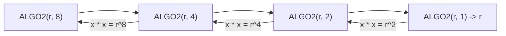

# [QZ] Divide and Conquer

> [!info] Document Metadata
> **Course:** `=this.course` | **Topic:** `=this.topic` | **Status:** `=this.status`

**Tags:** #[[Computer Science]] #[[CSALGCM]] #[[Algorithms]] #[[Quiz]] #[[Divide and Conquer]] #[[Exponentiation]]

---

## Overview

The divide-and-conquer paradigm breaks a problem into smaller sub-problems of the same type, solves them recursively, and combines their solutions. Comparing naive iterative exponentiation against recursive exponentiation by squaring illustrates how halving the problem size at each step slashes running time from linear $\Theta(n)$ to logarithmic $\Theta(\log n)$. Analyzing these two algorithms side by side also reinforces strict versus inclusive asymptotic comparisons ($o$, $O$, $\Omega$, $\omega$, $\Theta$).

## Algorithms Under Comparison

Both algorithms take a real number $r$ and a positive integer $n$ (assumed for simplicity to be a power of $2$):

```text
// Time Complexity: Theta(n) — performs n - 1 multiplications
// Space Complexity: Theta(1)
ALGO1(r, n)
-----------
x = r
for i = 2 to n:
    x = x * r
return x

// Time Complexity: Theta(log n) — T(n) = T(n/2) + Theta(1)
// Space Complexity: Theta(log n) — recursion call stack depth
ALGO2(r, n)
-----------
if n = 1:
    return r
else:
    x <- ALGO2(r, n/2)
    return x * x
```



## Quiz Compilation & Explanations

### Question 1 (1 pt)

**Prompt:**
What does `ALGO1` return?

**Choices:**

- $x * r$
- $x^n$
- $r^n$ *(Correct)*
- $n^r$

**Correct Answer:** **$r^n$**

**Rationale:**

- **Why $r^n$ is correct:** Before the loop, $x = r^1$. The loop runs for $i = 2, 3, \dots, n$ (a total of $n - 1$ iterations), multiplying $x$ by $r$ each time. After iteration $i$, the loop invariant $x = r^i$ holds, so upon termination at $i = n$, the algorithm returns $r^n$.
- **Why $x * r$ is wrong:** $x$ is a local variable, not an input parameter; the return value expressed in terms of inputs $(r, n)$ is $r^n$.
- **Why $x^n$ is wrong:** Same error — $x$ is not an input, and raising $x$ to the $n$-th power would not match the loop body.
- **Why $n^r$ is wrong:** Swaps the base $r$ and the exponent $n$.

---

### Question 2 (2 pts)

**Prompt:**
What does `ALGO2` return?

**Choices:**

- $x * r$
- $r^{(n/2)}$
- $r^n$ *(Correct)*
- $r * n$

**Correct Answer:** **$r^n$**

**Rationale:**

- **Why $r^n$ is correct:** By induction on powers of $2$:
  - **Base case ($n = 1$):** Returns $r = r^1$.
  - **Inductive step:** Assuming `ALGO2(r, n/2)` returns $x = r^{n/2}$, the function returns $x * x = r^{n/2} \cdot r^{n/2} = r^n$.
- **Why $x * r$ is wrong:** `ALGO2` squares $x$ ($x * x$), never multiplying $x$ by $r$, and $x$ is an internal variable.
- **Why $r^{(n/2)}$ is wrong:** $r^{n/2}$ is the intermediate value stored in `x` from the recursive call before squaring.
- **Why $r * n$ is wrong:** Multiplication is applied repeatedly (exponentiation), not addition ($r + r + \dots + r$).

---

### Question 3 (1 pt)

**Prompt:**
How many multiplication operations are performed in `ALGO1`?

**Choices:**

- $\Theta(nr)$
- $\Theta(r)$
- $\Theta(r + n)$
- $\Theta(n)$ *(Correct)*
- $\Theta(\log(n))$

**Correct Answer:** **$\Theta(n)$**

**Rationale:**

- **Why $\Theta(n)$ is correct:** The `for` loop executes for $i = 2, 3, \dots, n$, performing exactly $1$ multiplication per iteration, for a total of $n - 1 = \Theta(n)$ multiplications.
- **Why $\Theta(nr)$ is wrong:** The loop count depends solely on $n$, completely independent of the real value $r$.
- **Why $\Theta(r)$ is wrong:** The magnitude of $r$ does not control the number of iterations.
- **Why $\Theta(r + n)$ is wrong:** Incorrectly introduces a dependence on the real base $r$.
- **Why $\Theta(\log(n))$ is wrong:** That is the multiplication count for `ALGO2`, not linear `ALGO1`.

---

### Question 4 (2 pts)

**Prompt:**
How many multiplication operations are performed in `ALGO2`?

**Choices:**

- $\Theta(n)$
- $\Theta(\log n)$ *(Correct)*
- $\Theta(n \log n)$
- $\Theta(r + n)$
- $\Theta(r^n)$

**Correct Answer:** **$\Theta(\log n)$**

**Rationale:**

- **Why $\Theta(\log n)$ is correct:** Let $M(n)$ be the number of multiplications performed by `ALGO2(r, n)`:

$$M(1) = 0, \qquad M(n) = M(n/2) + 1$$

Crucially, `ALGO2` makes only **one** recursive call (`a = 1, b = 2, d = 0`) and reuses `x` to compute `x * x`. By the Master Theorem ($a = b^d \implies 1 = 2^0$), $M(n) = \log_2 n = \Theta(\log n)$.

- **Why $\Theta(n)$ is wrong:** $\Theta(n)$ would happen if `ALGO2` made **two** separate recursive calls (`return ALGO2(r, n/2) * ALGO2(r, n/2)`), yielding $M(n) = 2M(n/2) + 1 = \Theta(n)$. Saving `x` avoids that redundancy.
- **Why $\Theta(n \log n)$ is wrong:** Each level does $O(1)$ work, not $O(n)$ work.
- **Why $\Theta(r + n)$ is wrong:** Multiplications depend only on $n$, not on $r$.
- **Why $\Theta(r^n)$ is wrong:** Confuses the numerical output value $r^n$ with the operation count.

---

### Question 5 (4 pts)

**Prompt:**
Let $T1$ and $T2$ be the functions describing the running time of `ALGO1` and `ALGO2` respectively. Select the ones below that are true.

**Choices:**

- $T2 = \Theta(T1)$
- $T2 = o(T1)$ *(Correct)*
- $T2 = O(T1)$ *(Correct)*
- $T1 = \Omega(T2)$ *(Correct)*
- $T1 = \omega(T2)$ *(Correct)*

**Correct Answers:**

- **$T2 = o(T1)$**
- **$T2 = O(T1)$**
- **$T1 = \Omega(T2)$**
- **$T1 = \omega(T2)$**

**Rationale:**
Here $T1(n) = \Theta(n)$ and $T2(n) = \Theta(\log n)$. Checking the limit ratio:

$$\lim_{n \to \infty} \frac{T2(n)}{T1(n)} = \lim_{n \to \infty} \frac{\log n}{n} = 0, \qquad \lim_{n \to \infty} \frac{T1(n)}{T2(n)} = \lim_{n \to \infty} \frac{n}{\log n} = \infty$$

- **Why $T2 = \Theta(T1)$ is wrong:** $\Theta$ requires identical asymptotic growth rates (a finite positive limit), which is false since $\log n$ grows strictly slower than $n$.
- **Why $T2 = o(T1)$ is correct:** $\lim_{n \to \infty} T2(n)/T1(n) = 0$ directly proves $T2$ grows strictly slower than $T1$.
- **Why $T2 = O(T1)$ is correct:** Strict upper bound $o$ always implies inclusive upper bound $O$ ($\log n \le c \cdot n$).
- **Why $T1 = \Omega(T2)$ is correct:** By transpose symmetry, $T2 = O(T1) \iff T1 = \Omega(T2)$.
- **Why $T1 = \omega(T2)$ is correct:** By transpose symmetry, $T2 = o(T1) \iff T1 = \omega(T2)$, confirmed by $\lim_{n \to \infty} n / \log n = \infty$.

## Multiple Choice Questions

1. What happens to the time complexity of `ALGO2` if `x <- ALGO2(r, n/2); return x * x` is rewritten as `return ALGO2(r, n/2) * ALGO2(r, n/2)`?
    - **A)** It remains $\Theta(\log n)$
    - **B)** It degrades to $\Theta(n)$
    - **C)** It degrades to $\Theta(n \log n)$
    - **D)** It degrades to $\Theta(2^n)$

2. Which recurrence models the running time of `ALGO2(r, n)` as written?
    - **A)** $T(n) = 2T(n/2) + \Theta(1)$
    - **B)** $T(n) = T(n/2) + \Theta(1)$
    - **C)** $T(n) = T(n - 1) + \Theta(1)$
    - **D)** $T(n) = T(n/2) + \Theta(n)$

3. How many multiplications does `ALGO2(r, 64)` execute?
    - **A)** 63
    - **B)** 64
    - **C)** 6
    - **D)** 7

4. If $T2 = o(T1)$, which of the following MUST be false?
    - **A)** $T2 = O(T1)$
    - **B)** $T1 = \Omega(T2)$
    - **C)** $T1 = \omega(T2)$
    - **D)** $T2 = \Theta(T1)$

5. How would `ALGO2(r, n)` be extended to handle arbitrary positive integers $n$ (not just powers of $2$) while preserving $\Theta(\log n)$ time?
    - **A)** When $n$ is odd, return `r * ALGO2(r, n - 1)` or compute `x = ALGO2(r, floor(n/2))` and return `x * x * r`
    - **B)** Fall back to `ALGO1(r, n)` whenever $n$ is odd
    - **C)** Split $n$ into three recursive calls of size $n/3$
    - **D)** Round $n$ up to the next power of $2$ and ignore the difference

6. [MSQ] Let $T_1(n) = \Theta(n)$ be the running time of `ALGO1` and $T_2(n) = \Theta(\log n)$ be the running time of `ALGO2`. Which asymptotic relations are true? (Select all that apply)
    - **A)** $T_2 = \Theta(T_1)$
    - **B)** $T_2 = o(T_1)$
    - **C)** $T_1 = \Omega(T_2)$
    - **D)** $T_1 = \omega(T_2)$

7. [INPUT] How many fewer multiplications does `ALGO2(r, 32)` perform compared to `ALGO1(r, 32)`?

### Answer Key & Explanations

1. **B)** Making two recursive calls changes the recurrence to $T(n) = 2T(n/2) + \Theta(1)$, which solves by Case 1 of the Master Theorem to $\Theta(n^{\log_2 2}) = \Theta(n)$. A ignores the doubled branching, C assumes linear combine work, and D corresponds to $T(n-1)$ branching.
2. **B)** `ALGO2` makes one recursive call of size $n/2$ and performs one multiplication ($\Theta(1)$). A has two recursive calls, C describes iterative/linear recursion (`ALGO1`), and D has $\Theta(n)$ non-recursive work.
3. **C)** Since $M(n) = \log_2 n$, $M(64) = \log_2 64 = 6$ multiplications. A ($63$) is the count for `ALGO1`, B overcounts by $1$, and D counts recursion tree levels ($\log_2 64 + 1 = 7$), whereas the base case $n = 1$ performs $0$ multiplications.
4. **D)** $T2 = o(T1)$ means $T2$ grows strictly slower than $T1$, making $T2 = \Omega(T1)$ and therefore $T2 = \Theta(T1)$ impossible. A, B, and C are all logically implied by $T2 = o(T1)$.
5. **A)** Computing $x = r^{\lfloor n/2 \rfloor}$ once and returning $x \cdot x \cdot r$ for odd $n$ halves $n$ on every call and preserves $\Theta(\log n)$ time. B degrades odd inputs to $\Theta(n)$, C still requires handling remainders mod 3, and D computes the wrong value.
6. **B, C, D)** Since $\lim_{n\to\infty} (\log n)/n = 0$, $T_2 = o(T_1)$, which implies $T_1 = \omega(T_2)$ and $T_1 = \Omega(T_2)$. A is false because $\log n$ grows strictly slower than $n$.
7. **[26; 26 multiplications]** Iterative `ALGO1(r, 32)` executes $n - 1 = 31$ multiplications (for $i = 2 \dots 32$), whereas divide-and-conquer `ALGO2(r, 32)` executes $\log_2 32 = 5$ multiplications, saving $31 - 5 = 26$ multiplications.

## References & Navigation

- **Previous Quiz:** [[[QZ] Master Theorem]]
- **Next Quiz:** [[[QZ] Dynamic Programming Basics]]
- **Related Notes:** [[Divide and Conquer Introduction]], [[Complexity Analysis]]
