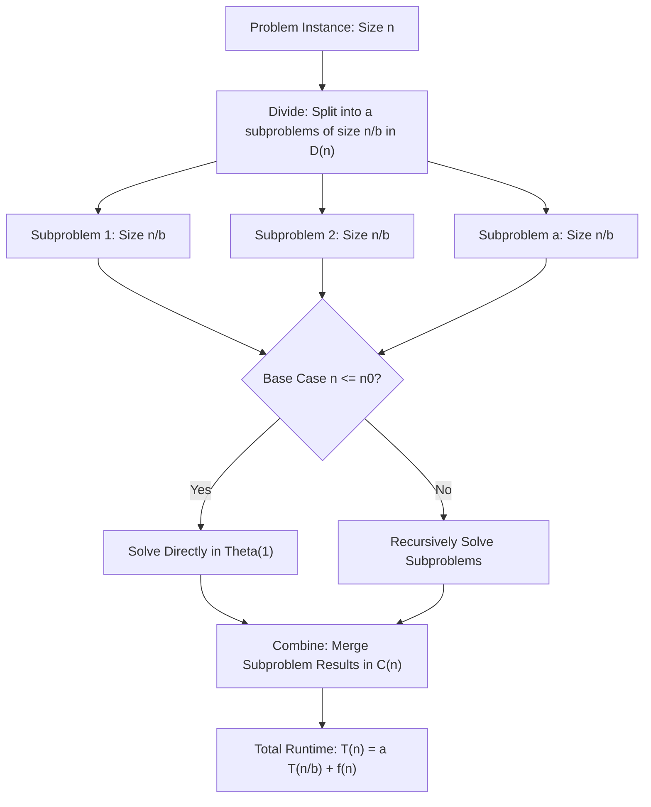

# Divide and Conquer Introduction

> [!info] Document Metadata
> - **Course:** CSALGCM
> - **Module:** Module 2 - Divide and Conquer
> - **Topic:** Divide and Conquer Introduction

**Tags:** #[[Computer Science]] #[[CSALGCM]] #[[Algorithms]] #[[Divide and Conquer Introduction]]

## Overview

**Divide and Conquer (D&C)** is a foundational top-down algorithmic paradigm that solves large problem instances by decomposing them into smaller, structurally identical, and **disjoint (independent)** subproblems. Rather than processing all $n$ elements iteratively in a flat loop—which frequently leads to $\Theta(n^2)$ pairwise comparisons—D&C recursively splits the input, resolves each branch independently until reaching trivial base cases, and synthesizes the partial results into a complete solution.

When subproblems are genuinely non-overlapping and balanced, Divide and Conquer routinely achieves exponential or polynomial asymptotic speedups—reducing $\Theta(n^2)$ sorting to $\Theta(n \log n)$, $O(n^2)$ schoolbook integer multiplication to $O(n^{\log_2 3})$, and $O(n^3)$ matrix multiplication to $O(n^{\log_2 7})$.

---

## The Divide, Conquer, and Combine Framework

Every Divide and Conquer algorithm follows three canonical phases:

1. **Divide:** Partition the current problem instance of size $n$ into $a \ge 1$ smaller, independent subproblems of the same type, typically each of size $n/b$ where $b > 1$. Let $D(n)$ denote the work required to split the input.
2. **Conquer:** Solve the $a$ subproblems recursively. When the subproblem size reaches a small threshold $n \le n_0$ (the **base case**), compute the answer directly in $\Theta(1)$ time without further recursion.
3. **Combine:** Merge the solutions of the $a$ subproblems into the solution for the parent problem of size $n$. Let $C(n)$ denote the merging work.

When $a = 1$ (only a single recursive branch is pursued at each level while the rest of the input is discarded), the pattern is commonly refined as **Decrease and Conquer** (exemplified by Binary Search and the Bisection Method).



---

## Recurrence Modeling and the Master Theorem

Grouping the non-recursive split and merge costs into $f(n) = D(n) + C(n)$, a uniform Divide and Conquer algorithm satisfies the canonical recurrence:

$$
T(n) = \begin{cases}
\Theta(1) & \text{if } n \le n_0 \\
a\,T(n/b) + f(n) & \text{if } n > n_0
\end{cases}
$$

where $a \ge 1$ is the number of recursive subproblems, $b > 1$ is the factor by which input size shrinks per level, and $f(n)$ is asymptotically positive.

### Recursion Tree Intuition

Expanding $T(n) = a\,T(n/b) + f(n)$ into a **recursion tree** reveals where the total computational cost concentrates:
- The tree has height $h = \log_b n$ (ignoring floors/ceilings, which do not alter asymptotic bounds under mild smoothness conditions).
- At depth $j$ ($0 \le j < \log_b n$), there are $a^j$ subproblems, each of size $n / b^j$, contributing level cost $a^j f(n / b^j)$.
- At the leaf level ($j = \log_b n$), there are $a^{\log_b n} = n^{\log_b a}$ leaves, each costing $\Theta(1)$.

This naturally defines the **critical polynomial exponent** (watershed exponent):

$$
c_{\text{crit}} = \log_b a
$$

Comparing $f(n)$ against the leaf-count function $n^{\log_b a}$ yields the three cases of the **Master Theorem**.

### The Three Cases of the Master Theorem

Let $a \ge 1$, $b > 1$ be constants, and let $T(n) = a\,T(n/b) + f(n)$ be defined on the nonnegative integers (where $n/b$ denotes $\lfloor n/b \rfloor$ or $\lceil n/b \rceil$).

| Case | Condition on $f(n)$ vs. $n^{\log_b a}$ | Closed-Form Solution $T(n)$ | Cost Distribution in Tree | Canonical Example |
| :--- | :--- | :--- | :--- | :--- |
| **Case 1 (Leaf-Dominated)** | $f(n) = O\!\left(n^{\log_b a - \epsilon}\right)$ for some constant $\epsilon > 0$ | $\Theta\!\left(n^{\log_b a}\right)$ | Exponentially increases toward leaves; leaves dominate | Karatsuba: $T(n) = 3T(n/2) + \Theta(n) \implies \Theta(n^{\log_2 3})$ |
| **Case 2 (Balanced)** | $f(n) = \Theta\!\left(n^{\log_b a} \log^k n\right)$ for some constant $k \ge 0$ | $\Theta\!\left(n^{\log_b a} \log^{k+1} n\right)$ | Equal cost across all $\log_b n$ levels | Merge Sort ($k=0$): $T(n) = 2T(n/2) + \Theta(n) \implies \Theta(n \log n)$ |
| **Case 3 (Root-Dominated)** | $f(n) = \Omega\!\left(n^{\log_b a + \epsilon}\right)$ for some $\epsilon > 0$ **AND** regularity: $a f(n/b) \le c f(n)$ for some $c < 1$ and large $n$ | $\Theta(f(n))$ | Geometrically decays away from root; root dominates | $T(n) = 2T(n/2) + n^2 \implies \Theta(n^2)$ |

#### Master Theorem Boundary Pitfalls
1. **Polynomial Gap Requirement (Cases 1 & 3):** $f(n)$ must be polynomially smaller (Case 1) or polynomially larger (Case 3) than $n^{\log_b a}$ by a factor of $n^\epsilon$. A logarithmic factor does **not** suffice. For example, $T(n) = 2T(n/2) + \frac{n}{\log n}$ falls in the gap between Case 1 and Case 2; the Master Theorem does not apply, and summing the recursion tree yields $\Theta(n \log \log n)$.
2. **Regularity Condition (Case 3):** Ensures the root cost truly dominates all subproblem work. Pathological non-monotone or oscillating functions (such as $f(n) = n^2(2 - \cos n)$ when $a=1, b=2$) can satisfy $f(n) = \Omega(n^\epsilon)$ while violating $a f(n/b) \le c f(n)$.
3. **Unequal Subproblem Sizes:** Recurrences with asymmetric partitions—such as $T(n) = T(n/3) + T(2n/3) + \Theta(n)$ or Quick Sort's worst case $T(n) = T(n-1) + \Theta(n)$—do not fit $a T(n/b) + f(n)$ and must be analyzed via the Recursion Tree, Substitution Method, or the Akra-Bazzi theorem.

---

## Classic Divide and Conquer Algorithms

| Algorithm | Divide Step | Subproblems ($a$, size) | Combine Step $C(n)$ | Recurrence | Time Complexity | Extra Space |
| :--- | :--- | :--- | :--- | :--- | :--- | :--- |
| **Binary Search** | Compare with middle element | $a=1$, size $n/2$ | None ($\Theta(1)$) | $T(n) = T(n/2) + \Theta(1)$ | $\Theta(\log n)$ (worst/avg) | $O(1)$ iterative |
| **Merge Sort** | Split array at midpoint $\lfloor n/2 \rfloor$ | $a=2$, size $n/2$ | Two-pointer sorted merge ($\Theta(n)$) | $T(n) = 2T(n/2) + \Theta(n)$ | $\Theta(n \log n)$ (all cases) | $\Theta(n)$ |
| **Quick Sort** | Partition around pivot ($\Theta(n)$) | $a=2$, sizes $k$ and $n-1-k$ | None ($\Theta(1)$, in-place) | Avg: $2T(n/2) + \Theta(n)$ / Worst: $T(n-1) + \Theta(n)$ | $\Theta(n \log n)$ avg, $\Theta(n^2)$ worst | $O(\log n)$ avg stack |
| **Karatsuba Multiplication** | Split $n$-digit ints into $n/2$ halves | $a=3$, size $n/2$ | Shifts & additions ($\Theta(n)$) | $T(n) = 3T(n/2) + \Theta(n)$ | $\Theta(n^{\log_2 3}) \approx \Theta(n^{1.585})$ | $O(n)$ |
| **Strassen Matrix Mult.** | Partition $n \times n$ into $(n/2)\times(n/2)$ blocks | $a=7$, size $n/2$ | 18 block additions ($\Theta(n^2)$) | $T(n) = 7T(n/2) + \Theta(n^2)$ | $\Theta(n^{\log_2 7}) \approx \Theta(n^{2.807})$ | $O(n^2)$ |
| **Closest Pair of Points** | Partition sorted points at median $x$ | $a=2$, size $n/2$ | Scan $\delta$-strip in $y$-order ($\Theta(n)$) | $T(n) = 2T(n/2) + \Theta(n)$ | $\Theta(n \log n)$ | $\Theta(n)$ |

### 1. Binary Search and the Bisection Method
Given a sorted array $A[0 \dots n-1]$ and target $x$, Binary Search probes $m = \lfloor (L + R)/2 \rfloor$ and discards half of the remaining search interval in $\Theta(1)$ work. By Master Theorem Case 2 ($a=1, b=2 \implies c_{\text{crit}} = 0$, $f(n) = \Theta(n^0 \log^0 n)$), $T(n) = \Theta(\log n)$.

The same decrease-and-conquer principle generalizes to:
- **Bisection Method (Numerical Root Finding):** Given a continuous function $g(x)$ on $[L, R]$ with $g(L) \cdot g(R) < 0$, repeatedly bisect $m = (L + R)/2$ and retain the subinterval exhibiting a sign change. Reaching absolute error $\le \epsilon$ requires $\lceil \log_2((R - L)/\epsilon) \rceil$ evaluations.
- **Binary Search on Answer:** Whenever a feasibility predicate $P(k)$ is monotonic (e.g., `false, ..., false, true, ..., true` in optimization problems like *Never Fade Away* from `[[[PS] Empress Arcana]]`), binary search finds the minimum feasible parameter $k^*$ in $O(T_{\text{check}} \log R)$ time.

### 2. Merge Sort (and Inversion Counting)
Merge Sort deterministically splits an array into two halves of size $\lfloor n/2 \rfloor$ and $\lceil n/2 \rceil$, sorts each recursively, and merges two sorted runs in $\Theta(n)$ linear time. Because splits are always balanced, its worst-case runtime is strictly $\Theta(n \log n)$ (Master Theorem Case 2, $k=0$). Moreover, during the merge step, whenever an element from the right subarray $R[j]$ is placed ahead of the remaining elements in the left subarray $L[i \dots \text{mid}]$, exactly $(\text{mid} - i + 1)$ **inversions** are counted simultaneously without changing the $\Theta(n \log n)$ bound.

### 3. Quick Sort: Average vs. Worst Case
Quick Sort performs its main work in the **Divide** phase via in-place `partition` ($\Theta(n)$ time), placing a pivot in its final sorted index $q$ so that elements $\le \text{pivot}$ sit to its left and elements $> \text{pivot}$ sit to its right, leaving $\Theta(1)$ combine work:
- **Balanced / Expected Case ($\Theta(n \log n)$):** With randomized pivot selection, every pair of elements $(z_i, z_j)$ ($i < j$) is compared at most once, with probability $\frac{2}{j - i + 1}$ (only if $z_i$ or $z_j$ is chosen first as a pivot among the slice $z_i \dots z_j$). Summing over all pairs gives expected comparisons $E[C(n)] = \sum_{i=1}^{n-1} \sum_{j=i+1}^n \frac{2}{j-i+1} = \Theta(n \log n)$. Even a fixed 90%-to-10% split yields $T(n) = T(0.9n) + T(0.1n) + \Theta(n) = \Theta(n \log n)$.
- **Adversarial Worst Case ($\Theta(n^2)$):** If a deterministic endpoint pivot repeatedly lands on the minimum or maximum element (e.g., an already sorted or reverse-sorted array with naive last-element pivot), the subproblem sizes become $n-1$ and $0$:

$$
T(n) = T(n-1) + \Theta(n) = \sum_{k=1}^{n} \Theta(k) = \Theta(n^2)
$$

This degrades recursion stack depth to $\Theta(n)$ unless tail-call elimination onto the smaller partition is used.

### 4. Karatsuba Integer Multiplication ($O(n^{\log_2 3})$)
Schoolbook multiplication of two $n$-digit numbers takes $\Theta(n^2)$ digit operations. Splitting two $n$-bit numbers in base $B = 2^m$ ($m = \lfloor n/2 \rfloor$) as $x = x_1 B + x_0$ and $y = y_1 B + y_0$:
- Naive D&C computes $x_1 y_1$, $x_1 y_0$, $x_0 y_1$, and $x_0 y_0$, giving $T(n) = 4T(n/2) + \Theta(n) = \Theta(n^2)$ (no improvement over brute force).
- **Karatsuba's Algebraic Trick** reduces 4 recursive multiplications to **3** by computing:

$$
z_2 = x_1 y_1, \qquad z_0 = x_0 y_0, \qquad z_1 = (x_1 + x_0)(y_1 + y_0) - z_2 - z_0
$$

Since $z_1 = x_1 y_0 + x_0 y_1$, the product is reconstructed via bit shifts and additions as $xy = z_2 B^2 + z_1 B + z_0$. With $a = 3, b = 2, f(n) = \Theta(n)$, Master Theorem Case 1 ($1 < \log_2 3 \approx 1.58496$) gives:

$$
T(n) = 3T(n/2) + \Theta(n) = \Theta\!\left(n^{\log_2 3}\right) \approx \Theta(n^{1.585})
$$

### 5. Strassen's Matrix Multiplication ($O(n^{\log_2 7})$)
Multiplying two $n \times n$ matrices directly takes $\Theta(n^3)$ scalar multiplications. Block-partitioning $A$ and $B$ into four $(n/2) \times (n/2)$ submatrices normally requires 8 recursive submatrix multiplications ($T(n) = 8T(n/2) + \Theta(n^2) = \Theta(n^3)$). Volker Strassen showed that computing just **7** specific linear-combination products $M_1, \dots, M_7$ and combining them with 18 block additions/subtractions recovers all four quadrants of $C = A \cdot B$:
- $M_1 = (A_{11} + A_{22})(B_{11} + B_{22})$
- $M_2 = (A_{21} + A_{22})B_{11}$, $M_3 = A_{11}(B_{12} - B_{22})$, $M_4 = A_{22}(B_{21} - B_{11})$
- $M_5 = (A_{11} + A_{12})B_{22}$, $M_6 = (A_{21} - A_{11})(B_{11} + B_{12})$, $M_7 = (A_{12} - A_{22})(B_{21} + B_{22})$
- Output blocks: $C_{11} = M_1 + M_4 - M_5 + M_7$, $C_{12} = M_3 + M_5$, $C_{21} = M_2 + M_4$, $C_{22} = M_1 - M_2 + M_3 + M_6$.

Here $a = 7, b = 2, f(n) = \Theta(n^2)$. Since $\log_2 7 \approx 2.80735 > 2$, Master Theorem Case 1 yields:

$$
T(n) = 7T(n/2) + \Theta(n^2) = \Theta\!\left(n^{\log_2 7}\right) \approx \Theta(n^{2.807})
$$

### 6. Closest Pair of Points in 2D ($O(n \log n)$)
Given $n$ points in the Euclidean plane $\mathbb{R}^2$, checking all $\binom{n}{2}$ pairs takes $\Theta(n^2)$. Using Divide and Conquer:
1. **Preprocessing ($O(n \log n)$):** Create arrays $P_x$ sorted by $x$-coordinate and $P_y$ sorted by $y$-coordinate.
2. **Divide ($O(n)$):** Split $P_x$ at median $x_{\text{mid}}$ into left and right halves $Q_x, R_x$, and partition $P_y$ in linear time into $Q_y, R_y$ preserving $y$-order.
3. **Conquer ($2T(n/2)$):** Recursively find $\delta_L = \text{Closest}(Q_x, Q_y)$ and $\delta_R = \text{Closest}(R_x, R_y)$; set $\delta = \min(\delta_L, \delta_R)$.
4. **Combine ($O(n)$):** Collect all points from $P_y$ within horizontal distance $\delta$ of the dividing line ($|p.x - x_{\text{mid}}| < \delta$) into a $y$-sorted strip $S_y$. For each point $p_i \in S_y$, compare $p_i$ **only with the next 7 points** $p_{i+1}, \dots, p_{i+7}$ (halting early if $p_j.y - p_i.y \ge \delta$).

**Geometric Packing Proof (Why 7 neighbors suffice):** Any point closer than $\delta$ to $p_i$ across the dividing line must lie in a $\delta \times 2\delta$ rectangle partitioned into eight squares of side $\delta/2$. Because every point on the left (or right) side already has pairwise distance $\ge \delta$ from other points on the same side, and the diagonal of a $(\delta/2) \times (\delta/2)$ square is $\delta/\sqrt{2} < \delta$, each square contains **at most 1 point**. Thus at most $8 - 1 = 7$ subsequent points in $S_y$ can fall within distance $\delta$ of $p_i$. The recurrence is $T(n) = 2T(n/2) + \Theta(n) = \Theta(n \log n)$.

---

## Code Examples

### C++: Merge Sort with Inversion Counting (`O(n log n)`)

```cpp
#include <iostream>
#include <vector>

using namespace std;

long long mergeAndCount(vector<int>& arr, vector<int>& tmp, int left, int mid, int right) {
    int i = left;      // Pointer into left sorted half [left..mid]
    int j = mid + 1;   // Pointer into right sorted half [mid+1..right]
    int k = left;
    long long inversions = 0;

    while (i <= mid && j <= right) {
        if (arr[i] <= arr[j]) {
            tmp[k++] = arr[i++];
        } else {
            // arr[j] precedes arr[i..mid]; counts (mid - i + 1) inversions
            tmp[k++] = arr[j++];
            inversions += (mid - i + 1);
        }
    }

    while (i <= mid) tmp[k++] = arr[i++];
    while (j <= right) tmp[k++] = arr[j++];

    for (int idx = left; idx <= right; ++idx) {
        arr[idx] = tmp[idx];
    }
    return inversions;
}

long long mergeSortCount(vector<int>& arr, vector<int>& tmp, int left, int right) {
    if (left >= right) return 0; // Base case: 0 or 1 element
    int mid = left + (right - left) / 2;
    long long count = 0;
    count += mergeSortCount(arr, tmp, left, mid);
    count += mergeSortCount(arr, tmp, mid + 1, right);
    count += mergeAndCount(arr, tmp, left, mid, right);
    return count;
}

int main() {
    vector<int> data = {8, 4, 2, 1, 5};
    vector<int> tmp(data.size());
    long long inv = mergeSortCount(data, tmp, 0, static_cast<int>(data.size()) - 1);
    cout << "Inversions: " << inv << "\n"; // 7 inversions
    return 0;
}
```

### Python: Karatsuba Multiplication (`O(n^1.585)`)

```python
def karatsuba(x: int, y: int) -> int:
    """Multiply two non-negative integers in O(n^(log2 3)) time."""
    if x < 10 or y < 10:
        return x * y

    # Number of decimal digits of the larger operand
    n = max(len(str(x)), len(str(y)))
    m = n // 2
    base = 10 ** m

    high1, low1 = divmod(x, base)
    high2, low2 = divmod(y, base)

    # Three recursive multiplications instead of four
    z0 = karatsuba(low1, low2)
    z2 = karatsuba(high1, high2)
    z1 = karatsuba(low1 + high1, low2 + high2) - z2 - z0

    return (z2 * (10 ** (2 * m))) + (z1 * base) + z0


if __name__ == "__main__":
    print(karatsuba(12345678, 87654321))  # 1082152022374638
```

---

## Requirements, Trade-offs, and Limitations

1. **Subproblem Independence Requirement:** Divide and Conquer assumes subproblems do **not** overlap heavily. Applying naive D&C to overlapping recurrences—such as Fibonacci $F(n) = F(n-1) + F(n-2)$—causes exponential re-evaluation ($\Theta(\phi^n)$), where **Dynamic Programming** is required instead.
2. **Balanced Partition Requirement:** Speedups depend on shrinking subproblem sizes multiplicatively ($n/b$ with $b > 1$). When splits become maximally unbalanced ($n - 1$ and $0$), D&C collapses from $O(n \log n)$ to $O(n^2)$ (e.g., deterministic Quick Sort on sorted arrays).
3. **Recursion Overhead and Cache Cutoff:** Recursive function calls and non-contiguous auxiliary buffers add constant-factor overhead for small $n$. Production implementations (such as `std::sort` / Timsort) hybridize D&C by switching to **Insertion Sort** once subarrays drop below a cutoff (e.g., $n \le 16$ or $32$) and limit stack depth via **Introsort** (falling back to Heap Sort if recursion depth exceeds $2\lfloor \log_2 n \rfloor$).
4. **Combine Cost Must Not Dominate Excessively:** If splitting or merging takes $\Omega(n^c)$ with $c > \log_b a$ (Master Theorem Case 3), D&C yields no asymptotic win over the combine step itself unless algebraic reductions (like Karatsuba or Strassen) reduce the branching factor $a$ or clever presorting (like Closest Pair of Points) avoids $O(n \log n)$ re-sorting inside each recursive frame.

---

## Multiple Choice Questions

1. Consider the recurrence $T(n) = 8 T(n/2) + n^2$. Which case of the Master Theorem applies, and what is the resulting asymptotic bound for $T(n)$?
    - **A)** Case 1, giving Θ(n³)
    - **B)** Case 2, giving Θ(n² log n)
    - **C)** Case 3, giving Θ(n²)
    - **D)** Case 1, giving Θ(n^(log₂ 7))

2. Which condition is required in Case 3 of the Master Theorem for $T(n) = a T(n/b) + f(n)$ in addition to $f(n) = \Omega(n^{\log_b a + \epsilon})$?
    - **A)** The branching factor a must be strictly less than b
    - **B)** The regularity condition a f(n/b) ≤ c f(n) must hold for some constant c < 1 and sufficiently large n
    - **C)** The combine function f(n) must be bounded by O(n log n)
    - **D)** Every recursive subproblem must have size strictly equal to n − 1

3. Why does the Master Theorem NOT apply to the recurrence $T(n) = 2 T(n/2) + \frac{n}{\log n}$?
    - **A)** Because a = 2 and b = 2 violate the requirement that b > 1
    - **B)** Because f(n) = n / log n grows faster than n^(log₂ 2)
    - **C)** Because f(n) = n / log n is smaller than n^1, but not polynomially smaller by a factor of n^ε for any ε > 0
    - **D)** Because the regularity condition fails when dividing by log n

4. What algebraic reduction enables Karatsuba's algorithm to multiply two $n$-digit integers asymptotically faster than the $\Theta(n^2)$ schoolbook method?
    - **A)** Caching intermediate digit products in a 2D dynamic programming table of size n × n
    - **B)** Partitioning digits into 7 sub-blocks and combining them with 18 additions
    - **C)** Sorting the decimal digits in O(n log n) time before applying binary search
    - **D)** Replacing 4 recursive (n/2)-digit multiplications with 3 multiplications via the middle-term identity (x₁ + x₀)(y₁ + y₀) − z₂ − z₀

5. Strassen's algorithm multiplies two $n \times n$ matrices by solving 7 recursive submatrix multiplications of size $(n/2) \times (n/2)$ and performing $\Theta(n^2)$ block additions. What is its recurrence and asymptotic complexity?
    - **A)** T(n) = 7 T(n/2) + Θ(n), yielding Θ(n²)
    - **B)** T(n) = 8 T(n/2) + Θ(n²), yielding Θ(n³)
    - **C)** T(n) = 7 T(n/2) + Θ(n²), yielding Θ(n^(log₂ 7)) ≈ Θ(n^2.807)
    - **D)** T(n) = 7 T(n/4) + Θ(n²), yielding Θ(n² log n)

6. In the $O(n \log n)$ Divide and Conquer Closest Pair of Points algorithm, why is it unnecessary to re-sort the strip points by $y$-coordinate inside each recursive call, and how many subsequent points in the strip must each point be checked against?
    - **A)** Points are presorted by y once up front and partitioned in O(n) per level; each strip point checks at most 7 subsequent points
    - **B)** Points are hashed into buckets of size δ; each strip point checks at most 2 subsequent points
    - **C)** Points are sorted by x inside each call in O(n log n); each strip point checks at most log₂ n subsequent points
    - **D)** Only points on the left half are checked against the median line; at most 16 points lie in any vertical strip

7. Under what scenario does Quick Sort degrade to its $\Theta(n^2)$ worst-case time complexity?
    - **A)** When the array contains duplicate values and Merge Sort's combine step is used
    - **B)** When a deterministic pivot repeatedly partitions the array into subproblems of size n − 1 and 0, such as an already-sorted array with an endpoint pivot
    - **C)** When randomized pivot selection chooses the median element at every recursive call
    - **D)** When the input size n is a power of two and the recursion depth equals log₂ n

8. Using Master Theorem Case 2 with $k = 1$, what is the tight asymptotic solution to $T(n) = 4 T(n/2) + n^2 \log n$?
    - **A)** Θ(n²)
    - **B)** Θ(n² log n)
    - **C)** Θ(n² log² n)
    - **D)** Θ(n³)

9. When using Merge Sort to sort an array and simultaneously count inversions $(i < j \text{ with } A[i] > A[j])$, how are cross-half inversions counted during the `merge` step?
    - **A)** Whenever R[j] < L[i], add 1 to the inversion counter and advance i
    - **B)** Whenever L[i] ≤ R[j], add (right − j + 1) to the inversion counter
    - **C)** Compare every pair (L[i], R[j]) in a nested loop after merging, taking O(n²) per level
    - **D)** Whenever R[j] < L[i], add (mid − i + 1) to the inversion counter because R[j] is smaller than L[i] and every remaining element in the sorted left half

10. Why does applying a pure Divide and Conquer recursion directly to compute Fibonacci numbers $F(n) = F(n-1) + F(n-2)$ fail to deliver an efficient algorithm?
    - **A)** Because the base cases F(0) and F(1) require Ω(n) work each
    - **B)** Because the subproblems overlap heavily rather than remaining disjoint, causing redundant exponential recomputation in Θ(φ^n) time
    - **C)** Because the Master Theorem Case 3 regularity condition is violated for b = 2
    - **D)** Because combining F(n-1) and F(n-2) requires Θ(n log n) addition time

### Answer Key & Explanations

1. **A)** Here $a = 8, b = 2$, so $c_{\text{crit}} = \log_2 8 = 3$. Since $f(n) = n^2 = O(n^{3 - 1})$ (with $\epsilon = 1 > 0$), Master Theorem Case 1 applies and the leaves dominate, giving $T(n) = \Theta(n^3)$.
2. **B)** Case 3 requires $f(n)$ to be polynomially larger than $n^{\log_b a}$ AND satisfy the regularity condition $a f(n/b) \le c f(n)$ for some $c < 1$ and sufficiently large $n$, guaranteeing that total work decays geometrically down the tree so the root dominates.
3. **C)** Here $n^{\log_2 2} = n^1$. While $n / \log n = o(n)$, the gap is only logarithmic ($1 / \log n$), not polynomial ($n^{-\epsilon}$ for any $\epsilon > 0$). Thus Case 1's polynomial separation requirement is unmet.
4. **D)** Karatsuba decomposes $n$-digit numbers into halves and computes $z_2 = x_1 y_1$, $z_0 = x_0 y_0$, and $z_1 = (x_1 + x_0)(y_1 + y_0) - z_2 - z_0$, reducing $a$ from 4 to 3 and giving $T(n) = 3T(n/2) + \Theta(n) = \Theta(n^{\log_2 3})$.
5. **C)** Strassen uses 7 recursive block multiplications of size $n/2$ and $\Theta(n^2)$ matrix additions. Since $\log_2 7 \approx 2.807 > 2$, Master Theorem Case 1 gives $\Theta(n^{\log_2 7})$.
6. **A)** Maintaining a presorted $y$-ordered list $P_y$ and splitting it in $O(n)$ per recursive call avoids an $O(n \log n)$ merge-step sort (which would raise the total to $O(n \log^2 n)$). By packing $(\delta/2) \times (\delta/2)$ squares in the $2\delta \times \delta$ box, each point only checks at most the next 7 strip neighbors.
7. **B)** Repeatedly choosing an extreme element as pivot creates unbalanced partitions of size $n-1$ and $0$, turning the recurrence into $T(n) = T(n-1) + \Theta(n) = \Theta(n^2)$.
8. **C)** Here $c_{\text{crit}} = \log_2 4 = 2$, and $f(n) = n^2 \log^1 n$ fits Master Theorem Case 2 with $k = 1$, giving $T(n) = \Theta(n^2 \log^{1+1} n) = \Theta(n^2 \log^2 n)$.
9. **D)** Both halves `L[left..mid]` and `R[mid+1..right]` are already sorted. When `R[j] < L[i]`, `R[j]` is strictly less than `L[i]` and every subsequent element `L[i+1..mid]`, yielding `mid - i + 1` inversions at once.
10. **B)** Divide and Conquer relies on disjoint subproblems. When subproblems overlap (as in $F(n-1)$ and $F(n-2)$ both recomputing $F(n-3)$ and deeper states), naive recursion balloons to $\Theta(\phi^n)$ calls unless memoization/DP is applied.

## References & Navigation

- **Previous Topic:** [[Computational Thinking in Problem Solving]]
- **Next Topic:** [[Dynamic Programming Introduction]]
- **Related Notes:** [[Complexity Analysis]], [[[PS] Empress Arcana]], [[[PS] Priestess Arcana]]
