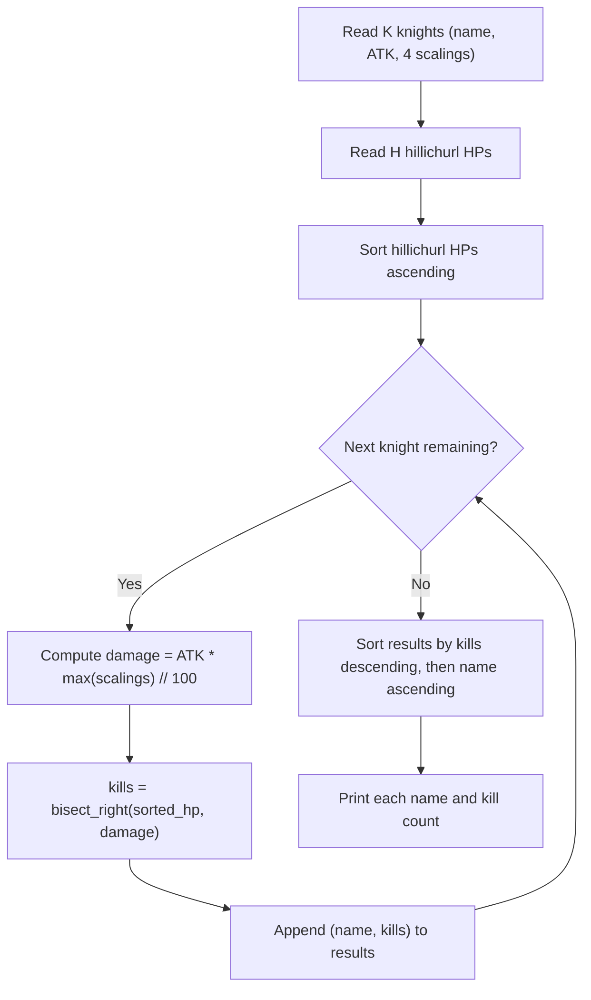

# DPS Check in the Knights of Favonius

> [!info] Document Metadata
> **Course:** `=this.course` | **Topic:** `=this.topic` | **Status:** `=this.status` | **Difficulty:** `=this.difficulty`

**Tags:** #[[Computer Science]] #[[CSALGCM]] #[[Algorithms and Complexity]] #[[HackerRank]] #[[Empress Arcana]]
---

## Problem Description

Jean Gunnhildr, Acting Grand Master of the Knights of Favonius, intends to test the combat efficiency of the members of her organization. Despite the odd assortment of characters at her disposal (among which includes a child with a penchant for violence, a creepy dude who is fond of giving people the cold shoulder, an alchemist with a stare that is perhaps a bit too intense, and an absent-minded gliding instructor with an exploding doll), she thinks they are capable fighters. However, she would still like to perform a classical "DPS Check" as she gathers data in order to more efficiently assign missions to the Knights of Favonius.

To explain this, we use a simplified version of Genshin Impact's mechanics. Each character has an ATK stat and four attacks: a normal attack, charged attack, elemental skill, and elemental burst. Each of these four attack types has a scaling factor that determines how much damage is dealt relative to ATK. For example, if a character has $1523$ ATK and their normal attack has $67\%$ scaling, their normal attack deals $1523 \cdot 67\% = 1523 \cdot 0.67 = 1020.41$ damage. Damage is always rounded down, giving a final damage of $1020$.

Jean has gathered a sample of hillichurls, each having a fixed number of hit points. When a character attacks a hillichurl, its hit points decrease by the damage dealt, and the hillichurl is defeated if its hit points drop to $0$ or lower. Given the hillichurls' hit points and the ATK stats and move scalings of Jean's Knights of Favonius, print the ranking of all knights by most hillichurls defeated. Assume each character always uses their most effective move and applies damage exactly once to each hypothetical hillichurl in Jean's sample.

### Input Format

The first line contains two space-separated integers $K$ and $H$ indicating the number of knights and hillichurls to be considered in the problem.

$2K$ lines follow, with every two lines describing one of Jean's Knights. The first line starts with a single string indicating the knight's name (containing only Latin alphabet characters, all distinct). The next line contains five integers $ATK_i, NA_i, CA_i, ES_i, EB_i$ indicating the ATK stat, normal attack scaling, charged attack scaling, elemental skill scaling, and elemental burst scaling of the $i$-th character.

After all knight descriptions, $H$ lines follow, each containing a single integer $H_j$ indicating the hit points of each of the $H$ hillichurls in Jean's sample.

### Output Format

Output $K$ lines, each containing the name of the knight and an integer indicating the number of hillichurls they can defeat with their optimal attack, separated by a single space. The knights must be sorted in non-ascending order according to the number of hillichurls defeated. In the case of a tie between two knights, print them in lexicographical order.

### Constraints

- $1 \le K, H \le 10^5$
- $1 \le ATK_i \le 9 \cdot 10^3$
- $1 \le NA_i, CA_i, ES_i, EB_i \le 10^3$
- $1 \le H_j \le 10^5$ for all $1 \le i \le H$

### Sample Test Cases

**Sample Input 0**
```text
3 5
Amber
101 47 13 33 11
Kaeya
473 16 36 49 47
Fischl
263 39 10 42 14
49
14
358
444
306
```

**Sample Output 0**
```text
Fischl 2
Kaeya 2
Amber 1
```

*Sample 0 Explanation:* Amber's strongest skill has $47\%$ scaling, dealing $\lfloor 101 \cdot 0.47 \rfloor = 47$ damage ($1$ hillichurl defeated). Kaeya's elemental skill ($49\%$) deals $\lfloor 473 \cdot 0.49 \rfloor = 231$ damage ($2$ hillichurls defeated). Fischl's elemental skill ($42\%$) deals $\lfloor 263 \cdot 0.42 \rfloor = 110$ damage ($2$ hillichurls defeated). Since Fischl and Kaeya tie at $2$, Fischl precedes Kaeya lexicographically.

**Sample Input 1**
```text
2 6
Timmie
9000 1000 100 500 100
Diluc
518 29 39 42 237
318
257
1490
3980
1960
3350
```

**Sample Output 1**
```text
Timmie 6
Diluc 2
```

*Sample 1 Explanation:* Timmie's normal attack ($1000\%$) deals $\lfloor 9000 \cdot 10.00 \rfloor = 90000$ damage, defeating all $6$ hillichurls. Diluc's elemental burst ($237\%$) deals $\lfloor 518 \cdot 2.37 \rfloor = 1227$ damage, defeating $2$ hillichurls ($318$ and $257$).

---

## Approach & Intuition

> **Problem Abstraction:**
> Each knight has an ATK stat and four percentage scalings, yielding optimal single-hit damage $\lfloor \text{ATK} \cdot \max(\text{scalings}) / 100 \rfloor$. Count how many hillichurls satisfy $H_j \le \text{damage}$ for each knight, then sort knights by kills descending and name ascending.

> **Brute-Force Approach:**
> For each of the $K$ knights, iterate over all $H$ hillichurls and count how many have $H_j \le \text{damage}$.
> This runs in $O(K \cdot H)$ time — up to $10^{10}$ checks when $K = H = 10^5$, causing Time Limit Exceeded (TLE).

> **Optimal Approach:**
> Sort the hillichurl HP list once in $O(H \log H)$ time. For each knight, binary search (`bisect_right`) in $O(\log H)$ time to count all hillichurls with $H_j \le \text{damage}$, then sort the resulting `(name, kills)` pairs by `(-kills, name)`.
> This achieves $O(H \log H + K \log H + K \log K)$ total time.

---

## Damage Formula

```text
damage = floor(ATK * best_scaling / 100)

Where best_scaling = max(normal, charged, elemental_skill, elemental_burst)
```

Example: Amber has $\text{ATK} = 101$ and scalings $[47, 13, 33, 11]$.
- Best scaling $= 47$ (normal attack)
- $\text{damage} = \lfloor 101 \times 47 / 100 \rfloor = \lfloor 47.47 \rfloor = \mathbf{47}$

---

## Algorithm Walkthrough



---

## Trace (Sample 0)

**Input:** $3$ knights, $5$ hillichurls with $\text{HP} = [49, 14, 358, 444, 306]$

**Step 1 — Sort HPs:** `[14, 49, 306, 358, 444]`

**Step 2 — Compute each knight:**

| Knight | ATK | Best Scaling | Damage | `bisect_right` | Kills |
| :--- | :--- | :--- | :--- | :--- | :--- |
| Amber | 101 | 47% (normal) | `101 * 47 // 100 = 47` | `bisect_right([14, 49, 306, 358, 444], 47) = 1` | **1** |
| Kaeya | 473 | 49% (elem skill) | `473 * 49 // 100 = 231` | `bisect_right([14, 49, 306, 358, 444], 231) = 2` | **2** |
| Fischl | 263 | 42% (elem skill) | `263 * 42 // 100 = 110` | `bisect_right([14, 49, 306, 358, 444], 110) = 2` | **2** |

**Step 3 — Sort results:** Fischl ($2$) and Kaeya ($2$) tie on kills, so lexicographical tie-breaking places Fischl first.

```text
Fischl 2
Kaeya 2
Amber 1
```

---

## Complexity Analysis

| Metric | Complexity | Rationale |
| :--- | :--- | :--- |
| **Time** | $O(H \log H + K \log H + K \log K)$ | Sorting $H$ hillichurl HPs takes $O(H \log H)$, computing optimal damage and running `bisect_right` for $K$ knights takes $O(K \log H)$, and sorting the $K$ knight rankings takes $O(K \log K)$. |
| **Space** | $O(H + K)$ | Storing the sorted hillichurl HP list of size $H$ alongside the $K$ knight records and output tuples requires linear memory. |

---

## Original Stub (HackerRank Template)

```python
def solve(k,h,knights,hillichurls):
    # compute and print answer here

def main():
    k, h = list(map(int,input().strip().split(" ")))
    knights = []

    for i in range(k):
        name = input().strip()
        temp = list(map(int,input().strip().split(" ")))
        knights.append((name,temp))

    hillichurls = [int(input().strip()) for i in range(h)]
    solve(k,h,knights,hillichurls)

if __name__ == "__main__":
    main()
```

## Full Solution

```python
def solve(k,h,knights,hillichurls):
    # compute and print answer here
    # For each knight: best damage = floor(ATK * max(scaling) / 100)
    # Count how many hillichurls have HP <= best damage
    # Sort hillichurls to use binary search
    import bisect
    sorted_hp = sorted(hillichurls)

    results = []
    for name, stats in knights:
        atk = stats[0]
        best_scaling = max(stats[1], stats[2], stats[3], stats[4])
        damage = atk * best_scaling // 100
        # Count hillichurls with HP <= damage
        kills = bisect.bisect_right(sorted_hp, damage)
        results.append((name, kills))

    # Sort: most kills first (descending), ties broken lexicographically (ascending)
    results.sort(key=lambda x: (-x[1], x[0]))

    for name, kills in results:
        print(f"{name} {kills}")

def main():
    k, h = list(map(int,input().strip().split(" ")))
    knights = []

    for i in range(k):
        name = input().strip()
        temp = list(map(int,input().strip().split(" ")))
        knights.append((name,temp))

    hillichurls = [int(input().strip()) for i in range(h)]
    solve(k,h,knights,hillichurls)

if __name__ == "__main__":
    main()
```

## References & Navigation

- **Next Problem:** [[02 - I Hate Spellcasters]]
- **Parent Set:** [[[PS] Empress Arcana|Empress Arcana Index]]
- **Related Notes:** [[Divide and Conquer Introduction]]
