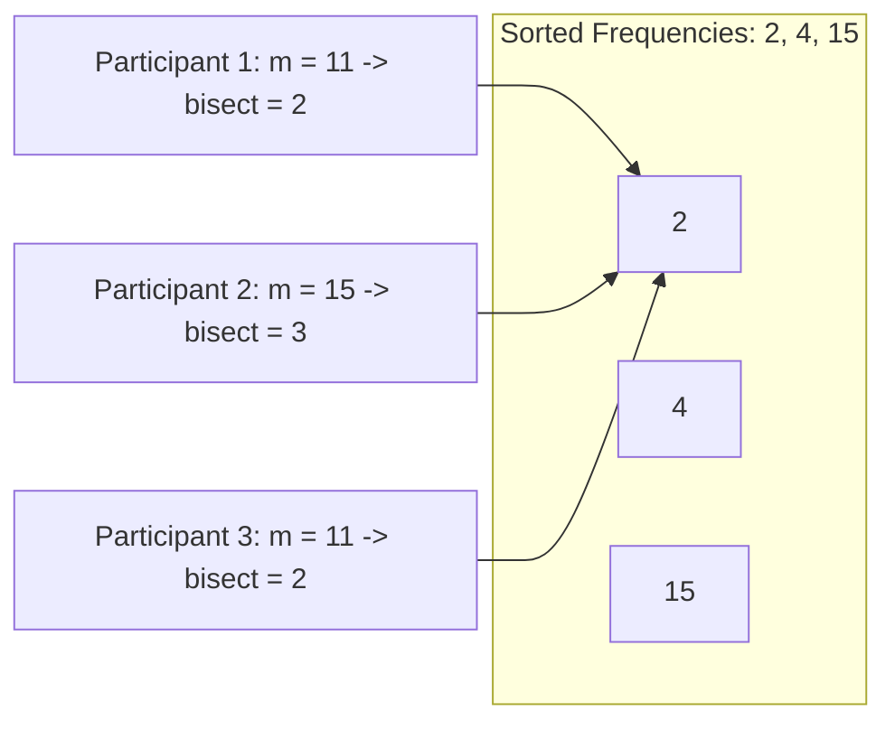

# Metacognitive Frequencies

> [!info] Document Metadata
> **Course:** `=this.course` | **Topic:** `=this.topic` | **Status:** `=this.status` | **Difficulty:** `=this.difficulty`

**Tags:** #[[Computer Science]] #[[CSALGCM]] #[[Algorithms and Complexity]] #[[HackerRank]] #[[Empress Arcana]]
---

## Problem Description

You are involved in a government black project testing technology for telepathic communication. Your transmitter must be tuned to specific frequencies. You are given $K$ frequencies at which to transmit some trial thoughts. A person can hear a particular thought transmitted at frequency $f_i$ if and only if the person's metacognitive frequency $m_j$ is greater than or equal to $f_i$.

You have $N$ participants who are about to enter the testing hall one by one. For each participant who enters, all $K$ frequencies will be blasted simultaneously. You must count how many frequencies each participant will hear among the $K$ frequencies.

### Input Format

Input begins with a line containing two space-separated integers $K$ and $N$, indicating the number of frequencies and number of participants, respectively.

$K$ lines follow, each containing a single integer $f_i$, indicating the frequency of the $i$-th telepathic transmission, as described in the problem statement.

$N$ lines follow, each containing a single integer $m_j$ indicating the metacognitive frequency of the $j$-th participant to enter the room.

### Output Format

For each of the $N$ participants, print a line containing a single integer indicating how many of the $K$ frequencies they can hear.

### Constraints

- $1 \le K, N \le 3 \cdot 10^5$
- $1 \le f_i, m_j \le 10^9$

### Sample Test Cases

**Sample Input 0**
```text
3 3
4
15
2
11
15
11
```

**Sample Output 0**
```text
2
3
2
```

---

## Approach & Intuition

> **Problem Abstraction:**
> Given $K$ transmission frequencies $f_i$ and $N$ participants with metacognitive frequencies $m_j$, count for each $m_j$ how many transmission frequencies satisfy $f_i \le m_j$.

> **Brute-Force Approach:**
> For each of the $N$ participants, linearly scan all $K$ frequencies and count those $\le m_j$.
> With $N = K = 3 \cdot 10^5$, this performs $N \cdot K = 9 \cdot 10^{10}$ checks, resulting in Time Limit Exceeded (TLE).

> **Optimal Approach:**
> Sort the $K$ transmission frequencies once upfront in $O(K \log K)$ time, then answer each participant query via `bisect_right(fs, m)` in $O(\log K)$ time to count all elements $\le m$.
> Total complexity is $O(K \log K + N \log K)$.

---

## Connection to "It's Like I Have ESPN Or Something"

This problem follows the exact same sorted-array counting pattern as the Priestess Arcana problem [[01 - Its Like I Have ESPN Or Something|It's Like I Have ESPN Or Something]]:
- **ESPN:** compute Manhattan distances, sort once, and binary search (`upper_bound`) per query.
- **Metacognitive Frequencies:** transmission frequencies `fs` are already sorted by the HackerRank template stub, so each participant reduces to a single `bisect_right` call:

```python
fs = sorted([int(input()) for i in range(k)])
```

---

## Trace (Sample 0)

**Frequencies:** $[4, 15, 2] \to$ sorted: $[2, 4, 15]$

| Participant | $m_j$ | `bisect_right([2, 4, 15], m)` | Explanation |
| :--- | :--- | :--- | :--- |
| 1 | 11 | **2** | $2 \le 11$ (yes), $4 \le 11$ (yes), $15 \le 11$ (no) |
| 2 | 15 | **3** | All $3$ frequencies are $\le 15$ |
| 3 | 11 | **2** | Same threshold as Participant 1 |



---

## Complexity Analysis

| Metric | Complexity | Rationale |
| :--- | :--- | :--- |
| **Time** | $O(K \log K + N \log K)$ | Sorting the $K$ transmission frequencies upfront takes $O(K \log K)$, and querying `bisect_right` for each of the $N$ participants runs in $O(\log K)$ per participant. |
| **Space** | $O(K + N)$ | Storing the sorted frequency array `fs` of size $K$ together with the participant query list `ms` and result list of size $N$ uses linear memory. |

---

## Original Stub (HackerRank Template)

```python
"""
This function solves a test case.

Parameters:
k : int - number of transmission frequencies
n : int - number of participants
fs : array-like - array of size (k,) with a list of transmission frequencies
ms : array-like - array of size (n,) with a list of participant frequencies

Returns a list of integers of size (n,) indicating the answers for each 
participant
"""
def solve(k,n,fs,ms):
    # compute and return answers here

def main():
    k,n = list(map(int,input().split(" ")))

    fs = sorted([int(input()) for i in range(k)])
    ms = [int(input()) for i in range(n)]

    ans = solve(k,n,fs,ms)

    print("\n".join(list(map(str,ans))))

if __name__ == "__main__":
    main()
```

## Full Solution

```python
"""
This function solves a test case.

Parameters:
k : int - number of transmission frequencies
n : int - number of participants
fs : array-like - array of size (k,) with a list of transmission frequencies
ms : array-like - array of size (n,) with a list of participant frequencies

Returns a list of integers of size (n,) indicating the answers for each 
participant
"""
def solve(k,n,fs,ms):
    # compute and return answers here
    # fs is already sorted (see main). For each participant m,
    # count how many frequencies f_i satisfy f_i <= m.
    # This is bisect_right(fs, m).
    import bisect
    return [bisect.bisect_right(fs, m) for m in ms]

def main():
    k,n = list(map(int,input().split(" ")))

    fs = sorted([int(input()) for i in range(k)])
    ms = [int(input()) for i in range(n)]

    ans = solve(k,n,fs,ms)

    print("\n".join(list(map(str,ans))))

if __name__ == "__main__":
    main()
```

## References & Navigation

- **Previous Problem:** [[02 - I Hate Spellcasters]]
- **Next Problem:** [[04 - Never Fade Away]]
- **Parent Set:** [[[PS] Empress Arcana|Empress Arcana Index]]
- **Related Notes:** [[Divide and Conquer Introduction]]
