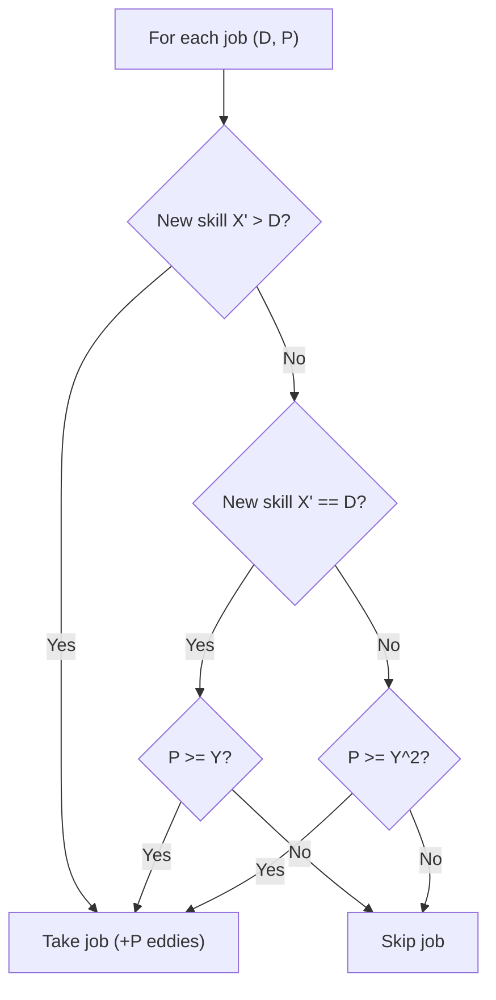

# Never Fade Away

> [!info] Document Metadata
> **Course:** `=this.course` | **Topic:** `=this.topic` | **Status:** `=this.status` | **Difficulty:** `=this.difficulty`

**Tags:** #[[Computer Science]] #[[CSALGCM]] #[[Algorithms and Complexity]] #[[HackerRank]] #[[Empress Arcana]]
---

## Problem Description

V is a mercenary for hire in Night City. As one of the most notorious mercenaries, she gets a lot of job offers. Having done this for a while, she can accurately assess the risk factor of a job and the likelihood of success, giving her a strict set of rules for accepting jobs. Given V's skill value $X$, a job's difficulty $D$, and the payout $P$:

- If $X > D$, V will take on the job.
- If $X = D$, $P$ must be at least $Y$ for V to take the job.
- If $X < D$, $P$ must be at least $Y^2$ for V to take the job.

Here, $Y$ is V's payout threshold for risky jobs. V is currently browsing cybernetic augmentations to help her earn at least $G$ total eddies (the unit of currency in Night City). Before selecting an augmentation, she needs to know the minimum amount of additional skill value she must add to her current skill value $X$ so that, given the list of all available jobs, she can earn at least $G$ eddies total across all accepted jobs.

### Input Format

Input begins with a line containing a single integer $T$, indicating the number of test cases. A blank line follows, followed by $T$ test case descriptions separated by a blank line.

Each test case begins with four space-separated integers $X$, $N$, $G$, and $Y$, indicating V's current skill level, the number of jobs available, V's goal payout, and V's payout threshold for risky jobs.

$N$ lines follow, each describing a job with two space-separated integers $D$ and $P$, indicating the difficulty of the job and the payout of the job respectively.

### Output Format

For each test case, print one line containing a single integer indicating the minimum additional skill that must be added to $X$ for V to get at least $G$ eddies. Print `-1` (without quotes) if no amount of skill will allow V to reach her goal.

### Constraints

- $1 \le T \le 30$
- $1 \le N \le 3 \cdot 10^4$
- $1 \le D, G, P, X, Y \le 10^9$

### Sample Test Cases

**Sample Input 0**
```text
2

1 2 2 11
15 7
11 19

3 1 13 17
7 12
```

**Sample Output 0**
```text
10
-1
```

---

## Approach & Intuition

> **Problem Abstraction:**
> Given initial skill $X$, threshold $Y$, goal $G$, and $N$ jobs $(D_i, P_i)$, find the minimum integer $\text{add} \ge 0$ such that the total payout of jobs accepted at skill level $X' = X + \text{add}$ is at least $G$, or output `-1` if $\sum P_i < G$.

> **Brute-Force Approach:**
> Incrementally test $\text{add} = 0, 1, 2, \dots, \max D$ and sum accepted payouts for each value.
> Because $D_i \le 10^9$, linear search requires up to $10^9 \cdot N$ steps per test case, which is completely infeasible.

> **Optimal Approach:**
> Since increasing $\text{add}$ only relaxes acceptance rules on each job, $\text{earnings}(\text{add})$ is **monotone non-decreasing**. First verify $\sum P_i \ge G$ (otherwise return `-1`); then binary search on $\text{add} \in [0, \max D + 1]$ in $O(\log(\max D))$ iterations, evaluating all $N$ jobs per step.
> This achieves $O(T \cdot N \log(\max D))$ total time.

---

## The Three Job Acceptance Rules

```text
Given V's skill X' = X + add, job difficulty D, payout P, threshold Y:

  X' > D  -> ALWAYS take (skill exceeds difficulty)
  X' = D  -> take ONLY IF P >= Y   (borderline -> needs decent pay)
  X' < D  -> take ONLY IF P >= Y^2 (dangerous -> needs excellent pay)
```



---

## Why Binary Search Works

As `add` increases:
- Each job can only transition from $X' < D$ (requires $P \ge Y^2$) $\to X' = D$ (requires $P \ge Y$) $\to X' > D$ (always taken).
- Because $P \ge 1$ and $Y \ge 1$ implies $Y^2 \ge Y$, the payout requirement only shrinks as $X'$ rises, so jobs can only become newly accepted and never lost.
- Hence $\text{earnings}(\text{add})$ is **monotone non-decreasing**.

```text
earnings:
  add=0:  only Y^2-paying jobs -> low earnings
  add=5:  a few more jobs unlock -> medium
  add=10: enough jobs unlock -> earnings >= G <- binary search finds minimum add
```

---

## Trace (Test Case 1: $X=1, N=2, G=2, Y=11$)

Jobs: $(D=15, P=7)$, $(D=11, P=19)$. $Y^2 = 121$.

| `add` | $X'$ | Job 1 ($D=15, P=7$) | Job 2 ($D=11, P=19$) | Total | $\ge G = 2$? |
| :--- | :--- | :--- | :--- | :--- | :--- |
| 0 | 1 | $1 < 15, P=7 < 121 \to$ skip | $1 < 11, P=19 < 121 \to$ skip | 0 | No |
| 9 | 10 | $10 < 15, P=7 < 121 \to$ skip | $10 < 11, P=19 < 121 \to$ skip | 0 | No |
| **10** | **11** | $11 < 15, P=7 < 121 \to$ skip | **$11 = 11, P=19 \ge 11 \to$ take** | **19** | **Yes** |

Binary search converges to **$\text{add} = 10$**.

---

## Complexity Analysis

| Metric | Complexity | Rationale |
| :--- | :--- | :--- |
| **Time** | $O(T \cdot N \log(\max D))$ | Each of the $T$ test cases performs binary search over $[0, \max D + 1]$ in $O(\log(\max D))$ iterations, scanning the $N$ jobs in $O(N)$ time per midpoint check. |
| **Space** | $O(N)$ | Storing the list of $N$ job `(D, P)` pairs for the active test case takes linear memory. |

---

## Original Stub (HackerRank Template)

```python
"""
Solves a test case.

Parameters:
x    : int        - V's current skill level
n    : int        - number of jobs available
g    : int        - V's goal income
y    : int        - V's pay threshold for dangerous jobs
jobs : array-like - list of size (n,2) indicating the jobs. Each element is 
                    comprised of two-integers d (the danger level of the job) 
                    and p (the payout of the job)
"""
def solve(x,n,g,y,jobs):
    # compute and return answer here

def main():
    t = int(input())

    ans = []
    for tc in range(t):
        input()
        x,n,g,y = list(map(int,input().split(" ")))

        jobs = [list(map(int,input().split(" "))) for i in range(n)]

        ans.append(solve(x,n,g,y,jobs))

    print("\n".join(list(map(str,ans))))

if __name__ == "__main__":
    main()
```

## Full Solution

```python
"""
Solves a test case.

Parameters:
x    : int        - V's current skill level
n    : int        - number of jobs available
g    : int        - V's goal income
y    : int        - V's pay threshold for dangerous jobs
jobs : array-like - list of size (n,2) indicating the jobs. Each element is 
                    comprised of two-integers d (the danger level of the job) 
                    and p (the payout of the job)
"""
def solve(x,n,g,y,jobs):
    # compute and return answer here
    # V adds 'add' skill points to X. New skill = X + add.
    # For each job (D, P):
    #   if X+add > D: always take it (earn P)
    #   if X+add == D: take it only if P >= Y
    #   if X+add < D: take it only if P >= Y^2
    #
    # We want minimum 'add' >= 0 such that total earnings >= G.
    #
    # Key insight: as 'add' increases, more jobs become available.
    # Binary search on 'add'.
    
    y_sq = y * y
    
    # First check: can V EVER reach G (even with infinite skill)?
    # With infinite skill, X+add > D for all jobs, so she takes all.
    total_all = sum(p for d, p in jobs)
    if total_all < g:
        return -1
    
    # Also check: with add=0, do the jobs with P >= Y^2 already satisfy?
    # Binary search on add from 0 to max(D)
    max_d = max(d for d, p in jobs) if jobs else 0
    
    # Sort jobs by difficulty for efficient computation
    # For a given skill level s = x + add:
    #   jobs with D < s: always taken
    #   jobs with D == s: taken if P >= Y
    #   jobs with D > s: taken if P >= Y^2
    
    def earnings(add):
        s = x + add
        total = 0
        for d, p in jobs:
            if s > d:
                total += p
            elif s == d:
                if p >= y:
                    total += p
            else:  # s < d
                if p >= y_sq:
                    total += p
        return total
    
    # Check if add=0 already works
    if earnings(0) >= g:
        return 0
    
    # Binary search: find minimum add such that earnings(add) >= g
    lo, hi = 0, max_d + 1
    # earnings is non-decreasing as add increases (monotone)
    # But we need to be careful: at add = max_d - x + 1, all jobs have s > D
    
    while lo < hi:
        mid = (lo + hi) // 2
        if earnings(mid) >= g:
            hi = mid
        else:
            lo = mid + 1
    
    return lo

def main():
    t = int(input())

    ans = []
    for tc in range(t):
        input()
        x,n,g,y = list(map(int,input().split(" ")))

        jobs = [list(map(int,input().split(" "))) for i in range(n)]

        ans.append(solve(x,n,g,y,jobs))

    print("\n".join(list(map(str,ans))))

if __name__ == "__main__":
    main()
```

## References & Navigation

- **Previous Problem:** [[03 - Metacognitive Frequencies]]
- **Next Problem:** [[05 - QUIIIIICKSOOOOORT!!!!!!!!!!!]]
- **Parent Set:** [[[PS] Empress Arcana|Empress Arcana Index]]
- **Related Notes:** [[Divide and Conquer Introduction]]
