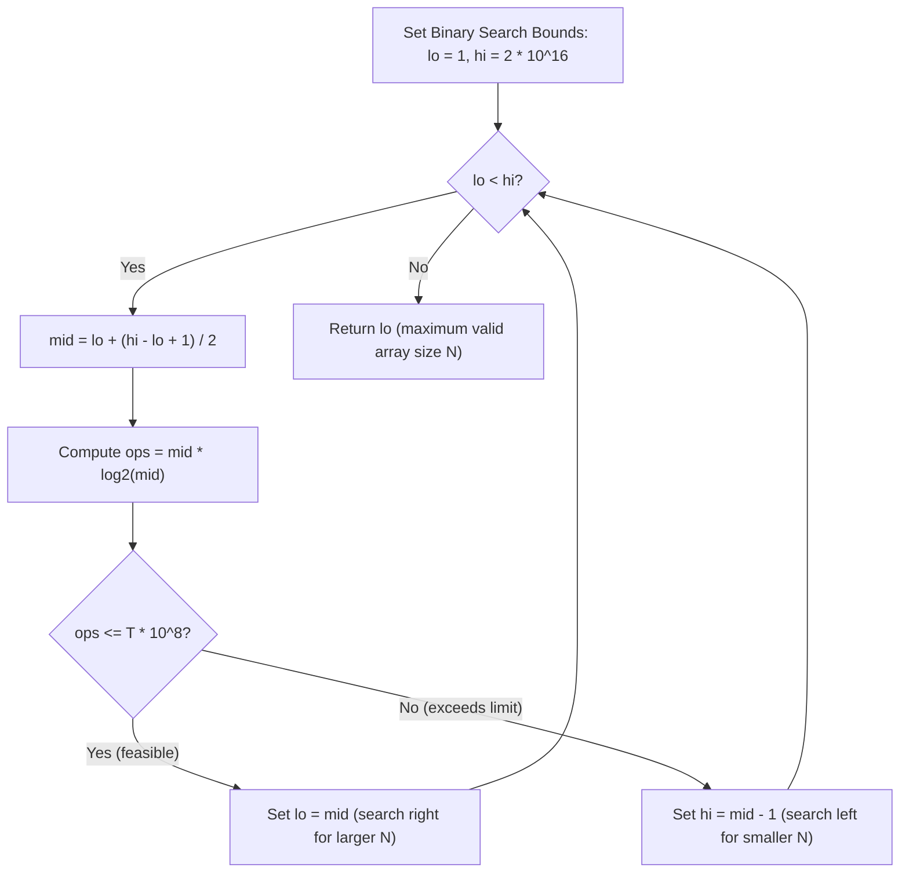
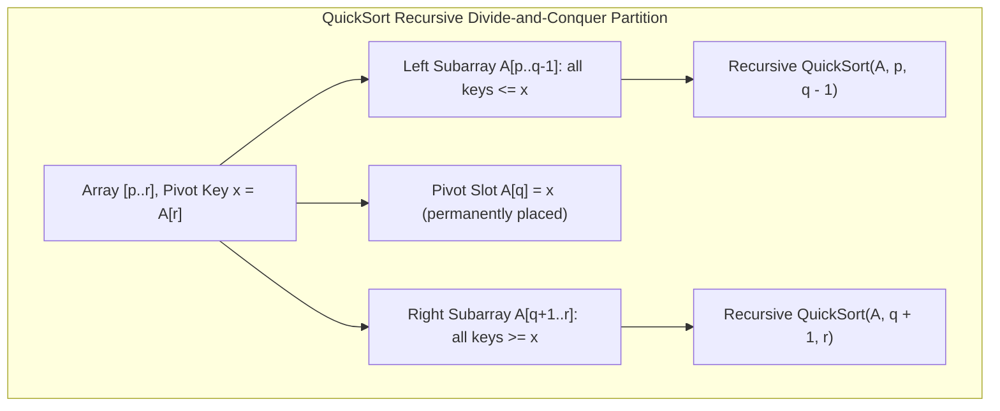

# QUIIIIICKSOOOOORT!!!!!!!!!!!

> [!info] Document Metadata
> **Course:** `=this.course` | **Topic:** `=this.topic` | **Status:** `=this.status` | **Difficulty:** `=this.difficulty`

**Tags:** #[[Computer Science]] #[[CSALGCM]] #[[Algorithms and Complexity]] #[[HackerRank]] #[[Empress Arcana]]
---

## Problem Description

While taking CSALGCM, you got fascinated by the quicksort algorithm. On average, quicksort has a time complexity of $O(N \log_2 N)$.

One way to estimate how long an algorithm takes to run is to substitute a value for $N$. For example, if $N = 10^7$, $N \log_2 N = 232,534,966.6421$. Dividing the result by $10^8$ yields the execution time in seconds (assuming a processor can execute $10^8$ operations sequentially in a second), which gives $2.3253$ seconds. Taking the ceiling of the time yields $\lceil 2.3253 \rceil = 3$ seconds. Depending on our time limit, we may or may not be able to sort $10^7$ elements.

Given the time limit $T$ in seconds, determine the largest array size $N$ you can apply quicksort to that will not exceed the time limit.

### Input Format

Input consists of a single test case consisting of a line with a single integer $T$ which is the number of seconds you have to execute quicksort.

### Output Format

Output one line with a single integer $N$ denoting the maximum array size that you can sort in $T$ seconds. It is guaranteed that $N$ will not exceed $2 \cdot 10^{15}$.

### Constraints

- $1 \le T \le 10^9$

### Sample Test Cases

**Sample Input 0**
```text
1
```

**Sample Output 0**
```text
4523071
```

**Sample Input 1**
```text
5
```

**Sample Output 1**
```text
20580553
```

**Sample Input 2**
```text
7
```

**Sample Output 2**
```text
28279132
```

---

## Approach & Intuition

> **Problem Abstraction:**
> Assuming quicksort executes $N \log_2 N$ operations on an array of size $N$ at $10^8$ operations per second, find the largest integer $N$ satisfying:
> $$\left\lceil \frac{N \log_2 N}{10^8} \right\rceil \le T \iff N \log_2 N \le T \cdot 10^8$$

> **Brute-Force Approach:**
> Linearly test $N = 1, 2, 3, \dots$ until $N \log_2 N$ exceeds $T \cdot 10^8$.
> Because $N$ can reach $2 \cdot 10^{15}$, linear iteration takes $O(N)$ steps and is completely intractable.

> **Optimal Approach:**
> Because $f(N) = N \log_2 N$ is strictly monotonically increasing for $N \ge 1$, the feasibility predicate $f(N) \le T \cdot 10^8$ partitions $[1, 2 \cdot 10^{16}]$ into a true prefix followed by a false suffix. Binary searching for the upper-bound boundary converges in $O(\log(2 \cdot 10^{16})) \approx 54$ iterations and $O(1)$ space.



## Theoretical Framework: QuickSort Partitioning Mechanism



## Why Binary Search Works

$f(N) = N \log_2(N)$ is **strictly increasing** for $N \ge 1$:
- $N$ grows linearly.
- $\log_2(N)$ grows monotonically.
- Their product $N \log_2 N$ is strictly monotonic, so any feasible $N$ guarantees all smaller array sizes are also feasible.

---

## Trace ($T = 1$)

```text
target = 1 * 10^8 = 100,000,000

Binary search between lo = 1 and hi = 2 * 10^16:
  mid = 4523072: 4523072 * log2(4523072) ~ 100,000,004 > 10^8 -> hi = 4523071
  mid = 4523071: 4523071 * log2(4523071) ~  99,999,982 <= 10^8 -> lo = 4523071
  lo == hi -> answer = 4523071
```

---

## Pitfall: Integer Overflow and Precision Considerations

```text
target = T * 10^8 where T <= 10^9
target <= 10^17 — fits comfortably in unsigned long long (max ~1.8 * 10^19)

N <= 2 * 10^15 (and search bound 2 * 10^16) — also fits in unsigned long long

Note on double precision:
N * log2(N) ~ 2 * 10^16 * 54 ~ 10^18, while IEEE 754 double has ~15-17 significant digits.
At 10^17, double precision suffices for matching the reference threshold comparisons.
```

---

## Complexity Analysis

| Metric | Complexity | Rationale |
| :--- | :--- | :--- |
| **Time** | $O(\log M)$ | Binary search over the search interval $[1, M]$ with $M = 2 \cdot 10^{16}$ halves the range on every iteration, converging in at most $\lceil \log_2(2 \cdot 10^{16}) \rceil = 55$ constant-time floating-point checks. |
| **Space** | $O(1)$ | Only a fixed number of `unsigned long long` bounds and `double` temporaries are allocated. |

---

## Original Stub (HackerRank Template)

```c
#include <stdio.h>

unsigned long long int compute_ans(unsigned long long int n){
	// solve for and return ans here
  	
}

int main() {
	unsigned long long int n, lo, hi, mid, temp;
	scanf("%llu",&n);
	printf("%llu\n",compute_ans(n));
}
```

## Full Solution

```c
#include <stdio.h>

unsigned long long int compute_ans(unsigned long long int n){
	// solve for and return ans here
    // Find max N such that N * log2(N) <= n * 10^8
    // Binary search on N.
    // n here is T (seconds). Target = T * 10^8 operations.
    unsigned long long int target = n * 100000000ULL;
    unsigned long long int lo = 1, hi = 20000000000000000ULL; // 2*10^16
    
    while (lo < hi) {
        unsigned long long int mid = lo + (hi - lo + 1) / 2;
        // Compute mid * log2(mid) using floating point
        double val = (double)mid * __builtin_log2((double)mid);
        if (val <= (double)target) {
            lo = mid;
        } else {
            hi = mid - 1;
        }
    }
    return lo;
}

int main() {
	unsigned long long int n, lo, hi, mid, temp;
	scanf("%llu",&n);
	printf("%llu\n",compute_ans(n));
}
```

## References & Navigation

- **Previous Problem:** [[04 - Never Fade Away]]
- **Next Problem:** [[06 - Swapper, No Swapping!!!]]
- **Parent Set:** [[[PS] Empress Arcana|Empress Arcana Index]]
- **Related Notes:** [[Divide and Conquer Introduction]]
