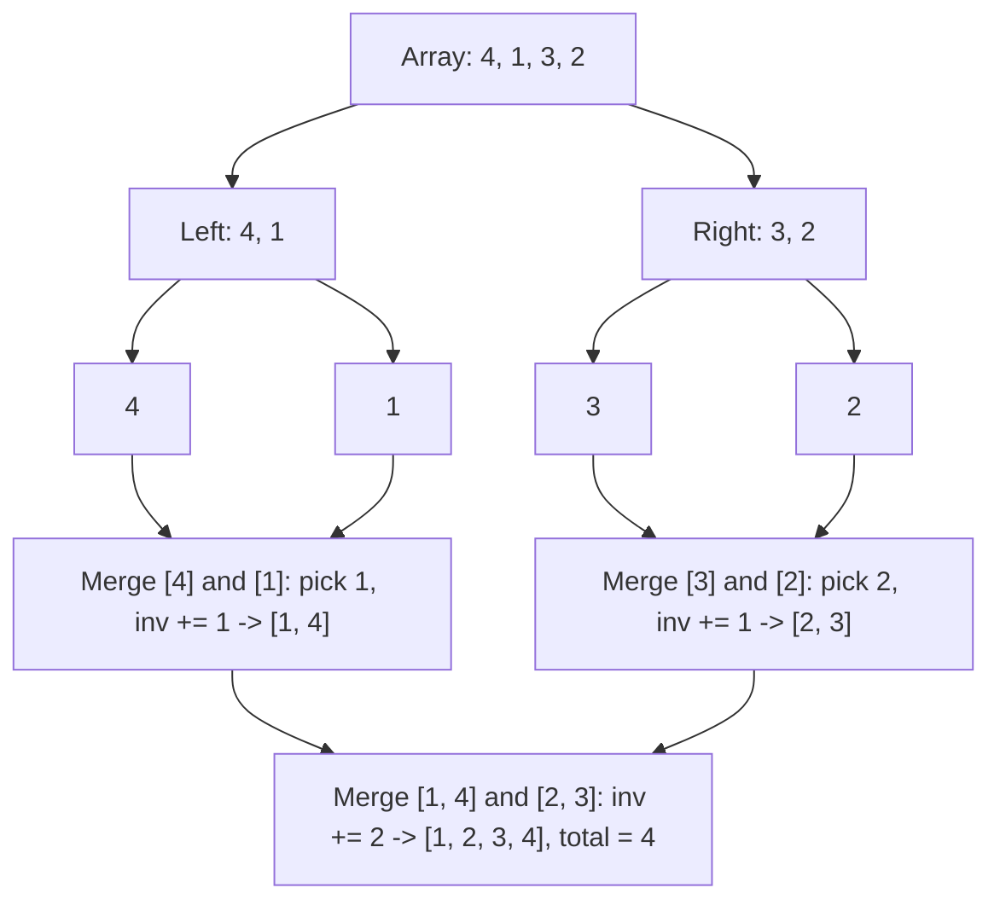

# Swapper, No Swapping!!!

> [!info] Document Metadata
> **Course:** `=this.course` | **Topic:** `=this.topic` | **Status:** `=this.status` | **Difficulty:** `=this.difficulty`

**Tags:** #[[Computer Science]] #[[CSALGCM]] #[[Algorithms and Complexity]] #[[HackerRank]] #[[Empress Arcana]]
---

## Problem Description

Swapper is a notorious, well, swapper. Whenever he sees objects in a line, he likes to swap them. He can, however, only swap two objects that are adjacent. He does this randomly, but every now and then, through astronomical odds, after performing enough swaps, the objects find themselves in a particularly desirable order. Take for example four playing cards with values $\{4, 1, 3, 2\}$; Swapper can do the following:

1. Swap $1$ and $3$, resulting in $\{4, 3, 1, 2\}$;
2. Swap $1$ and $2$, resulting in $\{4, 3, 2, 1\}$.

Through astronomical odds, Swapper has accidentally arranged the playing cards in descending order.

Butz is an agent of chaos who hates it when objects are organized, holding a particularly intense disdain for objects arranged in ascending or descending order. Currently, Swapper has stumbled upon a shelf with a new assortment of $N$ books that are not arranged yet, and his compulsion kicks in to begin randomly swapping pairs of books. Butz wants to account for the worst-case scenario where Swapper succeeds in sorting the books in either ascending or descending order as fast as possible.

Butz can fire quantum blasts at Swapper to slow him down. Swapper can take $S$ quantum blasts before being banished into Todash space, and he can swap exactly one pair of adjacent books each second. Assuming Swapper sorts the books (either ascending or descending) in the fewest possible swaps, how many quantum blasts per second must Butz fire to prevent a sorted set of books from ever manifesting?

### Input Format

Input consists of one test case, containing $N$ and $S$ indicating the number of books on the shelf and the number of quantum blasts Swapper can take before being banished into Todash space.

The second line contains $N$ distinct space-separated integers $B_i$, representing the ID codes of the books. If Swapper sorts the books in either ascending or descending ID codes $B_i$, Butz will be royally cross with him and will probably destroy several realities to relax.

### Output Format

Output consists of one line containing an integer indicating the number of quantum blasts per second that Butz must fire at Swapper to prevent him from sorting the books in the worst-case scenario (best case for Swapper). If this number is not a whole number, round up to the nearest whole number. If it is impossible for Butz to stop Swapper from restoring order to the shelf, print `Butz loses!` without quotes.

### Constraints

- $1 \le N, S \le 2 \cdot 10^5$
- $0 \le B_i \le 10^7$

### Sample Test Cases

**Sample Input 0**
```text
4 3
4 1 3 2
```

**Sample Output 0**
```text
2
```

*Sample 0 Explanation:* Swapper can sort $\{4, 1, 3, 2\}$ into descending order in $2$ swaps ($2$ seconds). Firing $1$ quantum blast per second only delivers $2$ blasts, whereas Swapper survives $3$, so Butz must fire $\lceil 3 / 2 \rceil = 2$ blasts per second to banish Swapper before completion.

**Sample Input 1**
```text
5 3
2 4 0 3 1
```

**Sample Output 1**
```text
1
```

**Sample Input 2**
```text
6 5
5 0 1 2 4 3
```

**Sample Output 2**
```text
1
```

---

## Approach & Intuition

> **Problem Abstraction:**
> Swapper can only swap adjacent elements. The minimum adjacent swaps required to sort a permutation equals its **inversion count**. Compute $\text{min\_swaps} = \min(\text{asc\_inv}, \text{desc\_inv})$; if $\text{min\_swaps} = 0$, print `Butz loses!`, otherwise print $\lceil S / \text{min\_swaps} \rceil$.

> **Brute-Force Approach:**
> Count inversions via nested loops checking all $\binom{N}{2}$ pairs $(i, j)$ with $i < j$.
> With $N = 2 \cdot 10^5$, $\binom{N}{2} \approx 2 \cdot 10^{10}$ comparisons causes Time Limit Exceeded (TLE).

> **Optimal Approach:**
> Count ascending inversions using **Merge Sort** in $O(N \log N)$ time: whenever an element from the right half precedes remaining elements of the left half during merging, add the count of remaining left elements to the inversion total. Because all $B_i$ are distinct, descending inversions equal $\frac{N(N - 1)}{2} - \text{asc\_inv}$ in $O(1)$.
> Total time is $O(N \log N)$.

---

## What Are Inversions?

An inversion for ascending order is a pair $(i, j)$ with $i < j$ and $\text{arr}[i] > \text{arr}[j]$. Each adjacent swap fixes exactly one inversion, so **minimum adjacent swaps = number of inversions**.

```text
Array: [4, 1, 3, 2]
Inversions for ascending sort:
  (4,1) (4,3) (4,2) (3,2) = 4 inversions

Inversions for descending sort:
  For descending [4,3,2,1], count pairs where i<j and arr[i]<arr[j]:
  (1,3) (1,2) = total_pairs - asc_inversions = 6 - 4 = 2 inversions
```

**Key insight:** Because the book IDs $B_i$ are distinct, every pair $(i, j)$ with $i < j$ is either an ascending inversion or a descending inversion, giving:

$$\text{desc\_inv} = \frac{N(N - 1)}{2} - \text{asc\_inv}$$

---

## Merge Sort Inversion Counting

During the merge step of two sorted halves, picking a smaller element from the right subarray resolves inversions with all remaining unpicked elements in the left subarray:

```text
Merge [1, 4] and [2, 3]:
  Compare 1 vs 2: pick 1 (from left).  Inversions += 0
  Compare 4 vs 2: pick 2 (from right). Inversions += 1 (4 > 2)
  Compare 4 vs 3: pick 3 (from right). Inversions += 1 (4 > 3)
  Pick remaining 4.
  Total from this merge: 2
```



---

## The Final Calculation

```text
min_swaps = min(asc_inversions, desc_inversions)

if min_swaps == 0:
    print("Butz loses!")        # Already sorted!
else:
    blasts_per_sec = ceil(S / min_swaps)
    print(blasts_per_sec)
```

**Why $\lceil S / \text{min\_swaps} \rceil$?** Swapper needs $\text{min\_swaps}$ seconds to finish sorting and can absorb $S$ blasts. Firing $r$ blasts per second over $\text{min\_swaps}$ seconds deals $r \cdot \text{min\_swaps}$ blasts, which must be $\ge S$ to banish Swapper before completion, hence $r = \lceil S / \text{min\_swaps} \rceil$.

---

## Trace (Sample 0: `books = [4, 1, 3, 2]`, $S = 3$)

**Step 1 — Count ascending inversions:**
```text
Pairs where i<j and arr[i]>arr[j]:
  (4,1) (4,3) (4,2) (3,2) -> asc_inv = 4
```

**Step 2 — Count descending inversions:**
```text
total_pairs = 4 * 3 / 2 = 6
desc_inv = 6 - 4 = 2
```

**Step 3 — Pick minimum:**
```text
min_swaps = min(4, 2) = 2   (faster to sort descending: only 2 swaps!)
```

**Step 4 — Compute blasts:**
```text
blasts = ceil(3 / 2) = ceil(1.5) = 2

Why: Swapper needs 2 seconds to sort. In 2 seconds at 1 blast/sec,
Swapper takes 2 blasts and survives 3. At 2 blasts/sec, Swapper
takes 4 blasts >= 3 -> banished before finishing!
```

---

## All Samples Verified

| Books | $S$ | `asc_inv` | `desc_inv` | `min_swaps` | `blasts/sec` |
| :--- | :--- | :--- | :--- | :--- | :--- |
| `[4, 1, 3, 2]` | 3 | 4 | 2 | 2 | $\lceil 3 / 2 \rceil = \mathbf{2}$ |
| `[2, 4, 0, 3, 1]` | 3 | 6 | 4 | 4 | $\lceil 3 / 4 \rceil = \mathbf{1}$ |
| `[5, 0, 1, 2, 4, 3]` | 5 | 6 | 9 | 6 | $\lceil 5 / 6 \rceil = \mathbf{1}$ |

---

## Complexity Analysis

| Metric | Complexity | Rationale |
| :--- | :--- | :--- |
| **Time** | $O(N \log N)$ | Merge sort splits the array of $N$ book IDs across $\lceil \log_2 N \rceil$ recursion levels and counts cross-half inversions in $O(N)$ time per level during merging. |
| **Space** | $O(N)$ | Storing the input book list plus temporary subarray slices and merged buffers during recursion requires linear auxiliary space. |

---

## Original Stub (HackerRank Template)

```python
def solve(books,n,s):
    # TODO: Compute and print answer here
    pass

def main():
    n, s = list(map(int,input().strip().split(" ")))
    books = list(map(int,input().strip().split(" ")))
    solve(books,n,s)

if __name__ == "__main__":
    main()
```

## Full Solution

```python
def solve(books,n,s):
    # TODO: Compute and print answer here
    # Count inversions for ascending sort and descending sort.
    # min_swaps = min(asc_inversions, desc_inversions)
    # This is the minimum adjacent swaps needed (= bubble sort swaps = inversions).
    # If min_swaps == 0: already sorted -> "Butz loses!"
    # Otherwise: blasts_per_second = ceil(s / min_swaps)
    
    import math
    
    # Count inversions using merge sort for O(n log n)
    def count_inversions(arr):
        if len(arr) <= 1:
            return arr, 0
        mid = len(arr) // 2
        left, left_inv = count_inversions(arr[:mid])
        right, right_inv = count_inversions(arr[mid:])
        merged = []
        inversions = left_inv + right_inv
        i = j = 0
        while i < len(left) and j < len(right):
            if left[i] <= right[j]:
                merged.append(left[i])
                i += 1
            else:
                merged.append(right[j])
                inversions += len(left) - i
                j += 1
        merged.extend(left[i:])
        merged.extend(right[j:])
        return merged, inversions
    
    # Inversions for ascending: count inversions in the array as-is
    _, asc_inv = count_inversions(books[:])
    
    # Inversions for descending: count inversions in the reversed array
    # Or equivalently: n*(n-1)/2 - asc_inv (total pairs minus ascending inversions)
    total_pairs = n * (n - 1) // 2
    desc_inv = total_pairs - asc_inv
    
    min_swaps = min(asc_inv, desc_inv)
    
    if min_swaps == 0:
        print("Butz loses!")
    else:
        blasts = math.ceil(s / min_swaps)
        print(blasts)

def main():
    n, s = list(map(int,input().strip().split(" ")))
    books = list(map(int,input().strip().split(" ")))
    solve(books,n,s)

if __name__ == "__main__":
    main()
```

## References & Navigation

- **Previous Problem:** [[05 - QUIIIIICKSOOOOORT!!!!!!!!!!!]]
- **Parent Set:** [[[PS] Empress Arcana|Empress Arcana Index]]
- **Related Notes:** [[Divide and Conquer Introduction]]
