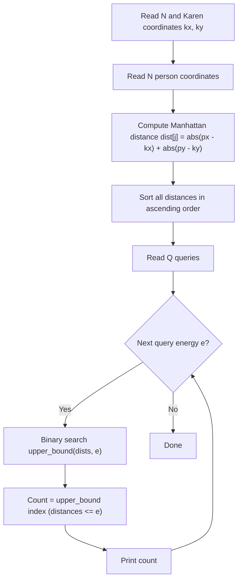
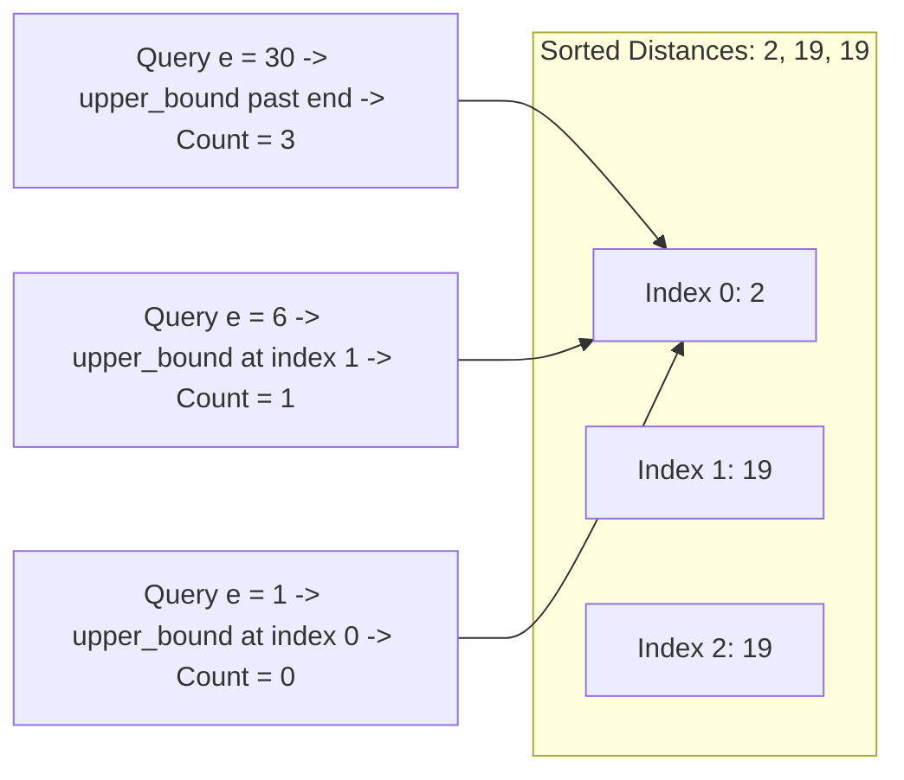

# It's Like I Have ESPN Or Something

> [!info] Document Metadata
> **Course:** `=this.course` | **Topic:** `=this.topic` | **Status:** `=this.status` | **Difficulty:** `=this.difficulty`

**Tags:** #[[Computer Science]] #[[CSALGCM]] #[[Algorithms and Complexity]] #[[HackerRank]] #[[Priestess Arcana]] #[[Order Statistics]] #[[Merge Sort Tree]]
---

## Problem Description

Karen Smith can read minds within a limited range based on her ESPN energy $E$. If she accumulates $E$ energy, she can read the minds of people who are at most $E$ units away from her, where the distance between two points $(x_1, y_1)$ and $(x_2, y_2)$ is defined as the Manhattan distance $D = |x_1 - x_2| + |y_1 - y_2|$. Positioned at coordinates $(K_x, K_y)$ in a cafeteria with $N$ people, Karen must answer $Q$ queries, each specifying an energy level $E$ and asking how many people she can collect gossip from.

### Input Format

Input consists of one test case beginning with three space-separated integers $N$, $K_x$, and $K_y$, which are the number of people in the cafeteria and Karen's location respectively.

$N$ lines follow, the $i$-th of which containing two space-separated integers $X_i$ and $Y_i$ denoting the coordinates of the $i$-th person.

The next line contains a single integer $Q$. You must answer $Q$ queries.

The next $Q$ lines contain an integer $E$, which is the energy of Karen for that query.

### Output Format

For each query, output one line containing a single integer which denotes the number of people within range of Karen's ESPN.

### Constraints

- $0 \le N \le 10^5$
- $0 \le |K_x|, |K_y|, |X_i|, |Y_i| \le 10^8$
- $0 \le E \le 4 \cdot 10^8$
- $1 \le Q \le 10^5$

### Sample Test Cases

**Sample Input 0**
```text
3 6 7
-10 10
-6 0
8 7
3
30
6
1
```

**Sample Output 0**
```text
3
1
0
```

*Sample 0 Explanation:* The Manhattan distances of the 3 people from $(6, 7)$ are $19$, $19$, and $2$. With $E = 30$, Karen can reach all $3$ of them. With $E = 6$, she can only reach the one $2$ units away. With $E = 1$, she cannot reach any of them.

---

## Approach & Intuition

> **Problem Abstraction:**
> Karen can read minds up to Manhattan distance $E$. Given $N$ people scattered on a 2D integer grid and $Q$ queries each specifying an energy level $E$, count how many people satisfy $|X_i - K_x| + |Y_i - K_y| \le E$.

> **Brute-Force Approach:**
> For every query, scan all $N$ people and recompute each Manhattan distance against $E$.
> This takes $O(N \cdot Q)$ time: for $N = Q = 10^5$, that is $10^{10}$ operations, resulting in Time Limit Exceeded (TLE).

> **Optimal Approach:**
> Precompute all $N$ Manhattan distances once upfront and sort them in ascending order. Each query reduces to a single binary search (`upper_bound`) to count how many distances are $\le E$.
> This achieves $O(N \log N + Q \log N)$ time, well within the time limit.

---

## What Is Manhattan Distance?

**Manhattan Distance** is $|x_1 - x_2| + |y_1 - y_2|$. On a city grid, movement is restricted to horizontal and vertical axes without diagonal shortcuts.

```text
   ^ y
   |
10 +  P1(-10,10)
   |              dist(K,P1) = |6-(-10)| + |7-10| = 16 + 3 = 19
 7 +        K(6,7)---P3(8,7)
   |         dist(K,P3) = |6-8| + |7-7| = 2 + 0 = 2
 0 +  P2(-6,0)
   |              dist(K,P2) = |6-(-6)| + |7-0| = 12 + 7 = 19
   +--------+---------> x
  -10        6  8
```

---

## Algorithm Walkthrough



---

## Code: Every Line Explained

```cpp
#include <bits/stdc++.h>
using namespace std;

int n, q, ans;
long long kx, ky, x, y, e, people[100000][2];
// n = number of people
// q = number of queries
// kx, ky = Karen's coordinates (long long because coordinates can be large)
// people[i][0] = x-coord of person i
// people[i][1] = y-coord of person i

int main() {
    cin >> n >> kx >> ky;       // Read: how many people, and Karen's position
    for(int i = 0; i < n; i++) {
        // fscanf is faster than cin for large inputs (stub already uses it)
        fscanf(stdin, "%lld%lld", &people[i][0], &people[i][1]);
    }

    // ---- PRECOMPUTATION PHASE ----
    vector<long long> dists(n);          // Allocate array of n distances
    for(int j = 0; j < n; j++) {
        // Manhattan distance formula: |px - kx| + |py - ky|
        dists[j] = abs(people[j][0] - kx) + abs(people[j][1] - ky);
    }
    sort(dists.begin(), dists.end());    // Sort ascending: [2, 19, 19, ...]
    // After this point: dists[0] <= dists[1] <= dists[2] <= ... <= dists[n-1]

    // ---- QUERY PHASE ----
    cin >> q;
    for(int i = 0; i < q; i++) {
        fscanf(stdin, "%lld", &e);       // Read energy level for this query

        // upper_bound returns iterator to first element STRICTLY GREATER THAN e
        // Everything before that iterator is <= e
        // Subtracting begin() gives the count of those elements
        ans = (int)(upper_bound(dists.begin(), dists.end(), e) - dists.begin());

        fprintf(stdout, "%d\n", ans);    // Print result
    }
}
```

---

## Step-by-Step Trace (Sample Input 0)

**Input:** Karen at $(6, 7)$. People: $(-10, 10)$, $(-6, 0)$, $(8, 7)$. Queries: $30, 6, 1$.

**Step 1 — Compute Distances:**

| Person | Coordinates | Calculation | Distance |
| :--- | :--- | :--- | :--- |
| 0 | $(-10, 10)$ | $\lvert (-10) - 6 \rvert + \lvert 10 - 7 \rvert = 16 + 3$ | **19** |
| 1 | $(-6, 0)$ | $\lvert (-6) - 6 \rvert + \lvert 0 - 7 \rvert = 12 + 7$ | **19** |
| 2 | $(8, 7)$ | $\lvert 8 - 6 \rvert + \lvert 7 - 7 \rvert = 2 + 0$ | **2** |

**Step 2 — Sort:**
```text
Before sort: [19, 19, 2]
After sort:  [2, 19, 19]
              ^index 0
```

**Step 3 — Queries using `upper_bound`:**
```text
Query e=30: upper_bound([2,19,19], 30) -> past last element -> index 3. Answer: 3
Query e=6:  upper_bound([2,19,19], 6)  -> points to first 19  -> index 1. Answer: 1
Query e=1:  upper_bound([2,19,19], 1)  -> points to 2         -> index 0. Answer: 0
```



## Complexity Analysis

| Metric | Complexity | Rationale |
| :--- | :--- | :--- |
| **Time** | $O(N \log N + Q \log N)$ | Computing all $N$ Manhattan distances takes $O(N)$, sorting them requires $O(N \log N)$, and each of the $Q$ queries executes `upper_bound` in $O(\log N)$ time. |
| **Space** | $O(N)$ | Storing the coordinate pairs and the sorted `dists` array of size $N$ requires linear auxiliary memory. |

---

## Original Stub (HackerRank Template)

```cpp
#include <bits/stdc++.h>

using namespace std;

int n, q, ans;
long long kx, ky, x, y, e, people[100000][2];

int main() {
	cin >> n >> kx >> ky;
	for(int i = 0; i < n; i++) {
      	// using fscanf to prevent TLE
		fscanf(stdin,"%lld%lld",&people[i][0],&people[i][1]);
	}
	cin >> q;
	for(int i = 0; i < q; i++) {
		fscanf(stdin,"%lld",&e);
		// solve for ans here
      	ans = 0;
      
      	
		fprintf(stdout,"%d\n",ans);
	}
}
```

---

## Full Solution

```cpp
#include <bits/stdc++.h>

using namespace std;

int n, q, ans;
long long kx, ky, x, y, e, people[100000][2];

int main() {
	cin >> n >> kx >> ky;
	for(int i = 0; i < n; i++) {
      	// using fscanf to prevent TLE
		fscanf(stdin,"%lld%lld",&people[i][0],&people[i][1]);
	}
	// Precompute all distances and sort for O(log n) per query
	vector<long long> dists(n);
	for(int j = 0; j < n; j++) {
		dists[j] = abs(people[j][0] - kx) + abs(people[j][1] - ky);
	}
	sort(dists.begin(), dists.end());

	cin >> q;
	for(int i = 0; i < q; i++) {
		fscanf(stdin,"%lld",&e);
		// solve for ans here
		// Binary search: count how many distances <= e
		ans = (int)(upper_bound(dists.begin(), dists.end(), e) - dists.begin());
		fprintf(stdout,"%d\n",ans);
	}
}
```

## References & Navigation

- **Next Problem:** [[02 - Laughter Is The Best Medicine]]
- **Parent Set:** [[[PS] Priestess Arcana|Priestess Arcana Index]]
- **Related Notes:** [[Divide and Conquer Introduction]]
