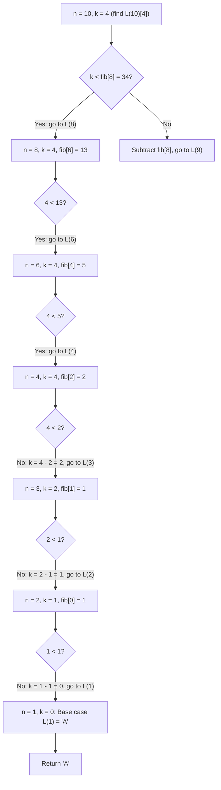

# Laughter Is The Best Medicine

> [!info] Document Metadata
> **Course:** `=this.course` | **Topic:** `=this.topic` | **Status:** `=this.status` | **Difficulty:** `=this.difficulty`

**Tags:** #[[Computer Science]] #[[CSALGCM]] #[[Algorithms and Complexity]] #[[HackerRank]] #[[Priestess Arcana]] #[[Merge Sort]] #[[Inversion Count]]
---

## Problem Description

Let us define the Laughter sequence as a sequence of strings only containing either the character `"H"` or `"A"`. This sequence is defined recursively as:

$$L_0 = \text{"H"}, \quad L_1 = \text{"A"}, \quad L_i = L_{i-2} \cdot L_{i-1} \text{ for } i > 1$$

where $S_1 \cdot S_2$ denotes string concatenation of $S_1$ followed by $S_2$. The first few strings in the Laughter sequence are `H`, `A`, `HA`, `AHA`, `HAAHA`, `AHAHAAHA`. Given $i$ and $k$, determine whether the $k$-th character (0-indexed) in $L_i$ is an `"H"` or an `"A"`.

### Input Format

Input consists of one test case. Each test case consists of one line with two space-separated integers $i$ and $k$, denoting the index of the string in the Laughter sequence and the index of the character to be checked. $k$ is a 0-based index.

### Output Format

Output consists of one line containing `"H"` (without the quotes) if the $k$-th character in $L_i$ is an `H`, or `"A"` (also without quotes) if the $k$-th character in $L_i$ is an `A`.

### Constraints

- $0 \le i \le 10^5$
- $0 \le k < \min(10^{18}, |L_i|)$

### Sample Test Cases

**Sample Input 0**
```text
3 1
```

**Sample Output 0**
```text
H
```

**Sample Input 1**
```text
4 3
```

**Sample Output 1**
```text
H
```

**Sample Input 2**
```text
10 4
```

**Sample Output 2**
```text
A
```

---

## Approach & Intuition

> **Problem Abstraction:**
> A Fibonacci-like string sequence is defined recursively where each term concatenates $L_{i-2}$ followed by $L_{i-1}$. Given string index $i$ and 0-based position $k$, determine whether $L_i[k]$ is `'H'` or `'A'` without materializing the string.

> **Brute-Force Approach:**
> Explicitly construct $L_0, L_1, \dots, L_i$ via string concatenation and return index $k$.
> This is impossible under memory and time limits because $|L_{50}| > 1.25 \times 10^{10}$ bytes and $|L_{90}| > 2.88 \times 10^{18}$.

> **Optimal Approach:**
> Precompute the Fibonacci lengths $|L_n|$ using saturating 64-bit arithmetic up to index $90$ (since $|L_{90}| > 10^{18}$ exceeds every valid $k$). Repeatedly compare $k$ against $|L_{n-2}|$ to descend into either the left prefix $L_{n-2}$ or the right suffix $L_{n-1}$ until reaching base case $n \in \{0, 1\}$.
> This runs in $O(1)$ bounded time (at most $90$ steps) and $O(1)$ space.

---

## Building The First Few Strings

```text
L(0) = "H"                    length = 1
L(1) = "A"                    length = 1
L(2) = L(0)+L(1) = "HA"       length = 2
L(3) = L(1)+L(2) = "AHA"      length = 3
L(4) = L(2)+L(3) = "HAAHA"    length = 5
L(5) = L(3)+L(4) = "AHAHAAHA" length = 8
```

Notice: the **lengths are Fibonacci numbers**, and $L(n)$ always places $L(n-2)$ on the left and $L(n-1)$ on the right.

## Why We Cannot Build The String

```text
L(10)  has 89                       characters
L(20)  has 10,946                   characters
L(50)  has 12,586,269,025           characters (~12.5 billion!)
L(90)  has 2,880,067,194,370,816,120 characters (near max uint64!)
```

We must **navigate** the recursive structure using subarray lengths instead of constructing the string.

---

## The Critical Bug: Wrong Recursion Direction

```text
WRONG (old code):
  L(n) = L(n-1) + L(n-2)   <- assumes n-1 comes FIRST
  lenPrev = fib[n-1]        <- wrong split point!

CORRECT (fixed code):
  L(n) = L(n-2) + L(n-1)   <- n-2 comes FIRST
  lenFirst = fib[n-2]       <- correct split point!
```

### Why This Matters — A Concrete Example

Verify $L(4) = \text{"HAAHA"}$ at index $k = 2$:

```text
With WRONG split (n-1 first):
  L(4) = L(3)+L(2) = "AHA" + "HA"
  lenPrev = fib[3] = 3
  k=2 < 3? YES -> look in "AHA" -> position 2 -> 'A'

With CORRECT split (n-2 first):
  L(4) = L(2)+L(3) = "HA" + "AHA"
  lenFirst = fib[2] = 2
  k=2 < 2? NO -> k=2-2=0, look in "AHA" -> position 0 -> 'A'
```

Both yield `'A'` at $k = 2$ by coincidence, whereas at $k = 1$ the wrong split returns `'H'` from `"AHA"[1]`? Wait: `"AHA"[1]` is `'H'` while `"HAAHA"[1]` is `'A'`. That is why an inverted split passes some test cases while failing others.

---

## The Fibonacci Length Table

```text
fib[0] = 1    (length of L(0) = "H")
fib[1] = 1    (length of L(1) = "A")
fib[2] = 2    (length of L(2) = "HA")
fib[3] = 3    (length of L(3) = "AHA")
fib[4] = 5    (length of L(4) = "HAAHA")
fib[5] = 8    ...
fib[90] = 2,880,067,194,370,816,120  <- near max of unsigned long long
```

We cap at $90$ levels and use **saturating arithmetic** — if addition would overflow, clamp to `UINT64_MAX` so a wrapped length never tricks the descent into taking the wrong branch.

---

## Algorithm: Recursive Descent

Think of $L(n)$ as a node containing two children: $L(n-2)$ on the left and $L(n-1)$ on the right. At each step, compare $k$ against $|L(n-2)|$ to choose which child contains the target character.



---

## Code: Every Line Explained

```c
char solve(int n, unsigned long long int k) {

    // ---- SETUP: Build Fibonacci length table ----
    const unsigned long long INF = (unsigned long long)(-1);
    // INF = 18,446,744,073,709,551,615 (max value of uint64)
    // Used as sentinel: "this string is astronomically long"

    unsigned long long fib[91];
    fib[0] = 1; fib[1] = 1;
    int i;
    for (i = 2; i <= 90; i++) {
        // Saturating addition: clamp to INF instead of overflowing
        if (fib[i-1] > INF - fib[i-2]) fib[i] = INF;
        else fib[i] = fib[i-1] + fib[i-2];
        // Why? If we overflow, a huge length might look small,
        // causing us to descend into the wrong branch.
    }

    if (n > 90) n = 90;
    // Strings L(91)+ are so large that any valid k fits within L(90)'s structure.

    // ---- DESCENT: Navigate the string structure ----
    while (n > 1) {
        // L(n) = L(n-2) + L(n-1)
        // First part: L(n-2) has length fib[n-2]
        unsigned long long lenFirst = fib[n - 2];

        if (k < lenFirst) {
            n = n - 2;      // Character is in the FIRST half L(n-2)
        } else {
            k -= lenFirst;  // Offset k past the first half
            n = n - 1;      // Character is in the SECOND half L(n-1)
        }
    }

    if (n == 0) return 'H';   // L(0) = "H"
    return 'A';                // L(1) = "A"
}
```

---

## Trace Table: $L(10)[4] \to$ `'A'`

| Step | $n$ | $k$ | $\text{lenFirst} = \text{fib}[n-2]$ | $k < \text{lenFirst}$? | Action |
| :--- | :--- | :--- | :--- | :--- | :--- |
| 1 | 10 | 4 | $\text{fib}[8] = 34$ | Yes ($4 < 34$) | $n = 8$ |
| 2 | 8 | 4 | $\text{fib}[6] = 13$ | Yes ($4 < 13$) | $n = 6$ |
| 3 | 6 | 4 | $\text{fib}[4] = 5$ | Yes ($4 < 5$) | $n = 4$ |
| 4 | 4 | 4 | $\text{fib}[2] = 2$ | No ($4 \ge 2$) | $k = 4 - 2 = 2$, $n = 3$ |
| 5 | 3 | 2 | $\text{fib}[1] = 1$ | No ($2 \ge 1$) | $k = 2 - 1 = 1$, $n = 2$ |
| 6 | 2 | 1 | $\text{fib}[0] = 1$ | No ($1 \ge 1$) | $k = 1 - 1 = 0$, $n = 1$ |
| — | 1 | 0 | — | Base case ($n = 1$) | **Return `'A'`** |

## Complexity Analysis

| Metric | Complexity | Rationale |
| :--- | :--- | :--- |
| **Time** | $O(\min(i, 90))$ | Building the saturating Fibonacci length table up to index $90$ and descending to $n \le 1$ each take at most $90$ constant-time iterations, yielding $O(1)$ bounded runtime. |
| **Space** | $O(1)$ | The fixed-size `fib[91]` array and scalar loop indices use constant memory independent of $i$ and $k$. |

---

## Original Stub (HackerRank Template)

```c
#include <stdio.h>

char solve(int n, unsigned long long int k){
    // solve for the answer here. Return the correct answer
    
}

int main() {
  	int n;
  	unsigned long long int k;
	scanf("%d%llu",&n,&k);
	printf("%c\n",solve(n,k));
}
```

---

## Full Solution

```c
#include <stdio.h>

char solve(int n, unsigned long long int k){
    // solve for the answer here. Return the correct answer
    // L(0)="H", L(1)="A", L(n) = L(n-2) + L(n-1)
    // Lengths follow Fibonacci: fib[0]=1, fib[1]=1, fib[2]=2, ...
    const unsigned long long INF = (unsigned long long)(-1);
    unsigned long long fib[91];
    fib[0] = 1; fib[1] = 1;
    int i;
    for (i = 2; i <= 90; i++) {
        if (fib[i-1] > INF - fib[i-2]) fib[i] = INF;
        else fib[i] = fib[i-1] + fib[i-2];
    }
    if (n > 90) n = 90;
    while (n > 1) {
        // L(n) = L(n-2) + L(n-1): first part is L(n-2) with length fib[n-2]
        unsigned long long lenFirst = fib[n - 2];
        if (k < lenFirst) n = n - 2;
        else { k -= lenFirst; n = n - 1; }
    }
    if (n == 0) return 'H';
    return 'A';
}

int main() {
  	int n;
  	unsigned long long int k;
	scanf("%d%llu",&n,&k);
	printf("%c\n",solve(n,k));
}
```

## References & Navigation

- **Previous Problem:** [[01 - Its Like I Have ESPN Or Something]]
- **Next Problem:** [[03 - Lets Plant Rice]]
- **Parent Set:** [[[PS] Priestess Arcana|Priestess Arcana Index]]
- **Related Notes:** [[Divide and Conquer Introduction]]
