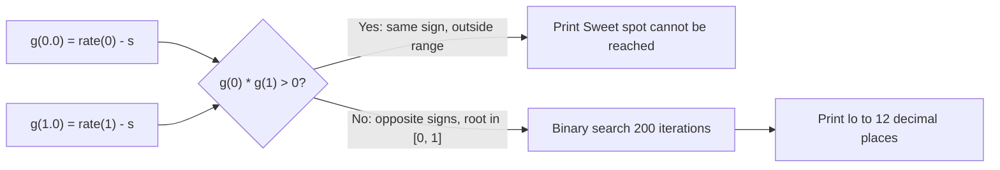

# Let's Plant Rice

> [!info] Document Metadata
> **Course:** `=this.course` | **Topic:** `=this.topic` | **Status:** `=this.status` | **Difficulty:** `=this.difficulty`

**Tags:** #[[Computer Science]] #[[CSALGCM]] #[[Algorithms and Complexity]] #[[HackerRank]] #[[Priestess Arcana]] #[[Bisection Method]] #[[Binary Search]]
---

## Problem Description

To simulate rice paddy maintenance, a game uses the following function to calculate the evaporation rate of water:

$$\text{rate}(x) = 1 - \left(\frac{1}{1 + e^{-k(x - 0.5)}}\right)^a + d$$

where $x$ is how full the rice paddy is at the start of the day ($0.0$ for $0\%$ water level to $1.0$ for $100\%$ water level), and $d$, $k$, and $a$ are daily variables that control the rate of evaporation. Given the values of $d$, $k$, and $a$ along with a target sweet spot evaporation rate $s$, determine the lowest starting water level $x \in [0.0, 1.0]$ that yields evaporation rate $s$ within an acceptable error margin of $10^{-6}$, or report that the sweet spot cannot be reached.

### Input Format

The first line of the input contains an integer $N$, indicating the number of days you need to figure out the starting water level for.

$N$ lines follow, each containing four space-separated real numbers that correspond to the values of $s$, $d$, $k$, and $a$, where $s$ is the sweet spot evaporation rate and $d$, $k$, and $a$ are the daily evaporation parameters.

### Output Format

There will be $N$ lines of output, each line being the lowest starting water level that reaches the sweet spot evaporation rate $s$ within acceptable margins. Absolute or relative error must not exceed $10^{-6}$. Print `Sweet spot cannot be reached! Those cheeky developers!` (without the quotation marks) if the sweet spot is impossible to reach.

### Constraints

- $0 \le N \le 5 \cdot 10^3$
- $0 \le s \le 1$
- $-0.5 \le d \le 0.5$
- $0 \le a, k \le 5$

### Sample Test Cases

**Sample Input 0**
```text
5
0.7119 -0.1206 2.9930 4.0577
0.9219 0.1963 2.7140 4.3201
0.2692 -0.0695 2.9132 1.6116
0.3601 -0.1771 0.6213 1.1870
0.3492 -0.3865 3.8889 2.5649
```

**Sample Output 0**
```text
0.697784503037
0.887908531876
0.921929270250
0.645118392190
0.599166042326
```

*Sample 0 Explanation:* On the first day, a starting water level of $0.6977845$ with $d = -0.1206$, $k = 2.9930$, and $a = 4.0577$ yields an evaporation rate within $10^{-6}$ absolute error of $0.7119$. The same holds for the remaining days.

**Sample Input 1**
```text
7
0.2772 0.2253 4.2550 1.9385
0.2807 -0.2682 1.5963 1.6372
0.9055 0.0522 2.5857 2.2600
0.3196 -0.2520 2.7628 0.9047
0.6853 -0.2366 3.6572 2.5567
0.7148 -0.1846 0.9737 4.1721
0.9411 -0.1370 2.0860 2.6794
```

**Sample Output 1**
```text
Sweet spot cannot be reached! Those cheeky developers!
0.793247141838
0.387402764833
0.340837109300
0.353158012405
0.817511673620
Sweet spot cannot be reached! Those cheeky developers!
```

*Sample 1 Explanation:* On the first day, it is impossible to reach an evaporation rate within $10^{-16}$ of $0.2772$ given $d = 0.2253$, $k = 4.2550$, and $a = 1.9385$.

---

## Approach & Intuition

> **Problem Abstraction:**
> Given daily parameters $(s, d, k, a)$ and a monotone evaporation curve $\text{rate}(x)$ on $x \in [0, 1]$, find the root $x \in [0, 1]$ solving $\text{rate}(x) - s = 0$ within tolerance $10^{-6}$, or detect infeasibility when $s$ lies outside $[\text{rate}(1), \text{rate}(0)]$.

> **Brute-Force Approach:**
> Sample $x$ linearly from $0.0$ to $1.0$ in steps of $10^{-6}$ ($10^6$ evaluations per day).
> For $N = 5000$ days, evaluating transcendental functions $5 \times 10^9$ times results in Time Limit Exceeded (TLE).

> **Optimal Approach:**
> Because $k \ge 0$ and $a \ge 0$, $\text{rate}(x)$ is monotone non-increasing on $[0, 1]$. Check endpoint signs $g(0) \cdot g(1) > 0$ for $g(x) = \text{rate}(x) - s$ to rule out unreachable targets, then run $200$ iterations of the bisection method on $[0, 1]$ to narrow the root interval to width $2^{-200} \approx 6.2 \times 10^{-61}$.
> This runs in $O(200 \cdot N)$ time, executing almost instantaneously.

---

## Understanding the Formula Component by Component

### Part 1: The Sigmoid (S-curve)

```text
sigma(x) = 1 / (1 + exp(-k * (x - 0.5)))
```

The sigmoid maps $x$ strictly into $(0, 1)$:

```text
sigma(x) for k=3, centered at x=0.5:

1.0 |                                           *****
    |                                      *****
    |                                 *****
0.5 |                        **********
    |                   *****
    |              *****
    |         *****
0.0 |*****
    +---+---+---+---+---+---+---+---+---+---+---
      0.0 0.1 0.2 0.3 0.4 0.5 0.6 0.7 0.8 0.9 1.0
                          ^
                          Always = 0.5 here, regardless of k
```

Key facts:
- At $x = 0.5$, $\sigma(0.5) = 0.5$ regardless of $k$.
- Larger $k$ produces a steeper S-curve transition.
- For $k > 0$, $\sigma(x)$ is strictly increasing in $x$.

### Part 2: Raising $\sigma(x)$ to Power $a$

Since $\sigma(x) \in (0, 1)$, raising it to power $a \ge 0$ reshapes the curve:

```text
sigma = 0.7:
  a=0.5  -> 0.7^0.5 = 0.836  (pulled toward 1)
  a=1.0  -> 0.7^1.0 = 0.700  (unchanged)
  a=2.0  -> 0.7^2.0 = 0.490  (pulled toward 0)
  a=4.0  -> 0.7^4.0 = 0.240  (much closer to 0)
```

### Part 3: $1 - \sigma(x)^a + d$

```text
rate(x) = 1 - sigma(x)^a + d
```

- As $x$ increases, $\sigma(x)$ increases, $\sigma(x)^a$ increases, and $1 - \sigma(x)^a$ **decreases**.
- Therefore `rate(x)` is **monotone non-increasing** on $[0, 1]$.
- The $+d$ term shifts the entire curve vertically.

```text
rate(x) shape (d=-0.1206, k=2.9930, a=4.0577):

HIGH  0.878 |* (x=0.0, empty paddy — high evaporation)
            | *
            |  *
            |   *
target 0.712|------*--- <- we want THIS x (answer ~ 0.698)
            |       *
            |        *
            |         *
LOW   0.439 |          * (x=1.0, full paddy — lower evaporation)
            +----------->
              0         1
```

---

## Why Bisection Works Here

Because `rate(x)` is monotone on $[0, 1]$, any solution to $g(x) = \text{rate}(x) - s = 0$ is bracketed by $g(0)$ and $g(1)$:



### The Bisection Step by Step (Target $s = 0.7119$)

```text
Iter 1: lo=0.0000, hi=1.0000, mid=0.5000
  g(lo)=+0.1665 (+), g(mid)=+0.1075 (+) -> same sign -> lo=0.5000

Iter 2: lo=0.5000, hi=1.0000, mid=0.7500
  g(lo)=+0.1075 (+), g(mid)=-0.0401 (-) -> opposite! -> hi=0.7500

Iter 3: lo=0.5000, hi=0.7500, mid=0.6250
  g(lo)=+0.1075 (+), g(mid)=+0.0480 (+) -> same sign -> lo=0.6250

Iter 4: lo=0.6250, hi=0.7500, mid=0.6875
  g(lo)=+0.0480 (+), g(mid)=+0.0074 (+) -> same sign -> lo=0.6875

...200 iterations...
  lo = hi = 0.697784503037 <- converged
```

Each iteration halves the search interval; after $200$ steps, width is $2^{-200} \approx 10^{-60}$.

---

## Code: Every Line Explained

```cpp
void solve(double s, double d, double k, double a) {
    // s = target evaporation rate (what we want rate(x) to equal)
    // d = vertical shift of the curve
    // k = sigmoid steepness
    // a = power applied to sigmoid

    // g(x) = rate(x) - s  (we want to find x where g(x) = 0)
    auto g = [&](double x) -> double {
        // Step 1: compute sigmoid centered at 0.5
        double sig = 1.0 / (1.0 + exp(-k * (x - 0.5)));

        // Step 2: full formula minus the target -> "residual"
        return 1.0 - pow(sig, a) + d - s;
    };

    double g0 = g(0.0);   // residual at x=0 (empty paddy)
    double g1 = g(1.0);   // residual at x=1 (full paddy)

    // Same sign = target is above both OR below both endpoints
    // = impossible to reach with any x in [0,1]
    if (g0 * g1 > 0) {
        printf("Sweet spot cannot be reached! Those cheeky developers!\n");
        return;
    }

    // Root is guaranteed between lo and hi -> bisect
    double lo = 0.0, hi = 1.0;
    for (int iter = 0; iter < 200; iter++) {
        double mid = (lo + hi) / 2.0;

        // If g(lo) and g(mid) have opposite signs: root is in [lo, mid]
        // Otherwise: root is in [mid, hi]
        if (g(lo) * g(mid) <= 0) hi = mid;
        else lo = mid;
    }

    printf("%.12f\n", lo);   // 12 decimal places (required: 10^-6 precision)
}
```

---

## Feasibility Table (Sample Inputs)

| $s$ (target) | $d$ | $k$ | $a$ | $\text{rate}(0)$ | $\text{rate}(1)$ | $s \in [\text{rate}(1), \text{rate}(0)]$? | Answer |
| :--- | :--- | :--- | :--- | :--- | :--- | :--- | :--- |
| `0.7119` | `-0.1206` | `2.9930` | `4.0577` | `0.878` | `0.439` | Yes | `0.697784503037` |
| `0.9219` | `0.1963` | `2.7140` | `4.3201` | `1.195` | `0.825` | Yes | `0.887908531876` |
| `0.2772` | `0.2253` | `4.2550` | `1.9385` | `1.212` | `0.421` | No ($s < \text{rate}(1)$) | Unreachable |
| `0.9411` | `-0.1370` | `2.0860` | `2.6794` | `0.836` | `0.418` | No ($s > \text{rate}(0)$) | Unreachable |

## Complexity Analysis

| Metric | Complexity | Rationale |
| :--- | :--- | :--- |
| **Time** | $O(200 \cdot N)$ | Each of the $N$ days evaluates the endpoint residual check once and executes $200$ fixed bisection steps in $O(1)$ per step, achieving precision $2^{-200} \ll 10^{-6}$. |
| **Space** | $O(N)$ | Each `solve` call uses $O(1)$ scalar locals, while the template `main` allocates the `vals` matrix of size $N \times 4$. |

---

## Original Stub (HackerRank Template)

```cpp
#include <bits/stdc++.h>

#define EPS 1e-8

using namespace std;

void solve(double s, double d, double k, double a){
 	// compute and print answer here
  	
}

int main() {
    int n;
    scanf("%d",&n);
    
    vector<vector<double>> vals(n,vector<double>(4));
    for(int i = 0; i < n; i++){
      	double s,d,k,a;
      	scanf("%lf%lf%lf%lf",&s,&d,&k,&a);
      	solve(s,d,k,a);
    }
}
```

---

## Full Solution

```cpp
#include <bits/stdc++.h>

#define EPS 1e-8

using namespace std;

void solve(double s, double d, double k, double a){
 	// compute and print answer here
    // Formula: rate(x) = 1 - (1 / (1 + exp(-k*(x-0.5))))^a + d
    // Find lowest x in [0,1] such that rate(x) = s

    auto g = [&](double x) -> double {
        double sig = 1.0 / (1.0 + exp(-k * (x - 0.5)));
        return 1.0 - pow(sig, a) + d - s;
    };

    double g0 = g(0.0), g1 = g(1.0);

    // If both endpoints are on the same side of zero, sweet spot is unreachable
    if (g0 * g1 > 0) {
        printf("Sweet spot cannot be reached! Those cheeky developers!\n");
        return;
    }

    // Binary search for root in [0, 1]
    double lo = 0.0, hi = 1.0;
    for (int iter = 0; iter < 200; iter++) {
        double mid = (lo + hi) / 2.0;
        if (g(lo) * g(mid) <= 0) hi = mid;
        else lo = mid;
    }
    printf("%.12f\n", lo);
}

int main() {
    int n;
    scanf("%d",&n);
    
    vector<vector<double>> vals(n,vector<double>(4));
    for(int i = 0; i < n; i++){
      	double s,d,k,a;
      	scanf("%lf%lf%lf%lf",&s,&d,&k,&a);
      	solve(s,d,k,a);
    }
}
```

## References & Navigation

- **Previous Problem:** [[02 - Laughter Is The Best Medicine]]
- **Next Problem:** [[04 - POWAH UNLIMITED POWAH]]
- **Parent Set:** [[[PS] Priestess Arcana|Priestess Arcana Index]]
- **Related Notes:** [[Divide and Conquer Introduction]]
