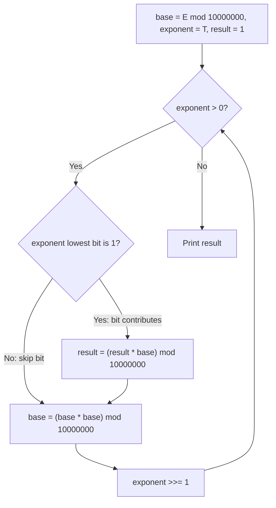

# POWAH! UNLIMITED POWAH!

> [!info] Document Metadata
> **Course:** `=this.course` | **Topic:** `=this.topic` | **Status:** `=this.status` | **Difficulty:** `=this.difficulty`

**Tags:** #[[Computer Science]] #[[CSALGCM]] #[[Algorithms and Complexity]] #[[HackerRank]] #[[Priestess Arcana]] #[[Modular Exponentiation]] #[[Fast Power]]
---

## Problem Description

Emperor Palpatine can shoot force lightning out of his fingers. Depending on how much he has exerted himself, he has an initial amount of energy $E$ stored. Once he starts shooting lightning, the initial power $P$ equals $1$. After each millisecond, $P$ increases by a factor of $E$ (that is, $P$ is multiplied by $E$ to get the new $P$). Given Palpatine's initial energy $E$ and the elapsed time $T$ in milliseconds, compute his lightning power $P = E^T$ modulo $10^7$.

### Input Format

Input consists of a single test case containing a line with two integers $E$ and $T$ separated by a space indicating the energy and the time elapsed in milliseconds.

### Output Format

Output consists of one line containing Palpatine's power $P$ after $T$ milliseconds modulo $10^7$.

### Constraints

- $1 \le E \le 10^{12}$
- $0 \le T \le 10^{12}$

### Sample Test Cases

**Sample Input 0**
```text
2 4
```

**Sample Output 0**
```text
16
```

**Sample Input 1**
```text
10 4
```

**Sample Output 1**
```text
10000
```

---

## Approach & Intuition

> **Problem Abstraction:**
> Given base energy $E$ and exponent time $T$, compute $E^T \bmod 10^7$.

> **Brute-Force Approach:**
> Multiply a running product by $E$ modulo $10^7$ inside a loop running $T$ times.
> With $T \le 10^{12}$, executing $10^{12}$ iterations takes hours and results in Time Limit Exceeded (TLE).

> **Optimal Approach:**
> Apply binary exponentiation (exponentiation by squaring). Decompose $T$ in binary and repeatedly square the base modulo $10^7$, multiplying into the accumulator only for set bits.
> This executes in $O(\log T)$ iterations (at most $40$ steps for $T \le 10^{12}$) and $O(1)$ space.

---

## The Two Bugs Fixed

### Bug 1: Wrong Modulus

```text
Problem says: output P modulo 10^7  (= 10,000,000)
Old code used:               10^9+7 (= 1,000,000,007)  <- completely different!

Both sample answers (16 and 10000) are small enough to pass either modulus,
so the bug is invisible on samples but wrong for large exponents.
```

### Bug 2: Variable Name `exp` Shadows C Stdlib

```c
// C's standard library defines:
double exp(double x);   // Euler's e^x

// Old code used:
long long exp = t;      // Shadows the stdlib function!
// Causes undefined behavior on some compilers -> wrong results

// Fix: rename to exponent
long long exponent = t;
```

---

## Fast Exponentiation: Exponentiation by Squaring

**Core Idea:** Express the exponent in binary. Each `1` bit contributes a power of $2$. Keep squaring the base to move through powers of $2$.

```text
Computing 2^13:
  13 in binary = 1 1 0 1
                 ^ ^ ^ ^
                 8 4 2 1   <- place values

  2^13 = 2^8 x 2^4 x 2^1   (skip 2^2 because bit-1 is 0)
       = 256 x 16 x 2 = 8192

Reading bits RIGHT to LEFT (low bit first):
  bit 0 = 1: result *= base(=2^1)   result=2,   base squares -> 4
  bit 1 = 0: skip                   result=2,   base squares -> 16
  bit 2 = 1: result *= base(=2^4)   result=32,  base squares -> 256
  bit 3 = 1: result *= base(=2^8)   result=8192. Done!
  Total: 4 steps instead of 13!
```

For $T = 10^{12}$: about **40 binary digits $\to$ 40 steps** instead of $10^{12}$.

---

## Modular Arithmetic: Why `%` At Every Step

```text
Without mod: numbers explode immediately.
  2^63 ~ 9.2 x 10^18  <- barely fits in int64
  2^64 = OVERFLOW -> garbage -> wrong answer

With mod applied at each step:
  Mathematical law: (a x b) mod m = ((a mod m) x (b mod m)) mod m
  This means applying mod per step = same result as applying once at end.

  Max intermediate: (10^7 - 1)^2 ~ 10^14 << int64_max (9.2 x 10^18)
  So no overflow ever occurs!
```

---

## Algorithm Flowchart



---

## Full Trace: $E = 2, T = 13$

| `exponent` | Binary | Lowest Bit | `result` | `base` After Squaring |
| :--- | :--- | :--- | :--- | :--- |
| 13 | `1101` | **1** | $1 \times 2 = \mathbf{2}$ | $2^2 = 4$ |
| 6 | `0110` | **0** | $2$ (unchanged) | $4^2 = 16$ |
| 3 | `0011` | **1** | $2 \times 16 = \mathbf{32}$ | $16^2 = 256$ |
| 1 | `0001` | **1** | $32 \times 256 = \mathbf{8192}$ | $256^2 = 65536$ |
| 0 | `0000` | — | Loop ends | — |

**Output:** $8192 = 2^{13}$

---

## Code: Every Line Explained

```c
int main() {
    long long e, t;
    scanf("%lld%lld", &e, &t);

    long long base = e % 10000000;
    // Reduce base first! e can be up to 10^12.
    // Squaring unreduced: (10^12)^2 = 10^24 -> immediate overflow.
    // After mod: base < 10^7, so base^2 < 10^14 -> safe in int64.

    long long exponent = t;
    // Named 'exponent', NOT 'exp' — 'exp' is C stdlib (Euler's e^x).
    // Using 'exp' as a variable name causes shadowing -> undefined behavior.

    long long result = 1;
    // Start at 1 (multiplicative identity).
    // We accumulate: result = E^(bits we've processed so far).

    while (exponent > 0) {
        if (exponent & 1) {
            // Bitwise AND with 1: true if lowest bit is 1.
            // This bit's contribution: multiply result by current base.
            result = (result * base) % 10000000;
        }

        base = (base * base) % 10000000;
        // Square the base: base goes 2->4->16->256->65536->...
        // Each squaring doubles the exponent the base represents.

        exponent >>= 1;
        // Bit shift right by 1 = integer divide by 2.
        // Discards the bit we just processed, exposing the next bit.
    }

    printf("%lld\n", result);
}
```

## Complexity Analysis

| Metric | Complexity | Rationale |
| :--- | :--- | :--- |
| **Time** | $O(\log T)$ | Each iteration halves `exponent` via right shift (`>>= 1`), performing at most $\lfloor \log_2 T \rfloor + 1 \le 40$ modular multiplications for $T \le 10^{12}$. |
| **Space** | $O(1)$ | The iterative binary exponentiation loop uses only three `long long` accumulator variables. |

---

## Original Stub (HackerRank Template)

```c
#include <stdio.h>

int main() {
  	long long e, t;
	scanf("%lld%lld",&e,&t);
	// compute answer
  	
}
```

---

## Full Solution

```c
#include <stdio.h>

int main() {
  	long long e, t;
	scanf("%lld%lld",&e,&t);
	// compute answer
    // Fast modular exponentiation: e^t mod 10^7 (= 10000000)
    long long base = e % 10000000;
    long long exponent = t;
    long long result = 1;
    while (exponent > 0) {
        if (exponent & 1) result = (result * base) % 10000000;
        base = (base * base) % 10000000;
        exponent >>= 1;
    }
    printf("%lld\n", result);
}
```

## References & Navigation

- **Previous Problem:** [[03 - Lets Plant Rice]]
- **Next Problem:** [[05 - Shattering The Towers Of Algorythmos]]
- **Parent Set:** [[[PS] Priestess Arcana|Priestess Arcana Index]]
- **Related Notes:** [[Divide and Conquer Introduction]]
