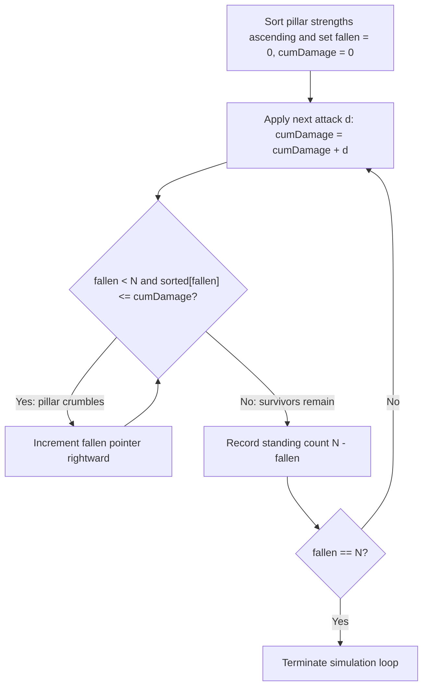
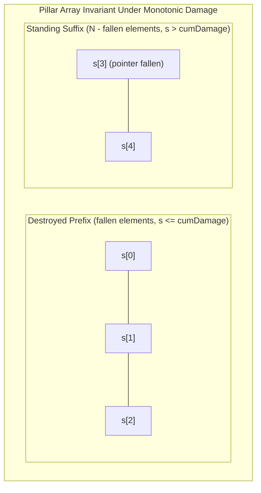
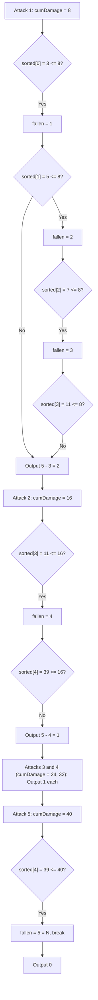

# Shattering the Towers of Algorythmos

> [!info] Document Metadata
> **Course:** `=this.course` | **Topic:** `=this.topic` | **Status:** `=this.status` | **Difficulty:** `=this.difficulty`

**Tags:** #[[Computer Science]] #[[CSALGCM]] #[[Algorithms and Complexity]] #[[HackerRank]] #[[Priestess Arcana]] #[[Sorting]] #[[Prefix Sum]]
---

## Problem Description

A tower is held up by $N$ pillars, where the $j$-th pillar has strength $S_j$. Your party leader has $K$ area-of-effect attacks: the $i$-th attack deals $D_i$ damage to all $N$ pillars simultaneously. The damage dealt is deducted from $S_j$, and a pillar crumbles once its remaining strength drops to $0$ or less. After executing the $K$-th attack, the party leader loops back to the first attack and repeats the sequence iteratively until the entire tower collapses. Output the number of pillars still standing after each attack until all pillars are destroyed.

### Input Format

Input begins with a line containing two space-separated integers $N$ and $K$, indicating the number of pillars holding up the tower and the number of attacks your team leader has.

$K$ lines follow, each containing a single integer $D_i$, the damage dealt to all the pillars by your party leader's $i$-th attack.

$N$ lines follow, each containing a single integer $S_j$, indicating the strength of the $j$-th pillar.

### Output Format

For each attack executed before the collapse of a tower, print a line containing a single integer indicating how many of the $N$ pillars are still standing. Once all pillars are destroyed, print $0$ to indicate that no pillars are standing. This is the last line of the output.

### Constraints

- $1 \le N, K, D_i, S_j \le 10^5$, for all $0 \le i \le K$ and $0 \le j \le N$

### Sample Test Cases

**Sample Input 0**
```text
5 1
8
3
7
11
5
39
```

**Sample Output 0**
```text
2
1
1
1
0
```

**Sample Input 1**
```text
6 1
23
21
56
51
51
56
92
```

**Sample Output 1**
```text
5
5
1
0
```

**Sample Input 2**
```text
7 1
54
60
55
57
367
42
57
19
```

**Sample Output 2**
```text
5
1
1
1
1
1
0
```

---

## Approach & Intuition

> **Problem Abstraction:**
> $N$ pillars have positive strength thresholds $S_j$. You cycle through $K$ attack damages $D_i$, adding each attack's damage to a running total `cumDamage`. After each attack, output how many pillars satisfy $S_j > \text{cumDamage}$ until all pillars satisfy $S_j \le \text{cumDamage}$.

> **Brute-Force Approach:**
> After each attack, scan all $N$ pillars to count how many remain standing.
> Across $A$ attacks and $N$ pillars, this takes $O(A \cdot N)$ time — up to $10^{10}$ checks when $A, N \approx 10^5$, causing Time Limit Exceeded (TLE).

> **Optimal Approach:**
> Sort the pillar strengths ascending in $O(N \log N)$ time ($s_0 \le s_1 \le \dots \le s_{N-1}$) and maintain a single monotonic pointer `fallen` starting at $0$. Since cumulative damage strictly increases with each positive attack ($D_i \ge 1$), fallen pillars never recover and `fallen` only advances rightward, taking amortized $O(1)$ per fallen pillar and $O(N \log N + K + A)$ total time.



## Theoretical Framework: Monotonic Array Partition



## Why Sorting Is The Key

**Observation:** The weakest pillar always falls first. After any attack, all pillars with strength $\le \text{cumDamage}$ have fallen. Sorting enables tracking the boundary with one rightward pointer.

```text
Unsorted: [11, 3, 39, 7, 5]   <- must scan all 5 every time
Sorted:   [ 3, 5,  7,11,39]   <- pointer only ever moves right ->
           ^
           next to potentially fall
```

---

## Two-Pointer Sweep Step by Step (Sample Input 0)

```text
Setup: sorted=[3, 5, 7, 11, 39], cyclic attacks=[8], cumDamage=0, fallen=0

== Attack 1: +8 -> cumDamage=8 ==
  sorted[0]=3  -> 3 <= 8?  YES -> fallen=1
  sorted[1]=5  -> 5 <= 8?  YES -> fallen=2
  sorted[2]=7  -> 7 <= 8?  YES -> fallen=3
  sorted[3]=11 -> 11 <= 8? NO  -> STOP
  Output: 5 - 3 = 2 still standing

== Attack 2: +8 -> cumDamage=16 ==
  (pointer resumes at index 3, NOT from 0!)
  sorted[3]=11 -> 11 <= 16? YES -> fallen=4
  sorted[4]=39 -> 39 <= 16? NO  -> STOP
  Output: 5 - 4 = 1 still standing

== Attacks 3, 4: cumDamage=24, 32 ==
  sorted[4]=39 -> 39 > 24, 39 > 32 -> STOP both times
  Output: 1 both times

== Attack 5: +8 -> cumDamage=40 ==
  sorted[4]=39 -> 39 <= 40? YES -> fallen=5=N -> BREAK
  Output: 0
```

---

## Why The Pointer Never Goes Backwards

```text
cumDamage always increases (attacks always deal positive damage D_i >= 1).
If pillar[i] survived the last attack: strength[i] > cumDamage_old.
For the next attack:                   cumDamage_new > cumDamage_old.
Once a pillar falls (strength[i] <= cumDamage), it STAYS fallen forever.

Therefore: the 'fallen' pointer moves right only. Total moves across all attacks = N.
This makes the inner while loop O(N) total across the entire run, not O(N) per attack.
```

---

## Complexity Comparison

| Approach | Complexity | $N = A = 100,000$ |
| :--- | :--- | :--- |
| Naive (scan all per attack) | $O(A \cdot N)$ | $10^{10}$ ops $\to$ TLE |
| Sort + sweep pointer | $O(N \log N + K + A)$ | $\approx 1.8 \times 10^6$ ops $\to$ Pass |

---

## Code: Every Line Explained

```cpp
void solve() {
    // Sort a COPY (preserve original order for other uses)
    std::vector<int> sorted_s(s_i, s_i + n);
    std::sort(sorted_s.begin(), sorted_s.end());
    // sorted_s[0] <= sorted_s[1] <= ... <= sorted_s[n-1]

    long long cumDamage = 0;   // Running total of all damage dealt
    int fallen = 0;            // Count of pillars fallen = index of NEXT to check
    int attackIdx = 0;         // Which attack in the cycle we're on

    while (fallen < n) {
        cumDamage += d_i[attackIdx % k];
        // attackIdx % k: cycles 0->1->...->k-1->0->1->... (modulo for cycling)
        attackIdx++;

        // Check if more pillars fall now
        while (fallen < n && sorted_s[fallen] <= cumDamage) {
            fallen++;
            // 'fallen' ONLY MOVES RIGHT -> amortized O(1) per attack
        }

        answers[answer_line_count++] = n - fallen;
        // n = total pillars, fallen = how many are down
        // n - fallen = still standing

        if (fallen == n) break;  // Everyone's down, no point continuing
    }
}
```



## Complexity Analysis

| Metric | Complexity | Rationale |
| :--- | :--- | :--- |
| **Time** | $O(N \log N + K + A)$ | Reading inputs takes $O(N + K)$, sorting the $N$ pillar strengths takes $O(N \log N)$, and the simulation loop runs $A \le \max S_j \le 10^5$ attack steps while `fallen` advances at most $N$ times total. |
| **Space** | $O(N + K)$ | Storing the attack array `d_i` of size $K$, the pillar arrays `s_i` and `sorted_s` of size $N$, and the `answers` buffer uses linear memory. |

---

## Original Stub (HackerRank Template)

```cpp
#include <bits/stdc++.h>

#define MAX_N 100000

using namespace std;

int n, k, d_i[MAX_N], s_i[MAX_N];
int answers[MAX_N]; // SAVE ANSWERS HERE
int answer_line_count; // SAVE NUMBER OF ANSWERS TO PRINT HERE

/*
Takes in the key input values and saves all answers in the 'answers' array. 
Save the number of answers to print in the 'answer_line_count' variable.
*/
void solve() {
    // TODO

    return;
}

int main() {
    scanf("%d%d",&n,&k);
    for(int i = 0; i < k; i++){
        scanf("%d",&d_i[i]);
    }
    for(int i = 0; i < n; i++) {
        scanf("%d",&s_i[i]);
    }

    solve();

    for(int i = 0; i < answer_line_count; i++) {
        printf("%d\n",answers[i]);
    }
}
```

---

## Full Solution

```cpp
#include <bits/stdc++.h>

#define MAX_N 100000

using namespace std;

int n, k, d_i[MAX_N], s_i[MAX_N];
int answers[MAX_N]; // SAVE ANSWERS HERE
int answer_line_count; // SAVE NUMBER OF ANSWERS TO PRINT HERE

/*
Takes in the key input values and saves all answers in the 'answers' array. 
Save the number of answers to print in the 'answer_line_count' variable.
*/
void solve() {
    // TODO
    std::vector<int> sorted_s(s_i, s_i + n);
    std::sort(sorted_s.begin(), sorted_s.end());
    long long cumDamage = 0;
    int fallen = 0;
    int attackIdx = 0;
    answer_line_count = 0;
    while (fallen < n) {
        cumDamage += d_i[attackIdx % k];
        attackIdx++;
        while (fallen < n && sorted_s[fallen] <= cumDamage) fallen++;
        answers[answer_line_count++] = n - fallen;
        if (fallen == n) break;
    }
    return;
}

int main() {
    scanf("%d%d",&n,&k);
    for(int i = 0; i < k; i++){
        scanf("%d",&d_i[i]);
    }
    for(int i = 0; i < n; i++) {
        scanf("%d",&s_i[i]);
    }

    solve();

    for(int i = 0; i < answer_line_count; i++) {
        printf("%d\n",answers[i]);
    }
}
```

## References & Navigation

- **Previous Problem:** [[04 - POWAH UNLIMITED POWAH]]
- **Next Problem:** [[06 - The Monkeys Paw]]
- **Parent Set:** [[[PS] Priestess Arcana|Priestess Arcana Index]]
- **Related Notes:** [[Divide and Conquer Introduction]]
