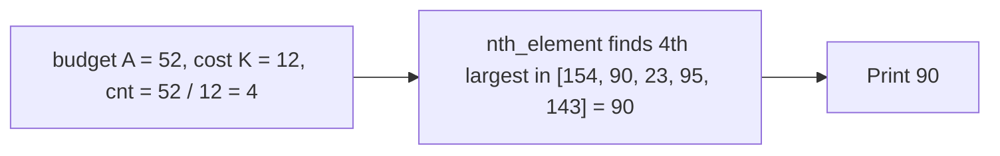

# The Monkey's Paw

> [!info] Document Metadata
> **Course:** `=this.course` | **Topic:** `=this.topic` | **Status:** `=this.status` | **Difficulty:** `=this.difficulty`

**Tags:** #[[Computer Science]] #[[CSALGCM]] #[[Algorithms and Complexity]] #[[HackerRank]] #[[Priestess Arcana]] #[[Segment Tree]] #[[Range Queries]]
---

## Problem Description

Richie is at a cineplex with $N$ movies showing, each having total runtime $R_i$ and credits length $C_i$. Because Richie always leaves before the credits, each movie's effective watchable runtime is $R_i - C_i$. Given $Q$ queries, each specifying a 0-based inclusive range of movies $[S, E]$, Richie's budget $A$, and a uniform ticket price $K$, Richie repeatedly picks the longest unwatched movie in $[S, E]$ until he can no longer afford another ticket. For each query, output the net runtime of the last movie Richie watches, or `-1` if he cannot afford any movie.

### Input Format

Input starts with a line containing a single integer $N$ denoting the number of movies showing in the theater.

$N$ lines follow, the $i$-th of which contains two space-separated integers $R_i$ and $C_i$. $R_i$ is the runtime of the film and $C_i$ is the length of the credits. Richie always leaves before the credits, so you can subtract the credits from the runtime when computing the answer.

This is followed by a line containing a single integer $Q$ denoting the number of queries.

$Q$ lines follow, each containing $4$ space-separated integers $S$, $E$, $A$, and $K$ denoting the start index, end index, Richie's budget, and the cost of a single ticket respectively. Indices are 0-based.

### Output Format

For each query, output one line containing the length of the last movie Richie watches, without the credits, given the strategy described in the problem statement. If Richie cannot watch any movie, output `-1`.

### Constraints

- $1 \le N \le 10^6$
- $1 \le C_i \le R_i \le 10^9$
- $1 \le Q \le 4000$
- $0 \le S \le E < N$
- $0 \le E - S < 10^4$
- $1 \le A, K \le 10^9$

### Sample Test Cases

**Sample Input 0**
```text
8
148 116
157 100
169 15
188 98
91 68
165 70
145 2
11 6
3
2 6 52 12
2 6 13 7
0 4 2 3
```

**Sample Output 0**
```text
90
154
-1
```

---

## Approach & Intuition

> **Problem Abstraction:**
> For each query $(S, E, A, K)$, Richie can purchase $\lfloor A / K \rfloor$ movies and always picks the largest net runtimes $R_i - C_i$ in subarray $[S, E]$. Return the $\lfloor A / K \rfloor$-th largest net runtime in $[S, E]$, the minimum if he buys all $E - S + 1$ movies, or `-1` if $\lfloor A / K \rfloor = 0$.

> **Brute-Force Approach:**
> Copy the subarray $[S, E]$ of length $r = E - S + 1$, sort it in descending order, and return the $\text{cnt}$-th element.
> Sorting takes $O(Q \cdot r \log r)$ time: with $Q = 4000$ and $r = 10^4$, $\approx 5.6 \times 10^8$ comparisons risk Time Limit Exceeded (TLE).

> **Optimal Approach:**
> Only the $\text{cnt}$-th largest element is needed rather than full sorted order. Using Quickselect (`std::nth_element`) places the $(m - \text{cnt})$-th smallest element in $O(r)$ average time without sorting either side.
> This reduces work to $O(N + Q \cdot r) \approx 4 \times 10^7$ operations, passing well within the time limit.

---

## Key Insight: We Don't Need Full Sorted Order

Richie can afford at most $\text{cnt} = \lfloor A / K \rfloor$ movies. Rather than sorting the entire range, we only need the $\text{cnt}$-th largest net runtime in $[S, E]$, which is the last movie he watches.

```text
cnt = floor(A / K)  <- how many movies max

If cnt = 0          -> output -1 (can't buy any)
If cnt >= range_size -> output min(range) (buys all, last = smallest)
Else                -> output the cnt-th largest in range
                      (use nth_element in O(r))
```

---

## Why `nth_element` Not `sort`

```text
sort:         O(r log r) per query — must arrange entire array
nth_element:  O(r) average  — only guarantees the k-th position is correct

For our query: we only need ONE value (the cnt-th largest).
nth_element is the right tool: it places the k-th element correctly
and partitions the rest (smaller left, larger right) — but doesn't sort either side.

Performance:
  sort:         4000 queries x 10000 x 14 steps ~ 560,000,000 -> TLE
  nth_element:  4000 queries x 10000 steps      ~  40,000,000 -> Pass
```

---

## Greedy Correctness: Why "Longest First" Is Optimal

**Claim:** Always buying the longest available movie reaches the same count $\text{cnt} = \lfloor A / K \rfloor$ while yielding the exact $\text{cnt}$-th largest runtime as the last movie watched.

**Proof by exchange argument:** Every movie costs the same ticket price $K$, so Richie always buys $\min(\lfloor A / K \rfloor, m)$ movies regardless of order. Picking strictly in decreasing order of net runtime guarantees the subset watched consists of the top $\text{cnt}$ longest films, making the final film the $\text{cnt}$-th largest.

---

## Step-by-Step Trace (Sample Query 1: $S=2, E=6, A=52, K=12$)

**Step 1 — Net Runtimes in range $[2..6]$:**

| Index | Runtime ($R_i$) | Credits ($C_i$) | Net ($R_i - C_i$) |
| :--- | :--- | :--- | :--- |
| 2 | 169 | 15 | **154** |
| 3 | 188 | 98 | **90** |
| 4 | 91 | 68 | **23** |
| 5 | 165 | 70 | **95** |
| 6 | 145 | 2 | **143** |

**Step 2 — How many can he buy?**
```text
cnt = floor(52 / 12) = 4
range_size = 5
cnt < range_size -> use nth_element to find 4th largest
```

**Step 3 — `nth_element` finds 4th largest:**
```text
buf = [154, 90, 23, 95, 143]   (m=5, cnt=4, so pivot index = m-cnt = 1)
After nth_element(buf, buf+1, buf+5):
  buf[1] = 4th largest = 90   (everything at index<1 is <=90, index>1 is >=90)
Output: buf[m-cnt] = buf[1] = 90
```



---

## Code: Every Line Explained

```cpp
int q, n, s, e, a, k;
int movies[1000000][2];         // movies[i][0]=runtime, movies[i][1]=credits
static int buf[10001];          // reusable scratch buffer (avoids per-query malloc)

for(int cc = 0; cc < q; cc++) {
    scanf("%d%d%d%d", &s, &e, &a, &k);
    // s = start index, e = end index, a = budget, k = ticket cost

    int cnt = a / k;            // How many tickets Richie can afford (floor division)
    if (cnt == 0) {
        printf("-1\n");         // Can't buy even one ticket
        continue;
    }

    int m = e - s + 1;         // Number of movies in this range
    for (int i = 0; i < m; i++) {
        buf[i] = movies[s + i][0] - movies[s + i][1];
        // Net runtime = total runtime - credits length
        // Richie leaves before credits, so credits don't count.
    }

    if (cnt >= m) {
        // Can buy ALL movies -> last watched = the shortest one
        printf("%d\n", *min_element(buf, buf + m));
    } else {
        // Need the cnt-th largest value.
        // nth_element places buf[m-cnt] = the (m-cnt)-th smallest
        //                              = the cnt-th largest
        // All elements at index < m-cnt will be <= buf[m-cnt]
        // All elements at index > m-cnt will be >= buf[m-cnt]
        nth_element(buf, buf + (m - cnt), buf + m);
        printf("%d\n", buf[m - cnt]);
        // This is the runtime of the last movie watched.
    }
}
```

---

## All Three Sample Queries Traced

| Query | Range | Net Runtimes | $\text{cnt} = \lfloor A / K \rfloor$ | $m$ | $\text{cnt} \ge m$? | Answer |
| :--- | :--- | :--- | :--- | :--- | :--- | :--- |
| `2 6 52 12` | $[2..6]$ | `154, 90, 23, 95, 143` | 4 | 5 | No $\to$ `nth_element` | **90** |
| `2 6 13 7` | $[2..6]$ | `154, 90, 23, 95, 143` | 1 | 5 | No $\to$ `nth_element` | **154** |
| `0 4 2 3` | $[0..4]$ | `32, 57, 154, 90, 23` | 0 | 5 | $\text{cnt} = 0 \to$ skip | **-1** |

## Complexity Analysis

| Metric | Complexity | Rationale |
| :--- | :--- | :--- |
| **Time** | $O(N + Q \cdot r)$ | Reading all $N$ movie runtimes and credits takes $O(N)$, and each of the $Q$ queries copies $r = E - S + 1 < 10^4$ net runtimes and invokes `nth_element` in $O(r)$ average time. |
| **Space** | $O(N + r)$ | Storing the $N$ movie `(runtime, credits)` pairs takes $O(N)$ static storage, and the reusable `buf` scratch buffer uses $O(r)$ ($\le 10^4$) space. |

---

## Original Stub (HackerRank Template)

```cpp
#include <bits/stdc++.h>

using namespace std;

int q, n, s, e, a, k, r, c, movies[1000000][2];

int main() {
    scanf("%d",&n);
    for(int i = 0; i < n; i++) {
        scanf("%d%d",&movies[i][0],&movies[i][1]);
    }
    scanf("%d",&q);
    for(int cc = 0; cc < q; cc++) {
        scanf("%d%d%d%d",&s,&e,&a,&k);
        // compute for answer here
      
      	
    }
}
```

---

## Full Solution

```cpp
#include <bits/stdc++.h>

using namespace std;

int q, n, s, e, a, k, r, c, movies[1000000][2];
static int buf[10001]; // reusable buffer, avoids per-query heap allocation

int main() {
    scanf("%d",&n);
    for(int i = 0; i < n; i++) {
        scanf("%d%d",&movies[i][0],&movies[i][1]);
    }
    scanf("%d",&q);
    for(int cc = 0; cc < q; cc++) {
        scanf("%d%d%d%d",&s,&e,&a,&k);
        // compute for answer here
        // How many movies can Richie afford to buy?
        int cnt = a / k; // floor(budget / ticket_cost)
        if (cnt == 0) {
            printf("-1\n");
            continue;
        }

        // Fill buffer with net runtimes for movies in range [s, e]
        int m = e - s + 1; // total movies in range
        for (int i = 0; i < m; i++) {
            buf[i] = movies[s + i][0] - movies[s + i][1];
        }

        if (cnt >= m) {
            // Can buy ALL movies — answer is the smallest (last bought)
            printf("%d\n", *min_element(buf, buf + m));
        } else {
            // Need the cnt-th largest net runtime.
            // nth_element rearranges so buf[m-cnt] is the (m-cnt)-th smallest
            // (i.e., cnt-th largest), in O(m) average — much faster than sort!
            nth_element(buf, buf + (m - cnt), buf + m);
            printf("%d\n", buf[m - cnt]);
        }
    }
}
```

## References & Navigation

- **Previous Problem:** [[05 - Shattering The Towers Of Algorythmos]]
- **Parent Set:** [[[PS] Priestess Arcana|Priestess Arcana Index]]
- **Related Notes:** [[Divide and Conquer Introduction]]
