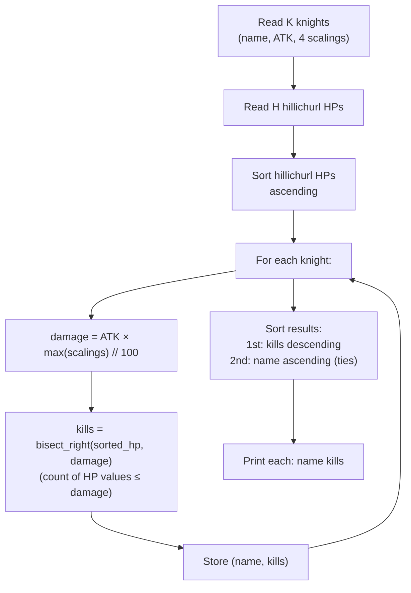

> [!info] Document Metadata
> - **Course:** `=this.course`
> - **Topic:** `=this.topic`
> - **Status:** `=this.status`
> - **Difficulty:** `=this.difficulty`

**🏷️ Tags:** #[[Computer Science]] #[[CSALGCM]] #[[Algorithms and Complexity]] #[[HackerRank]] #[[Empress Arcana]]

---

# DPS Check in the Knights of Favonius

## Problem Description
Jean Gunnhildr, Acting Grand Master of the Knights of Favonius, intends to test the combat efficiency
of the members of her organization. Despite the odd assortment of characters at her disposal (among
which includes a child with a penchant for violence, a creepy dude who is fond of giving people the
cold shoulder, an alchemist with a stare that is perhaps a bit too intense, an absent-minded gliding
instructor with an exploding doll), she thinks they are capable fighters.
However, she would still like to perform a classical "DPS Check" as she gathers data in order to more
efficiently assign missions to the Knights of Favonius.
To explain this, we will be using a simplified version of Genshin Impact's mechanics.
Each character has an ATK stat. The character then has four attacks: a normal attack, charged attack,
elemental skill, and elemental burst.
Each of these four attack types have a scaling factor. This determines how much damage is dealt
relative to the attack. For example, if a character has 1523 ATK and their normal attack has 67%
scaling, their normal attack would deal 1523 · 67% = 1523 · 0.67 = 1020.41 damage. After this,
damage is always rounded down. The final damage for the normal attack is 1020.
Jean has gathered a sizable amount of data involving hillichurls. For our purposes, we will abstract the
consititution of these hillichurls using the concept of hit points. A hillichurl will have a fixed number of
hit points. When a character attacks this hillichurl, their hit points are decreased by the damage dealt.
When the hillichurl's hit points drop to 0 or lower, the hillichurl is defeated.
Given the number of hillchurls in the sample Jean collected, and the ATK stats and damage scaling of
each of the moves of her Knights of Favonius, kindly print the ranking of all her knights in terms of
most hillichurls defeated. You may assume that each character always uses their most effective
move and the damage is applied exactly once to each of the hypothetical hillichurls in Jean's
sample. See the sample input for an explanation of how this would look like.

**Input Format:**
The first line contains two space-separated integers K and H indicating the number of knights and
hillichurls to be considered in the problem.
2K lines follow, with every two lines describing one of Jean's Knights. The line will start with a single
string indicating the knight's name. This string will only contain latin alphabet characters. All the
names are guaranteed to be distinct. The next line contains five integers
ATK_i, NA_i, CA_i, ES_i, EB_i indicating the ATK stat, normal attack scaling, charged attack scaling,
elemental skill scaling, and elemental burst scaling of the i-th character.
After all the knight description, H lines follow, each containing a single integer H_j, indicating the hit
points of each of the H hillichurls in Jean's sample.

**Output Format:**
Output K lines, each containing the name of the knight and an integer indicating the number of
hillichurls they can defeat with their optimal attack separated by a single space. The knights must be
sorted in non-ascending order according to the number of hillichurls defeated. In the case of a tie
between two knights, print them in lexicographical order.

**Constraints:**
$1 \le K, H \le 10^5$
$1 \le ATK_i \le 9 \cdot 10^3$
$1 \le NA_i, CA_i, ES_i, EB_i \le 10^3$
$1 \le H_j \le 10^5$ for all $1 \le i \le H$

**Sample:**
| Input | Output |
|-------|--------|
| `3 5<br>Amber<br>101 47 13 33 11<br>Kaeya<br>473 16 36 49 47<br>Fischl<br>263 39 10 42 14<br>49<br>14<br>358<br>444<br>306` | `Fischl 2<br>Kaeya 2<br>Amber 1` |

---

## Approach & Intuition
> **🗂️ Abstract the problem**
> Each knight has an ATK stat and 4 attack scalings. Compute the best single-hit damage for each knight (floor of ATK × best_scaling%). Count how many hillichurls each can one-shot. Rank knights by kills descending, ties broken lexicographically.

> **🐢 Dumb sol?**
> For each knight, loop through ALL hillichurls and check if damage ≥ HP.
> **O(K × H)** — with K = H = 100,000 that's **10 billion ops** → TLE.

> **🚀 Smart sol?**
> Sort hillichurls by HP once. For each knight, binary search (`bisect_right`) to count how many have HP ≤ damage.
> **O(H log H + K log H)** — fast.

---

## Damage Formula

```
damage = floor(ATK × best_scaling / 100)

Where best_scaling = max(normal, charged, elemental_skill, elemental_burst)
```

Example: Amber has ATK=101, scalings = [47, 13, 33, 11]
- Best scaling = 47 (normal attack)
- Damage = floor(101 × 47 / 100) = floor(47.47) = **47**

---

## Algorithm Walkthrough



---

## Trace (Sample 0)

**Input:** 3 knights, 5 hillichurls with HP = [49, 14, 358, 444, 306]

**Step 1 — Sort HPs:** `[14, 49, 306, 358, 444]`

**Step 2 — Compute each knight:**

| Knight | ATK | Best Scaling | Damage | bisect_right | Kills |
|---|---|---|---|---|---|
| Amber | 101 | 47% (normal) | 101×47//100 = **47** | bisect([14,49,306,358,444], 47) = 1 | **1** |
| Kaeya | 473 | 49% (elem skill) | 473×49//100 = **231** | bisect(..., 231) = 2 | **2** |
| Fischl | 263 | 42% (elem skill) | 263×42//100 = **110** | bisect(..., 110) = 2 | **2** |

**Step 3 — Sort results:** Fischl(2) & Kaeya(2) tied → alphabetical → Fischl first.

```
Fischl 2  ✓
Kaeya 2   ✓
Amber 1   ✓
```

---

## Complexity Analysis

| | Complexity |
|--|--|
| **Time** | $O(K \cdot 4 + H \log H + K \log H)$ | Based on optimal algorithm
| **Space** | $O(H + K)$ | Required memory

---

## Original Stub (HackerRank Template)
```python
def solve(k,h,knights,hillichurls):
    # compute and print answer here

def main():
    k, h = list(map(int,input().strip().split(" ")))
    knights = []

    for i in range(k):
        name = input().strip()
        temp = list(map(int,input().strip().split(" ")))
        knights.append((name,temp))

    hillichurls = [int(input().strip()) for i in range(h)]
    solve(k,h,knights,hillichurls)

if __name__ == "__main__":
    main()
```

## Full Solution
```python
def solve(k,h,knights,hillichurls):
    # compute and print answer here
    # For each knight: best damage = floor(ATK * max(scaling) / 100)
    # Count how many hillichurls have HP <= best damage
    # Sort hillichurls to use binary search
    import bisect
    sorted_hp = sorted(hillichurls)

    results = []
    for name, stats in knights:
        atk = stats[0]
        best_scaling = max(stats[1], stats[2], stats[3], stats[4])
        damage = atk * best_scaling // 100
        # Count hillichurls with HP <= damage
        kills = bisect.bisect_right(sorted_hp, damage)
        results.append((name, kills))

    # Sort: most kills first (descending), ties broken lexicographically (ascending)
    results.sort(key=lambda x: (-x[1], x[0]))

    for name, kills in results:
        print(f"{name} {kills}")

def main():
    k, h = list(map(int,input().strip().split(" ")))
    knights = []

    for i in range(k):
        name = input().strip()
        temp = list(map(int,input().strip().split(" ")))
        knights.append((name,temp))

    hillichurls = [int(input().strip()) for i in range(h)]
    solve(k,h,knights,hillichurls)

if __name__ == "__main__":
    main()
```

---

## References & Navigation
- **Related Notes:** [[Divide and Conquer Introduction]]
- **Next Problem:** [[02 - I Hate Spellcasters]]
- **Parent Set:** [[[PS] Empress Arcana|Empress Arcana Index]]
