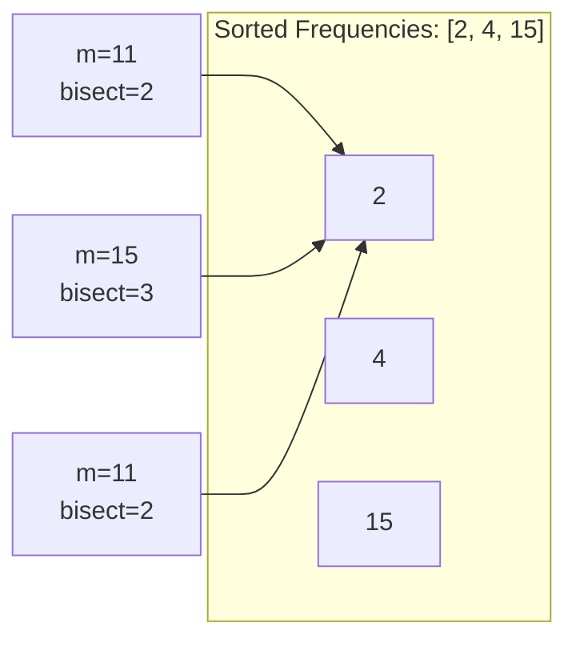

> [!info] Document Metadata
> - **Course:** `=this.course`
> - **Topic:** `=this.topic`
> - **Status:** `=this.status`
> - **Difficulty:** `=this.difficulty`

**🏷️ Tags:** #[[Computer Science]] #[[CSALGCM]] #[[Algorithms and Complexity]] #[[HackerRank]] #[[Empress Arcana]]

---

# Metacognitive Frequencies

## Problem Description
You are involved in a government black project testing technology for telepathic communication.
Your transmitter must be tuned to specific frequencies. You are given K frequencies at which to
transmit some trial thoughts. A person can hear a particular thought transmitted at frequency f_i if
and only if the person's metacognitive frequency m_i is greater than or equal to f_i.
You have N participants who are about to enter the testing hall one by one. For each participant
who enters, all K frequencies will be blasted simultaneously. You must count how many
frequencies each participant will hear among the K frequencies.

**Input Format:**
Input begins with a line containing two space-separated integers K and N, indicating the number
of frequencies and number of participants, respectively.
K lines follow, each containing a single integer f_i, indicating the frequency of the i-th telepathic
transmission, as described in the problem statement.
N lines follow, each containing a single integer m_j indicating the metacognitive frequency of the
j-th participant to enter the room.

**Output Format:**
For each of the N participants, print a line containing a single integer indicating how many of the
K frequencies they can hear.

**Constraints:**
$1 \le K, N \le 3 \cdot 10^5$
$1 \le f_i, m_j \le 10^9$

**Sample:**
| Input | Output |
|-------|--------|
| `3 3<br>4<br>15<br>2<br>11<br>15<br>11` | `2<br>3<br>2` |

---

## Approach & Intuition
> **🗂️ Abstract the problem**
> Given K transmission frequencies and N participants, for each participant with metacognitive frequency `m`, count how many transmissions have frequency `f_i ≤ m`.

> **🐢 Dumb sol?**
> For each participant, scan all K frequencies and count.
> **O(N × K)** — with N = K = 300,000 that's **90 billion ops** → TLE.

> **🚀 Smart sol?**
> Sort frequencies once. For each participant, binary search (`bisect_right`) to count how many are ≤ m.
> **O(K log K + N log K)** — fast.

---

## This Is The Same Pattern As ESPN!

This problem is structurally identical to the Priestess Arcana "ESPN" problem:
- **ESPN**: precompute distances, sort, binary search per query
- **Metacognitive**: frequencies already sorted by the stub, binary search per participant

The stub even calls `sorted()` for us:
```python
fs = sorted([int(input()) for i in range(k)])
```

---

## Trace (Sample 0)

**Frequencies:** [4, 15, 2] → sorted: [2, 4, 15]

| Participant | m | bisect_right([2,4,15], m) | Explanation |
|---|---|---|---|
| 1 | 11 | **2** | 2 ≤ 11 ✓, 4 ≤ 11 ✓, 15 ≤ 11 ✗ |
| 2 | 15 | **3** | All ≤ 15 |
| 3 | 11 | **2** | Same as participant 1 |



---

## Complexity Analysis

| | Complexity |
|--|--|
| **Time** | $O(K \log K + N \log K)$ | Based on optimal algorithm
| **Space** | $O(K)$ | Required memory

---

## Original Stub (HackerRank Template)
```python
"""
This function solves a test case.

Parameters:
k : int - number of transmission frequencies
n : int - number of participants
fs : array-like - array of size (k,) with a list of transmission frequencies
ms : array-like - array of size (n,) with a list of participant frequencies

Returns a list of integers of size (n,) indicating the answers for each 
participant
"""
def solve(k,n,fs,ms):
    # compute and return answers here

def main():
    k,n = list(map(int,input().split(" ")))

    fs = sorted([int(input()) for i in range(k)])
    ms = [int(input()) for i in range(n)]

    ans = solve(k,n,fs,ms)

    print("\n".join(list(map(str,ans))))

if __name__ == "__main__":
    main()
```

## Full Solution
```python
"""
This function solves a test case.

Parameters:
k : int - number of transmission frequencies
n : int - number of participants
fs : array-like - array of size (k,) with a list of transmission frequencies
ms : array-like - array of size (n,) with a list of participant frequencies

Returns a list of integers of size (n,) indicating the answers for each 
participant
"""
def solve(k,n,fs,ms):
    # compute and return answers here
    # fs is already sorted (see main). For each participant m,
    # count how many frequencies f_i satisfy f_i <= m.
    # This is bisect_right(fs, m).
    import bisect
    return [bisect.bisect_right(fs, m) for m in ms]

def main():
    k,n = list(map(int,input().split(" ")))

    fs = sorted([int(input()) for i in range(k)])
    ms = [int(input()) for i in range(n)]

    ans = solve(k,n,fs,ms)

    print("\n".join(list(map(str,ans))))

if __name__ == "__main__":
    main()
```

---

## References & Navigation
- **Related Notes:** [[Divide and Conquer Introduction]]
- **Previous Problem:** [[02 - I Hate Spellcasters]]
- **Next Problem:** [[04 - Never Fade Away]]
- **Parent Set:** [[[PS] Empress Arcana|Empress Arcana Index]]
