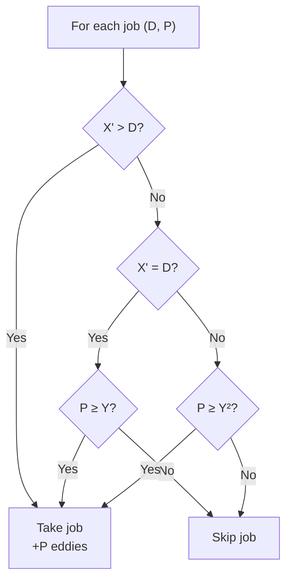

> [!info] Document Metadata
> - **Course:** `=this.course`
> - **Topic:** `=this.topic`
> - **Status:** `=this.status`
> - **Difficulty:** `=this.difficulty`

**Tags:** #[[Computer Science]] #[[CSALGCM]] #[[Algorithms and Complexity]] #[[HackerRank]] #[[Empress Arcana]]

---

# Never Fade Away

## Problem Description
V is a mercenary for hire in Night City. As one of the most notorious mercenaries, she gets a lot of job
offers. Having done this for a while, she can accurately assess the risk factor of a job and the
likelihood of success. This gives her a set of rules for accepting jobs in Night City:
Given V's skill value X, the job's difficulty D, and the payout for the job P:
• If $X > D$, V will take on the job
• If $X = D$, P must be at least Y for V to take the job
• If $X < D$, P must be at least Y^2 for V to take the job
, where Y is V's payout threshold for risky jobs.
V is currently browsing cybernetic augmentations to help her earn her goal of at least G total eddies
(the unit of currency in Night City). Before V selects an augmentation, she needs to know the
minimum amount of additional skill value she must add to her current skill value X, so that given the
list of all available jobs, she can reach her goal of at least G eddies total across all the jobs.

**Input Format:**
Input begins with a line containing a single integer T, indicating the number of test cases. A blank line
follows, followed by T test case descriptions. Each test case description is separated by a blank line.
Each test case begins with four space-separated integers X, N, G, and Y, indicating V's current skill
level, the number of jobs available, V's goal payout, and V's payout threshold for risky jobs.
N lines follow, each describing a job. Each line contains two space-separated integers D and P,
indicating the difficulty of the job and the payout of the job, respectively.

**Output Format:**
For each test case, print one line containing a single integer indicating the minimum additional skill
that must be added to X for V to get at least G eddies. Print "-1" (without quotes) if no amount of skill
will allow V to reach her goal.

**Constraints:**
$1 \le T \le 30$
$1 \le N \le 3 \cdot 10^4$
$1 \le D, G, P, X, Y \le 10^9$

**Sample:**
| Input | Output |
|-------|--------|
| `2<br>1 2 2 11<br>15 7<br>11 19<br>3 1 13 17<br>7 12` | `10<br>-1` |

---

## Approach & Intuition
> ** Abstract the problem**
> V is a mercenary. She can add skill points to increase her skill level. Given job acceptance rules (based on skill vs. difficulty and payout vs. thresholds Y and Y²), find the **minimum** extra skill so her total earnings reach at least G eddies. Output -1 if impossible.

> ** Dumb sol?**
> Try add = 0, 1, 2, ... up to max(D), computing earnings each time.
> **O(max_D × N)** — max_D can be 10⁹ → impossible.

> ** Smart sol?**
> Earnings is **non-decreasing** as skill increases (higher skill unlocks more jobs). Binary search on the skill increase.
> **O(N · log(max_D)) per test case** — fast.

---

## The Three Job Acceptance Rules

```
Given V's skill X' = X + add, job difficulty D, payout P, threshold Y:

  X' > D  → ALWAYS take (skill exceeds difficulty)
  X' = D  → take ONLY IF P ≥ Y   (borderline → needs decent pay)
  X' < D  → take ONLY IF P ≥ Y²  (dangerous → needs excellent pay)
```



---

## Why Binary Search Works

As `add` increases:
- Some jobs transition from `X' < D` (requires P ≥ Y²) → `X' = D` (requires P ≥ Y) → `X' > D` (always taken)
- Each transition can only **add** earnings, never remove them
- So `earnings(add)` is **monotone non-decreasing**

```
earnings:
  add=0:  only Y²-paying jobs → low earnings
  add=5:  a few more jobs unlock → medium
  add=10: most jobs unlock → high ≥ G ← binary search finds this
```

---

## Trace (Test Case 1: X=1, N=2, G=2, Y=11)

Jobs: (D=15, P=7), (D=11, P=19). Y²=121.

| add | X' | Job 1 (D=15,P=7) | Job 2 (D=11,P=19) | Total | ≥ G=2? |
|---|---|---|---|---|---|
| 0 | 1 | 1<15, P=7<121 → skip | 1<11, P=19<121 → skip | 0 |  |
| 9 | 10 | 10<15, P=7<121 → skip | 10<11, P=19<121 → skip | 0 |  |
| **10** | **11** | 11<15, P=7<121 → skip | **11=11, P=19≥11** → take | **19** | **** |

Binary search converges to **add = 10** 

---

## Complexity Analysis

| | Complexity |
|--|--|
| **Time** | $O(T \cdot N \cdot \log(\max\_D))$ | Based on optimal algorithm
| **Space** | $O(N)$ | Required memory

---

## Original Stub (HackerRank Template)
```python
"""
Solves a test case.

Parameters:
x    : int        - V's current skill level
n    : int        - number of jobs available
g    : int        - V's goal income
y    : int        - V's pay threshold for dangerous jobs
jobs : array-like - list of size (n,2) indicating the jobs. Each element is 
                    comprised of two-integers d (the danger level of the job) 
                    and p (the payout of the job)
"""
def solve(x,n,g,y,jobs):
    # compute and return answer here

def main():
    t = int(input())

    ans = []
    for tc in range(t):
        input()
        x,n,g,y = list(map(int,input().split(" ")))

        jobs = [list(map(int,input().split(" "))) for i in range(n)]

        ans.append(solve(x,n,g,y,jobs))

    print("\n".join(list(map(str,ans))))

if __name__ == "__main__":
    main()
```

## Full Solution
```python
"""
Solves a test case.

Parameters:
x    : int        - V's current skill level
n    : int        - number of jobs available
g    : int        - V's goal income
y    : int        - V's pay threshold for dangerous jobs
jobs : array-like - list of size (n,2) indicating the jobs. Each element is 
                    comprised of two-integers d (the danger level of the job) 
                    and p (the payout of the job)
"""
def solve(x,n,g,y,jobs):
    # compute and return answer here
    # V adds 'add' skill points to X. New skill = X + add.
    # For each job (D, P):
    #   if X+add > D: always take it (earn P)
    #   if X+add == D: take it only if P >= Y
    #   if X+add < D: take it only if P >= Y^2
    #
    # We want minimum 'add' >= 0 such that total earnings >= G.
    #
    # Key insight: as 'add' increases, more jobs become available.
    # Binary search on 'add'.
    
    y_sq = y * y
    
    # First check: can V EVER reach G (even with infinite skill)?
    # With infinite skill, X+add > D for all jobs, so she takes all.
    total_all = sum(p for d, p in jobs)
    if total_all < g:
        return -1
    
    # Also check: with add=0, do the jobs with P >= Y^2 already satisfy?
    # Binary search on add from 0 to max(D)
    max_d = max(d for d, p in jobs) if jobs else 0
    
    # Sort jobs by difficulty for efficient computation
    # For a given skill level s = x + add:
    #   jobs with D < s: always taken
    #   jobs with D == s: taken if P >= Y
    #   jobs with D > s: taken if P >= Y^2
    
    def earnings(add):
        s = x + add
        total = 0
        for d, p in jobs:
            if s > d:
                total += p
            elif s == d:
                if p >= y:
                    total += p
            else:  # s < d
                if p >= y_sq:
                    total += p
        return total
    
    # Check if add=0 already works
    if earnings(0) >= g:
        return 0
    
    # Binary search: find minimum add such that earnings(add) >= g
    lo, hi = 0, max_d + 1
    # earnings is non-decreasing as add increases (monotone)
    # But we need to be careful: at add = max_d - x + 1, all jobs have s > D
    
    while lo < hi:
        mid = (lo + hi) // 2
        if earnings(mid) >= g:
            hi = mid
        else:
            lo = mid + 1
    
    return lo

def main():
    t = int(input())

    ans = []
    for tc in range(t):
        input()
        x,n,g,y = list(map(int,input().split(" ")))

        jobs = [list(map(int,input().split(" "))) for i in range(n)]

        ans.append(solve(x,n,g,y,jobs))

    print("\n".join(list(map(str,ans))))

if __name__ == "__main__":
    main()
```


## References & Navigation
- **Related Notes:** [[Divide and Conquer Introduction]]
- **Previous Problem:** [[03 - Metacognitive Frequencies]]
- **Next Problem:** [[05 - QUIIIIICKSOOOOORT!!!!!!!!!!!]]
- **Parent Set:** [[[PS] Empress Arcana|Empress Arcana Index]]
